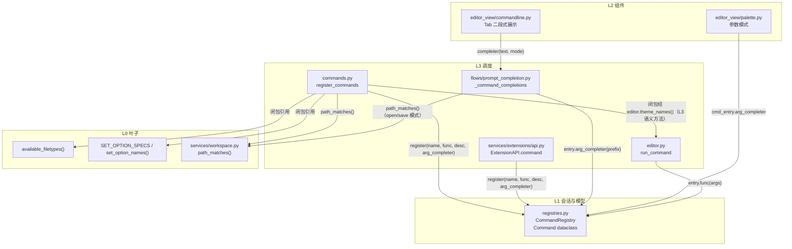
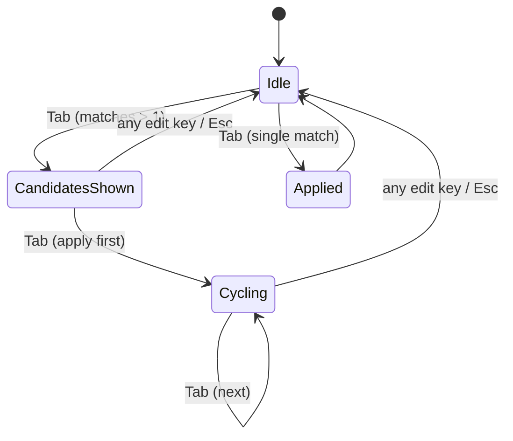
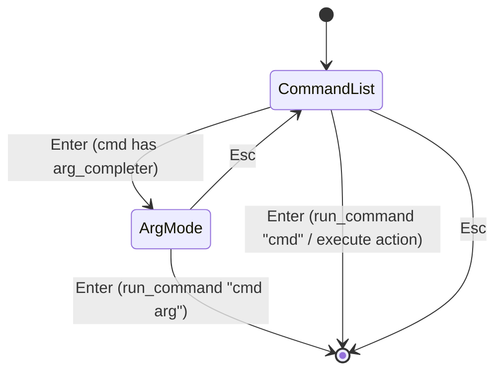

# arg-completion-plan（参数候选元数据化 + ex 行 / palette 消费）

> 本任务为无人值守模式，用户已预先授权免批准直接执行（批准环节由用户指令豁免）。
> 2026-10-30 主代理复核修正：theme 访问改经 `editor.theme_names()`（L3 表禁连 L2）、
> `_path_matches` 下沉 L0 `services/workspace.py`、波 a 增补 UI_FROZEN_FILES 与 R11 规则文本同步。

合并实施 Gitee issue IKQ4VD（CommandRegistry 参数候选元数据）与 IKQ4VA
（ex 行 Emacs 风格候选展示 + palette 参数阶段）。两 issue 有依赖关系：
IKQ4VD 是数据基础，IKQ4VA 是 UI 消费，按 IKQ4VD → IKQ4VA 顺序分两波串行执行。

## 一、目标与非目标

### 目标

1. **IKQ4VD（波 a）**：`CommandRegistry` 条目 dataclass 化，新增可选 `arg_completer`
   字段（`Callable[[str], list[str]] | None`）；扩展 API 的 `command` / `register_command`
   透传该字段；rollback 快照同步携带；存量内置命令（`theme` / `filetype` / `set` /
   `manual` / 路径类）逐个声明 `arg_completer`；`prompt_completion._command_completions`
   的参数分支改为读注册元数据，集中式 if/else 参数知识退役。
2. **IKQ4VA（波 b）**：ex 行 Tab 二段式（首轮右侧展示候选串、再 Tab 落值轮询）；
   palette 带参命令回车后进入参数模式（清空 input、列出值候选、Enter 完整提交、
   Esc 回命令列表）。

### 非目标

- 不做参数类型 / 必选性 / 多参数建模（只做单参候选函数）；
- 不做路径类命令在 palette 里的文件浏览；
- 不动 which-key 面板；
- 不改 `:set` 无参分支与 `:theme` 无参分支的消息行为（保留 fallback）；
- 不改 bash 风格"唯一匹配直接应用"的快捷路径。

## 二、关键事实取证（worktree `D:\Programming\yate-arg-completion`）

| 项 | 位置 | 现状 |
|---|---|---|
| `CommandRegistry` 容器 | [registries.py](file:///D:/Programming/yate-arg-completion/yate/registries.py#L82-L113) | `dict[str, tuple[CommandFunc, str]]`，`register(name, func, desc)`，`get()` 返回二元组 |
| `Action` dataclass 形态 | [registries.py](file:///D:/Programming/yate-arg-completion/yate/registries.py#L30-L36) | `@dataclass class Action(name, func, description)` —— `Command` 对齐同款形态 |
| 内置命令注册 | [commands.py](file:///D:/Programming/yate-arg-completion/yate/commands.py#L175-L495) | `reg = registry.register`；`reg(name, func, desc)` 形态 |
| 参数候选硬编码 | [prompt_completion.py](file:///D:/Programming/yate-arg-completion/yate/flows/prompt_completion.py#L53-L107) | `_command_completions` if/else 链：`_PATH_COMMANDS` / `set` 键值 / `theme` / `filetype` / `manual` |
| 扩展 rollback 快照 | [api.py](file:///D:/Programming/yate-arg-completion/yate/services/extensions/api.py#L204-L218) | `_record_command_snapshot` 闭包按 `previous[0]` / `previous[1]` 还原 |
| 扩展 `command` 装饰器 | [api.py](file:///D:/Programming/yate-arg-completion/yate/services/extensions/api.py#L503-L518) | `command(name, description)` 返回 decorator |
| 扩展 `register_command` | [api.py](file:///D:/Programming/yate-arg-completion/yate/services/extensions/api.py#L520-L527) | `register_command(name, func, description="")` |
| `run_command` 派发 | [editor.py](file:///D:/Programming/yate-arg-completion/yate/editor.py#L1176-L1197) | `entry[0](args)` 取二元组首元素 |
| ex 行 Tab 状态机 | [commandline.py](file:///D:/Programming/yate-arg-completion/yate/editor_view/commandline.py#L119-L152) | `_do_tab_completion` 已实现 bash 风格 + 循环；无候选展示 |
| ex 行 message 槽位 | [commandline.py](file:///D:/Programming/yate-arg-completion/yate/editor_view/commandline.py#L242-L247) | `compose()` 中 `self.message` Static 在 prompt 激活时空闲 |
| palette `_choose` | [palette.py](file:///D:/Programming/yate-arg-completion/yate/editor_view/palette.py#L624-L641) | commands 模式直接 `run_command(name)`，无参数阶段 |
| 门面 14 名冻结 | [extensions/\_\_init\_\_.py](file:///D:/Programming/yate-arg-completion/yate/services/extensions/__init__.py#L81-L96) | `__all__` 14 名，R14 守卫 |

## 三、备选方案与否决理由

### 决策 1：`SET_OPTIONS` / `theme.available()` / `available_filetypes()` 数据表去留

- **方案 A（采纳）**：数据表留原处（`config.py` / `editor_syntax`），
  `commands.py` 在注册内置命令时闭包引用这些数据表构造 `arg_completer` 函数。
  主题候选一律经 L3 语义方法 `editor.theme_names()` 取（commands.py:335 既有先例）——
  **`commands.py` 禁止 import `editor_view`**（依赖图中 TABLES 无连 L2 的边，
  R11 白名单只覆盖 flows/*）。
  `prompt_completion` 不再维护参数分支，只负责"命令名补全 + 路径补全"两件事，
  参数候选统一读 `entry.arg_completer`。
- **方案 B（否决）**：把数据表搬到 `commands.py`。否决理由：`SET_OPTION_SPECS`
  是 config 层权威（`tests/test_set_options.py` 守卫表↔apply 契约），搬运会破坏
  数据源唯一性与既有守卫。
- **方案 C（否决）**：`commands.py` 直接 `from yate.editor_view import theme`。
  否决理由：commands.py 是 L3 表，依赖图未画 TABLES→EV 连线（"未画出的连线一律
  禁止"）；且 R11 冻结白名单只登记 flows 模块，表模块新增 L2 导入无登记通道。

### 决策 2：palette 参数模式的状态机选型

- **方案 A（采纳）**：在 `CommandPalette` 内新增 `_arg_mode: str | None` 属性
  （`None` = 命令列表模式，`"<cmd>"` = 该命令的参数模式）；`_entries` 在参数模式
  下替换为 `arg_completer("")` 给出的值候选（每条 payload = `("arg", "<cmd> <val>")`）；
  Enter 在参数模式下以 `run_command(payload)` 完整提交；Esc 在参数模式下清
  `_arg_mode`、恢复命令列表。
- **方案 B（否决）**：新开一个 `ArgumentPaletteScreen` 模态屏。否决理由：palette
  已经是模态屏，嵌套模态屏增加焦点管理复杂度且破坏既有 fuzzy 过滤 / 光标移动
  复用；现有 `CommandPalette` 的状态机扩展量小（约 40 行），不值得拆屏。

### 决策 3：ex 行候选展示的渲染槽位

- **方案 A（采纳）**：复用 `PromptBar.message` Static（prompt 激活时该槽位空闲，
  `commandline.py:243-247`），新增 `OWNER_CANDIDATES` 所有权标记，候选串超行宽时
  截断并追加 `...` 余量提示；候选串只在 `_do_tab_completion` 首轮（`_tab_index == -1`
  且 `len(matches) > 1`）写入，任何编辑键 / escape / 确认均清掉。
- **方案 B（否决）**：新增独立 `Static` widget。否决理由：违反 R9 id 冻结（新增
  widget id 必须登记 `app.tcss`），且 `message` 槽位已空闲可复用。

### 决策 4：`_path_matches` 的归属（2026-10-30 主代理复核新增）

- **方案 A（采纳）**：`_path_matches` 下沉为 L0 纯函数，迁入
  [services/workspace.py](file:///D:/Programming/yate-arg-completion/yate/services/workspace.py)
  公共名 `path_matches(prefix, workspace)`（该模块本就持有 `Workspace`，纯
  pathlib/os 逻辑，R4 UI-free 不受影响）。`prompt_completion`（open/save 等
  path 模式仍需要）与 `commands.py` 的路径类 `arg_completer` 均向下 import services。
- **方案 B（否决）**：`_path_matches` 留在 prompt_completion，`commands.py` 经其导入。
  否决理由：制造 TABLES→FLOWS 的同层未画连线（依赖图中 L3 内部无此边）。
- **方案 C（否决）**：复制一份进 commands.py。否决理由：两份路径匹配事实源，
  行为漂移风险。

## 四、架构边界自检

| 触碰项 | 层级 | 规则 | 结论 |
|---|---|---|---|
| `registries.py` 增加 `Command` dataclass 与 `arg_completer` 字段 | L1 | R4（UI-free） | 仍 UI-free（`Callable` 是纯函数，不 import `editor_view`） |
| `commands.py` 闭包构造 `arg_completer` 引用 `editor.theme_names()` 等 | L3 | R5（表→editor 单向） | 经注入的 `editor` 取数（:335 先例），**不 import `editor_view`**（决策 1 方案 C 否决） |
| `_path_matches` 迁入 `services/workspace.py` | L0 | R4（UI-free） | 纯 pathlib/os 函数，`services/*` 保持 UI-free；两个 L3 消费者均向下依赖 |
| `prompt_completion.py` 迁移后不再 import `editor_view` | L3 flows | R11 | 同步从 `UI_FROZEN_FILES` 移除该条目并更新规则文本 R11 段（见步骤 a.5） |
| `commandline.py` 候选展示 | L2 | R3 / R13 | 组件自持渲染，不 import `yate.editor` / `yate.app`；主题着色走 `theme.active()` |
| `palette.py` 参数模式 | L2 | R3 / R13 | 同上 |
| `api.py` 增加可选参数 | L3 extensions | R14（门面 14 名冻结） | `__all__` 不变，`ExtensionAPI` / `ExtensionContext` 名字不变，只加可选参数 |
| `editor.py` `run_command` 适配 `Command` dataclass | L3 | R5 | `entry[0]` 改为 `entry.func`，无新依赖 |

**不触碰**：R1 / R2 / R6 / R7 / R8 / R9 / R10 / R12 / R14（门面名） / R15。
**守卫回归**：`tests/test_architecture.py` 37 个用例全量回归（重点 R4 / R5 / R11 / R14）。

## 五、波次划分

| 波次 | 子计划 | 独占文件（产品源码 + 测试） | 依赖 |
|---|---|---|---|
| **wave-1 (a)** | IKQ4VD 元数据基础 | `yate/registries.py`、`yate/commands.py`、`yate/editor.py`、`yate/flows/prompt_completion.py`、`yate/services/extensions/api.py`、`yate/services/workspace.py`、`tests/test_registries.py`、`tests/test_prompt_completion*.py`、`tests/test_set_options.py`、`tests/test_extensions_*.py`、`tests/test_architecture.py`（仅 UI_FROZEN_FILES 条目移除）、`tests/test_services_workspace.py`（如有）、`.trae/rules/architecture-boundaries.md`（仅 R11 段登记同步） | 无 |
| **wave-2 (b)** | IKQ4VA UI 消费 | `yate/editor_view/commandline.py`、`yate/editor_view/palette.py`、`tests/test_commandline*.py`、`tests/test_palette*.py` | wave-1 全部验收通过 |

波内文件互不重叠；波间串行（wave-1 验收退出码 0 才进入 wave-2）。

## 六、分步实施计划

### 波 a：IKQ4VD（元数据基础）

#### 步骤 a.1 — `CommandRegistry` dataclass 化

**输入**：当前 [registries.py](file:///D:/Programming/yate-arg-completion/yate/registries.py#L82-L113)。

**改动**：

1. 新增 `Command` dataclass（对齐 `Action` 形态，位于 `Action` 定义之后）：

   ```python
   #: A ``:`` command handler: receives the raw argument string.
   type CommandFunc = Callable[[str], object]

   #: Argument completer: prefix -> pure value candidates (no command-name prefix).
   type ArgCompleter = Callable[[str], list[str]]

   @dataclass
   class Command:
       """A named ``:`` command registered in :class:`CommandRegistry`."""

       name: str
       func: CommandFunc
       description: str
       arg_completer: ArgCompleter | None = None
   ```

2. `CommandRegistry` 内部容器改为 `dict[str, Command]`：

   ```python
   class CommandRegistry:
       def __init__(self) -> None:
           self._commands: dict[str, Command] = {}

       def register(
           self, name: str, func: CommandFunc, description: str,
           arg_completer: ArgCompleter | None = None,
       ) -> None:
           if name in self._commands:
               log.warning("command overwritten: %s", name)
           self._commands[name] = Command(name, func, description, arg_completer)

       def get(self, name: str) -> Command | None:
           return self._commands.get(name)

       def unregister(self, name: str) -> bool:
           return self._commands.pop(name, None) is not None

       def names(self) -> list[str]:
           return sorted(self._commands)

       def describe(self, name: str) -> str:
           entry = self._commands.get(name)
           return entry.description if entry else ""
   ```

**输出**：`CommandRegistry` 接口保持向后兼容（旧调用 `reg(name, func, desc)` 仍工作，
`arg_completer` 默认 `None`）；`get()` 返回 `Command` dataclass。

**验收**：
```powershell
.venv\Scripts\python.exe -m pyright yate/registries.py
.venv\Scripts\python.exe -m pytest tests/test_registries.py -q
```

#### 步骤 a.2 — 消费点适配（`editor.py` / `api.py`）

**输入**：步骤 a.1 产物。

**改动**：

1. [editor.py:1197](file:///D:/Programming/yate-arg-completion/yate/editor.py#L1197)：
   `entry[0](args)` → `entry.func(args)`。
2. [api.py:204-218](file:///D:/Programming/yate-arg-completion/yate/services/extensions/api.py#L204-L218)
   `_record_command_snapshot`：闭包捕获 `previous: Command | None`，
   undo 内 `previous[0]` / `previous[1]` 改为 `previous.func` / `previous.description` /
   `previous.arg_completer`，还原时把 `arg_completer` 一并传回 `register`：

   ```python
   def _record_command_snapshot(self, name: str) -> None:
       if self._scope is None:
           return
       previous = self._ctx.commands.get(name)

       def undo(
           name: str = name, previous: Command | None = previous
       ) -> None:
           if previous is None:
               self._ctx.commands.unregister(name)
           else:
               self._ctx.commands.register(
                   name, previous.func, previous.description, previous.arg_completer
               )

       self._scope.append(undo)
   ```

   顶部 `from yate.registries import Command` 增加导入。

**输出**：`run_command` 与 rollback 均按 `Command` dataclass 字段访问。

**验收**：
```powershell
.venv\Scripts\python.exe -m pyright yate/editor.py yate/services/extensions/api.py
.venv\Scripts\python.exe -m pytest tests/test_extensions_rollback.py -q
```

#### 步骤 a.3 — 扩展 API 透传 `arg_completer`

**输入**：步骤 a.2 产物。

**改动**：

1. [api.py:503-527](file:///D:/Programming/yate-arg-completion/yate/services/extensions/api.py#L503-L527)：
   `command` 装饰器与 `register_command` 各加 `arg_completer: ArgCompleter | None = None`
   可选参数，传入 `self._ctx.commands.register(...)`。

   ```python
   def command(
       self, name: str, description: str = "extension command",
       arg_completer: ArgCompleter | None = None,
   ) -> CommandDecorator:
       def _decorator(func: CommandFunc) -> CommandFunc:
           self._record_command_snapshot(name)
           self._ctx.commands.register(
               name, self._guarded_callback(f"command {name}", func),
               description, arg_completer,
           )
           return func
       return _decorator

   def register_command(
       self, name: str, func: CommandFunc, description: str = "",
       arg_completer: ArgCompleter | None = None,
   ) -> None:
       self._record_command_snapshot(name)
       self._ctx.commands.register(
           name,
           self._guarded_callback(f"command {name}", func),
           description or "extension command",
           arg_completer,
       )
   ```

2. 顶部 `from yate.registries import ArgCompleter, Command` 增加导入。

**输出**：扩展双路径透传 `arg_completer`，旧扩展零破坏（默认 `None`）。

**验收**：
```powershell
.venv\Scripts\python.exe -m pyright yate/services/extensions/api.py
.venv\Scripts\python.exe -m pytest tests/test_extensions_api.py -q
```

#### 步骤 a.4 — 内置命令声明 `arg_completer`（含 `_path_matches` 下沉）

**输入**：步骤 a.1 产物 + `editor.theme_names()` / `available_filetypes()` /
`set_option_names()` 数据表 + `services/workspace.py`。

**改动**：

1. [services/workspace.py](file:///D:/Programming/yate-arg-completion/yate/services/workspace.py)：
   新增公共纯函数 `path_matches(prefix: str, workspace: Workspace) -> list[str]`
   （函数体自 prompt_completion.py:110-147 原样迁移，docstring 保持；`os` /
   `Path` 导入随之并入或确认已有）。**零行为变更**。

2. [commands.py](file:///D:/Programming/yate-arg-completion/yate/commands.py#L175-L495)
   在 `register_commands` 内为带参命令构造闭包 `arg_completer`（**捕获注入的
   `editor`，禁止 import `editor_view`**；`format_filetype_candidates` /
   `SET_OPTION_SPECS` 已在文件头部导入，补 `set_option_names` 与
   `from yate.services.workspace import path_matches`）：

```python
def _make_theme_completer(editor: Editor) -> ArgCompleter:
    def _complete(prefix: str) -> list[str]:
        return [t for t in editor.theme_names() if t.startswith(prefix) and t != prefix]
    return _complete

def _filetype_completer(prefix: str) -> list[str]:
    vals = ("auto", *available_filetypes())
    return [v for v in vals if v.startswith(prefix) and v != prefix]

def _make_set_completer(editor: Editor) -> ArgCompleter:
    options: tuple[str, ...] = set_option_names()
    def _complete(prefix: str) -> list[str]:
        if "=" in prefix:
            key, _, value = prefix.partition("=")
            key = key.strip()
            value = value.strip()
            if key == "keymap":
                vals: tuple[str, ...] = ("vsc", "vim")
            elif key == "theme":
                vals = tuple(editor.theme_names())
            elif key in _FILETYPE_KEYS:
                vals = ("auto", *available_filetypes())
            elif key == "show_hidden":
                vals = ("on", "off")
            elif key == "readonly":
                vals = ("true", "false")
            else:
                return []
            return [f"{key}={v}" for v in vals if v.startswith(value) and v != value]
        return [opt for opt in options if opt.startswith(prefix) and opt != prefix]
    return _complete

def _manual_completer(prefix: str) -> list[str]:
    return [lang for lang in _MANUAL_LANGS if lang.startswith(prefix) and lang != prefix]

def _make_path_completer(editor: Editor) -> ArgCompleter:
    def _complete(prefix: str) -> list[str]:
        return path_matches(prefix, editor.workspace)
    return _complete
```

注册时传入（注意 `colorscheme` 别名与 `theme` 同 completer；`e`/`edit`/
`sp`/`split`/`vs`/`vsplit` 同 path completer）：

```python
reg("theme", _theme, "...", arg_completer=_make_theme_completer(editor))
reg("colorscheme", _theme, "...", arg_completer=_make_theme_completer(editor))
reg("filetype", _filetype, "...", arg_completer=_filetype_completer)
reg("ft", _filetype, "...", arg_completer=_filetype_completer)          # 如存在
reg("language", _filetype, "...", arg_completer=_filetype_completer)    # 如存在
reg("set", _set, "...", arg_completer=_make_set_completer(editor))
reg("manual", _manual, "...", arg_completer=_manual_completer)
reg("e", _edit, "...", arg_completer=_make_path_completer(editor))
# edit / sp / split / vs / vsplit 同理
```

候选口径与现状严格一致（逐条对照 prompt_completion.py:65-106 旧分支：
`v != value` / `v != prefix` / `t != rest` 的"排除当前已完整输入值"语义
全部保留——旧代码 `f"{name} {v}"` 的过滤条件即 `v.startswith(rest) and
v != rest`，新 completer 收到的 `prefix` 就是旧 `rest`）。

`_FILETYPE_KEYS` / `_MANUAL_LANGS` 从 `prompt_completion.py` 搬到
`commands.py`（它们属于命令知识，不是补全知识）。

**输出**：内置命令自带参数候选元数据；`path_matches` 落位 L0。

**验收**：
```powershell
.venv\Scripts\python.exe -m pyright yate/commands.py yate/services/workspace.py
.venv\Scripts\python.exe -m pytest tests/test_commands.py -q
```

#### 步骤 a.5 — `prompt_completion` 退役 if/else 参数分支 + R11 登记同步

**输入**：步骤 a.4 产物。

**改动**：

1. [prompt_completion.py](file:///D:/Programming/yate-arg-completion/yate/flows/prompt_completion.py#L53-L107)
   `_command_completions` 简化为（**公共入口 `prompt_completions` 签名不变**，
   L2 调用点零波及；私有 helper 移除不再使用的 `session` / `workspace` 参数；
   open/save 等 path 模式改调 `path_matches`，本地 `_path_matches` 删除）：

```python
def _command_completions(
    text: str, *, commands: CommandRegistry,
) -> list[str]:
    if " " not in text:
        return sorted(n for n in commands.names() if n.startswith(text))
    name, _, rest = text.partition(" ")
    name = name.strip()
    rest = rest.lstrip()
    entry = commands.get(name)
    if entry is None or entry.arg_completer is None:
        return []
    values = entry.arg_completer(rest)
    return [f"{name} {v}" for v in values]
```

   文件头部 `from yate.editor_view import theme` 删除（迁移后本模块不再有
   任何 editor_view 导入）；`_PATH_COMMANDS` / `_FILETYPE_KEYS` /
   `_FILETYPE_COMMANDS` / `_MANUAL_LANGS` / `_path_matches` 删除；
   `SET_OPTIONS` 公共常量与 `set_option_names` 导入随之迁出（见 a.6 的
   test_set_options 适配——`commands.py` 侧 `_make_set_completer` 内
   `set_option_names()` 即数据源，`SET_OPTIONS` 常量名如测试需要可保留
   于 commands.py 或由测试改用 `set_option_names()`，以测试守卫最小改动为准）。

2. [tests/test_architecture.py](file:///D:/Programming/yate-arg-completion/tests/test_architecture.py)
   `UI_FROZEN_FILES` 移除 `flows/prompt_completion.py` 条目（该文件不再
   import editor_view，白名单只收存量耦合面）。

3. `.trae/rules/architecture-boundaries.md` R11 段同步：`flows/prompt_completion.py`
   从"存量耦合冻结"登记描述中注明 2026-10-30 起不再 import editor_view、
   白名单条目移除（保留模块在 flows 枚举清单中的地位不变）。

**输出**：集中式 if/else 参数知识退役，统一读注册元数据；R11 冻结面收缩。

**验收**：
```powershell
.venv\Scripts\python.exe -m pyright yate/flows/prompt_completion.py
.venv\Scripts\python.exe -m pytest tests/test_prompt_completion.py tests/test_prompt_completion_*.py tests/test_architecture.py -q
```

#### 步骤 a.6 — 测试适配与新增

**改动文件**：
- `tests/test_registries.py`：新增 `test_command_dataclass_has_arg_completer_field`、
  `test_command_registry_get_returns_command_dataclass`、
  `test_command_registry_register_with_arg_completer`、
  `test_command_registry_register_without_arg_completer_defaults_none`。
- `tests/test_prompt_completion*.py`：适配 `Command` dataclass 形态（如有直接构造
  二元组的 fixture 改为 `Command(...)`）；新增
  `test_command_completions_uses_registered_arg_completer`、
  `test_command_completions_returns_empty_when_no_arg_completer`。
- `tests/test_set_options.py`：守卫表↔补全契约同步适配（`SET_OPTIONS` 常量来源
  随步骤 a.5 调整，导入路径更新）。
- `tests/test_services_workspace.py`（如不存在则新建或就近落在既有 workspace
  测试文件）：`path_matches` 迁移回归（从 prompt_completion 测试搬迁既有用例，
  零行为变更口径）。
- `tests/test_extensions_rollback.py`：新增
  `test_command_rollback_restores_arg_completer`（setup 失败回滚后重注册，
  `arg_completer` 完整还原）。
- `tests/test_extensions_api.py`：新增
  `test_register_command_with_arg_completer`、
  `test_command_decorator_with_arg_completer`、
  `test_register_command_without_arg_completer_backward_compatible`。

**验收**：
```powershell
.venv\Scripts\python.exe -m pytest tests/test_registries.py tests/test_prompt_completion.py tests/test_set_options.py tests/test_extensions_rollback.py tests/test_extensions_api.py -q
```

#### 步骤 a.7 — 波 a 全量验收

```powershell
.venv\Scripts\python.exe -m pyright yate/ tests/ tools/
.venv\Scripts\python.exe -m pytest tests/ -q -n auto
.venv\Scripts\python.exe -m pytest tests/test_architecture.py -q
```

通过标准：退出码 0，37 个架构守卫全绿（重点 R4 / R5 / R11 / R14）。

---

### 波 b：IKQ4VA（UI 消费）

#### 步骤 b.1 — ex 行 Emacs 风格候选展示

**输入**：波 a 全部验收通过。

**改动**：[commandline.py](file:///D:/Programming/yate-arg-completion/yate/editor_view/commandline.py#L119-L152)

1. `CommandInput._do_tab_completion` 改造：首轮（`_tab_index == -1` 且 `len(matches) > 1`）
   不直接落值，而是把候选串写入 `self.bar.message`（设 `owner = OWNER_CANDIDATES`），
   保留 `_tab_matches`；再次 Tab 进入轮询（`_tab_index = 0`，落第一项，清候选串）。

   ```python
   def _do_tab_completion(self) -> None:
       current = self.value
       mode = self.bar.active_mode
       if mode is None:
           return
       matches = self.bar.completer(current, mode)
       if not matches:
           self._reset_tab_state()
           self.bar._clear_candidates()
           return
       if len(matches) == 1:
           self._apply_value(matches[0])
           self._reset_tab_state()
           self.bar._clear_candidates()
           return
       # Repeated Tab with value still at one of the matches -> cycle.
       if self._tab_matches and current in self._tab_matches:
           self._tab_index = (self._tab_index + 1) % len(self._tab_matches)
           self._apply_value(self._tab_matches[self._tab_index])
           self.bar._clear_candidates()
           return
       # New completion round: show candidates first, apply on next Tab.
       lcp = self._common_prefix(matches)
       self._tab_matches = matches
       if len(lcp) > len(current):
           # LCP extends current: apply LCP, show remaining candidates
           self._apply_value(lcp)
           self._tab_index = -1
           remaining = [m for m in matches if m != lcp]
           if remaining:
               self.bar._show_candidates(remaining)
           else:
               self.bar._clear_candidates()
       else:
           # No LCP extension: show all candidates, wait for next Tab
           self._tab_index = -1
           self.bar._show_candidates(matches)
   ```

2. `PromptBar` 新增 `_show_candidates(candidates: list[str])` 与 `_clear_candidates()`：

   ```python
   def _show_candidates(self, candidates: list[str]) -> None:
       # Format as {opt1, opt2, opt3...}, truncate to input width
       bar = ", ".join(candidates)
       display = "{" + bar
       max_width = self.input.size.width if self.input.size.width else 40
       if len(display) > max_width:
           display = display[: max_width - 3] + "..."
       display += "}"
       self.message.update(display)
       self.owner = OWNER_CANDIDATES

   def _clear_candidates(self) -> None:
       if self.owner == OWNER_CANDIDATES:
           self.message.update(" Ready. Press F1 for help.")
           self.owner = OWNER_IDLE
   ```

3. 新增 `OWNER_CANDIDATES = "candidates"` 常量。

4. `CommandInput.on_key`：任何编辑键（非 Tab / 非上下键）调用 `self._reset_tab_state()`
   后追加 `self.bar._clear_candidates()`。

**输出**：ex 行 Tab 二段式（首轮展示、再 Tab 落值轮询）。

**验收**：
```powershell
.venv\Scripts\python.exe -m pyright yate/editor_view/commandline.py
.venv\Scripts\python.exe -m pytest tests/test_commandline.py tests/test_commandline_*.py -q
```

#### 步骤 b.2 — palette 参数模式

**输入**：波 a 全部验收通过。

**改动**：[palette.py](file:///D:/Programming/yate-arg-completion/yate/editor_view/palette.py#L624-L641)

1. `CommandPalette` 新增属性 `_arg_mode: str | None = None`（命令名）与
   `_arg_cmd_payload: str | None = None`（完整命令前缀如 `"theme "`）。

2. `_choose()` 改造：

   ```python
   def _choose(self) -> None:
       if not self._filtered:
           return
       _score, _hits, idx = self._filtered[self._cursor]
       _display, _hint, payload = self._entries[idx]
       if self._arg_mode is not None:
           # Argument mode: payload is the full "cmd arg" string
           self.dismiss()
           self.run_command(str(payload))
           return
       if self.mode == "files":
           self.dismiss()
           self.open_path(payload)
           self.focus_editor()
           return
       kind, name = payload
       if kind == "action":
           self.dismiss()
           self.execute_action(str(name))
           self.refresh_ui()
           return
       # Command mode: check if the command has arg_completer
       cmd_entry = self.commands.get(str(name))
       if cmd_entry is not None and cmd_entry.arg_completer is not None:
           # Enter argument mode
           self._arg_mode = str(name)
           self._enter_argument_mode(cmd_entry)
           return
       self.dismiss()
       self.run_command(str(name))

   def _enter_argument_mode(self, cmd_entry: Command) -> None:
       """Switch the palette to argument selection for *cmd_entry*."""
       self._arg_mode = cmd_entry.name
       input_widget = self.query_one("#palette-input", Input)
       input_widget.value = ""
       input_widget.placeholder = f"argument for :{cmd_entry.name}"
       # Build entries from arg_completer
       values = cmd_entry.arg_completer("")
       self._entries = [
           (v, "", ("arg", f"{cmd_entry.name} {v}")) for v in values
       ]
       self._entries_lower = [d.lower() for d, _, _ in self._entries]
       self._filtered = []
       self._cursor = 0
       self._render_results()
   ```

3. `on_key`：Esc 在 `_arg_mode is not None` 时清 `_arg_mode`、恢复命令列表（重新
  `build_entries`）而非关闭面板。

4. `Input.on_key` 或 `on_input_changed`：参数模式下输入变化时重新过滤 `_entries`
   （复用现有 `_filter_entries` 逻辑）。

**输出**：palette 带参命令回车进入参数模式，Enter 完整提交，Esc 回命令列表。

**验收**：
```powershell
.venv\Scripts\python.exe -m pyright yate/editor_view/palette.py
.venv\Scripts\python.exe -m pytest tests/test_palette.py tests/test_palette_*.py -q
```

#### 步骤 b.3 — 测试新增

**改动文件**：
- `tests/test_commandline*.py`：新增
  `test_tab_first_shows_candidates_does_not_apply`、
  `test_tab_second_applies_first_candidate`、
  `test_tab_cycling_through_candidates`、
  `test_any_edit_key_clears_candidates`、
  `test_escape_clears_candidates`、
  `test_candidates_truncated_when_oversize`。
- `tests/test_palette*.py`：新增
  `test_palette_command_with_arg_completer_enters_arg_mode`、
  `test_palette_arg_mode_enter_submits_full_command`、
  `test_palette_arg_mode_escape_returns_to_command_list`、
  `test_palette_command_without_arg_completer_runs_directly`、
  `test_palette_arg_mode_filters_on_input_change`。

**验收**：
```powershell
.venv\Scripts\python.exe -m pytest tests/test_commandline.py tests/test_commandline_*.py tests/test_palette.py tests/test_palette_*.py -q
```

#### 步骤 b.4 — 波 b 全量验收

```powershell
.venv\Scripts\python.exe -m pyright yate/ tests/ tools/
.venv\Scripts\python.exe -m pytest tests/ -q -n auto
.venv\Scripts\python.exe -m pytest tests/test_architecture.py -q
```

通过标准：退出码 0，37 个架构守卫全绿。

## 七、风险清单与回滚路径

| 风险 | 影响 | 缓解 |
|---|---|---|
| `CommandRegistry.get()` 返回类型变更（二元组 → `Command`）破坏未列出的消费点 | 运行期 `TypeError` | 步骤 a.2 前用 `Grep "commands\.get\("` 全仓扫描确认只有 `editor.py` / `api.py` / `prompt_completion.py` / `tests/` 消费 |
| 扩展 rollback 漏携带 `arg_completer` | 回滚后命令丢失元数据 | 步骤 a.2 显式列出 `_record_command_snapshot` 改动，配套 `test_command_rollback_restores_arg_completer` 守卫 |
| `prompt_completion` 退役 if/else 后候选与现状不一致 | 用户感知补全退化 | 步骤 a.5 配套 `test_prompt_completion` 全量回归，逐命令比对候选集；a.4 补全器过滤条件（`v != value` 等）逐条对齐旧分支 |
| `commands.py` 误连 L2（import editor_view） | 架构守卫拦截 / 层秩破坏 | 决策 1 方案 C 否决条款 + theme 一律经 `editor.theme_names()`；`test_architecture.py` 全量回归 |
| `UI_FROZEN_FILES` 与规则文本漏同步 | 守卫面与事实漂移 | 步骤 a.5 显式列出移除条目 + R11 段注记；架构测试全绿为准 |
| ex 行候选串遮挡 message 行重要提示 | 用户体验回退 | `OWNER_CANDIDATES` 所有权标记，任何编辑键 / escape 立即清除 |
| palette 参数模式 Esc 未正确恢复命令列表 | 面板卡死在参数模式 | 步骤 b.2 配套 `test_palette_arg_mode_escape_returns_to_command_list` |
| `editor.py` 体量膨胀（当前 ~1238 行） | 触发 §三.7 阈值复审 | 本次只改 `run_command` 一行（`entry[0]` → `entry.func`），净增 0 行，不触发阈值 |

**回滚路径**：每步独立可回滚（git revert 单步 commit），波间回滚整波 revert。

## 八、Mermaid 图

### 数据流：参数候选从注册到消费



### ex 行 Tab 状态机



### palette 参数模式状态机



## 九、验收总命令

波 a 完成后：
```powershell
.venv\Scripts\python.exe -m pyright yate/ tests/ tools/
.venv\Scripts\python.exe -m pytest tests/ -q -n auto
.venv\Scripts\python.exe -m pytest tests/test_architecture.py -q
```

波 b 完成后（全量门禁）：
```powershell
.venv\Scripts\python.exe -m pyright yate/ tests/ tools/
.venv\Scripts\python.exe -m pytest tests/ -q -n auto
.venv\Scripts\python.exe -m pytest tests/test_architecture.py -q
.venv\Scripts\python.exe -m pytest tests/ --cov=yate --cov-branch -n auto --cov-fail-under=0
```

通过标准：退出码 0，37 个架构守卫全绿，覆盖率不降。

## 十、执行记录（2026-10-30 回填）

### 闭环轮次
- 方案：plan-architect-designer 落盘初版；主代理复核修正三处（见文首注记）。
- 执行波 a：plan-executor 完成 a.1-a.7，commit `1ecb7fa`。
- 执行波 b：plan-executor 完成 b.1-b.4，commit `67c3509`（含主代理适配 3 个断言旧行为的既有 pilot 用例）。
- 审核：code-review-expert 结论"需修复"——1 blocker / 3 major / 2 minor，均有运行时/冒烟实证。
- 迭代修复：plan-executor 按 B1/M1/M2/M3/m1/m2 清单修复并补回归测试；主代理独立重跑五项验收全绿。

### 偏离计划的实测记录
1. 计划引用的测试文件名与现实不符：`test_commands.py` 实际为 `test_command_path_args.py`；
   扩展 API 用例实际为 `test_extension_api.py`；`path_matches` 直测就近落入
   `test_workspace_filter.py`。按现实文件落位。
2. 6 个以二元组消费 `commands.get()` 的既有测试文件机械适配
   （`entry[0]→entry.func` / `entry[1]→entry.description`），零设计变更。
3. M3 修复：扩展 completer 在注册边界包守卫（异常记日志返回 `[]`），
   rollback 快照还原的是已包装版本（行为等价）；两处 `arg_completer is fn`
   身份断言改为行为断言。
4. m1 裁决：删除 `set` 值分支 `value.strip()`，严格对齐基线候选口径。
5. B1 为计划缺口（未列 E2E 冒烟场景更新步骤）：本轮补修
   `tools/smoke_test/scenarios/guards.py` 的 `prompt_tab_completion` /
   `path_cycled` 场景至二段式语义（docstring 同步重写）。
6. M1 修复为双保险：`activate()` 单点复位 + escape/ctrl+c 与 key_hook
   消费路径显式复位；`_reset_tab_state` 升为公共方法（跨类消费者）。
7. 观测到一次并行时序 flake：`test_live_search_debounces_rapid_typing`
   （0.3s 防抖断言）；随后两轮全量 `-n auto` 与单进程复跑均未复现，
   与本任务改动文件无交集，留待专项维护任务，不在本任务扩面。
   ——已由 2026-10-30 闭环修复轮关闭（见下节，根因判定为测试竞态，
   产品契约无缺陷）。
8. 闭环修复轮门禁期间另行观测到两例同族 flake（均按
   python-coding-style.md §4.7 就地修复，不留"重跑即过"）：
   a. `test_palette_preview.py::test_update_preview_passes_worker_callable`
      ——单次 `pilot.pause()` 与"按键→worker 产出"链路竞速，`-n auto`
      下观测一次 captured 为空，单进程复跑通过；改为 `wait_until`
      轮询 captured。
   b. `test_app_find_replace.py::test_project_replace_end_to_end_open_edit_replace`
      ——`wait_until` 谓词直接 `read_text` 与产品侧 `os.replace` 落盘竞速，
      Windows 上读到 PermissionError 直接打断轮询；谓词改包
      try/except OSError 视为"未落地、继续轮询"。

### 闭环修复轮（2026-10-30，并行时序 flake 专项）

- **根因取证**（`test_live_search_debounces_rapid_typing`）：产品契约是
  "每键重臂防抖计时器，窗口流逝后扫一次"；载荷高的 `-n auto` 节点上
  0.12s 窗口可在按键间隔内流逝，合法产生一次 mid-burst sweep，
  随后再补一次终态 sweep，`call_count==2`。判为**测试竞态**而非产品缺陷；
  `tests/test_app_render.py` 的 doc-search 防抖用例注释已记录同型事故
  （"a loaded CI box once let the real 0.12s window elapse between
  keystrokes"），修复先例即"冻结窗口 30s + 直接 flush"。
- **修复**（仅 tests/，产品代码零改动）：
  1. `test_live_search_debounces_rapid_typing`：按上述先例重写——
     monkeypatch 冻结 `LIVE_SEARCH_DEBOUNCE_S=30.0`、爆发期断言 0 次扫、
     断言计时器在臂、直调 `_flush_live_search()` 断言恰好 1 次最新查询扫；
     删除固定 0.3s sleep。
  2. `test_live_search_drop_after_prompt_cancel`：同法冻结窗口，
     删除 0.3s sleep（30s 窗口下计时器不可能测试期内触发）。
  3. 偏离记录 8.a / 8.b 两例同族修复。
- **门禁**（worktree `enh/arg-completion`）：
  | 门禁 | 结果 | 退出码 |
  |---|---|---|
  | `pyright yate/ tests/ tools/`（全部改动后复跑） | 0 errors, 0 warnings, 0 informations | 0 |
  | `pytest tests/ -q -n auto` × 4 轮 | 第 1 轮暴露 8.a、第 2 轮暴露 8.b（均已修复），第 3、4 轮全绿（8 skipped，存量） | 0 |
  | `pytest tests/test_architecture.py -q`（含于全量轮） | 37 passed | 0 |
  | 冒烟 | 产品代码零改动，不适用 | — |

### 最终验收（2026-10-30 主代理亲自重跑）
| 门禁 | 结果 | 退出码 |
|---|---|---|
| `pyright yate/ tests/ tools/` | 0 errors, 0 warnings, 0 informations | 0 |
| `pytest tests/ -q -n auto` | 全绿（8 skipped，存量） | 0 |
| `pytest tests/test_architecture.py -q` | 37 passed | 0 |
| `pytest tests/ --cov=yate --cov-branch --cov-fail-under=0` | TOTAL 92%（门禁 75） | 0 |
| `tools.smoke_test run --jobs 4` | 117/117 场景，1411/1411 checks | 0 |
