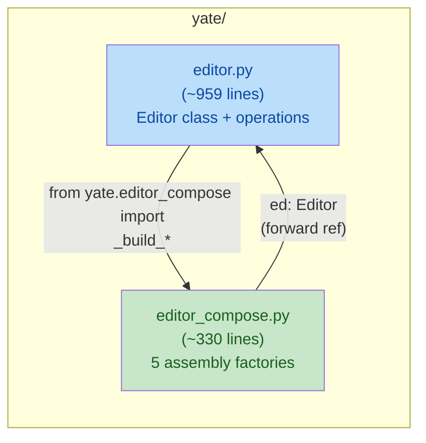

# big-module-split-2 editor plan-a: extract assembly factories

**Wave**: wave-1
**Issue**: Gitee IKSFMQ (candidate P1, wave-a)
**Depends on**: nothing (first wave)

## Goal

Extract the five module-level assembly factory functions from
`yate/editor.py` into a sibling module `yate/editor_compose.py`:

- `_build_models` (L88-L146, 59 lines)
- `_build_widgets` (L149-L222, 74 lines)
- `_open_startup_target` (L225-L235, 11 lines)
- `_build_pane_stack` (L238-L386, 149 lines)
- `_build_key_ui` (L389-L403, 15 lines)

Total extracted: ~316 lines of factory code. After extraction,
`editor.py` drops from 1275 to ~959 lines (still exempt; wave-b
handles the rest).

## Non-goals

- Changing the `Editor` public API surface.
- Changing the construction order or semantics.
- Extracting key/mouse dispatch (that is wave-b).
- Removing the `SIZE_EXEMPT_FILES` entry (wave-b does that).

## Alternative considered and rejected

**Alternative**: Extract into `editor/_compose.py` (subpackage).
**Rejected**: The issue explicitly suggests a sibling module
`editor_compose.py`. A subpackage would require converting `editor.py`
into `editor/__init__.py`, breaking every `from yate.editor import
Editor` consumer (app.py, commands.py, actions.py, diagnostics.py,
tests, smoke harness). The sibling module approach is zero-breakage.

## Exclusive file list

| File | Action |
|---|---|
| `yate/editor.py` | Remove L86-L403 (factories + section comment); add `from yate.editor_compose import ...` |
| `yate/editor_compose.py` | **NEW**: the five factory functions + necessary imports |
| `tests/test_editor_compose.py` | **NEW**: structural tests for the new module |

No other files are touched. `Editor.__init__` keeps calling the same
five functions in the same order; only the import source changes.

## Detailed changes

### Step 1: Create `yate/editor_compose.py`

New file containing the five functions verbatim from `editor.py`
L86-L403. The functions are already module-level and parameterized by
`ed: Editor`; no code changes are needed beyond adjusting imports.

**Imports needed** (derived from the function bodies):

```python
"""Assembly factories for the Editor widget tree.

Module-level factories (review 20260926 #5): keeps ``Editor.__init__``
a readable sequence of build steps. Callbacks are bound methods of the
not-yet-fully-initialized editor; they only fire after construction, so
the half-built state is never observed.
"""

from __future__ import annotations

from collections.abc import Callable
from functools import partial
from pathlib import Path
from typing import Literal

from textual.containers import Horizontal, Vertical

from yate.config import YateConfig
from yate.editor_core import Document
from yate.editor_lsp.manager import LspManager
from yate.editor_components import theme
from yate.editor_components.chrome import Breadcrumbs, SidebarHead, TabBar
from yate.editor_components.commandline import PromptBar
from yate.editor_components.completion import CompletionPopup
from yate.editor_components.editor import EditorView
from yate.editor_components.explorer import ExplorerTree
from yate.editor_components.panes import PaneHost, PaneManager
from yate.editor_components.statusbar import StatusBar
from yate.editor_components.terminal import TerminalPanel
from yate.editor_components.whichkey import EditorColumn, WhichKeyPanel
from yate.flows.chunked_flows import ChunkedFlows
from yate.flows.completion_flows import CompletionFlows
from yate.flows.document_flows import DocumentFlows
from yate.flows.extension_flows import ExtensionFlows
from yate.flows.file_manager_flows import FileManagerFlows
from yate.flows.lsp_sync import LspSync
from yate.flows.mouse_flows import MouseFlows
from yate.flows.overlay_flows import OverlayFlows
from yate.flows.cmdline_completions import cmdline_completions
from yate.flows.prompt_flows import PromptFlows
from yate.flows.shell_flows import ShellFlows
from yate.flows.whichkey_flows import WhichKeyFlows
from yate.flows.window_flows import WindowFlows
from yate.keymaps.base import KeyUi
from yate.keymaps.registry import KeymapSet
from yate.keymaps.vim import VimKeymap
from yate.keymaps.vsc import VscKeymap
from yate.registries import ActionRegistry, CommandRegistry
from yate.services.events import EventHub
from yate.services.extensions import ExtensionAPI, ExtensionContext, ExtensionLoader
from yate.services.workspace import Workspace
from yate.session import EditorSession
```

**Type annotation for `ed` parameter**: The factories take
`ed: yate.editor.Editor`. See the correction section below for the
import-cycle resolution (main-agent correction, 2026-11-04).

**Functions to copy** (line references are to the current `editor.py`):

1. `_build_models(ed: Editor, keymap: str | None) -> None` (L88-L146)
2. `_build_widgets(ed: Editor) -> None` (L149-L222)
3. `_open_startup_target(ed: Editor, target: str | Path | None) -> None` (L225-L235)
4. `_build_pane_stack(ed: Editor) -> None` (L238-L386)
5. `_build_key_ui(ed: Editor) -> None` (L389-L403)

Each function is copied verbatim. The `# --- assembly` section comment
(L86) moves to the new file's module docstring.

### Step 2: Edit `yate/editor.py`

1. **Remove** lines L86-L403 (the section comment + five functions).
2. **Add** import at the top (after existing imports, line ~81):
   ```python
   from yate.editor_compose import (
       _build_key_ui,
       _build_models,
       _build_pane_stack,
       _build_widgets,
       _open_startup_target,
   )
   ```
3. **Keep** `Editor.__init__` unchanged (it still calls the same five
   functions in the same order; they now come from the import).

### Step 3: Create `tests/test_editor_compose.py`

New test file verifying the structural properties of the new module:

```python
"""Tests for yate.editor_compose (assembly factories)."""

from __future__ import annotations

import ast
from pathlib import Path


def test_editor_compose_has_no_self_app() -> None:
    """editor_compose.py must not hold self.app (architecture guard).

    The module is top-level yate/; test_flow_modules_hold_no_app_handle
    scans such files. Functions take ed: Editor and never touch self.app.
    """
    src = Path("yate/editor_compose.py").read_text(encoding="utf-8")
    tree = ast.parse(src)
    for node in ast.walk(tree):
        if isinstance(node, ast.Attribute):
            if (
                isinstance(node.value, ast.Name)
                and node.value.id == "self"
                and node.attr == "app"
            ):
                raise AssertionError(
                    "editor_compose.py must not contain self.app"
                )


def test_editor_compose_exports_five_factories() -> None:
    """The module must define exactly the five assembly factories."""
    src = Path("yate/editor_compose.py").read_text(encoding="utf-8")
    tree = ast.parse(src)
    funcs = {
        node.name
        for node in tree.body
        if isinstance(node, ast.FunctionDef)
    }
    expected = {
        "_build_models",
        "_build_widgets",
        "_open_startup_target",
        "_build_pane_stack",
        "_build_key_ui",
    }
    assert funcs == expected, f"expected {expected}, got {funcs}"


def test_editor_imports_factories_from_compose() -> None:
    """editor.py must import the five factories from editor_compose."""
    src = Path("yate/editor.py").read_text(encoding="utf-8")
    assert "from yate.editor_compose import" in src
    for name in [
        "_build_models",
        "_build_widgets",
        "_open_startup_target",
        "_build_pane_stack",
        "_build_key_ui",
    ]:
        assert name in src, f"missing import: {name}"


def test_editor_compose_no_actions_no_commands_import() -> None:
    """editor_compose.py must not import actions/commands (R5 direction).

    The factories assemble widgets and flows; they never reference the
    built-in tables. R5 forbids editor -> actions/commands; the compose
    module is conceptually part of editor, so the same direction applies.
    """
    src = Path("yate/editor_compose.py").read_text(encoding="utf-8")
    assert "from yate.actions" not in src
    assert "from yate.commands" not in src
    assert "import yate.actions" not in src
    assert "import yate.commands" not in src
```

## Correction: import-cycle resolution (main-agent, 2026-11-04)

The original draft claimed a bare string annotation `"Editor"` plus
`from yate.editor_compose import ...` inside `editor.py` is enough. It
is not, and the runtime evidence is decisive:

1. `from yate.editor_compose import _build_models` (editor.py top) runs
   while `yate.editor` is partially initialized, so a module-level
   `from yate.editor import Editor` inside `editor_compose.py` raises
   `ImportError: cannot import name 'Editor' from partially initialized
   module` on the production path (cli -> app -> editor ->
   editor_compose -> editor).
2. Deferring the compose import to the bottom of `editor.py` only moves
   the failure: importing `yate.editor_compose` first (tests do) makes
   editor.py's bottom from-import hit the still-partial compose module.
3. pyright strict cannot resolve an unimported `Editor` name
   (reportUndefinedVariable), and R6 bans `TYPE_CHECKING`, so the
   annotation must be backed by a real import.

**Corrected wiring (cycle-safe in both import orders)**:

- `editor_compose.py` uses a module-object import at top:
  `import yate.editor`; the parameter annotation is
  `ed: yate.editor.Editor` (never evaluated at runtime under
  `from __future__ import annotations`; `import yate.editor` on a
  partially initialized module only binds the module object and never
  raises).
- `editor.py` uses a module-object import at top:
  `import yate.editor_compose`; `Editor.__init__` calls the factories
  through module attribute access at call time, e.g.
  `editor_compose._build_models(self, keymap)`. By the time `__init__`
  runs, both modules are fully initialized regardless of import order.
- Cross-module underscore access is an established repo pattern under
  the strict gate (`yate/editor_lsp/manager.py:43` imports
  `_from_utf16` from `yate.editor_lsp.parsing`); pyright stays clean.
- The verification step `test_editor_imports_factories_from_compose`
  asserts the module-object import form instead:
  `"import yate.editor_compose" in src` plus
  `"editor_compose._build_models" in src` (and likewise for the other
  four call sites).

## Verification commands (execute in order)

```powershell
# 1. pyright strict -- zero diagnostics
.venv\Scripts\python.exe -m pyright yate/editor.py yate/editor_compose.py tests/test_editor_compose.py

# 2. New tests pass
.venv\Scripts\python.exe -m pytest tests/test_editor_compose.py -q

# 3. Full test suite (no regression)
.venv\Scripts\python.exe -m pytest tests/ -q -n auto

# 4. Architecture tests (37 cases, no regression)
.venv\Scripts\python.exe -m pytest tests/test_architecture.py -q

# 5. Line count check (editor.py should be ~959 lines, still exempt)
.venv\Scripts\python.exe -c "print(len(open('yate/editor.py').read().splitlines()))"

# 6. editor_compose.py line count (should be ~330 lines, well under 800)
.venv\Scripts\python.exe -c "print(len(open('yate/editor_compose.py').read().splitlines()))"
```

## Risk assessment

| Risk | Impact | Mitigation |
|---|---|---|
| Circular import (editor <-> editor_compose) | Import fails at startup | `from __future__ import annotations` makes `ed: Editor` a string annotation; no runtime import of Editor needed in compose module |
| Missing import in new module | pyright error | Copy all imports from the original functions; verify with pyright |
| `test_flow_modules_hold_no_app_handle` flags new file | Architecture test fails | The module uses `ed: Editor` parameter, never `self.app`; structural test in step 3 verifies this |
| R5 violation (compose imports actions/commands) | Architecture test fails | Structural test `test_editor_compose_no_actions_no_commands_import` prevents this |

## Rollback path

If any step fails: revert `yate/editor.py` to its pre-wave-1 state and
delete `yate/editor_compose.py` and `tests/test_editor_compose.py`.
The changes are purely additive (new file) + removal from editor.py;
a git checkout of the original file is sufficient.

## Mermaid: module structure after wave-1


