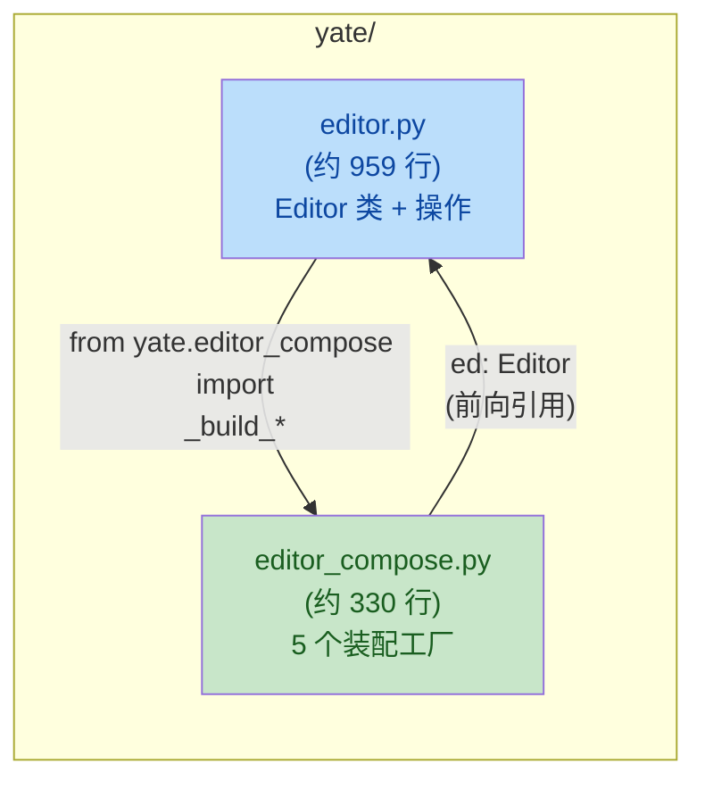

# big-module-split-2 editor 计划-a：抽取装配工厂

**波次**：wave-1
**议题**：Gitee IKSFMQ（候选 P1，wave-a）
**依赖**：无（首个波次）

## 目标

将 `yate/editor.py` 中的五个模块级装配工厂函数抽取到同级模块 `yate/editor_compose.py`：

- `_build_models`（L88-L146，59 行）
- `_build_widgets`（L149-L222，74 行）
- `_open_startup_target`（L225-L235，11 行）
- `_build_pane_stack`（L238-L386，149 行）
- `_build_key_ui`（L389-L403，15 行）

共抽取约 316 行工厂代码。抽取后，`editor.py` 从 1275 行降至约 959 行（仍属豁免；其余部分由 wave-b 处理）。

## 非目标

- 改变 `Editor` 的公开 API 表面。
- 改变构造顺序或语义。
- 抽取按键/鼠标分发（那是 wave-b 的工作）。
- 移除 `SIZE_EXEMPT_FILES` 条目（由 wave-b 完成）。

## 考虑过但否决的备选方案

**备选方案**：抽取到 `editor/_compose.py`（子包）。
**否决理由**：议题明确建议同级模块 `editor_compose.py`。子包需要将 `editor.py` 改造为 `editor/__init__.py`，这会破坏每一个 `from yate.editor import Editor` 的使用方（app.py、commands.py、actions.py、diagnostics.py、tests、冒烟测试框架）。同级模块方案可做到零破坏。

## 独占文件清单

| 文件 | 操作 |
|---|---|
| `yate/editor.py` | 删除 L86-L403（工厂函数 + 分节注释）；添加 `from yate.editor_compose import ...` |
| `yate/editor_compose.py` | **新建**：五个工厂函数 + 必要的 import |
| `tests/test_editor_compose.py` | **新建**：新模块的结构测试 |

不触碰其它文件。`Editor.__init__` 继续以相同顺序调用同样的五个函数；仅 import 来源发生变化。

## 详细改动

### 第 1 步：创建 `yate/editor_compose.py`

新文件逐字包含 `editor.py` L86-L403 的五个函数。这些函数本就是模块级并以 `ed: Editor` 参数化；除调整 import 外无需改动代码。

**所需 import**（由函数体推导）：

```python
"""Assembly factories for the Editor widget tree.

Module-level factories (review 20260926 #5): keeps ``Editor.__init__``
a readable sequence of build steps. Callbacks are bound methods of the
not-yet-fully-initialized editor; they only fire after construction, so
the half-built state is never observed.
"""

from __future__ import annotations

from collections.abc import Callable
from functools import partial
from pathlib import Path
from typing import Literal

from textual.containers import Horizontal, Vertical

from yate.config import YateConfig
from yate.editor_core import Document
from yate.editor_lsp.manager import LspManager
from yate.editor_components import theme
from yate.editor_components.chrome import Breadcrumbs, SidebarHead, TabBar
from yate.editor_components.commandline import PromptBar
from yate.editor_components.completion import CompletionPopup
from yate.editor_components.editor import EditorView
from yate.editor_components.explorer import ExplorerTree
from yate.editor_components.panes import PaneHost, PaneManager
from yate.editor_components.statusbar import StatusBar
from yate.editor_components.terminal import TerminalPanel
from yate.editor_components.whichkey import EditorColumn, WhichKeyPanel
from yate.flows.chunked_flows import ChunkedFlows
from yate.flows.completion_flows import CompletionFlows
from yate.flows.document_flows import DocumentFlows
from yate.flows.extension_flows import ExtensionFlows
from yate.flows.file_manager_flows import FileManagerFlows
from yate.flows.lsp_sync import LspSync
from yate.flows.mouse_flows import MouseFlows
from yate.flows.overlay_flows import OverlayFlows
from yate.flows.cmdline_completions import cmdline_completions
from yate.flows.prompt_flows import PromptFlows
from yate.flows.shell_flows import ShellFlows
from yate.flows.whichkey_flows import WhichKeyFlows
from yate.flows.window_flows import WindowFlows
from yate.keymaps.base import KeyUi
from yate.keymaps.registry import KeymapSet
from yate.keymaps.vim import VimKeymap
from yate.keymaps.vsc import VscKeymap
from yate.registries import ActionRegistry, CommandRegistry
from yate.services.events import EventHub
from yate.services.extensions import ExtensionAPI, ExtensionContext, ExtensionLoader
from yate.services.workspace import Workspace
from yate.session import EditorSession
```

`ed` 参数的类型标注：工厂函数接受 `ed: yate.editor.Editor`。导入环的解决办法见下方的更正章节（主代理更正，2026-11-04）。

**待复制的函数**（行号引用针对当前 `editor.py`）：

1. `_build_models(ed: Editor, keymap: str | None) -> None`（L88-L146）
2. `_build_widgets(ed: Editor) -> None`（L149-L222）
3. `_open_startup_target(ed: Editor, target: str | Path | None) -> None`（L225-L235）
4. `_build_pane_stack(ed: Editor) -> None`（L238-L386）
5. `_build_key_ui(ed: Editor) -> None`（L389-L403）

每个函数逐字复制。`# --- assembly` 分节注释（L86）移至新文件的模块 docstring。

### 第 2 步：编辑 `yate/editor.py`

1. **删除** L86-L403 行（分节注释 + 五个函数）。
2. **添加**顶部的 import（在现有 import 之后，约第 81 行）：
   ```python
   from yate.editor_compose import (
       _build_key_ui,
       _build_models,
       _build_pane_stack,
       _build_widgets,
       _open_startup_target,
   )
   ```
3. **保持** `Editor.__init__` 不变（它仍以相同顺序调用同样的五个函数；现在这些函数来自 import）。

### 第 3 步：创建 `tests/test_editor_compose.py`

新测试文件，验证新模块的结构属性：

```python
"""Tests for yate.editor_compose (assembly factories)."""

from __future__ import annotations

import ast
from pathlib import Path


def test_editor_compose_has_no_self_app() -> None:
    """editor_compose.py must not hold self.app (architecture guard).

    The module is top-level yate/; test_flow_modules_hold_no_app_handle
    scans such files. Functions take ed: Editor and never touch self.app.
    """
    src = Path("yate/editor_compose.py").read_text(encoding="utf-8")
    tree = ast.parse(src)
    for node in ast.walk(tree):
        if isinstance(node, ast.Attribute):
            if (
                isinstance(node.value, ast.Name)
                and node.value.id == "self"
                and node.attr == "app"
            ):
                raise AssertionError(
                    "editor_compose.py must not contain self.app"
                )


def test_editor_compose_exports_five_factories() -> None:
    """The module must define exactly the five assembly factories."""
    src = Path("yate/editor_compose.py").read_text(encoding="utf-8")
    tree = ast.parse(src)
    funcs = {
        node.name
        for node in tree.body
        if isinstance(node, ast.FunctionDef)
    }
    expected = {
        "_build_models",
        "_build_widgets",
        "_open_startup_target",
        "_build_pane_stack",
        "_build_key_ui",
    }
    assert funcs == expected, f"expected {expected}, got {funcs}"


def test_editor_imports_factories_from_compose() -> None:
    """editor.py must import the five factories from editor_compose."""
    src = Path("yate/editor.py").read_text(encoding="utf-8")
    assert "from yate.editor_compose import" in src
    for name in [
        "_build_models",
        "_build_widgets",
        "_open_startup_target",
        "_build_pane_stack",
        "_build_key_ui",
    ]:
        assert name in src, f"missing import: {name}"


def test_editor_compose_no_actions_no_commands_import() -> None:
    """editor_compose.py must not import actions/commands (R5 direction).

    The factories assemble widgets and flows; they never reference the
    built-in tables. R5 forbids editor -> actions/commands; the compose
    module is conceptually part of editor, so the same direction applies.
    """
    src = Path("yate/editor_compose.py").read_text(encoding="utf-8")
    assert "from yate.actions" not in src
    assert "from yate.commands" not in src
    assert "import yate.actions" not in src
    assert "import yate.commands" not in src
```

## 更正：导入环的解决（主代理，2026-11-04）

最初的草稿声称，仅用一个裸字符串标注 `"Editor"` 加上 `editor.py` 中的 `from yate.editor_compose import ...` 就足够了。事实并非如此，运行时证据是决定性的：

1. `from yate.editor_compose import _build_models`（editor.py 顶部）在 `yate.editor` 部分初始化时运行，因此 `editor_compose.py` 中的模块级 `from yate.editor import Editor` 会在生产路径（cli -> app -> editor -> editor_compose -> editor）上抛出 `ImportError: cannot import name 'Editor' from partially initialized module`。
2. 将 compose 的 import 推迟到 `editor.py` 底部只是转移了故障：先导入 `yate.editor_compose`（测试就是这么做的）会使 editor.py 底部的 from-import 命中仍处于部分初始化状态的 compose 模块。
3. pyright strict 无法解析未导入的 `Editor` 名称（reportUndefinedVariable），而 R6 禁用 `TYPE_CHECKING`，因此标注必须有真实的 import 支撑。

**更正后的接线（两种导入顺序下均安全无环）**：

- `editor_compose.py` 在顶部使用模块对象导入：`import yate.editor`；参数标注为 `ed: yate.editor.Editor`（在 `from __future__ import annotations` 下永不在运行时求值；对部分初始化的模块执行 `import yate.editor` 只会绑定模块对象，绝不会抛错）。
- `editor.py` 在顶部使用模块对象导入：`import yate.editor_compose`；`Editor.__init__` 在调用时通过模块属性访问来调用工厂函数，例如 `editor_compose._build_models(self, keymap)`。当 `__init__` 运行时，无论导入顺序如何，两个模块都已完全初始化。
- 跨模块的下划线访问是严格门禁下既有的仓库惯例（`yate/editor_lsp/manager.py:43` 从 `yate.editor_lsp.parsing` 导入 `_from_utf16`）；pyright 保持干净。
- 验证步骤 `test_editor_imports_factories_from_compose` 改为断言模块对象导入形式：`"import yate.editor_compose" in src` 加上 `"editor_compose._build_models" in src`（另外四处调用点同理）。

## 验收命令（按顺序执行）

```powershell
# 1. pyright strict -- zero diagnostics
.venv\Scripts\python.exe -m pyright yate/editor.py yate/editor_compose.py tests/test_editor_compose.py

# 2. New tests pass
.venv\Scripts\python.exe -m pytest tests/test_editor_compose.py -q

# 3. Full test suite (no regression)
.venv\Scripts\python.exe -m pytest tests/ -q -n auto

# 4. Architecture tests (37 cases, no regression)
.venv\Scripts\python.exe -m pytest tests/test_architecture.py -q

# 5. Line count check (editor.py should be ~959 lines, still exempt)
.venv\Scripts\python.exe -c "print(len(open('yate/editor.py').read().splitlines()))"

# 6. editor_compose.py line count (should be ~330 lines, well under 800)
.venv\Scripts\python.exe -c "print(len(open('yate/editor_compose.py').read().splitlines()))"
```

## 风险评估

| 风险 | 影响 | 缓解措施 |
|---|---|---|
| 循环导入（editor <-> editor_compose） | 启动时导入失败 | `from __future__ import annotations` 使 `ed: Editor` 成为字符串标注；compose 模块中无需运行时导入 Editor |
| 新模块缺少 import | pyright 报错 | 复制原函数的所有 import；用 pyright 验证 |
| `test_flow_modules_hold_no_app_handle` 标记新文件 | 架构测试失败 | 该模块使用 `ed: Editor` 参数，从不用 `self.app`；第 3 步的结构测试对此进行验证 |
| 违反 R5（compose 导入 actions/commands） | 架构测试失败 | 结构测试 `test_editor_compose_no_actions_no_commands_import` 可防止这种情况 |

## 回滚路径

若任一步骤失败：将 `yate/editor.py` 恢复到 wave-1 之前的状态，并删除 `yate/editor_compose.py` 和 `tests/test_editor_compose.py`。改动纯粹是新增（新文件）+ 从 editor.py 删除；对原文件执行一次 git checkout 即可。

## Mermaid：wave-1 之后的模块结构


