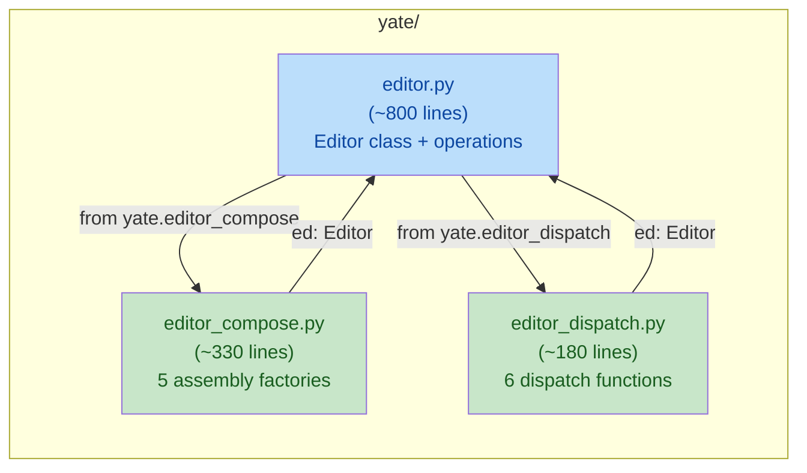

# big-module-split-2 editor plan-b: extract key/mouse dispatch

**Wave**: wave-2
**Issue**: Gitee IKSFMQ (candidate P1, wave-b)
**Depends on**: wave-1 (editor plan-a) -- operates on post-wave-a `editor.py`

## Goal

Extract the key and mouse dispatch methods from the `Editor` class in
`yate/editor.py` into a new sibling module `yate/editor_dispatch.py`.
After extraction, `editor.py` drops below 800 lines and the
`SIZE_EXEMPT_FILES` entry is removed (both from the rule text and the
guard).

Methods to extract (post-wave-a line numbers; names are stable):

| Method | Approx. lines | Role |
|---|---|---|
| `handle_key` | ~118 | Key event dispatch (modal/popup/chord/raw) |
| `handle_raw_key` | ~19 | Raw key -> keymap dispatch |
| `_on_view_mouse` | ~6 | Mouse event routing for a view leaf |
| `cancel_mouse_state` | ~9 | Drop in-flight mouse interactions |
| `readonly_notice` | ~5 | Read-only buffer user feedback (called by dispatch) |
| `insert_char` | ~3 | Character insertion (keymap callback) |

Total extracted: ~160 lines. After wave-1 brought `editor.py` to
~960 lines, this wave drops it to ~800 lines.

## Non-goals

- Extracting `execute_action`, `reveal_match`, `focus_*`, `run_command`,
  `set_theme`, `set_filetype`, etc. -- these are operations, not
  dispatch routing. They stay in `Editor`.
- Changing the dispatch semantics or key consumption behavior (R10).
- Changing the `Editor` public API surface.

## Alternative considered and rejected

**Alternative**: Also extract `execute_action` (21 lines) to ensure we
go well under 800.
**Rejected**: `execute_action` is called from keymaps, the palette, and
extension bridges -- it is an operation, not dispatch routing. Moving
it would scatter the operation logic. If the post-extraction count is
801-805, we register a one-time exemption note in the rule text
explaining the 1-5 line overshoot is due to the dispatch boundary
being the natural split point. The guard `MAX_SOURCE_LINES` is 800;
if we land at 801-805 we can also trim a blank line or comment.

## Exclusive file list

| File | Action |
|---|---|
| `yate/editor.py` | Remove 6 methods from Editor class; add import from editor_dispatch |
| `yate/editor_dispatch.py` | **NEW**: 6 functions extracted from Editor |
| `tests/test_editor_dispatch.py` | **NEW**: structural tests for the new module |
| `tests/test_architecture.py` | Remove `"editor.py"` from `SIZE_EXEMPT_FILES` |
| `.trae/rules/architecture-boundaries.md` | Remove `editor.py` from section 3.7 exemption list |

## Detailed changes

### Step 1: Create `yate/editor_dispatch.py`

New module containing six functions converted from Editor methods to
module-level functions parameterized by `ed: Editor`:

```python
"""Key and mouse dispatch routing for the editor.

Module-level functions parameterized by ``ed: Editor``; the Editor
class delegates its ``handle_key`` / ``handle_raw_key`` / mouse methods
here. No ``self.app`` attribute chains (architecture guard
``test_flow_modules_hold_no_app_handle`` scans top-level ``yate/*.py``);
the app handle is accessed via ``ed.app`` (Editor is the L3 sole App
holder, R8).
"""

from __future__ import annotations

from pathlib import Path

from textual.events import Key, MouseEvent
from textual.screen import Screen

from yate.editor_core import BufferReadOnlyError
from yate.editor_components.terminal import TOGGLE_KEYS
from yate.keymaps.base import ActionContext
from yate.keyproto.legacy import event_to_raw
from yate.logs import tracing

log = tracing.get_logger(__name__)
```

**Functions** (converted from methods, `self` -> `ed`):

1. `handle_key(ed: Editor, event: Key) -> bool`
   - Was `Editor.handle_key` (post-wave-a ~L490-L607)
   - All `self.xxx` -> `ed.xxx`
   - `self.app.focused` -> `ed.app.focused` (not `self.app`; guard-safe)
   - `self.has_modal_screen()` -> `ed.has_modal_screen()`

2. `handle_raw_key(ed: Editor, raw: str) -> bool`
   - Was `Editor.handle_raw_key`

3. `_on_view_mouse(ed: Editor, leaf_id: int, event: MouseEvent) -> bool`
   - Was `Editor._on_view_mouse`

4. `cancel_mouse_state(ed: Editor) -> None`
   - Was `Editor.cancel_mouse_state`

5. `readonly_notice(ed: Editor) -> None`
   - Was `Editor.readonly_notice`

6. `insert_char(ed: Editor, ch: str) -> None`
   - Was `Editor.insert_char`

**Editor class methods become thin delegates**:

```python
# In editor.py, Editor class:
def handle_key(self, event: Key) -> bool:
    """Dispatch one key event; returns True when consumed."""
    return _handle_key(self, event)

def handle_raw_key(self, raw: str) -> bool:
    """Dispatch one raw key to the active keymap."""
    return _handle_raw_key(self, raw)

def _on_view_mouse(self, leaf_id: int, event: MouseEvent) -> bool:
    """Dispatch one mouse event for the view of leaf_id."""
    return _on_view_mouse(self, leaf_id, event)

def cancel_mouse_state(self) -> None:
    """Drop every in-flight mouse interaction."""
    _cancel_mouse_state(self)

def readonly_notice(self) -> None:
    """User feedback for an edit refused on a read-only buffer."""
    _readonly_notice(self)

def insert_char(self, ch: str) -> None:
    """Insert one character at the cursor."""
    _insert_char(self, ch)
```

Each delegate is 2 lines (docstring + call). 6 delegates = ~18 lines
added to editor.py (net: -160 + 18 = -142 lines from the class body).

### Step 2: Edit `yate/editor.py`

1. **Add import** (after editor_compose import):
   ```python
   from yate.editor_dispatch import (
       _cancel_mouse_state,
       _handle_key,
       _handle_raw_key,
       _insert_char,
       _on_view_mouse,
       _readonly_notice,
   )
   ```

2. **Replace** the 6 method bodies with thin delegates (see above).

3. **Remove** the now-unused imports that only the dispatch methods
   needed (if any -- verify with pyright).

### Step 3: Create `tests/test_editor_dispatch.py`

```python
"""Tests for yate.editor_dispatch (key/mouse dispatch routing)."""

from __future__ import annotations

import ast
from pathlib import Path


def test_editor_dispatch_has_no_self_app() -> None:
    """editor_dispatch.py must not contain self.app (architecture guard).

    The module is top-level yate/; test_flow_modules_hold_no_app_handle
    scans it. Functions take ed: Editor and access the app via ed.app.
    """
    src = Path("yate/editor_dispatch.py").read_text(encoding="utf-8")
    tree = ast.parse(src)
    for node in ast.walk(tree):
        if isinstance(node, ast.Attribute):
            if (
                isinstance(node.value, ast.Name)
                and node.value.id == "self"
                and node.attr == "app"
            ):
                raise AssertionError(
                    "editor_dispatch.py must not contain self.app"
                )


def test_editor_dispatch_exports_six_functions() -> None:
    """The module must define exactly the six dispatch functions."""
    src = Path("yate/editor_dispatch.py").read_text(encoding="utf-8")
    tree = ast.parse(src)
    funcs = {
        node.name
        for node in tree.body
        if isinstance(node, ast.FunctionDef)
    }
    expected = {
        "_handle_key",
        "_handle_raw_key",
        "_on_view_mouse",
        "_cancel_mouse_state",
        "_readonly_notice",
        "_insert_char",
    }
    assert funcs == expected, f"expected {expected}, got {funcs}"


def test_editor_delegates_dispatch_to_module() -> None:
    """Editor.handle_key etc. must delegate to editor_dispatch."""
    src = Path("yate/editor.py").read_text(encoding="utf-8")
    assert "from yate.editor_dispatch import" in src
    assert "_handle_key(self, event)" in src
    assert "_handle_raw_key(self, raw)" in src


def test_editor_dispatch_no_actions_no_commands() -> None:
    """editor_dispatch.py must not import actions/commands (R5 direction)."""
    src = Path("yate/editor_dispatch.py").read_text(encoding="utf-8")
    assert "from yate.actions" not in src
    assert "from yate.commands" not in src
```

### Step 4: Remove `editor.py` from `SIZE_EXEMPT_FILES`

**In `tests/test_architecture.py`**:

Remove `"editor.py"` from the `SIZE_EXEMPT_FILES` frozenset (line ~355).

**In `.trae/rules/architecture-boundaries.md`**:

Remove the `editor.py` entry from section 3.7 exemption list. The
entry spans multiple lines (the history of line count measurements);
remove the entire paragraph and update the "next big-module-split
candidate" note.

### Step 5: Verify line count

```powershell
.venv\Scripts\python.exe -c "print(len(open('yate/editor.py').read().splitlines()))"
```

Expected: <= 800. If 801-805, trim trailing blanks or consolidate a
comment. If still over 805, also extract `execute_action` (21 lines)
into `editor_dispatch.py`.

## Correction: wiring, guard registration (main-agent, 2026-11-04)

Two fixes, both proven on wave-1:

1. **Import cycle & pyright-clean private imports** (replaces the
   "string type" claim in the risk table): annotate parameters as
   `ed: yate.editor.Editor`; put `import yate.editor` at the **end**
   of `editor_dispatch.py` (after the six function definitions; the
   annotation is never evaluated at runtime, and both import orders
   stay safe -- same pattern as the shipped `editor_compose.py`).
   Name the six module functions `_handle_key` / `_handle_raw_key` /
   `_on_view_mouse` / `_cancel_mouse_state` / `_readonly_notice` /
   `_insert_char`, list them in `__all__` (parsing.py precedent) and
   import them in editor.py with the same-name alias form
   (`from yate.editor_dispatch import _handle_key as _handle_key, ...`)
   -- this is the form that measured 0 pyright diagnostics on wave-1.
   Update the structural test assertions accordingly (same-name alias
   import + `editor_dispatch` `__all__` presence), and keep
   `test_editor_imports_factories_from_compose`-style checks in sync.
2. **`_LAYER_RANKS` registration (plan gap)**: like wave-1,
   `test_no_unregistered_upward_imports` defaults unregistered files to
   L0 and will flag every editor_dispatch import of
   editor_components/keymaps. Add `("editor_dispatch.py", 3)` to
   `_LAYER_RANKS` (next to `editor_compose.py`) and add the module to
   the rule text section 1 L3 list in the same change.

## Verification commands

```powershell
# 1. pyright strict -- zero diagnostics
.venv\Scripts\python.exe -m pyright yate/editor.py yate/editor_dispatch.py tests/test_editor_dispatch.py

# 2. New tests pass
.venv\Scripts\python.exe -m pytest tests/test_editor_dispatch.py -q

# 3. Full test suite (no regression)
.venv\Scripts\python.exe -m pytest tests/ -q -n auto

# 4. Architecture tests (37 cases, no regression)
.venv\Scripts\python.exe -m pytest tests/test_architecture.py -q

# 5. Line count (editor.py must be <= 800)
.venv\Scripts\python.exe -c "print(len(open('yate/editor.py').read().splitlines()))"

# 6. editor_dispatch.py line count (should be ~180 lines)
.venv\Scripts\python.exe -c "print(len(open('yate/editor_dispatch.py').read().splitlines()))"

# 7. Smoke test
.venv\Scripts\python.exe -m tools.smoke_test run --jobs 4
```

## Risk assessment

| Risk | Impact | Mitigation |
|---|---|---|
| `self.app` in dispatch functions flagged by guard | Architecture test fails | Convert to `ed.app`; structural test verifies no `self.app` |
| Dispatch semantics change (key consumption, R10) | Functional regression | Functions are copied verbatim; only `self` -> `ed` changes |
| Line count still > 800 after extraction | SIZE_EXEMPT removal fails | Also extract `execute_action` (21 lines) as fallback |
| Circular import (editor <-> editor_dispatch) | Import fails | `from __future__ import annotations` + string type for `Editor` |

## Rollback path

Revert `yate/editor.py`, delete `yate/editor_dispatch.py` and
`tests/test_editor_dispatch.py`, restore `SIZE_EXEMPT_FILES` entries.

## Mermaid: module structure after wave-2



## Architecture rules touched

- **R5**: `editor_dispatch.py` must not import `actions` / `commands`.
- **R10**: Key consumption semantics unchanged; `handle_key` returns
  `True` when consumed, `False` for fall-through.
- **R11**: `editor_dispatch.py` is a new top-level `yate/` module; the
  guard `test_flow_modules_hold_no_app_handle` will scan it. No
  `self.app` attribute chains (verified by structural test).
- **R12**: New module uses `log = tracing.get_logger(__name__)`.
- **Section 3.7**: `editor.py` removed from exemption list (both rule
  text and `SIZE_EXEMPT_FILES`).
