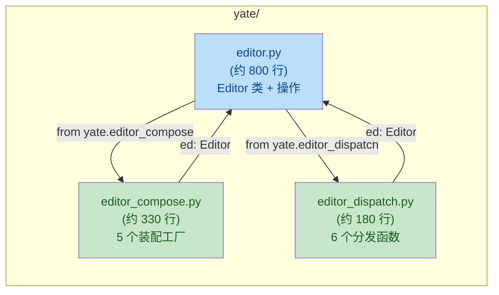

# big-module-split-2 editor 计划-b：抽取按键/鼠标分发

**波次**：wave-2
**议题**：Gitee IKSFMQ（候选 P1，wave-b）
**依赖**：wave-1（editor 计划-a）——在 wave-a 之后的 `editor.py` 上操作

## 目标

将 `yate/editor.py` 中 `Editor` 类的按键与鼠标分发方法抽取到新的同级模块 `yate/editor_dispatch.py`。抽取后，`editor.py` 降至 800 行以下，`SIZE_EXEMPT_FILES` 条目被移除（规则文本与守卫中同时移除）。

待抽取的方法（wave-a 之后的行号；名称保持稳定）：

| 方法 | 约行数 | 职责 |
|---|---|---|
| `handle_key` | ~118 | 按键事件分发（模态/弹窗/和弦/原始） |
| `handle_raw_key` | ~19 | 原始按键 -> 键位映射分发 |
| `_on_view_mouse` | ~6 | 视图叶节点的鼠标事件路由 |
| `cancel_mouse_state` | ~9 | 丢弃进行中的鼠标交互 |
| `readonly_notice` | ~5 | 只读缓冲区的用户反馈（由分发调用） |
| `insert_char` | ~3 | 字符插入（键位映射回调） |

共抽取约 160 行。wave-1 将 `editor.py` 降至约 960 行后，本波次将其进一步降至约 800 行。

## 非目标

- 抽取 `execute_action`、`reveal_match`、`focus_*`、`run_command`、`set_theme`、`set_filetype` 等——这些是操作，而非分发路由。它们留在 `Editor` 中。
- 改变分发语义或按键消费行为（R10）。
- 改变 `Editor` 的公开 API 表面。

## 考虑过但否决的备选方案

**备选方案**：同时抽取 `execute_action`（21 行），以确保远低于 800 行。
**否决理由**：`execute_action` 由键位映射、命令面板和扩展桥接调用——它是操作，而非分发路由。移动它会使操作逻辑分散。若抽取后行数为 801-805，我们会在规则文本中登记一条一次性豁免说明，解释超出 1-5 行是因为分发边界是天然的分界点。守卫 `MAX_SOURCE_LINES` 为 800；若落在 801-805，也可以删掉一个空行或注释。

## 独占文件清单

| 文件 | 操作 |
|---|---|
| `yate/editor.py` | 从 Editor 类中删除 6 个方法；添加来自 editor_dispatch 的 import |
| `yate/editor_dispatch.py` | **新建**：从 Editor 抽取的 6 个函数 |
| `tests/test_editor_dispatch.py` | **新建**：新模块的结构测试 |
| `tests/test_architecture.py` | 从 `SIZE_EXEMPT_FILES` 中移除 `"editor.py"` |
| `.trae/rules/architecture-boundaries.md` | 从 3.7 节豁免列表中移除 `editor.py` |

## 详细改动

### 第 1 步：创建 `yate/editor_dispatch.py`

新模块包含六个由 Editor 方法改造而来的函数，以 `ed: Editor` 参数化为模块级函数：

```python
"""Key and mouse dispatch routing for the editor.

Module-level functions parameterized by ``ed: Editor``; the Editor
class delegates its ``handle_key`` / ``handle_raw_key`` / mouse methods
here. No ``self.app`` attribute chains (architecture guard
``test_flow_modules_hold_no_app_handle`` scans top-level ``yate/*.py``);
the app handle is accessed via ``ed.app`` (Editor is the L3 sole App
holder, R8).
"""

from __future__ import annotations

from pathlib import Path

from textual.events import Key, MouseEvent
from textual.screen import Screen

from yate.editor_core import BufferReadOnlyError
from yate.editor_components.terminal import TOGGLE_KEYS
from yate.keymaps.base import ActionContext
from yate.keyproto.legacy import event_to_raw
from yate.logs import tracing

log = tracing.get_logger(__name__)
```

**函数**（由方法改造，`self` -> `ed`）：

1. `handle_key(ed: Editor, event: Key) -> bool`
   - 原为 `Editor.handle_key`（wave-a 之后约 L490-L607）
   - 所有 `self.xxx` -> `ed.xxx`
   - `self.app.focused` -> `ed.app.focused`（不是 `self.app`；守卫安全）
   - `self.has_modal_screen()` -> `ed.has_modal_screen()`

2. `handle_raw_key(ed: Editor, raw: str) -> bool`
   - 原为 `Editor.handle_raw_key`

3. `_on_view_mouse(ed: Editor, leaf_id: int, event: MouseEvent) -> bool`
   - 原为 `Editor._on_view_mouse`

4. `cancel_mouse_state(ed: Editor) -> None`
   - 原为 `Editor.cancel_mouse_state`

5. `readonly_notice(ed: Editor) -> None`
   - 原为 `Editor.readonly_notice`

6. `insert_char(ed: Editor, ch: str) -> None`
   - 原为 `Editor.insert_char`

**Editor 类的方法变为薄委托**：

```python
# In editor.py, Editor class:
def handle_key(self, event: Key) -> bool:
    """Dispatch one key event; returns True when consumed."""
    return _handle_key(self, event)

def handle_raw_key(self, raw: str) -> bool:
    """Dispatch one raw key to the active keymap."""
    return _handle_raw_key(self, raw)

def _on_view_mouse(self, leaf_id: int, event: MouseEvent) -> bool:
    """Dispatch one mouse event for the view of leaf_id."""
    return _on_view_mouse(self, leaf_id, event)

def cancel_mouse_state(self) -> None:
    """Drop every in-flight mouse interaction."""
    _cancel_mouse_state(self)

def readonly_notice(self) -> None:
    """User feedback for an edit refused on a read-only buffer."""
    _readonly_notice(self)

def insert_char(self, ch: str) -> None:
    """Insert one character at the cursor."""
    _insert_char(self, ch)
```

每个委托为 2 行（docstring + 调用）。6 个委托 = 向 editor.py 增加约 18 行（净计：类体中 -160 + 18 = -142 行）。

### 第 2 步：编辑 `yate/editor.py`

1. **添加 import**（在 editor_compose 的 import 之后）：
   ```python
   from yate.editor_dispatch import (
       _cancel_mouse_state,
       _handle_key,
       _handle_raw_key,
       _insert_char,
       _on_view_mouse,
       _readonly_notice,
   )
   ```

2. **替换**这 6 个方法体为薄委托（见上文）。

3. **移除**现已不再使用、仅为分发方法所需的 import（如有——用 pyright 验证）。

### 第 3 步：创建 `tests/test_editor_dispatch.py`

```python
"""Tests for yate.editor_dispatch (key/mouse dispatch routing)."""

from __future__ import annotations

import ast
from pathlib import Path


def test_editor_dispatch_has_no_self_app() -> None:
    """editor_dispatch.py must not contain self.app (architecture guard).

    The module is top-level yate/; test_flow_modules_hold_no_app_handle
    scans it. Functions take ed: Editor and access the app via ed.app.
    """
    src = Path("yate/editor_dispatch.py").read_text(encoding="utf-8")
    tree = ast.parse(src)
    for node in ast.walk(tree):
        if isinstance(node, ast.Attribute):
            if (
                isinstance(node.value, ast.Name)
                and node.value.id == "self"
                and node.attr == "app"
            ):
                raise AssertionError(
                    "editor_dispatch.py must not contain self.app"
                )


def test_editor_dispatch_exports_six_functions() -> None:
    """The module must define exactly the six dispatch functions."""
    src = Path("yate/editor_dispatch.py").read_text(encoding="utf-8")
    tree = ast.parse(src)
    funcs = {
        node.name
        for node in tree.body
        if isinstance(node, ast.FunctionDef)
    }
    expected = {
        "_handle_key",
        "_handle_raw_key",
        "_on_view_mouse",
        "_cancel_mouse_state",
        "_readonly_notice",
        "_insert_char",
    }
    assert funcs == expected, f"expected {expected}, got {funcs}"


def test_editor_delegates_dispatch_to_module() -> None:
    """Editor.handle_key etc. must delegate to editor_dispatch."""
    src = Path("yate/editor.py").read_text(encoding="utf-8")
    assert "from yate.editor_dispatch import" in src
    assert "_handle_key(self, event)" in src
    assert "_handle_raw_key(self, raw)" in src


def test_editor_dispatch_no_actions_no_commands() -> None:
    """editor_dispatch.py must not import actions/commands (R5 direction)."""
    src = Path("yate/editor_dispatch.py").read_text(encoding="utf-8")
    assert "from yate.actions" not in src
    assert "from yate.commands" not in src
```

### 第 4 步：从 `SIZE_EXEMPT_FILES` 中移除 `editor.py`

**在 `tests/test_architecture.py` 中**：

从 `SIZE_EXEMPT_FILES` 的 frozenset 中移除 `"editor.py"`（约第 355 行）。

**在 `.trae/rules/architecture-boundaries.md` 中**：

从 3.7 节豁免列表中移除 `editor.py` 条目。该条目跨越多行（行数测量的历史记录）；删除整个段落，并更新"下一个 big-module-split 候选"的说明。

### 第 5 步：核对行数

```powershell
.venv\Scripts\python.exe -c "print(len(open('yate/editor.py').read().splitlines()))"
```

预期：<= 800。若为 801-805，删减末尾空行或合并注释。若仍超过 805，则同时将 `execute_action`（21 行）抽取到 `editor_dispatch.py`。

## 更正：接线、守卫登记（主代理，2026-11-04）

两处修复，均已在 wave-1 验证：

1. **导入环与 pyright 干净的私有 import**（取代风险表中"字符串类型"的说法）：将参数标注为 `ed: yate.editor.Editor`；把 `import yate.editor` 放在 `editor_dispatch.py` 的**末尾**（六个函数定义之后；标注从不在运行时求值，两种导入顺序都安全——与已交付的 `editor_compose.py` 模式相同）。六个模块函数命名为 `_handle_key` / `_handle_raw_key` / `_on_view_mouse` / `_cancel_mouse_state` / `_readonly_notice` / `_insert_char`，在 `__all__` 中列出（沿用 parsing.py 的先例），并在 editor.py 中以同名别名形式导入（`from yate.editor_dispatch import _handle_key as _handle_key, ...`）——这是在 wave-1 实测得到 0 条 pyright 诊断的形式。相应更新结构测试的断言（同名别名 import + `editor_dispatch` 中存在 `__all__`），并保持 `test_editor_imports_factories_from_compose` 风格的检查同步。
2. **`_LAYER_RANKS` 登记（计划疏漏）**：与 wave-1 一样，`test_no_unregistered_upward_imports` 将未登记的文件默认为 L0，会标记 editor_dispatch 对 editor_components/keymaps 的每一处 import。将 `("editor_dispatch.py", 3)` 加入 `_LAYER_RANKS`（紧邻 `editor_compose.py`），并在同一次改动中把该模块加入规则文本第 1 节的 L3 列表。

## 验收命令

```powershell
# 1. pyright strict -- zero diagnostics
.venv\Scripts\python.exe -m pyright yate/editor.py yate/editor_dispatch.py tests/test_editor_dispatch.py

# 2. New tests pass
.venv\Scripts\python.exe -m pytest tests/test_editor_dispatch.py -q

# 3. Full test suite (no regression)
.venv\Scripts\python.exe -m pytest tests/ -q -n auto

# 4. Architecture tests (37 cases, no regression)
.venv\Scripts\python.exe -m pytest tests/test_architecture.py -q

# 5. Line count (editor.py must be <= 800)
.venv\Scripts\python.exe -c "print(len(open('yate/editor.py').read().splitlines()))"

# 6. editor_dispatch.py line count (should be ~180 lines)
.venv\Scripts\python.exe -c "print(len(open('yate/editor_dispatch.py').read().splitlines()))"

# 7. Smoke test
.venv\Scripts\python.exe -m tools.smoke_test run --jobs 4
```

## 风险评估

| 风险 | 影响 | 缓解措施 |
|---|---|---|
| 分发函数中的 `self.app` 被守卫标记 | 架构测试失败 | 改为 `ed.app`；结构测试验证无 `self.app` |
| 分发语义改变（按键消费，R10） | 功能回归 | 函数逐字复制；仅 `self` -> `ed` 改动 |
| 抽取后行数仍 > 800 | SIZE_EXEMPT 移除失败 | 同时抽取 `execute_action`（21 行）作为兜底 |
| 循环导入（editor <-> editor_dispatch） | 导入失败 | `from __future__ import annotations` + `Editor` 的字符串类型 |

## 回滚路径

回退 `yate/editor.py`，删除 `yate/editor_dispatch.py` 和 `tests/test_editor_dispatch.py`，恢复 `SIZE_EXEMPT_FILES` 条目。

## Mermaid：wave-2 之后的模块结构



## 涉及的架构规则

- **R5**：`editor_dispatch.py` 不得导入 `actions` / `commands`。
- **R10**：按键消费语义不变；`handle_key` 消费时返回 `True`，否则返回 `False` 继续向下传递。
- **R11**：`editor_dispatch.py` 是新的顶层 `yate/` 模块；守卫 `test_flow_modules_hold_no_app_handle` 会扫描它。不得有 `self.app` 属性链（由结构测试验证）。
- **R12**：新模块使用 `log = tracing.get_logger(__name__)`。
- **第 3.7 节**：`editor.py` 从豁免列表中移除（规则文本与 `SIZE_EXEMPT_FILES` 均移除）。
