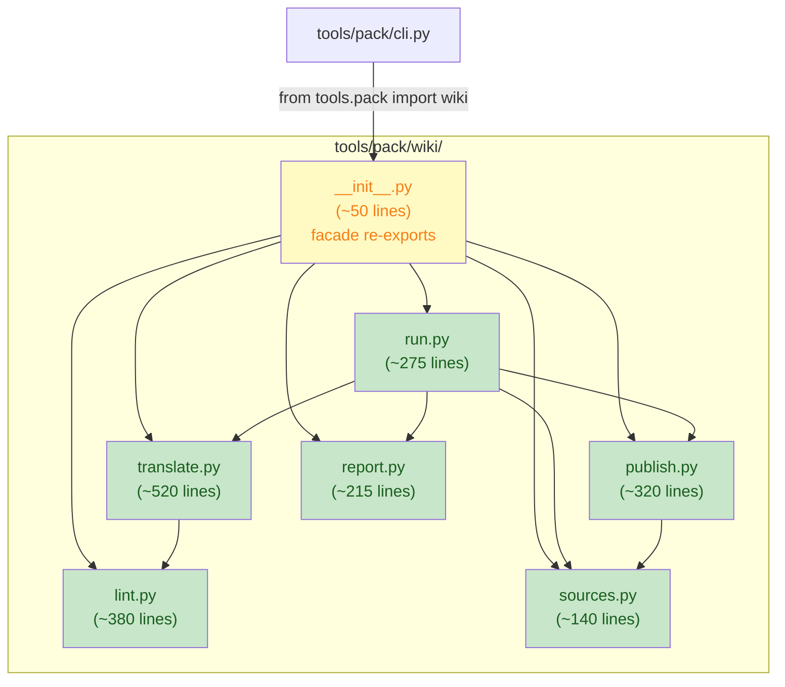

# big-module-split-2 wiki plan-a: subpackage-ize tools/pack/wiki.py

**Wave**: wave-3 (parallel with yxp plan-d)
**Issue**: Gitee IKSFMQ (candidate P2)
**Depends on**: nothing (independent of editor waves)

## Goal

Convert the monolithic `tools/pack/wiki.py` (2149 lines) into a
subpackage `tools/pack/wiki/` with 6 submodules + facade `__init__.py`.
Each file stays well under 800 lines. The public import path
`from tools.pack import wiki` is preserved via the facade; consumers
(`tools/pack/cli.py`, `tests/test_pack_wiki.py`,
`tests/test_pack_wiki_lint.py`) require zero changes.

## Non-goals

- Changing the CLI semantics (`python -m tools.pack wiki --check --push
  --jobs N` behavior unchanged).
- Changing the lint / translation / publish logic.
- Modifying test assertions.

## Alternative considered and rejected

**Alternative**: Keep as a single file, register exemption.
**Rejected**: At 2149 lines it is 2.7x the threshold. The AST analysis
shows 5+ distinct responsibility blocks (lint, sources, publish,
translate, report, orchestration). This is the definition of
multi-duty mixed file (rules section 3.7: must split).

**Alternative**: Split into 3 files (lint / translate / rest).
**Rejected**: The "rest" bucket would still be ~1400 lines. Fine-grained
6-way split keeps each file focused and under 600 lines.

## Submodule split (by AST responsibility blocks)

| Submodule | Source lines | Approx. size | Content |
|---|---|---|---|
| `__init__.py` | new | ~50 | Facade re-exports + docstring exception note |
| `lint.py` | L174-L551 | ~380 | WikiError, lint engine/pool/bar, _lint_texts* |
| `sources.py` | L555-L694 | ~140 | WikiPage, _collect_*, collect_sources, _page_* |
| `publish.py` | L697-L858 + L1218-L1288 + L1721-L1822 | ~320 | run_git, manifest, prune, push, _publish_translations |
| `translate.py` | L878-L1202 + L1527-L1589 + L1825-L1996 | ~520 | _run_translate, translate_via_cmd, needs_translation, _run_batch, _translate_pending |
| `report.py` | L1291-L1524 | ~215 | _nav_documents, _PagePlan/Outcome, _ProgressBoard, resolve_jobs |
| `run.py` | L1593-L1717 + L1999-L2149 | ~275 | _prepare_pages, _PreparedPage, run() entry point |

All files < 800 lines. Total ~1900 lines (some overhead from
per-module imports).

## Exclusive file list

| File | Action |
|---|---|
| `tools/pack/wiki.py` | **DELETE** (replaced by `tools/pack/wiki/` subpackage) |
| `tools/pack/wiki/__init__.py` | **NEW**: facade re-exports |
| `tools/pack/wiki/lint.py` | **NEW**: lint pipeline |
| `tools/pack/wiki/sources.py` | **NEW**: source collection |
| `tools/pack/wiki/publish.py` | **NEW**: git/manifest/publish |
| `tools/pack/wiki/translate.py` | **NEW**: translation execution |
| `tools/pack/wiki/report.py` | **NEW**: navigation/progress |
| `tools/pack/wiki/run.py` | **NEW**: orchestration + run() |
| `tests/test_architecture.py` | Remove `"tools/pack/wiki.py"` from `SIZE_EXEMPT_FILES` |
| `.trae/rules/architecture-boundaries.md` | Remove `tools/pack/wiki.py` from section 3.7 |

**No changes** to: `tools/pack/cli.py`, `tools/pack/__init__.py`,
`tools/pack/__main__.py`, `tests/test_pack_wiki.py`,
`tests/test_pack_wiki_lint.py`. The facade preserves the import path.

## Detailed changes

### Step 1: Create `tools/pack/wiki/` subpackage

Create the directory and 7 files. Each file gets:
- `from __future__ import annotations` as first code line
- ASCII-only module docstring
- `log = tracing.get_logger(__name__)` if it logs
- Absolute imports only (no `from .lint import ...`; use
  `from tools.pack.wiki.lint import ...`)

**`__init__.py`** (facade):

```python
"""Bilingual wiki publisher (``python -m tools.pack wiki``).

Collects .trae documents and bilingual guides, publishes them as
paired zh/en pages into the sibling ``<repo>.wiki`` git repository.

Package-root re-export note (architecture rules section 3.5): tools
packages normally keep ``__init__.py`` inert; this facade re-exports
the public API so the consumer path ``from tools.pack import wiki``
(used by ``tools/pack/cli.py`` and the test suite) stays unchanged
after the single-file-to-subpackage migration.
"""

from __future__ import annotations

from tools.pack.wiki.lint import (
    WikiError,
    reset_lint_engine_cache,
)
from tools.pack.wiki.run import run
from tools.pack.wiki.sources import WikiPage, collect_sources
from tools.pack.wiki.publish import (
    default_target,
    load_manifest,
    prune_orphan_pages,
    push_wiki,
    store_manifest,
)
from tools.pack.wiki.translate import needs_translation
from tools.pack.wiki.report import resolve_jobs

__all__ = [
    "WikiError",
    "WikiPage",
    "collect_sources",
    "default_target",
    "load_manifest",
    "needs_translation",
    "prune_orphan_pages",
    "push_wiki",
    "reset_lint_engine_cache",
    "resolve_jobs",
    "run",
    "store_manifest",
]
```

**Intra-package imports**: Each submodule uses absolute imports
(`from tools.pack.wiki.lint import ...`). This satisfies
`test_no_relative_imports` (no `from .X` allowed).

### Step 2: Populate each submodule

Copy functions verbatim from `tools/pack/wiki.py` into the target
submodule. Adjust cross-references:

- Functions that call functions in other submodules need to import them.
  Example: `run()` in `run.py` calls `collect_sources()` from
  `sources.py`, `_prepare_pages()` (local), `_translate_pending()` from
  `translate.py`, etc.

- Module-level constants (`MANIFEST_NAME`, lint engine cache, etc.) go
  to the submodule that owns them. Shared constants go to a small
  `_common.py` if needed (but prefer placing them in the owning module
  and importing).

### Step 3: Delete `tools/pack/wiki.py`

After all functions are copied and imports verified, delete the
original file.

### Step 4: Create `tests/test_wiki_subpackage.py`

```python
"""Structural tests for the wiki subpackage."""

from __future__ import annotations

import ast
from pathlib import Path


def test_wiki_subpackage_no_relative_imports() -> None:
    """Every .py in tools/pack/wiki/ uses absolute imports only."""
    pkg = Path("tools/pack/wiki")
    for py in sorted(pkg.glob("*.py")):
        src = py.read_text(encoding="utf-8")
        tree = ast.parse(src)
        for node in ast.walk(tree):
            if isinstance(node, ast.ImportFrom):
                assert node.level == 0, (
                    f"{py}: relative import found: {ast.dump(node)}"
                )


def test_wiki_subpackage_all_files_under_threshold() -> None:
    """Every file in the subpackage is under 800 lines."""
    pkg = Path("tools/pack/wiki")
    for py in sorted(pkg.glob("*.py")):
        lines = len(py.read_text(encoding="utf-8").splitlines())
        assert lines <= 800, f"{py}: {lines} lines (over 800)"


def test_wiki_facade_preserves_import_path() -> None:
    """``from tools.pack import wiki`` still works after subpackage-ization."""
    from tools.pack import wiki
    assert hasattr(wiki, "run")
    assert hasattr(wiki, "collect_sources")
    assert hasattr(wiki, "default_target")
    assert hasattr(wiki, "WikiPage")
    assert hasattr(wiki, "WikiError")


def test_wiki_subpackage_ascii_comments() -> None:
    """All new files carry ASCII-only comments and docstrings."""
    pkg = Path("tools/pack/wiki")
    for py in sorted(pkg.glob("*.py")):
        src = py.read_text(encoding="utf-8")
        # The architecture guard test_comments_and_docstrings_stay_ascii
        # covers this; this test is a fast pre-check.
        for line in src.splitlines():
            stripped = line.lstrip()
            if stripped.startswith("#"):
                comment = stripped[1:].strip()
                # Allow ASCII + common Latin chars
                assert all(ord(c) < 0x2000 for c in comment), (
                    f"{py}: non-ASCII in comment: {comment!r}"
                )
```

### Step 5: Remove `tools/pack/wiki.py` from `SIZE_EXEMPT_FILES`

**In `tests/test_architecture.py`**: Remove `"tools/pack/wiki.py"` from
the `SIZE_EXEMPT_FILES` frozenset.

**In `.trae/rules/architecture-boundaries.md`**: Remove the
`tools/pack/wiki.py` entry from section 3.7 exemption list.

## Correction: monkeypatch-surface wiring (main-agent, 2026-11-04)

The tests couple to the single file's module-global namespace
(`from tools.pack import wiki` + `monkeypatch.setattr(wiki, ...)`).
After a split, a plain direct import inside submodules breaks every
patch: the caller keeps its own binding and the facade attribute the
test patched is never consulted. Evidence (test surface, all in
`tests/test_pack_wiki*.py`): patched names include `translate_via_cmd`,
`collect_sources`, `_get_lint_engine`, `_emit_mode`,
`_drain_collected_failures`, `_STOP_POLL_S`, `TRANSLATE_TIMEOUT_S`,
`PARALLEL_LINT_MIN_CHARS`, `subprocess` (whole module replaced),
`ThreadPoolExecutor`, `job_ceiling`; directly referenced attrs include
`WikiError`, `WikiPage`, `Code`, `SECTION_GUIDES/PLANS/SETS/REVIEWS`,
`BATCH_SIZE`, `PARALLEL_LINT_MIN_TEXTS`, `MANIFEST_NAME`, `Console`,
`_feed_stdin`. The "tests unchanged" hard requirement forces:

1. **Patch-surface rule**: enumerate every `monkeypatch.setattr(wiki, ...)`
   target and every `wiki.<attr>` reference in the four test files.
   Every patched name is (a) re-exported by the facade and (b) read /
   called inside submodules **via the late-bound facade**, not via a
   from-import binding: submodules that need it do a module-object
   import at top (`import tools.pack.wiki as _wiki_facade`) and call
   sites resolve `_wiki_facade.<name>` at call time. Module-object
   import on a partially initialized package only binds the module
   object and never raises (wave-1 evidence). pyright stays typed:
   the facade module's attributes resolve statically (no
   `ModuleType`/Any escape), so strict mode stays clean.
2. **Import discipline**: the submodules are internal; only the facade
   path `tools.pack.wiki` is public (R14 `services/extensions/`
   precedent). A direct `import tools.pack.wiki.run` may raise
   ImportError due to the intentional cycle; note this in the
   subpackage docstring. Nothing in the repo or tests imports
   submodules directly (verified 2026-11-04).
3. **Facade coverage**: `__all__` (plus explicit re-exports, private
   names included with same-name alias form for pyright) must cover
   every attribute the tests reference; the structural test asserts
   the patched-name set is importable from the facade.
4. **Behavior arbiter**: the existing behavioral tests run unchanged
   and green -- they are the authoritative regression net. The CLI
   smoke (`python -m tools.pack wiki --help` plus a `--check` run on a
   fixture tree if available) stays in verification.

## Ruling: structural source guards (main-agent, 2026-11-04)

`tests/test_pack_wiki_errors.py` holds two structural guards that read
`tools/pack/wiki.py` source text for AST assertions:
`test_the_collect_policy_is_installed_inside_the_protected_region`
(L784-L837) and `test_every_drained_failure_is_rendered_the_same_way`
(L840-L883). Deleting the file breaks them unconditionally, which
collides with the "tests unchanged" requirement. Ruling: **option 1,
authorized** -- update exactly these two guards in lockstep (path
literal to the new translate module; the drain-loop search scope may
span the new subpackage files as needed). Their own docstrings mandate
lockstep updates for equivalent refactors, so this does not relax
assertion strength. Every other test in the four files stays
untouched, and the guards' assertions must keep the same strength
(same protected-region checks, same "exactly 2" drain-loop count,
same markup/highlight keyword checks).

## Verification commands

```powershell
# 1. pyright strict -- zero diagnostics
.venv\Scripts\python.exe -m pyright tools/pack/wiki/ tools/pack/cli.py tests/test_wiki_subpackage.py

# 2. New structural tests pass
.venv\Scripts\python.exe -m pytest tests/test_wiki_subpackage.py -q

# 3. Existing wiki tests pass (no regression)
.venv\Scripts\python.exe -m pytest tests/test_pack_wiki.py tests/test_pack_wiki_lint.py -q

# 4. Full test suite
.venv\Scripts\python.exe -m pytest tests/ -q -n auto

# 5. Architecture tests
.venv\Scripts\python.exe -m pytest tests/test_architecture.py -q

# 6. CLI still works
.venv\Scripts\python.exe -m tools.pack wiki --help

# 7. Line counts (all files < 800)
.venv\Scripts\python.exe -c "from pathlib import Path; [print(f'{p}: {len(p.read_text().splitlines())}') for p in sorted(Path('tools/pack/wiki').glob('*.py'))]"
```

## Risk assessment

| Risk | Impact | Mitigation |
|---|---|---|
| Circular import between submodules | Import fails | Careful dependency ordering; `__init__.py` imports last |
| Missing public name in facade | Consumer breaks | `__all__` lists all public names; structural test verifies |
| Relative import accidentally introduced | `test_no_relative_imports` fails | Structural test pre-checks; all imports use `from tools.pack.wiki.X` |
| Test import path breaks | Tests fail | Facade preserves `from tools.pack import wiki` |

## Rollback path

Delete `tools/pack/wiki/` directory, restore `tools/pack/wiki.py` from
git. Restore `SIZE_EXEMPT_FILES` entries.

## Mermaid: module structure after wave-3



## Architecture rules touched

- **test_no_relative_imports**: All intra-package imports use absolute
  paths (`from tools.pack.wiki.lint import ...`).
- **test_comments_and_docstrings_stay_ascii**: All new files carry
  ASCII-only comments/docstrings.
- **test_source_files_within_size_threshold**: All sub-files < 800
  lines; `tools/pack/wiki.py` removed from exemption list.
- **test_no_debug_prints_in_library_modules**: `tools/` is NOT in the
  scan scope (only `yate/` is scanned), so `print()` in tools/pack/
  is acceptable. But we keep the existing pattern of using `print()`
  only in CLI-facing code.
