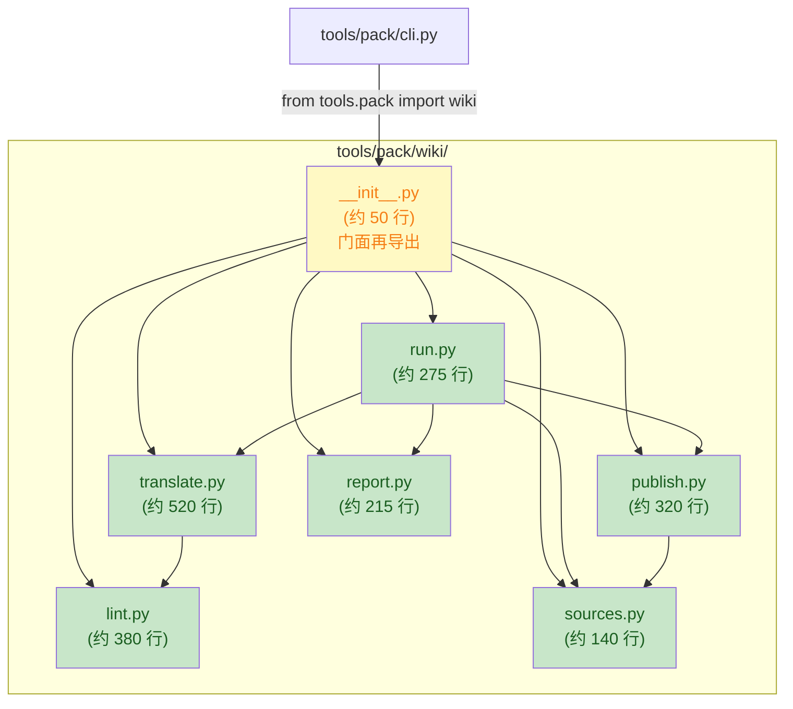

# big-module-split-2 wiki 计划-a：将 tools/pack/wiki.py 子包化

**波次**：wave-3（与 yxp 计划-d 并行）
**议题**：Gitee IKSFMQ（候选 P2）
**依赖**：无（独立于 editor 各波次）

## 目标

将单体文件 `tools/pack/wiki.py`（2149 行）转换为子包 `tools/pack/wiki/`，包含 6 个子模块 + 门面 `__init__.py`。每个文件都远低于 800 行。公开导入路径 `from tools.pack import wiki` 通过门面得以保留；使用方（`tools/pack/cli.py`、`tests/test_pack_wiki.py`、`tests/test_pack_wiki_lint.py`）无需任何改动。

## 非目标

- 改变 CLI 语义（`python -m tools.pack wiki --check --push --jobs N` 行为不变）。
- 改变 lint / 翻译 / 发布逻辑。
- 修改测试断言。

## 考虑过但否决的备选方案

**备选方案**：保持单文件，登记豁免。
**否决理由**：2149 行是阈值的 2.7 倍。AST 分析显示有 5 个以上不同的职责块（lint、sources、publish、translate、report、编排）。这正是多职责混合文件的定义（规则第 3.7 节：必须拆分）。

**备选方案**：拆成 3 个文件（lint / translate / 其余）。
**否决理由**："其余"这个桶仍会有约 1400 行。细粒度的 6 路拆分能让每个文件保持专注且低于 600 行。

## 子模块拆分（按 AST 职责块）

| 子模块 | 源码行 | 约大小 | 内容 |
|---|---|---|---|
| `__init__.py` | new | ~50 | 门面再导出 + docstring 例外说明 |
| `lint.py` | L174-L551 | ~380 | WikiError, lint engine/pool/bar, _lint_texts* |
| `sources.py` | L555-L694 | ~140 | WikiPage, _collect_*, collect_sources, _page_* |
| `publish.py` | L697-L858 + L1218-L1288 + L1721-L1822 | ~320 | run_git, manifest, prune, push, _publish_translations |
| `translate.py` | L878-L1202 + L1527-L1589 + L1825-L1996 | ~520 | _run_translate, translate_via_cmd, needs_translation, _run_batch, _translate_pending |
| `report.py` | L1291-L1524 | ~215 | _nav_documents, _PagePlan/Outcome, _ProgressBoard, resolve_jobs |
| `run.py` | L1593-L1717 + L1999-L2149 | ~275 | _prepare_pages, _PreparedPage, run() 入口点 |

所有文件 < 800 行。合计约 1900 行（各模块 import 带来少量额外开销）。

## 独占文件清单

| 文件 | 操作 |
|---|---|
| `tools/pack/wiki.py` | **删除**（由 `tools/pack/wiki/` 子包取代） |
| `tools/pack/wiki/__init__.py` | **新建**：门面再导出 |
| `tools/pack/wiki/lint.py` | **新建**：lint 流水线 |
| `tools/pack/wiki/sources.py` | **新建**：源码收集 |
| `tools/pack/wiki/publish.py` | **新建**：git/manifest/发布 |
| `tools/pack/wiki/translate.py` | **新建**：翻译执行 |
| `tools/pack/wiki/report.py` | **新建**：导航/进度 |
| `tools/pack/wiki/run.py` | **新建**：编排 + run() |
| `tests/test_architecture.py` | 从 `SIZE_EXEMPT_FILES` 中移除 `"tools/pack/wiki.py"` |
| `.trae/rules/architecture-boundaries.md` | 从 3.7 节中移除 `tools/pack/wiki.py` |

**不改动**：`tools/pack/cli.py`、`tools/pack/__init__.py`、`tools/pack/__main__.py`、`tests/test_pack_wiki.py`、`tests/test_pack_wiki_lint.py`。门面保留了导入路径。

## 详细改动

### 第 1 步：创建 `tools/pack/wiki/` 子包

创建目录及 7 个文件。每个文件都包含：

- `from __future__ import annotations` 作为第一行代码
- 仅含 ASCII 的模块 docstring
- 若记录日志则包含 `log = tracing.get_logger(__name__)`
- 仅使用绝对导入（不用 `from .lint import ...`；使用 `from tools.pack.wiki.lint import ...`）

**`__init__.py`**（门面）：

```python
"""Bilingual wiki publisher (``python -m tools.pack wiki``).

Collects .trae documents and bilingual guides, publishes them as
paired zh/en pages into the sibling ``<repo>.wiki`` git repository.

Package-root re-export note (architecture rules section 3.5): tools
packages normally keep ``__init__.py`` inert; this facade re-exports
the public API so the consumer path ``from tools.pack import wiki``
(used by ``tools/pack/cli.py`` and the test suite) stays unchanged
after the single-file-to-subpackage migration.
"""

from __future__ import annotations

from tools.pack.wiki.lint import (
    WikiError,
    reset_lint_engine_cache,
)
from tools.pack.wiki.run import run
from tools.pack.wiki.sources import WikiPage, collect_sources
from tools.pack.wiki.publish import (
    default_target,
    load_manifest,
    prune_orphan_pages,
    push_wiki,
    store_manifest,
)
from tools.pack.wiki.translate import needs_translation
from tools.pack.wiki.report import resolve_jobs

__all__ = [
    "WikiError",
    "WikiPage",
    "collect_sources",
    "default_target",
    "load_manifest",
    "needs_translation",
    "prune_orphan_pages",
    "push_wiki",
    "reset_lint_engine_cache",
    "resolve_jobs",
    "run",
    "store_manifest",
]
```

**包内导入**：每个子模块使用绝对导入（`from tools.pack.wiki.lint import ...`）。这满足 `test_no_relative_imports`（不允许 `from .X`）。

### 第 2 步：填充每个子模块

将 `tools/pack/wiki.py` 中的函数逐字复制到目标子模块。调整交叉引用：

- 调用其它子模块中函数的函数需要导入它们。例如：`run.py` 中的 `run()` 调用 `sources.py` 的 `collect_sources()`、`_prepare_pages()`（本地）、`translate.py` 的 `_translate_pending()` 等。
- 模块级常量（`MANIFEST_NAME`、lint 引擎缓存等）归入拥有它们的子模块。共享常量如有需要可放入一个小的 `_common.py`（但更推荐放在归属模块中再导入）。

### 第 3 步：删除 `tools/pack/wiki.py`

在所有函数复制完毕并验证 import 后，删除原文件。

### 第 4 步：创建 `tests/test_wiki_subpackage.py`

```python
"""Structural tests for the wiki subpackage."""

from __future__ import annotations

import ast
from pathlib import Path


def test_wiki_subpackage_no_relative_imports() -> None:
    """Every .py in tools/pack/wiki/ uses absolute imports only."""
    pkg = Path("tools/pack/wiki")
    for py in sorted(pkg.glob("*.py")):
        src = py.read_text(encoding="utf-8")
        tree = ast.parse(src)
        for node in ast.walk(tree):
            if isinstance(node, ast.ImportFrom):
                assert node.level == 0, (
                    f"{py}: relative import found: {ast.dump(node)}"
                )


def test_wiki_subpackage_all_files_under_threshold() -> None:
    """Every file in the subpackage is under 800 lines."""
    pkg = Path("tools/pack/wiki")
    for py in sorted(pkg.glob("*.py")):
        lines = len(py.read_text(encoding="utf-8").splitlines())
        assert lines <= 800, f"{py}: {lines} lines (over 800)"


def test_wiki_facade_preserves_import_path() -> None:
    """``from tools.pack import wiki`` still works after subpackage-ization."""
    from tools.pack import wiki
    assert hasattr(wiki, "run")
    assert hasattr(wiki, "collect_sources")
    assert hasattr(wiki, "default_target")
    assert hasattr(wiki, "WikiPage")
    assert hasattr(wiki, "WikiError")


def test_wiki_subpackage_ascii_comments() -> None:
    """All new files carry ASCII-only comments and docstrings."""
    pkg = Path("tools/pack/wiki")
    for py in sorted(pkg.glob("*.py")):
        src = py.read_text(encoding="utf-8")
        # The architecture guard test_comments_and_docstrings_stay_ascii
        # covers this; this test is a fast pre-check.
        for line in src.splitlines():
            stripped = line.lstrip()
            if stripped.startswith("#"):
                comment = stripped[1:].strip()
                # Allow ASCII + common Latin chars
                assert all(ord(c) < 0x2000 for c in comment), (
                    f"{py}: non-ASCII in comment: {comment!r}"
                )
```

### 第 5 步：从 `SIZE_EXEMPT_FILES` 中移除 `tools/pack/wiki.py`

**在 `tests/test_architecture.py` 中**：从 `SIZE_EXEMPT_FILES` 的 frozenset 中移除 `"tools/pack/wiki.py"`。

**在 `.trae/rules/architecture-boundaries.md` 中**：从 3.7 节豁免列表中移除 `tools/pack/wiki.py` 条目。

## 更正：monkeypatch 作用面接线（主代理，2026-11-04）

测试与单文件的模块全局命名空间相耦合（`from tools.pack import wiki` + `monkeypatch.setattr(wiki, ...)`）。拆分后，子模块内部的普通直接导入会使每一个 patch 失效：调用方保留自己的绑定，而测试所 patch 的门面属性永远不会被查询。证据（测试作用面，全部位于 `tests/test_pack_wiki*.py`）：被 patch 的名称包括 `translate_via_cmd`、`collect_sources`、`_get_lint_engine`、`_emit_mode`、`_drain_collected_failures`、`_STOP_POLL_S`、`TRANSLATE_TIMEOUT_S`、`PARALLEL_LINT_MIN_CHARS`、`subprocess`（整个模块被替换）、`ThreadPoolExecutor`、`job_ceiling`；直接引用的属性包括 `WikiError`、`WikiPage`、`Code`、`SECTION_GUIDES/PLANS/SETS/REVIEWS`、`BATCH_SIZE`、`PARALLEL_LINT_MIN_TEXTS`、`MANIFEST_NAME`、`Console`、`_feed_stdin`。"测试不变"这一硬性要求迫使：

1. **Patch 作用面规则**：枚举四个测试文件中的每一个 `monkeypatch.setattr(wiki, ...)` 目标以及每一处 `wiki.<attr>` 引用。每个被 patch 的名称都 (a) 由门面再导出，且 (b) 在子模块内部**通过后期绑定的门面**读取/调用，而非通过 from-import 绑定：需要它的子模块在顶部做模块对象导入（`import tools.pack.wiki as _wiki_facade`），调用点在调用时解析 `_wiki_facade.<name>`。对部分初始化的包做模块对象导入只会绑定模块对象、绝不会抛错（wave-1 的证据）。pyright 保持类型化：门面模块的属性可静态解析（不会退化为 `ModuleType`/Any），因此严格模式保持干净。
2. **导入纪律**：子模块是内部的；只有门面路径 `tools.pack.wiki` 是公开的（沿用 R14 中 `services/extensions/` 的先例）。直接 `import tools.pack.wiki.run` 可能因刻意引入的环而抛出 ImportError；在子包 docstring 中注明这一点。仓库或测试中没有任何地方直接导入子模块（2026-11-04 已核实）。
3. **门面覆盖**：`__all__`（加上显式再导出，私有名称以同名别名形式纳入以适配 pyright）必须覆盖测试引用的每一个属性；结构测试断言被 patch 的名称集合可从门面导入。
4. **行为裁决**：现有的行为测试原样运行且保持通过——它们是权威的回归网。CLI 冒烟（`python -m tools.pack wiki --help`，若有测试样本树则再执行一次 `--check`）保留在验收中。

## 裁决：源码结构守卫（主代理，2026-11-04）

`tests/test_pack_wiki_errors.py` 中有两个结构守卫，它们读取 `tools/pack/wiki.py` 的源码文本进行 AST 断言：`test_the_collect_policy_is_installed_inside_the_protected_region`（L784-L837）和 `test_every_drained_failure_is_rendered_the_same_way`（L840-L883）。删除该文件会无条件破坏这两个守卫，与"测试不变"的要求冲突。裁决：**选项 1，授权**——仅同步更新这两个守卫（路径字面量指向新的 translate 模块；drain-loop 的搜索范围可按需覆盖新的子包文件）。它们自身的 docstring 要求对等重构时同步更新，因此这不会削弱断言强度。四个文件中的其它测试保持不动，守卫的断言必须保持同等强度（相同的受保护区域检查、相同的"恰好 2" drain-loop 计数、相同的 markup/highlight 关键字检查）。

## 验收命令

```powershell
# 1. pyright strict -- zero diagnostics
.venv\Scripts\python.exe -m pyright tools/pack/wiki/ tools/pack/cli.py tests/test_wiki_subpackage.py

# 2. New structural tests pass
.venv\Scripts\python.exe -m pytest tests/test_wiki_subpackage.py -q

# 3. Existing wiki tests pass (no regression)
.venv\Scripts\python.exe -m pytest tests/test_pack_wiki.py tests/test_pack_wiki_lint.py -q

# 4. Full test suite
.venv\Scripts\python.exe -m pytest tests/ -q -n auto

# 5. Architecture tests
.venv\Scripts\python.exe -m pytest tests/test_architecture.py -q

# 6. CLI still works
.venv\Scripts\python.exe -m tools.pack wiki --help

# 7. Line counts (all files < 800)
.venv\Scripts\python.exe -c "from pathlib import Path; [print(f'{p}: {len(p.read_text().splitlines())}') for p in sorted(Path('tools/pack/wiki').glob('*.py'))]"
```

## 风险评估

| 风险 | 影响 | 缓解措施 |
|---|---|---|
| 子模块之间的循环导入 | 导入失败 | 仔细安排依赖顺序；`__init__.py` 最后导入 |
| 门面缺少公开名称 | 使用方失效 | `__all__` 列出所有公开名称；结构测试验证 |
| 意外引入相对导入 | `test_no_relative_imports` 失败 | 结构测试预先检查；所有导入使用 `from tools.pack.wiki.X` |
| 测试导入路径失效 | 测试失败 | 门面保留 `from tools.pack import wiki` |

## 回滚路径

删除 `tools/pack/wiki/` 目录，从 git 恢复 `tools/pack/wiki.py`。恢复 `SIZE_EXEMPT_FILES` 条目。

## Mermaid：wave-3 之后的模块结构



## 涉及的架构规则

- **test_no_relative_imports**：所有包内导入使用绝对路径（`from tools.pack.wiki.lint import ...`）。
- **test_comments_and_docstrings_stay_ascii**：所有新文件仅含 ASCII 注释/docstring。
- **test_source_files_within_size_threshold**：所有子文件 < 800 行；`tools/pack/wiki.py` 已从豁免列表移除。
- **test_no_debug_prints_in_library_modules**：`tools/` 不在扫描范围内（仅扫描 `yate/`），因此 tools/pack/ 中的 `print()` 是可接受的。但我们沿用既有模式，只在面向 CLI 的代码中使用 `print()`。
