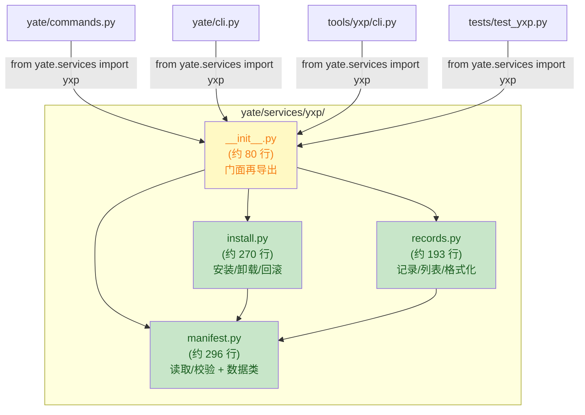

# big-module-split-2 yxp 计划-a：将 yate/services/yxp.py 子包化

**波次**：wave-3（与 wiki 计划-c 并行）
**议题**：Gitee IKSFMQ（候选 P3）
**依赖**：无（独立于 editor 各波次）

## 目标

将 `yate/services/yxp.py`（841 行）转换为子包 `yate/services/yxp/`，包含 3 个子模块 + 门面 `__init__.py`。公开导入路径 `from yate.services import yxp`（以及 `from yate.services.yxp import YxpError` 等）通过门面得以保留；使用方（`yate/commands.py`、`yate/cli.py`、`tools/yxp/cli.py`、`tests/test_yxp.py`、`tests/test_tools_yxp.py`、`tests/test_cli.py`）无需任何改动。

## 非目标

- 改变安装/卸载/读取/列表逻辑。
- 修改测试断言（尤其是近期 symlink/casefold 审计中经过安全加固的测试）。
- 改变公开 API 表面。

## 考虑过但否决的备选方案

**备选方案**：保持单文件，维持豁免。
**否决理由**：841 行刚好略高于 800 行阈值。AST 分析显示有 3 个不同的职责块（读取/校验、安装/回滚、记录/列表）。安全加固刚完成；按清晰边界拆分风险低，并可取消豁免。

**备选方案**：拆成 2 个文件（读取+安装 / 记录+列表）。
**否决理由**：安装块（374-643，约 270 行）加上读取块（142-368，约 227 行）在一个文件中将达到约 500 行。三路拆分更清晰，且每个文件都远低于 400 行。

## 子模块拆分（按 AST 职责块）

| 子模块 | 源码行 | 约大小 | 内容 |
|---|---|---|---|
| `__init__.py` | new | ~80 | 门面再导出 + docstring 例外说明 |
| `manifest.py` | L73-L368 | ~296 | YxpError, 常量, YxpManifest, YxpPackage, read_package, _parse_manifest, _check_*, _verify_digests |
| `install.py` | L374-L643 | ~270 | install_package, _extract_payload, _rollback_files, _restore_stale_files, _remove_stale_files, _write_record, uninstall_package |
| `records.py` | L649-L841 | ~193 | _Record, _parse_record, list_packages, format_*, _unlink_quietly, _prune_empty_parents |

所有文件 < 400 行。合计约 840 行（保留原始大小，各模块 import 带来少量额外开销）。

## 独占文件清单

| 文件 | 操作 |
|---|---|
| `yate/services/yxp.py` | **删除**（由 `yate/services/yxp/` 子包取代） |
| `yate/services/yxp/__init__.py` | **新建**：门面再导出 |
| `yate/services/yxp/manifest.py` | **新建**：读取/校验 + 数据类 |
| `yate/services/yxp/install.py` | **新建**：安装/卸载/回滚 |
| `yate/services/yxp/records.py` | **新建**：记录/列表/格式化 |
| `tests/test_yxp_subpackage.py` | **新建**：结构测试 |
| `tests/test_architecture.py` | 从 `SIZE_EXEMPT_FILES` 中移除 `"services/yxp.py"` |
| `.trae/rules/architecture-boundaries.md` | 从 3.7 节中移除 `services/yxp.py` |

**不改动**使用方：`yate/commands.py`、`yate/cli.py`、`tools/yxp/cli.py`、`tests/test_yxp.py`、`tests/test_tools_yxp.py`、`tests/test_cli.py`。门面保留了所有导入路径。

## 详细改动

### 第 1 步：创建 `yate/services/yxp/` 子包

**`__init__.py`**（门面）：

```python
"""Extension packages (``.yxp``): read, verify, install, uninstall, list.

A ``.yxp`` file is a zip archive holding extension payload plus
``manifest`` and ``checksum`` metadata members. See the submodules for
the implementation: :mod:`manifest` (read/verify), :mod:`install`
(install/uninstall/rollback), :mod:`records` (ownership records and
listing).

Package-root re-export exception note (architecture rules section 3.5):
UI and service packages normally must not re-export; this facade is a
registered exception -- the consumer path ``from yate.services import
yxp`` (and ``from yate.services.yxp import YxpError``) is used by
``yate/commands.py``, ``yate/cli.py``, ``tools/yxp/cli.py`` and the
test suite. The submodules are internal; consumers import from here.
"""

from __future__ import annotations

from yate.services.yxp.manifest import (
    CHECKSUM_NAME,
    MANIFEST_NAME,
    MAX_MEMBER_BYTES,
    MAX_PAYLOAD_BYTES,
    NAME_RE,
    RECORDS_DIRNAME,
    RECORD_SUFFIX,
    InstalledPackage,
    InstallReport,
    UninstallReport,
    YxpError,
    YxpManifest,
    YxpPackage,
    default_extensions_dir,
    read_package,
)
from yate.services.yxp.install import (
    install_package,
    uninstall_package,
)
from yate.services.yxp.records import (
    format_install_report,
    format_package_list,
    format_uninstall_report,
    list_packages,
)

__all__ = [
    "CHECKSUM_NAME",
    "INSTALLED_PACKAGES",
    "MANIFEST_NAME",
    "MAX_MEMBER_BYTES",
    "MAX_PAYLOAD_BYTES",
    "NAME_RE",
    "RECORDS_DIRNAME",
    "RECORD_SUFFIX",
    "InstalledPackage",
    "InstallReport",
    "UninstallReport",
    "YxpError",
    "YxpManifest",
    "YxpPackage",
    "default_extensions_dir",
    "format_install_report",
    "format_package_list",
    "format_uninstall_report",
    "install_package",
    "list_packages",
    "read_package",
    "uninstall_package",
]
```

### 第 2 步：填充子模块

**`manifest.py`**：从 `yxp.py` L1-L368 复制（模块 docstring、import、常量、数据类、read_package 及其辅助函数）。

**`install.py`**：复制 L374-L697（install_package、_extract_payload、_rollback_files、_restore_stale_files、_remove_stale_files、_write_record、uninstall_package）。从 `manifest.py` 导入：`YxpError`、`YxpPackage`、`YxpManifest`、`read_package`、`default_extensions_dir`、`RECORDS_DIRNAME`、`RECORD_SUFFIX`、`NAME_RE`、`MANIFEST_NAME`。

**`records.py`**：复制 L649-L841（_Record、_parse_record、_read_record_files、list_packages、_unlink_quietly、_prune_empty_parents、format_*）。从 `manifest.py` 导入：`YxpError`、`YxpManifest`、`InstalledPackage`、`RECORDS_DIRNAME`、`RECORD_SUFFIX`、`NAME_RE`、`default_extensions_dir`。从 `install.py` 导入：无（records 是只读的；install 使用 records）。

### 第 3 步：删除 `yate/services/yxp.py`

在所有函数复制完毕并验证 import 之后。

### 第 4 步：创建 `tests/test_yxp_subpackage.py`

```python
"""Structural tests for the yxp subpackage."""

from __future__ import annotations

import ast
from pathlib import Path


def test_yxp_subpackage_no_relative_imports() -> None:
    """Every .py in yate/services/yxp/ uses absolute imports only."""
    pkg = Path("yate/services/yxp")
    for py in sorted(pkg.glob("*.py")):
        src = py.read_text(encoding="utf-8")
        tree = ast.parse(src)
        for node in ast.walk(tree):
            if isinstance(node, ast.ImportFrom):
                assert node.level == 0, (
                    f"{py}: relative import found: {ast.dump(node)}"
                )


def test_yxp_subpackage_all_files_under_threshold() -> None:
    """Every file in the subpackage is under 800 lines."""
    pkg = Path("yate/services/yxp")
    for py in sorted(pkg.glob("*.py")):
        lines = len(py.read_text(encoding="utf-8").splitlines())
        assert lines <= 800, f"{py}: {lines} lines (over 800)"


def test_yxp_facade_preserves_import_path() -> None:
    """``from yate.services import yxp`` still works."""
    from yate.services import yxp
    assert hasattr(yxp, "read_package")
    assert hasattr(yxp, "install_package")
    assert hasattr(yxp, "uninstall_package")
    assert hasattr(yxp, "list_packages")
    assert hasattr(yxp, "YxpError")
    assert hasattr(yxp, "YxpManifest")
    assert hasattr(yxp, "YxpPackage")


def test_yxp_facade_direct_import() -> None:
    """``from yate.services.yxp import YxpError`` still works."""
    from yate.services.yxp import YxpError, YxpManifest, read_package
    assert YxpError is not None
    assert YxpManifest is not None
    assert read_package is not None


def test_yxp_subpackage_ascii_comments() -> None:
    """All new files carry ASCII-only comments and docstrings."""
    pkg = Path("yate/services/yxp")
    for py in sorted(pkg.glob("*.py")):
        src = py.read_text(encoding="utf-8")
        for line in src.splitlines():
            stripped = line.lstrip()
            if stripped.startswith("#"):
                comment = stripped[1:].strip()
                assert all(ord(c) < 0x2000 for c in comment), (
                    f"{py}: non-ASCII in comment: {comment!r}"
                )
```

### 第 5 步：从 `SIZE_EXEMPT_FILES` 中移除 `services/yxp.py`

**在 `tests/test_architecture.py` 中**：从 `SIZE_EXEMPT_FILES` 的 frozenset 中移除 `"services/yxp.py"`。

**在 `.trae/rules/architecture-boundaries.md` 中**：从 3.7 节豁免列表中移除 `services/yxp.py` 条目。

## 更正：patch 作用面、日志名、门面全览（主代理，2026-11-04）

1. **日志名冻结**：`tests/test_yxp.py:590` 断言 logger 名为 `"yate.services.yxp"` 的 caplog 记录。拆分后，子模块中的 `__name__` 为 `yate.services.yxp.manifest` 等，断言会失效。修复：每个子模块都用显式冻结的名称创建其 logger（`log = tracing.get_logger("yate.services.yxp")`），并在子包 docstring 中注明。这是对 R12 的 `__name__` 惯例的接线偏离，由"测试断言不变"所迫使。
2. **Patch 作用面**：`tests/test_yxp.py` patch 了 `yxp._write_record`（L346、L365）、`yxp.read_package`（L392）和 `yxp.os.replace`（L419，stdlib 全局，无接缝）；`tests/test_tools_yxp.py` 与 `tests/test_cli.py` 通过字符串 patch `"yate.services.yxp.uninstall_package"`。规则：枚举 yxp 测试文件中的每一个 `monkeypatch.setattr(yxp, ...)` 目标以及每一处 `yxp.<attr>` / 字符串 patch 引用；每个被 patch 的名称都由门面再导出，并且其在子模块内部的调用方**在调用时通过后期绑定的门面查找来解析**——对 yxp 而言，是在调用函数内部做函数级的 `from yate.services import yxp as _facade`（作用面有限：install_package 是主要调用方）。门面路径上的字符串 patch 之所以仍然有效，是因为调用方在调用时做属性查找（`yxp.uninstall_package(...)`）。
3. **门面 `__all__` 一致性**：草稿的 `__all__` 列出了 `INSTALLED_PACKAGES`，但 import 块中遗漏了它。对齐方法：枚举原模块的公开名称，加上 tests/CLI 中的每一处 `yxp.<attr>` 引用；`__all__` 必须精确等于已再导出、可导入的集合。结构测试断言每个 `__all__` 名称都能在门面上解析。
4. **子模块是内部的**（沿用 R14 先例）：只有 `yate.services.yxp` 是公开的；直接 `import yate.services.yxp.install` 可能因刻意引入的环而抛出 ImportError；没有任何地方直接导入子模块（2026-11-04 已核实）。在子包 docstring 中注明这一点。

## 验收命令

```powershell
# 1. pyright strict -- zero diagnostics
.venv\Scripts\python.exe -m pyright yate/services/yxp/ yate/commands.py yate/cli.py tests/test_yxp_subpackage.py

# 2. New structural tests pass
.venv\Scripts\python.exe -m pytest tests/test_yxp_subpackage.py -q

# 3. Existing yxp tests pass (no regression -- critical for security hardening)
.venv\Scripts\python.exe -m pytest tests/test_yxp.py tests/test_tools_yxp.py -q

# 4. CLI tests (yxp commands)
.venv\Scripts\python.exe -m pytest tests/test_cli.py -q -k "yxp or extension"

# 5. Full test suite
.venv\Scripts\python.exe -m pytest tests/ -q -n auto

# 6. Architecture tests
.venv\Scripts\python.exe -m pytest tests/test_architecture.py -q

# 7. Line counts
.venv\Scripts\python.exe -c "from pathlib import Path; [print(f'{p}: {len(p.read_text().splitlines())}') for p in sorted(Path('yate/services/yxp').glob('*.py'))]"
```

## 风险评估

| 风险 | 影响 | 缓解措施 |
|---|---|---|
| 子模块之间的循环导入 | 导入失败 | `records.py` 不从 `install.py` 导入；`install.py` 仅从 `manifest.py` 导入 |
| 门面缺少公开名称 | 使用方失效 | `__all__` 列出使用方用到的所有名称；结构测试验证 |
| 安全测试回归 | 加固行为被破坏 | 函数逐字复制；所有现有测试原样运行 |
| `test_leaf_package_reexports_carry_exception_note` 标记门面 | 架构测试失败 | docstring 带有例外说明（见上文门面代码） |

## 回滚路径

删除 `yate/services/yxp/` 目录，从 git 恢复 `yate/services/yxp.py`。恢复 `SIZE_EXEMPT_FILES` 条目。

## Mermaid：wave-3 之后的模块结构



## 涉及的架构规则

- **R4**：`services/*` 不得导入 `editor_components`。新子模块保持无 UI（不导入 editor_components）。
- **R14 先例**：门面模式沿用 `services/extensions/__init__.py`（冻结的公开名称、docstring 例外说明）。
- **第 3.5 节**：包 `__init__.py` 的再导出例外说明写在 docstring 中（如同 `services/extensions/__init__.py`）。
- **test_no_relative_imports**：所有包内导入使用绝对路径（`from yate.services.yxp.manifest import ...`）。
- **test_comments_and_docstrings_stay_ascii**：所有新文件仅含 ASCII 注释/docstring。
- **test_source_files_within_size_threshold**：所有子文件 < 800 行；`services/yxp.py` 已从豁免列表移除。
- **test_leaf_package_reexports_carry_exception_note**：门面 docstring 带有例外说明。
- **R12**：新模块使用 `log = tracing.get_logger(__name__)`。
