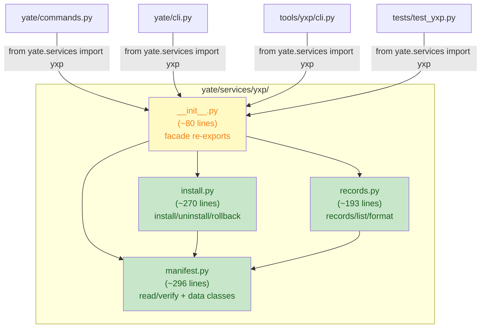

# big-module-split-2 yxp plan-a: subpackage-ize yate/services/yxp.py

**Wave**: wave-3 (parallel with wiki plan-c)
**Issue**: Gitee IKSFMQ (candidate P3)
**Depends on**: nothing (independent of editor waves)

## Goal

Convert `yate/services/yxp.py` (841 lines) into a subpackage
`yate/services/yxp/` with 3 submodules + facade `__init__.py`. The
public import path `from yate.services import yxp` (and
`from yate.services.yxp import YxpError` etc.) is preserved via the
facade; consumers (`yate/commands.py`, `yate/cli.py`,
`tools/yxp/cli.py`, `tests/test_yxp.py`, `tests/test_tools_yxp.py`,
`tests/test_cli.py`) require zero changes.

## Non-goals

- Changing the install/uninstall/read/list logic.
- Modifying test assertions (especially the security-hardened tests
  from the recent symlink/casefold audit).
- Changing the public API surface.

## Alternative considered and rejected

**Alternative**: Keep as single file, maintain exemption.
**Rejected**: At 841 lines it is just over the 800-line threshold. The
AST analysis shows 3 distinct responsibility blocks (read/verify,
install/rollback, records/list). The security hardening is fresh;
splitting by clean boundaries is low-risk and removes the exemption.

**Alternative**: Split into 2 files (read+install / records+list).
**Rejected**: The install block (374-643, ~270 lines) plus the read
block (142-368, ~227 lines) would be ~500 lines in one file. Three-way
split is cleaner and each file is well under 400 lines.

## Submodule split (by AST responsibility blocks)

| Submodule | Source lines | Approx. size | Content |
|---|---|---|---|
| `__init__.py` | new | ~80 | Facade re-exports + docstring exception note |
| `manifest.py` | L73-L368 | ~296 | YxpError, constants, YxpManifest, YxpPackage, read_package, _parse_manifest, _check_*, _verify_digests |
| `install.py` | L374-L643 | ~270 | install_package, _extract_payload, _rollback_files, _restore_stale_files, _remove_stale_files, _write_record, uninstall_package |
| `records.py` | L649-L841 | ~193 | _Record, _parse_record, list_packages, format_*, _unlink_quietly, _prune_empty_parents |

All files < 400 lines. Total ~840 lines (original size preserved with
small overhead for per-module imports).

## Exclusive file list

| File | Action |
|---|---|
| `yate/services/yxp.py` | **DELETE** (replaced by `yate/services/yxp/` subpackage) |
| `yate/services/yxp/__init__.py` | **NEW**: facade re-exports |
| `yate/services/yxp/manifest.py` | **NEW**: read/verify + data classes |
| `yate/services/yxp/install.py` | **NEW**: install/uninstall/rollback |
| `yate/services/yxp/records.py` | **NEW**: records/list/format |
| `tests/test_yxp_subpackage.py` | **NEW**: structural tests |
| `tests/test_architecture.py` | Remove `"services/yxp.py"` from `SIZE_EXEMPT_FILES` |
| `.trae/rules/architecture-boundaries.md` | Remove `services/yxp.py` from section 3.7 |

**No changes** to consumers: `yate/commands.py`, `yate/cli.py`,
`tools/yxp/cli.py`, `tests/test_yxp.py`, `tests/test_tools_yxp.py`,
`tests/test_cli.py`. The facade preserves all import paths.

## Detailed changes

### Step 1: Create `yate/services/yxp/` subpackage

**`__init__.py`** (facade):

```python
"""Extension packages (``.yxp``): read, verify, install, uninstall, list.

A ``.yxp`` file is a zip archive holding extension payload plus
``manifest`` and ``checksum`` metadata members. See the submodules for
the implementation: :mod:`manifest` (read/verify), :mod:`install`
(install/uninstall/rollback), :mod:`records` (ownership records and
listing).

Package-root re-export exception note (architecture rules section 3.5):
UI and service packages normally must not re-export; this facade is a
registered exception -- the consumer path ``from yate.services import
yxp`` (and ``from yate.services.yxp import YxpError``) is used by
``yate/commands.py``, ``yate/cli.py``, ``tools/yxp/cli.py`` and the
test suite. The submodules are internal; consumers import from here.
"""

from __future__ import annotations

from yate.services.yxp.manifest import (
    CHECKSUM_NAME,
    MANIFEST_NAME,
    MAX_MEMBER_BYTES,
    MAX_PAYLOAD_BYTES,
    NAME_RE,
    RECORDS_DIRNAME,
    RECORD_SUFFIX,
    InstalledPackage,
    InstallReport,
    UninstallReport,
    YxpError,
    YxpManifest,
    YxpPackage,
    default_extensions_dir,
    read_package,
)
from yate.services.yxp.install import (
    install_package,
    uninstall_package,
)
from yate.services.yxp.records import (
    format_install_report,
    format_package_list,
    format_uninstall_report,
    list_packages,
)

__all__ = [
    "CHECKSUM_NAME",
    "INSTALLED_PACKAGES",
    "MANIFEST_NAME",
    "MAX_MEMBER_BYTES",
    "MAX_PAYLOAD_BYTES",
    "NAME_RE",
    "RECORDS_DIRNAME",
    "RECORD_SUFFIX",
    "InstalledPackage",
    "InstallReport",
    "UninstallReport",
    "YxpError",
    "YxpManifest",
    "YxpPackage",
    "default_extensions_dir",
    "format_install_report",
    "format_package_list",
    "format_uninstall_report",
    "install_package",
    "list_packages",
    "read_package",
    "uninstall_package",
]
```

### Step 2: Populate submodules

**`manifest.py`**: Copy from `yxp.py` L1-L368 (module docstring,
imports, constants, data classes, read_package and its helpers).

**`install.py`**: Copy L374-L697 (install_package, _extract_payload,
_rollback_files, _restore_stale_files, _remove_stale_files,
_write_record, uninstall_package). Imports from `manifest.py`:
`YxpError`, `YxpPackage`, `YxpManifest`, `read_package`,
`default_extensions_dir`, `RECORDS_DIRNAME`, `RECORD_SUFFIX`,
`NAME_RE`, `MANIFEST_NAME`.

**`records.py`**: Copy L649-L841 (_Record, _parse_record,
_read_record_files, list_packages, _unlink_quietly,
_prune_empty_parents, format_*). Imports from `manifest.py`:
`YxpError`, `YxpManifest`, `InstalledPackage`, `RECORDS_DIRNAME`,
`RECORD_SUFFIX`, `NAME_RE`, `default_extensions_dir`. Imports from
`install.py`: none (records is read-only; install uses records).

### Step 3: Delete `yate/services/yxp.py`

After all functions are copied and imports verified.

### Step 4: Create `tests/test_yxp_subpackage.py`

```python
"""Structural tests for the yxp subpackage."""

from __future__ import annotations

import ast
from pathlib import Path


def test_yxp_subpackage_no_relative_imports() -> None:
    """Every .py in yate/services/yxp/ uses absolute imports only."""
    pkg = Path("yate/services/yxp")
    for py in sorted(pkg.glob("*.py")):
        src = py.read_text(encoding="utf-8")
        tree = ast.parse(src)
        for node in ast.walk(tree):
            if isinstance(node, ast.ImportFrom):
                assert node.level == 0, (
                    f"{py}: relative import found: {ast.dump(node)}"
                )


def test_yxp_subpackage_all_files_under_threshold() -> None:
    """Every file in the subpackage is under 800 lines."""
    pkg = Path("yate/services/yxp")
    for py in sorted(pkg.glob("*.py")):
        lines = len(py.read_text(encoding="utf-8").splitlines())
        assert lines <= 800, f"{py}: {lines} lines (over 800)"


def test_yxp_facade_preserves_import_path() -> None:
    """``from yate.services import yxp`` still works."""
    from yate.services import yxp
    assert hasattr(yxp, "read_package")
    assert hasattr(yxp, "install_package")
    assert hasattr(yxp, "uninstall_package")
    assert hasattr(yxp, "list_packages")
    assert hasattr(yxp, "YxpError")
    assert hasattr(yxp, "YxpManifest")
    assert hasattr(yxp, "YxpPackage")


def test_yxp_facade_direct_import() -> None:
    """``from yate.services.yxp import YxpError`` still works."""
    from yate.services.yxp import YxpError, YxpManifest, read_package
    assert YxpError is not None
    assert YxpManifest is not None
    assert read_package is not None


def test_yxp_subpackage_ascii_comments() -> None:
    """All new files carry ASCII-only comments and docstrings."""
    pkg = Path("yate/services/yxp")
    for py in sorted(pkg.glob("*.py")):
        src = py.read_text(encoding="utf-8")
        for line in src.splitlines():
            stripped = line.lstrip()
            if stripped.startswith("#"):
                comment = stripped[1:].strip()
                assert all(ord(c) < 0x2000 for c in comment), (
                    f"{py}: non-ASCII in comment: {comment!r}"
                )
```

### Step 5: Remove `services/yxp.py` from `SIZE_EXEMPT_FILES`

**In `tests/test_architecture.py`**: Remove `"services/yxp.py"` from
the `SIZE_EXEMPT_FILES` frozenset.

**In `.trae/rules/architecture-boundaries.md`**: Remove the
`services/yxp.py` entry from section 3.7 exemption list.

## Correction: patch surface, logger name, facade all (main-agent, 2026-11-04)

1. **Logger-name freeze**: `tests/test_yxp.py:590` asserts caplog
   records on logger name `"yate.services.yxp"`. After the split,
   `__name__` in submodules is `yate.services.yxp.manifest` etc. and
   the assertions would break. Fix: every submodule creates its logger
   with the explicit frozen name
   (`log = tracing.get_logger("yate.services.yxp")`), noted in the
   subpackage docstring. This is a wiring deviation from R12's
   `__name__` convention, forced by unchanged test assertions.
2. **Patch surface**: `tests/test_yxp.py` patches `yxp._write_record`
   (L346, L365), `yxp.read_package` (L392) and `yxp.os.replace`
   (L419, stdlib-global, seam-free); `tests/test_tools_yxp.py` and
   `tests/test_cli.py` patch `"yate.services.yxp.uninstall_package"`
   via string. Rule: enumerate every `monkeypatch.setattr(yxp, ...)`
   target and every `yxp.<attr>` / string-patch reference in the yxp
   test files; every patched name is re-exported by the facade AND its
   callers inside submodules resolve it **via a late-bound facade
   lookup at call time** -- for yxp, a function-level
   `from yate.services import yxp as _facade` inside the calling
   function (bounded surface: install_package is the main caller).
   String patches on the facade path keep working because callers do
   attribute lookup at call time (`yxp.uninstall_package(...)`).
3. **Facade `__all__` consistency**: the draft `__all__` lists
   `INSTALLED_PACKAGES` but the import block omits it. Reconcile:
   enumerate the original module's public names plus every
   `yxp.<attr>` reference in tests/CLI; `__all__` must exactly equal
   the re-exported, importable set. The structural test asserts every
   `__all__` name resolves on the facade.
4. **Submodules are internal** (R14 precedent): only
   `yate.services.yxp` is public; a direct
   `import yate.services.yxp.install` may raise ImportError due to the
   intentional cycle; nothing imports submodules directly (verified
   2026-11-04). Note it in the subpackage docstring.

## Verification commands

```powershell
# 1. pyright strict -- zero diagnostics
.venv\Scripts\python.exe -m pyright yate/services/yxp/ yate/commands.py yate/cli.py tests/test_yxp_subpackage.py

# 2. New structural tests pass
.venv\Scripts\python.exe -m pytest tests/test_yxp_subpackage.py -q

# 3. Existing yxp tests pass (no regression -- critical for security hardening)
.venv\Scripts\python.exe -m pytest tests/test_yxp.py tests/test_tools_yxp.py -q

# 4. CLI tests (yxp commands)
.venv\Scripts\python.exe -m pytest tests/test_cli.py -q -k "yxp or extension"

# 5. Full test suite
.venv\Scripts\python.exe -m pytest tests/ -q -n auto

# 6. Architecture tests
.venv\Scripts\python.exe -m pytest tests/test_architecture.py -q

# 7. Line counts
.venv\Scripts\python.exe -c "from pathlib import Path; [print(f'{p}: {len(p.read_text().splitlines())}') for p in sorted(Path('yate/services/yxp').glob('*.py'))]"
```

## Risk assessment

| Risk | Impact | Mitigation |
|---|---|---|
| Circular import between submodules | Import fails | `records.py` does not import from `install.py`; `install.py` imports from `manifest.py` only |
| Missing public name in facade | Consumer breaks | `__all__` lists all names used by consumers; structural test verifies |
| Security test regression | Hardened behavior breaks | Functions are copied verbatim; all existing tests run unchanged |
| `test_leaf_package_reexports_carry_exception_note` flags facade | Architecture test fails | Docstring carries the exception note (see facade code above) |

## Rollback path

Delete `yate/services/yxp/` directory, restore `yate/services/yxp.py`
from git. Restore `SIZE_EXEMPT_FILES` entries.

## Mermaid: module structure after wave-3



## Architecture rules touched

- **R4**: `services/*` must not import `editor_components`. The new
  submodules stay UI-free (no editor_components imports).
- **R14 precedent**: The facade pattern follows
  `services/extensions/__init__.py` (frozen public names, docstring
  exception note).
- **Section 3.5**: Package `__init__.py` re-export exception note in
  docstring (like `services/extensions/__init__.py`).
- **test_no_relative_imports**: All intra-package imports use absolute
  paths (`from yate.services.yxp.manifest import ...`).
- **test_comments_and_docstrings_stay_ascii**: All new files carry
  ASCII-only comments/docstrings.
- **test_source_files_within_size_threshold**: All sub-files < 800
  lines; `services/yxp.py` removed from exemption list.
- **test_leaf_package_reexports_carry_exception_note**: The facade
  docstring carries the exception note.
- **R12**: New modules use `log = tracing.get_logger(__name__)`.
