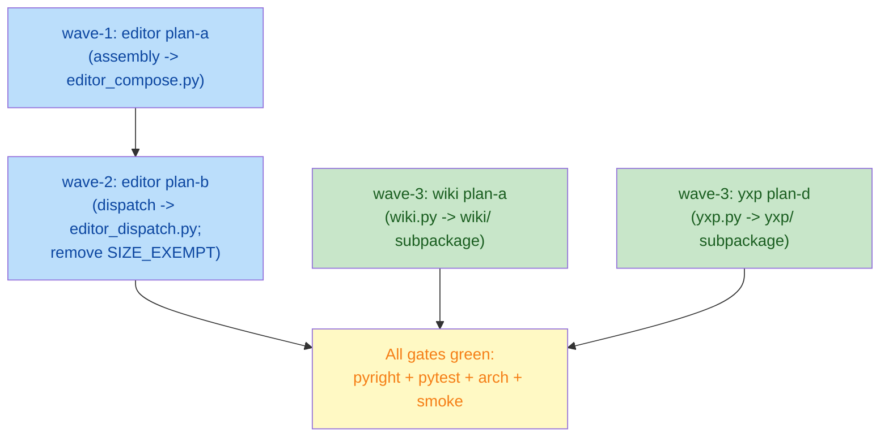

# big-module-split-2 -- split oversized modules by single-duty principle

Gitee issue IKSFMQ: split modules exceeding the 800-line threshold (rules
section 3.7 / A11) by the single-duty principle. Three candidates were
identified; this plan covers all three.

## Goals

1. Split `yate/editor.py` (1275 lines) into `editor_compose.py` (assembly
   factories) + `editor_dispatch.py` (key/mouse dispatch) + slimmed
   `editor.py` (orchestration + operations).
2. Subpackage-ize `tools/pack/wiki.py` (2149 lines) into
   `tools/pack/wiki/` (lint / sources / publish / translate / report / run).
3. Subpackage-ize `yate/services/yxp.py` (841 lines) into
   `yate/services/yxp/` (manifest / install / records) with a re-export
   facade preserving the `yate.services.yxp` import path.
4. Remove the three entries from `SIZE_EXEMPT_FILES` (both the rule text
   section 3.7 and `tests/test_architecture.py`) once each split lands.

## Non-goals

- Splitting `keymaps/vim.py` (1480 lines), `editor_core/buffer.py`
  (1565 lines), `editor_components/file_manager/screen.py` (963 lines),
  `editor_syntax/langdefs.py` (841 lines) -- all single-duty, remain
  exempt (issue explicitly excludes them).
- Observing the 700-800 line "watch list" modules (`emulator.py`,
  `pty_proc.py`, `ts_backend/backend.py`, `manual.py`,
  `editor_lsp/manager.py`, `tools/smoke_test/harness.py`,
  `yaterc_options.py`, `logs.py`) -- out of scope.
- Behavior changes. Every split is move-only + re-wiring; no logic
  rewrites. Existing regression tests keep their assertions unchanged.

## Current line counts (splitlines口径, 2026-11-04 re-measured)

| File | Lines | Exempt | Target after split |
|---|---|---|---|
| `yate/editor.py` | 1275 | yes | < 800 (remove exempt) |
| `tools/pack/wiki.py` | 2149 | yes | each sub-file < 800 (remove exempt) |
| `yate/services/yxp.py` | 841 | yes | each sub-file < 800 (remove exempt) |

## Sub-plan index

| Sub-plan | Wave | File | Scope |
|---|---|---|---|
| [plan-a](big-module-split-2-editor-plan-a.md) | wave-1 | `yate/editor.py` | Extract assembly factories into `editor_compose.py` |
| [plan-b](big-module-split-2-editor-plan-b.md) | wave-2 | `yate/editor.py` | Extract key/mouse dispatch into `editor_dispatch.py`; remove exemption |
| [plan-c](big-module-split-2-wiki-plan-a.md) | wave-3 | `tools/pack/wiki.py` | Subpackage-ize into `tools/pack/wiki/` |
| [plan-d](big-module-split-2-yxp-plan-a.md) | wave-3 | `yate/services/yxp.py` | Subpackage-ize into `yate/services/yxp/` |

## Execution wave table

| Wave | Sub-plans | Dependency | File overlap |
|---|---|---|---|
| wave-1 | editor plan-a | none | `editor.py` + new `editor_compose.py` |
| wave-2 | editor plan-b | wave-1 (needs post-plan-a `editor.py`) | `editor.py` + new `editor_dispatch.py` |
| wave-3 | wiki plan-a || yxp plan-d | wiki and yxp are independent; no overlap with editor files |

Wave-3 members run in parallel (different files, no overlap).

## Dependency graph (Mermaid)



## Architecture rules touched

- **R5**: `editor.py` must not import `actions` / `commands` (reverse
  direction). The new `editor_compose.py` and `editor_dispatch.py` are
  module-level function collections parameterized by `ed: Editor`; they
  never import `actions` / `commands` directly.
- **R9**: Widget IDs stay assigned by the assembly code; `app.tcss`
  selectors are unchanged.
- **R11**: `editor_dispatch.py` is a new top-level `yate/` module. The
  guard `test_flow_modules_hold_no_app_handle` scans `yate/*.py`
  top-level (excluding `editor.py`); the new module must NOT contain
  `self.app` attribute chains. All dispatch functions take `ed: Editor`
  as a parameter.
- **R12**: New modules use `log = tracing.get_logger(__name__)`.
- **R14 precedent**: The `yxp` subpackage-ization follows the
  `services/extensions/` facade pattern (frozen public names, docstring
  exception note).
- **Section 3.5**: Package `__init__.py` inertia. `yxp/__init__.py`
  re-exports all public names (consumer path preservation); the
  docstring must carry the exception note (like
  `services/extensions/__init__.py`).
- **test_no_relative_imports**: All intra-package imports use absolute
  paths (`from yate.services.yxp.manifest import ...`).
- **test_comments_and_docstrings_stay_ascii**: All new files carry
  ASCII-only comments and docstrings.
- **test_source_files_within_size_threshold**: After each wave, the
  affected files must be < 800 lines; `SIZE_EXEMPT_FILES` shrinks.

## Global verification commands (after each wave)

```powershell
# pyright strict -- zero diagnostics
.venv\Scripts\python.exe -m pyright yate/ tests/ tools/

# full test suite
.venv\Scripts\python.exe -m pytest tests/ -q -n auto

# architecture tests (37 cases)
.venv\Scripts\python.exe -m pytest tests/test_architecture.py -q

# smoke test (after wave-2 and wave-3)
.venv\Scripts\python.exe -m tools.smoke_test run --jobs 4

# coverage gate
.venv\Scripts\python.exe -m pytest tests/ -q -n auto --cov=yate --cov-fail-under=75
```

## Deviation from issue

The issue text (dated 2026-11-02) reports `editor.py` at 1275 lines,
`tools/pack/wiki.py` at 2149 lines, `yate/services/yxp.py` at 841 lines.
Re-measured on 2026-11-04 with `splitlines()` (the guard's口径):
**all three match exactly**. No deviation.

The issue suggests `editor_compose.py` for wave-a and a separate
dispatch module for wave-b. This plan follows that direction. The issue
suggests `tools/pack/wiki/` subpackage with `lint.py / sources.py /
publish.py / translate.py / report.py`; this plan refines the split
based on actual AST analysis (see wiki sub-plan for the refined file
list). The issue suggests `yate/services/yxp/` with `manifest.py /
install.py / records.py`; this plan follows that direction.

## Execution record (2026-11-04, closed loop)

| Wave | Plan | Outcome | Commit |
|---|---|---|---|
| plans | overview + 4 sub-plans | landed, import-cycle wiring corrected by main agent | plans commit + ebe401e / 651a5b8 (corrections) |
| wave-1 | editor plan-a | `_build_*` factories -> `editor_compose.py`; editor.py 1275 -> 959; `_LAYER_RANKS` +L3 | af92c07 |
| wave-2 | editor plan-b | dispatch methods -> `editor_dispatch.py`; editor.py 959 -> 800; exemption dropped; `execute_action` fallback per plan pre-authorization | 6c48dc2 |
| wave-3 | wiki plan-a | 2149-line wiki.py -> 7-file subpackage, facade with 48-name `__all__`, late-bound patch surface | a71c0da |
| wave-3 | yxp plan-a | 841-line yxp.py -> 4-file subpackage, facade `__all__` 26 names == PATCH_SURFACE, frozen logger name | 6c0b31d |
| governance | rule + guard sync | SIZE_EXEMPT_FILES drops 3 entries; rule text 3.7 exemption register shrunk, closed list extended; R12 gains the frozen-logger-name exception note | e3b3009 + final |

Review (code-review-expert): **APPROVE** -- 0 blocker, 0 major,
3 minor, 3 nit. 150 moved symbols verified byte-identical by AST
body-dump. Fixups applied after review: dead escape clause removed in
`tests/test_wiki_subpackage.py:138`; R12 exception note added.

Registered follow-ups (non-blocking, out of this branch's scope):

- `yate/editor.py` sits at exactly 800 lines (guard uses `>`), zero
  headroom -- any later addition re-triggers the size guard until a
  further extraction lands.
- `tests/test_app_panes.py` has a pre-existing empty-snapshot hole
  (L168-197): when `panes.all_views()` snapshots empty, the settle
  polling passes vacuously and the test crashes at `views[0]`; seen
  once under full-suite parallel load, 0/10 solo, full rerun green.
  Fix: guard the settle loop with `views and ...`.
- Coverage scope note: the gate is yate-only by config
  (`source = ["yate"]`). An early run that also counted `tools/`
  reported 83.54% -- a mixed-scope figure, not a regression.
  Re-measured 2026-11-04 with the CI command
  (`--cov=yate --cov-branch`): **92.90%** (19366 stmts / 1087 miss,
  6190 branches / 578 partial).

Final gates on HEAD (all exit 0): pyright strict 0 diagnostics;
`pytest tests/ -q -n auto` green; architecture tests 37 passed;
coverage 92.90% (>= 75, yate-only); smoke 121/121 scenarios, 1463/1463 checks;
`python -m tools.pack wiki --help` unchanged.
