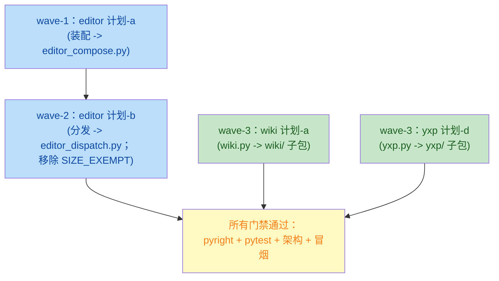

# big-module-split-2 —— 按单一职责原则拆分超大模块

Gitee 议题 IKSFMQ：按单一职责原则拆分超过 800 行阈值的模块（规则第 3.7 节 / A11）。已识别出三个候选；本计划覆盖全部三个。

## 目标

1. 将 `yate/editor.py`（1275 行）拆分为 `editor_compose.py`（装配工厂）+ `editor_dispatch.py`（按键/鼠标分发）+ 精简后的 `editor.py`（编排 + 操作）。
2. 将 `tools/pack/wiki.py`（2149 行）子包化为 `tools/pack/wiki/`（lint / sources / publish / translate / report / run）。
3. 将 `yate/services/yxp.py`（841 行）子包化为 `yate/services/yxp/`（manifest / install / records），并以再导出门面保留 `yate.services.yxp` 导入路径。
4. 每次拆分落地后，从 `SIZE_EXEMPT_FILES` 中移除对应条目（规则文本第 3.7 节与 `tests/test_architecture.py` 均移除）。

## 非目标

- 拆分 `keymaps/vim.py`（1480 行）、`editor_core/buffer.py`（1565 行）、`editor_components/file_manager/screen.py`（963 行）、`editor_syntax/langdefs.py`（841 行）——它们均为单一职责，保持豁免（议题明确将它们排除在外）。
- 观察 700-800 行的"观察名单"模块（`emulator.py`、`pty_proc.py`、`ts_backend/backend.py`、`manual.py`、`editor_lsp/manager.py`、`tools/smoke_test/harness.py`、`yaterc_options.py`、`logs.py`）——不在范围内。
- 行为变更。每次拆分都只是移动 + 重新接线；不重写逻辑。现有回归测试的断言保持不变。

## 当前行数（splitlines 口径，2026-11-04 重新测量）

| 文件 | 行数 | 豁免 | 拆分后目标 |
|---|---|---|---|
| `yate/editor.py` | 1275 | 是 | < 800（移除豁免） |
| `tools/pack/wiki.py` | 2149 | 是 | 每个子文件 < 800（移除豁免） |
| `yate/services/yxp.py` | 841 | 是 | 每个子文件 < 800（移除豁免） |

## 子计划索引

| 子计划 | 波次 | 文件 | 范围 |
|---|---|---|---|
| [计划-a](big-module-split-2-editor-plan-a.md) | wave-1 | `yate/editor.py` | 将装配工厂抽取到 `editor_compose.py` |
| [计划-b](big-module-split-2-editor-plan-b.md) | wave-2 | `yate/editor.py` | 将按键/鼠标分发抽取到 `editor_dispatch.py`；移除豁免 |
| [计划-c](big-module-split-2-wiki-plan-a.md) | wave-3 | `tools/pack/wiki.py` | 子包化为 `tools/pack/wiki/` |
| [计划-d](big-module-split-2-yxp-plan-a.md) | wave-3 | `yate/services/yxp.py` | 子包化为 `yate/services/yxp/` |

## 波次执行表

| 波次 | 子计划 | 依赖 | 文件重叠 |
|---|---|---|---|
| wave-1 | editor 计划-a | 无 | `editor.py` + 新建 `editor_compose.py` |
| wave-2 | editor 计划-b | wave-1（需要计划-a 之后的 `editor.py`） | `editor.py` + 新建 `editor_dispatch.py` |
| wave-3 | wiki 计划-a || yxp 计划-d | wiki 与 yxp 相互独立；与 editor 文件无重叠 |

wave-3 的成员并行运行（文件不同，无重叠）。

## 依赖图（Mermaid）



## 涉及的架构规则

- **R5**：`editor.py` 不得导入 `actions` / `commands`（反向）。新的 `editor_compose.py` 与 `editor_dispatch.py` 是以 `ed: Editor` 参数化的模块级函数集合；它们从不直接导入 `actions` / `commands`。
- **R9**：控件 ID 仍由装配代码赋值；`app.tcss` 选择器不变。
- **R11**：`editor_dispatch.py` 是新的顶层 `yate/` 模块。守卫 `test_flow_modules_hold_no_app_handle` 扫描顶层 `yate/*.py`（不含 `editor.py`）；新模块不得包含 `self.app` 属性链。所有分发函数都以 `ed: Editor` 作为参数。
- **R12**：新模块使用 `log = tracing.get_logger(__name__)`。
- **R14 先例**：`yxp` 的子包化沿用 `services/extensions/` 的门面模式（冻结的公开名称、docstring 例外说明）。
- **第 3.5 节**：包 `__init__.py` 保持惰性。`yxp/__init__.py` 再导出所有公开名称（保留使用方路径）；docstring 必须带有例外说明（如同 `services/extensions/__init__.py`）。
- **test_no_relative_imports**：所有包内导入使用绝对路径（`from yate.services.yxp.manifest import ...`）。
- **test_comments_and_docstrings_stay_ascii**：所有新文件仅含 ASCII 注释与 docstring。
- **test_source_files_within_size_threshold**：每一波次之后，受影响文件必须 < 800 行；`SIZE_EXEMPT_FILES` 逐渐缩减。

## 全局验收命令（每波次之后）

```powershell
# pyright strict -- zero diagnostics
.venv\Scripts\python.exe -m pyright yate/ tests/ tools/

# full test suite
.venv\Scripts\python.exe -m pytest tests/ -q -n auto

# architecture tests (37 cases)
.venv\Scripts\python.exe -m pytest tests/test_architecture.py -q

# smoke test (after wave-2 and wave-3)
.venv\Scripts\python.exe -m tools.smoke_test run --jobs 4

# coverage gate
.venv\Scripts\python.exe -m pytest tests/ -q -n auto --cov=yate --cov-fail-under=75
```

## 与议题的偏离

议题文本（日期 2026-11-02）报告 `editor.py` 为 1275 行、`tools/pack/wiki.py` 为 2149 行、`yate/services/yxp.py` 为 841 行。2026-11-04 用 `splitlines()`（守卫的口径）重新测量：**三者完全一致**。无偏离。

议题建议 wave-a 使用 `editor_compose.py`，wave-b 使用独立的分发模块。本计划遵循该方向。议题建议 `tools/pack/wiki/` 子包包含 `lint.py / sources.py / publish.py / translate.py / report.py`；本计划基于实际 AST 分析细化了拆分（细化后的文件清单见 wiki 子计划）。议题建议 `yate/services/yxp/` 包含 `manifest.py / install.py / records.py`；本计划遵循该方向。

## 执行记录（2026-11-04，闭环）

| 波次 | 计划 | 结果 | 提交 |
|---|---|---|---|
| plans | overview + 4 个子计划 | 已落地，导入环接线由主代理更正 | plans 提交 + ebe401e / 651a5b8（更正） |
| wave-1 | editor 计划-a | `_build_*` 工厂 -> `editor_compose.py`；editor.py 1275 -> 959；`_LAYER_RANKS` +L3 | af92c07 |
| wave-2 | editor 计划-b | 分发方法 -> `editor_dispatch.py`；editor.py 959 -> 800；豁免取消；按计划预先授权使用 `execute_action` 兜底 | 6c48dc2 |
| wave-3 | wiki 计划-a | 2149 行 wiki.py -> 7 文件子包，门面含 48 个名称的 `__all__`，后期绑定 patch 作用面 | a71c0da |
| wave-3 | yxp 计划-a | 841 行 yxp.py -> 4 文件子包，门面 `__all__` 26 个名称 == PATCH_SURFACE，冻结日志名 | 6c0b31d |
| 治理 | 规则 + 守卫同步 | SIZE_EXEMPT_FILES 减少 3 个条目；规则文本 3.7 豁免登记表缩减、封闭列表扩展；R12 增加冻结日志名的例外说明 | e3b3009 + final |

评审（code-review-expert）：**APPROVE**——0 阻塞项、0 严重、3 次要、3 nit。150 个移动符号通过 AST body-dump 验证为逐字节一致。评审后应用的修补：`tests/test_wiki_subpackage.py:138` 中删除了失效的逃生子句；增加了 R12 例外说明。

已登记的后续事项（非阻塞，超出本分支范围）：

- `yate/editor.py` 恰好为 800 行（守卫使用 `>`），零余量——任何后续新增都会再次触发行数守卫，直到进一步拆分落地。
- `tests/test_app_panes.py` 存在既有的空快照漏洞（L168-197）：当 `panes.all_views()` 快照为空时，settle 轮询会空过，测试在 `views[0]` 处崩溃；在全套并行负载下出现过一次，单独运行 0/10，完整重跑通过。修复：用 `views and ...` 守卫 settle 循环。
- 覆盖率范围说明：按配置门禁仅针对 yate（`source = ["yate"]`）。早期一次同时计入 `tools/` 的运行报告为 83.54%——这是混合范围的数字，并非回归。2026-11-04 用 CI 命令（`--cov=yate --cov-branch`）重新测量：**92.90%**（19366 条语句 / 1087 未覆盖，6190 个分支 / 578 部分覆盖）。

HEAD 上的最终门禁（退出码均为 0）：pyright strict 0 条诊断；`pytest tests/ -q -n auto` 通过；架构测试 37 项通过；覆盖率 92.90%（>= 75，仅 yate）；冒烟 121/121 场景、1463/1463 检查；`python -m tools.pack wiki --help` 不变。
