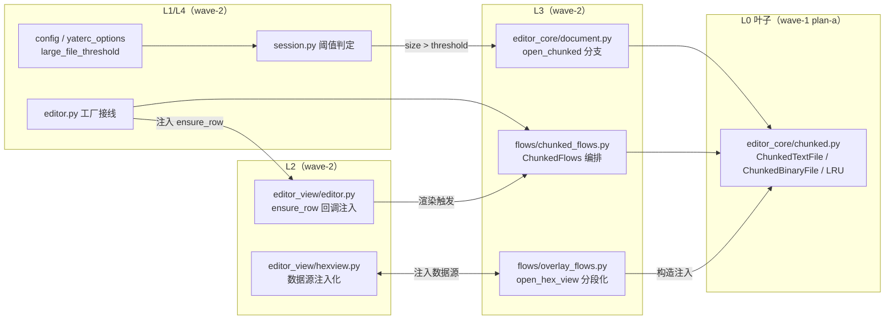

# chunked-loading-plan（大文件分段加载 主计划）

- 来源：Gitee issue IKQ2EG「FEAT - 大文件分段加载（CHUNKED / LAZY LOADING）：文本视图与 HEX 视图共用按需加载层」。
- 分支：`feat/chunked-loading`（worktree `../yate-chunked-loading`，基线 = `feat/hex-feat` @ 8f81299，issue A 已落地）。
- 日期：2026-10-25（无人值守会话；批准环节按总纲 §二.5 自动通过，本文件即批准留档）。
- 规划者：主代理亲自执行 plan-architect-designer 剧本（子代理 spawn 两次均因模型 `qwen-3.7-plus` 未注册零产出，按 `task-orchestration.md` §一.5/§三 兜底，如实登记）。

## 一、目标与非目标

### 目标

1. 文本文件超过阈值后进入**分段（chunked）模式**：打开只读首块即可呈现首屏，滚动到未加载区域按块加载；首屏时间不随文件大小线性增长（解码 + 行切分不再一次性完成）。
2. 块缓存 LRU 淘汰：常驻内存与视口/缓存上限相关，与文件大小解耦（tracemalloc 实测对照）。
3. **文本视图与 hex 视图共用同一分块加载层**（L0 `yate/editor_core/chunked.py`：文本按行对齐块、hex 按字节偏移块）；同一文件两种视图切换不重复读盘的语义由各自数据源保证（文本分段 Document 与 hex ChunkedBinaryFile 独立会话，不共享 buffer 状态——共用的是**同一套块读取/缓存机件**）。
4. 阈值内置默认 + yaterc 可配（`large_file_threshold`）。
5. hex 视图废除 100 MB 一次性整读上限（`MAX_HEX_VIEW_SIZE`），大二进制也可打开浏览/编辑。

### 非目标

- 不改变 ≤ 阈值文件的全量加载路径（`Document.open` 原样保留，默认路径零回归风险）。
- 文本分段模式不做全功能编辑（见 §三 定案 3）；跨行结构编辑、分段保存、分段增量 undo 不在本期。
- palette 预览（`yate/editor_view/palette.py:436`，可配 max_size 默认 1 MiB）与项目搜索（`yate/editor_core/project_search.py:95`，2 MB 跳过阈值）是**独立场景的门禁**，本期不动（issue 描述中的「>2MB 跳过」指这两处，均非打开路径）。
- 不引入 mmap。

## 二、调研事实（关键定位，均已在 feat/chunked-loading 工作区核实）

文本链路：

- `yate/editor_core/document.py:66-84` `Document.open`：`read_bytes()` → `_decode` → 全文 EOL replace → `TextBuffer(text)` 一次 split；`open_async` 仅 `asyncio.to_thread` 包装。
- `yate/editor_core/buffer.py:97` `TextBuffer.lines: list[str]` 是全系统唯一行存储；渲染直接下标（`yate/editor_view/editor.py:381`）；undo 为全量行快照（`buffer.py:41-50`，上限 1000 步）；`Document.modified` 兜底 O(N) 行比较（`document.py:55-56,129-149`）；保存全文 join + 临时文件原子替换（`document.py:200,245-274`）。
- 打开链路**无任何大小门禁**：`yate/session.py:97-116`（`EditorSession.open`，唯一判定是 `Workspace.is_text_file`）。
- 渲染天然按可见行：`yate/editor_view/editor.py:345-381` `render_line(y)` 按 `scroll_offset.y` 换算 buffer 行；`y >= buf.line_count` 已有空白行分支（:377-379）——渐进填充行结构对渲染零侵入。
- `virtual_size`/gutter/statusbar 依赖 `line_count`（`editor.py:207-212,320-322`、`yate/editor_view/statusbar.py:143`）。
- yaterc 数值选项链路参照 `file_preview.max_size`：`yate/config.py:112-120`（dict 配置类）+ `yate/yaterc_options.py:320-416`（解析）+ 消费方门禁。
- 只读机制已存在：`yate/flows/document_flows.py:432-437,454-456`（save_as 对 read-only 的抬起/恢复），EditorView 对只读文档已不落编辑。

hex 链路（issue A 产物）：

- `yate/flows/overlay_flows.py:186-233` `open_hex_view`：stat → `MAX_HEX_VIEW_SIZE = 100MB` 门禁（`yate/editor_view/hexview.py:55`）→ **一次性 `read_bytes()`**（overlay_flows.py:216）→ `HexScreen(path, data, ...)`。
- `HexView` presentation-only（R3 合规）：构造注入 bytes、内部 `bytearray` 全量拷贝（`hexview.py:260-262`）；渲染按偏移随机访问（:396-397，`offset = (y + scroll_y) * 16`）；`virtual_size` 构造期由总大小算出（:273-275，无需读内容）。
- 编辑 = 同长覆写：nibble 编辑不插删，undo 栈 `(offset, old_byte)`（`hexview.py:269`）；保存走注入回调 `write_bytes(path, data, mtime, size) -> (mtime,size)|None`（:472-474），flow 层三道门（冲突门/TOCTOU 指纹门/`r+b` 全量覆写，`overlay_flows.py:252-262`），成功后刷新指纹基线（`hexview.py:565-567`）。
- hex 与 Document/TextBuffer **完全独立**（无数据交互，`open_hex_view` 不建 Document）。
- 测试锚点：`tests/test_hex_view.py`（39 例，断言 `render_line().text` 逐字节不变）、`tests/test_overlay_flows_hex.py`（18 例，含 `test_open_hex_view_rejects_oversize_file` :208 与 stat 预检 :227）、冒烟 `tools/smoke_test/scenarios/hexview.py`（4 场景）。

## 三、四个设计点定案（issue 要求实现前定案）

### 定案 1：总行数/总偏移元数据 —— 渐进式分块预扫描（行前缀和索引）

打开分段 Document 时后台 worker 顺序扫描字节流（**只统计行数、不建行内容、不解码全文**），每扫完一个块：

- 记录该块行数，维护 `chunk_start_rows` 前缀和（块 → 行范围索引，goto line O(1) 定位块）;
- 全局 `line_count` 渐进增长，渲染 virtual_size / gutter 随之更新。

首屏不等预扫描（先渲染首块内容）；gutter 宽度用首块行密度估计总行数一次到位，超出时自然重排。纯字节扫描 50 MB 约 <100 ms 量级（实测回填 §八），且与首屏并行、可分批推进。

否决的备选：

- **打开时全文件预扫描统计行数**：仍是 O(size) 同步 IO，违反验收标准 1（首屏非线性）。
- **惰性行数（滚动条/行号近似）**：行号不正确，违反验收标准 3。

### 定案 2：搜索与跳转 —— 按需扫描

- 跳转（goto line / `n`/`N` 搜索）：行遍历本身经 `read_rows` 按需触发块加载——语义即「触发按需扫描」，无需单独实现两套。
- 未加载行渲染为空白（不闪烁：已加载内容不会被腾挪，块边界 = 行边界对齐）。
- 代价如实登记：分段模式对全文件搜索 = 顺序加载全部块（LRU 控制内存峰值），性能弱于全量模式内存换速度，属可接受语义。

### 定案 3：编辑与撤销 —— 文本分段模式只读（受限模式），显式全量升级

分段 Document 锁定编辑（`TextBuffer` 新增 `locked` 卫语句，变更方法 no-op）；只读语义复用现有 read-only 机制面。提供显式命令 `:fullload`（注册进 `commands.py`）把当前分段文档升级为全量可编辑（内存换编辑能力，用户显式选择），undo/save 语义在升级后与现有完全一致。

否决的备选：**分段模式行内编辑 + 行级逆操作 undo**——编辑改变字节长度使块内偏移漂移、undo 快照全量拷贝不可用，正确性风险面大且 issue 验收 4 条均为查看语义；列为后续增强（非本期）。

hex 分段**保留编辑**：同长覆写模型天然分块兼容（脏字节记录 + 就地写回），见定案 4。

### 定案 4：保存语义

- 文本分段模式只读 → 无保存需求；`:fullload` 升级后走现有全量原子保存（`document.py:245-274` 原样）。
- hex 分段保存 = **脏块就地写回**：TOCTOU 指纹门（mtime+size）与冲突门（`session.is_open`）原样保留，写回从「全量 `r+b` seek(0) 覆写」改为「仅写脏字节（逐 offset seek+write）」——不再需要全量重写，也不再需要先把全文件读进内存。保存回调签名同步改为传递脏编辑集。

## 四、架构对齐（R 条款）

| 归属 | 条款 | 说明 |
|---|---|---|
| `yate/editor_core/chunked.py`（新） | L0 叶子，R4 | 纯 stdlib + 磁盘 IO；`editor_core/*` 已在 `UI_FREE_PACKAGES` 守卫面，零新增守卫 |
| `yate/flows/chunked_flows.py`（新） | L3 流程模块，§三.8 接入清单 | `ChunkedFlows` 命名、`editor.py` 声明类属性 + `_build` 工厂构造、注入协作者与回调、不持 App 句柄（既有守卫覆盖）；不 import `editor_view`，无需登记 `UI_FROZEN_FILES` |
| `yate/editor_view/editor.py` 改动 | L2，R3 | 只新增注入回调 `ensure_row: Callable[[int], None]`（构造参数，默认 `None`），不新增向上依赖 |
| `yate/editor_view/hexview.py` 改动 | L2，R3 | 数据源由 `bytes` 入参改为注入 `ChunkedBinaryFile`（L2→L0 合法向下），widget 仍不碰文件系统 |
| 阈值选项 | L0 config/yaterc_options | 仿 `file_preview` dict 链路新增 `large_file` 组 |
| 禁项自查 | R2/R6/R10/R12 | 无新 Protocol、无 TYPE_CHECKING、无按键二次派发变化、日志走 `tracing.get_logger` |

## 五、子计划与执行波次

| 波次 | 子计划 | 独占文件 | 依赖 |
|---|---|---|---|
| wave-1 | [plan-a 核心](chunked-loading-plans/chunked-loading-core-plan-a.md) | `yate/editor_core/chunked.py`、`tests/test_chunked.py` | 无 |
| wave-2 | [plan-b 文本接入](chunked-loading-plans/chunked-loading-text-plan-b.md) | `document.py`、`buffer.py`、`session.py`、`config.py`、`yaterc_options.py`、`commands.py`、`flows/chunked_flows.py`、`editor.py`、`editor_view/editor.py`、`tests/*`（非 hex） | plan-a |
| wave-2 | [plan-c hex 接入](chunked-loading-plans/chunked-loading-hex-plan-c.md) | `flows/overlay_flows.py`、`editor_view/hexview.py`、`tests/test_hex_view.py`、`tests/test_overlay_flows_hex.py` | plan-a |
| wave-3 | [plan-d 集成收尾](chunked-loading-plans/chunked-loading-integration-plan-d.md) | `tools/smoke_test/**`、`yate/docs/*`、`.trae/documents/**` 回填 | plan-a/b/c |

wave-2 两支文件零重叠，可并行（2 个一批，符合 subagent-workflow 批大小纪律）；wave-3 串行收尾。

## 六、风险清单与回滚

| 风险 | 缓解 | 回滚 |
|---|---|---|
| 分块边界劈开 CRLF / 多字节 UTF-8 字符 | 块边界强制对齐到 `\n` 之后（块 = 整数行）；解码按块 `errors="replace"`，多字节截断与现有 `_decode` 容错同语义 | 单块回退全量加载 |
| CR-only（无 `\n`）文件无法对齐 | 探测首块：有 `\r` 无 `\n` → 抛 `ChunkedFallback`，session 回退全量 `Document.open` | 天然回滚 |
| 后台扫描与 UI 线程数据竞争 | 索引只追加前缀 + `threading.Lock`；行内容只在 worker 侧 `fill_lines` 写入 | 加锁面小，易审计 |
| 既有 hex 测试逐字节断言破坏 | plan-c 改造仅替换数据来源，渲染函数零改动；39+18 例全量回归 | 每例失败即回退对应 hunks |
| 新阈值选项破坏既有 yaterc | 仿 `file_preview` 既有链路，默认值 8 MiB，非法值进 `config.errors` 与现有行为一致 | 撤销 config/yaterc_options hunks |
| buffer.py/document.py 超豁免线 | buffer.py（1069 行）与 editor.py 已在 SIZE_EXEMPT_FILES；修改后同步更新豁免名单行数（§三.7 两处同步） | 名单回填 |

## 七、验收标准与实测方法（issue 4 条）

1. **首屏非线性**：生成 50 MB 合成日志，`time.perf_counter()` 对照「全量 `Document.open`」vs「分段 `open_chunked` 到首屏可渲染（首块就绪 + buffer 就绪）」，分段耗时须显著低于全量且不随文件大小线性增长（10 MB / 50 MB 两档对照，数字回填 plan-d）。
2. **内存与文件大小解耦**：`tracemalloc` 对照——分段模式打开后 peak 与 `MAX_CACHED_CHUNKS × CHUNK_SIZE` 同量级，与文件大小无关（10 MB vs 50 MB peak 对照）。
3. **滚动加载正确**：pytest 单测覆盖块对齐/CRLF/BOM/行号前缀和；冒烟场景（plan-d）打开大文件 goto 末行，断言行号与内容正确。
4. **两视图共用加载层**：hex 与文本均消费 `yate/editor_core/chunked.py` 的块机件（代码层共用）；hex 打开不再有 100 MB 上限，同一文件文本↔hex 切换各自数据源不重复整读盘（hex 侧断言渲染首屏的块读取次数受控）。

## 八、执行记录（回填区）

- （待 plan-a/b/c/d 执行后回填：实测数字、偏离记录、门禁结果。）
