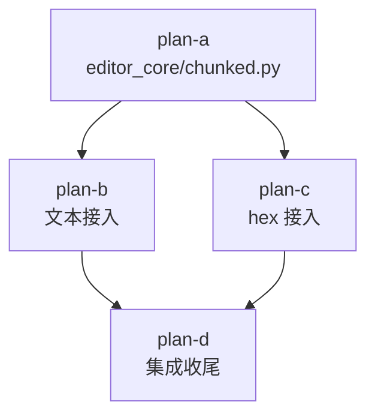

# chunked-loading-plans 总纲

主计划：[../chunked-loading-plan.md](../chunked-loading-plan.md)（目标 / 非目标 / 设计定案 / 风险 / 验收，以主计划为唯一规范来源）。

## 子计划索引

| 子计划 | 波次 | 主题 |
|---|---|---|
| [chunked-loading-core-plan-a.md](chunked-loading-core-plan-a.md) | wave-1 | L0 分块机件：`ChunkedTextFile` / `ChunkedBinaryFile` / LRU + 单测 |
| [chunked-loading-text-plan-b.md](chunked-loading-text-plan-b.md) | wave-2 | 文本接入：Document/session/config/flows/EditorView |
| [chunked-loading-hex-plan-c.md](chunked-loading-hex-plan-c.md) | wave-2 | hex 接入：overlay_flows / hexview 数据源注入化 |
| [chunked-loading-integration-plan-d.md](chunked-loading-integration-plan-d.md) | wave-3 | 集成：冒烟场景 / yaterc 双语手册 / 性能基线 / 门禁回填 |

## 执行波次表

| 波次 | 子计划 | 并行性 | 准入条件 |
|---|---|---|---|
| wave-1 | plan-a | 单个 | 无 |
| wave-2 | plan-b ∥ plan-c | 2 个一批并行，文件零重叠 | wave-1 验收全绿（`pytest tests/test_chunked.py -q` 退出码 0） |
| wave-3 | plan-d | 单个 | wave-2 全部子计划验收命令退出码 0 |

波次一经批准不得执行中临时重排；确需调整须回填主计划并附实测依据。

## 依赖关系

## 调度口径

- 子代理按 subagent-workflow 纪律下发：任务书以本目录子计划为**唯一规范来源**，声明独占文件清单（只改名下文件）、验证命令（`.venv\Scripts\python.exe -m pytest ...`，worktree `D:\Programming\yate-chunked-loading`）、报告格式（改动清单 + 实际执行的命令与结果 + 未解决项）。
- wave-2 并行批 = plan-b + plan-c（2 个，硬上限内）。
- 成员回报的数据主代理一律独立复核；成员声称完成但文件无变化 = 零产出。
