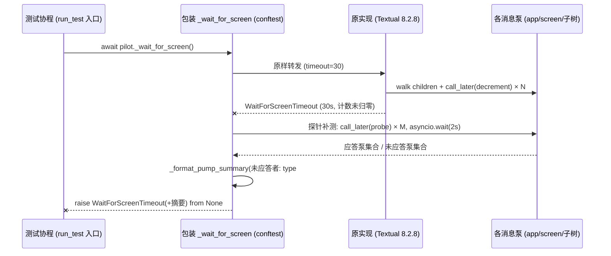

# ci-pilot-startup-stall-plan

> 任务来源：CI `ubuntu-latest / py3.13` leg 红跑（2026-11-04 用户提供的 pytest 输出）。
> 状态：**待用户批准**（批准后建 worktree `fix/ci-pilot-waitfor-stall`，本文件随任务分支首个提交入库）。

## 一、诊断结论（全部带证据）

失败签名：`tests/test_file_manager.py` 三个相邻用例（fullscreen / half-page / gg，
525 / 544 / 566 行）在 `app.run_test()` 入口的 `Pilot._wait_for_screen()`（Textual
8.2.8 `app.py:2209`）处 `WaitForScreenTimeout`（30s 硬编码预算）；同 run 其余
3322 个用例全绿，三个失败用例之后同文件用例照常通过。

| # | 事实 | 证据 |
|---|---|---|
| 1 | 失败点是 run_test **入口**首次等待，非用例体内 | 回溯栈 `app.py:2209`；三用例内容互异（fullscreen 布尔 / 20 文件 / gg 前缀），内容无关 |
| 2 | 事件循环存活、app 无异常（`_exception_event` 未触发），但至少一个泵 30s 未消费 `decrement_counter` 回调 | `pilot.py:473-533` 源码语义：异常路径返回 False 不抛超时；纯超时 = 计数不归零 |
| 3 | Textual 8.2.8 即最新版本，上游无相关已知 issue | PyPI/CHANGELOG（main）核对 8.2.8 为最新；GitHub issues 搜 `WaitForScreenTimeout` / 错误原文均 0 命中 |
| 4 | 计数回调不可能被消息合并机制吞掉 | `messages.py / message.py`：`can_replace` 默认 False，仅 Update/Layout/UpdateScroll/Resize/Prompt 覆写 |
| 5 | 队列 FIFO + 哨兵退出语义下，已入队消息在泵关闭时仍会排空 | `message_pump.py:335-376`（`_get_message` 严格 FIFO）、`:528-548`（close 哨兵排在队尾）、`widget.py:4510-4535`（prune 级联） |
| 6 | CI 环境高度挤兑：4 workers 挤 4 vCPU，套件内 fork-heavy 用例的池上限为 `cores×2`=8/worker | `.github/workflows/test.yml:111-113`；`tools/pack/wiki.py resolve_jobs`（tests/test_pack_wiki_parallel.py:153 实证 cores=4 → 8）；CI 实测 578.83s vs 本地 234s |
| 7 | 停顿窗口 ≥90s 且自愈 | 三连失败 = 3×30s 连续超时，其后用例恢复通过 |
| 8 | 本地无法复现（Windows / Py3.13.2 同 minor） | 五种形态全绿：空载 300 轮探针、8 CPU-hog 200 轮、2 核亲和性 + `-n 4` + coverage 全文件（插桩 5s 短超时 + 泵级 dump）、串行 cov、并行 cov |
| 9 | `wait_until` 每次轮询都完整执行一次 `_wait_for_screen` 协议（walk 全子树 + 每泵 post 一条 Callback） | `conftest.py:170`（`pilot.pause(step)`）→ `pilot.py:542`（pause 内必经 `_wait_for_screen`）；dbe28c7 把轮询步长 50ms→10ms 后调用频率 ×5 |

**结论**：失败发生在 Textual 内部的测试等待协议上，与 yate 产品代码无涉
（yate 侧启动期唯一渲染管线 `_wire_mount → _reload` 正常且单次）；触发条件是
CI worker 上的环境性停顿（邻居 worker fork 风暴 / cgroup 节流的疑似组合），
本地五种形态不可复现，机制未能在源码层闭环。**在机制未明前，任何"调大超时 /
盲目重试 / 砍 workers"都是无实测依据的盲改**，且受 15min CI 上限
（当前 9:38，余量不足 5min）约束。

## 二、目标与非目标

**目标**
1. 下一次同类红跑自带泵级诊断（哪个泵未应答、task 状态、队列积压摘要），
   把"盲 flake"变成可定位证据；
2. 绿跑零行为变化、零可测开销；
3. pyright strict 零诊断、`pytest tests/ -q -n auto` 全绿、覆盖率门禁不回退。

**非目标**
- 不改 CI worker 数 / 分片（机制未明前的盲调，见 §三 C/E）；
- 不改 yate 产品代码（失败点不在产品代码）；
- 不给用例加重试包装（见 §三 C）。

## 三、备选方案与否决理由

| 方案 | 内容 | 裁决 |
|---|---|---|
| A. conftest 诊断埋点（采用） | 包装 `Pilot._wait_for_screen`：原实现超时后做一次 2s 探针补测，把未应答泵摘要附进重抛的 `WaitForScreenTimeout` | **采用**。failure-path-only、零绿跑开销、先例充分（conftest `_speed_up_pilot` 已 patch Textual 内部常量） |
| B. CI 侧削减 fork 风暴（wiki lint 池上限 / `-n 3`） | 压邻居风暴 | **否决（本轮）**。纯 CPU 挤兑在本地（8 hog）不足以复现，盲改无实测依据；且 `-n 3` 拉长墙钟逼近 15min 上限。待 A 的诊断数据再议 |
| C. 用例级重试 / 加大 `_wait_for_screen` 预算 | 30s→90s 或 N 次重试 | **否决**。实测停顿 ≥90s，救活需 ~120s+ 预算；三卡死用例最坏 +6min 直接顶破 15min 上限；且无限重试会掩盖真实死锁 |
| D. 升级 Textual | 上游修复 | **否决**。8.2.8 已是最新，无修复可取 |
| E. 分片 / 改调度 | 恢复 shard | **否决**。shard 已于 aea1da4 回退（coverage 合并复杂度）；worksteal 是 dbe28c7 的实测收益 |

## 四、实施步骤

### 步骤 1：worktree 与沙箱自举

- 输入：本计划（获批）。
- 动作：`git worktree add ../yate-ci-waitfor-stall -b fix/ci-pilot-waitfor-stall`；
  worktree 内 `python -m venv .venv; .venv\Scripts\python.exe -m pip install -e ".[dev]"`；
  自证 `import yate` 指向 worktree。
- 本文件从主仓 `.trae/documents/` 复制入 worktree 并作为首个提交。

### 步骤 2：conftest 诊断埋点（唯一产品面改动，tests/ 内）

- 改动文件：`tests/conftest.py`（独占）。
- 实现：
  - 模块级 `_install_wait_for_screen_diagnostics()`（导入时执行，紧邻
    `_speed_up_pilot()`，同先例）：保存原 `Pilot._wait_for_screen`，替换为
    "调用原实现 → 捕获 `WaitForScreenTimeout` → `_probe_unresponsive_pumps()` →
    连同摘要重抛"；
  - 探针（2s 预算）：对 `app` + 当前 screen 子树逐泵 `call_later` 应答探针，
    `asyncio.wait` 收集未应答者，摘要字段：`type#id / task(None|pending|done) /
    closing / closed / qsize / 队列前 3 条消息 repr`；
  - 摘要格式化抽成纯函数 `_format_pump_summary` 便于单测；
  - 私有访问（`_closing` / `_closed` / `_message_queue`）用 `getattr` 收敛 +
    局部 `# pyright: ignore[reportPrivateUsage]` + 理由注释（先例 conftest.py:72）；
  - 版本锚注释：行为对齐 Textual 8.2.8 `pilot.py:473-533`，升级 Textual 时复核。
- 新增/改动测试：`tests/test_conftest_wait_diagnosis.py`——
  `_format_pump_summary` 纯函数快照断言 + 探针对"人工挂起泵"场景的摘要输出
  （用不启动消息循环的裸 `MessagePump` 桩，不跑真 app）。
- 验收命令（worktree 内）：
  - `.venv\Scripts\python.exe -m pyright yate/ tests/ tools/ pack/`（零诊断）；
  - `.venv\Scripts\python.exe -m pytest tests/test_conftest_wait_diagnosis.py tests/test_file_manager.py -q -n auto`（全绿）；
  - `.venv\Scripts\python.exe -m pytest tests/test_file_manager.py -q -n 1`（串行复核全绿）。

### 步骤 3：收尾门禁（主代理亲跑，与 CI 口径一致）

```powershell
.venv\Scripts\python.exe -m pyright yate/ tests/ tools/ pack/
.venv\Scripts\python.exe -m pytest tests/ -q -n auto
.venv\Scripts\python.exe -m pytest tests/test_architecture.py -q
.venv\Scripts\python.exe -m pytest tests/ --cov=yate --cov-branch -n auto
.venv\Scripts\python.exe -m tools.smoke_test run --jobs 4
```

- 覆盖率回填计划文档（前后实测数字）；按 `git-commit-message.md` 分步提交
  （`docs(plan)` → `test(conftest): ...`），只提交不推送。

## 五、风险与回滚

| 风险 | 缓解 |
|---|---|
| 探针在超时路径再挂 2s（极端：全队列冻结） | 探针自身 `asyncio.wait` 硬超时 2s，`for task in pending: task.cancel()`；最坏额外 2s |
| 包装层与未来 Textual 版本语义漂移 | 版本锚注释 + 探针只依赖公共面（`walk_children` / `call_later` / `screen`）；升级复核项写入注释 |
| 诊断输出泄漏大对象到失败消息 | 摘要仅含类型名/id/状态/条数/前 3 条消息 repr（每条截断 120 字符） |
| 真实死锁被"重抛"掩盖 | 不重试、不吞——原异常类型与消息保留，仅附加摘要；`raise ... from None` 保留原栈语义 |

回滚路径：单文件（conftest.py）+ 一个新测试文件，`git revert` 单提交即可整体回退；
CI 行为在绿跑路径上零变化。

## 六、模块交互（failure path 时序）



## 七、执行记录（收尾回填）

- [ ] 步骤 1 worktree + 沙箱自举（自证 `import yate` 路径）
- [ ] 步骤 2 conftest 埋点 + 单测（pyright / 局部 pytest 实测结果）
- [ ] 步骤 3 全量门禁（五项实测数字与退出码）
- [ ] 偏离记录（如有）
