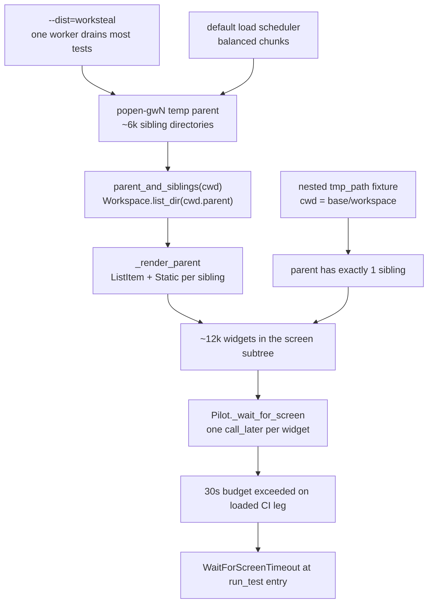

# ci-worksteal-timeout-plan

> 任务来源：CI `ubuntu-latest / py3.13` leg 2026-11-05 红跑（用户提供的 pytest 输出）。
> 前案：[ci-pilot-startup-stall-plan.md](ci-pilot-startup-stall-plan.md) 留下「机制未在源码层钉死，等下一次红跑的泵级 dump」。
> 状态：方案已由用户选定（范围 A：去掉 `--dist=worksteal` + 修测试隔离），待实施。

## 一、诊断结论（证据链）

前案结论是「CI 环境性停顿」；本次红跑的泵探针把机制钉死了：**不是泵不响应，而是泵太多**。

| # | 事实 | 证据 |
|---|---|---|
| 1 | 三个失败用例都在 `app.run_test()` 入口的 `Pilot._wait_for_screen()` 超时，用例体尚未执行 | 回溯栈 `textual/app.py:2209` → `tests/conftest.py:208`；三用例内容互异（cut/paste、paste 冲突、rename 冲突） |
| 2 | 探针报 `all 12379 watched pumps answered within 2s`，且三次失败依次为 12379 / 12385 / 12391（每用例 +6） | 用户提供的 CI 输出；`tests/conftest.py:134-157` 的 `watched = len(armed)`，`armed` 是「当前 screen 子树每个 pump 一个回调」 |
| 3 | 12379 个 pump ≈ 6180 个兄弟目录 × 2 widget | `../../yate/editor_components/file_manager/screen.py:431-455`：`_render_parent` 对每个兄弟 `pane.extend(ListItem(Static(row)))`，即每条 2 个 widget；基础 widget 约 14 个 |
| 4 | `tmp_path` 的父目录是 xdist worker 共享的 `popen-gwN` 临时根，随该 worker 跑过的用例数线性膨胀 | `../../yate/editor_components/file_manager/model.py:252-261`：`parent_and_siblings` 返回 `current.parent, workspace.list_dir(current.parent)`；`../../yate/editor_components/file_manager/screen.py:169-175` 以 `workspace.root`（= `tmp_path`）为初始 `_cwd` |
| 5 | widget 数与 `run_test()` 耗时随兄弟目录数线性增长 | 本地探针（monkeypatch `Workspace.list_dir` 只伪造父目录返回 N 条，其余走真实文件系统）：N=0/500/1500/3000 → widget=14/1012/3012/6012，`run_test()`=0.15s/1.72s/5.01s/11.22s |
| 6 | 队列在超时后排空，所以 2s 内全部应答 | `Pilot._wait_for_screen` 每泵 post 一条 `Callback`；12k 条回调在 CI 4 vCPU 挤兑 + coverage 插桩下超过 30s 预算 |
| 7 | `--dist=worksteal` 让一个 worker 抢走大部分用例，其 `popen-gw3` 累积到 ~6k 目录；默认 `load` 按集合顺序分块，每 worker 约 1/4 | `../../.github/workflows/test.yml:104-113`（`dbe28c7` 引入）；失败三例都在 `[gw3]` 且落在进度 99%-100% 尾部 |
| 8 | 失败集合随调度漂移，与用例本身无关 | 2026-11-04 红跑是 fullscreen / half-page / gg（525/544/566 行），2026-11-05 是 cut/paste / paste 冲突 / rename（689/726/759 行） |

**结论**：`--dist=worksteal` 是触发器，`tests/test_file_manager.py` 把 `tmp_path` 直接当 workspace 根是根因。去掉 worksteal 把 ~6k 兄弟降到 ~1.7k（缓解）；把 workspace 根嵌套一层让父目录恒定只有 1 个兄弟（消除）。

## 二、目标与非目标

**目标**

1. CI pytest 命令去掉 `--dist=worksteal`，注释记录证据链，避免后人以「提速」为由加回；
2. `tests/test_file_manager.py` 的 workspace 根父目录恒定只有一个条目，使启动期 `_wait_for_screen` 的泵数与调度策略、套件规模无关；
3. 补一条不变量回归用例，防止 fixture 覆盖被误删；
4. pyright strict 零诊断、全量 pytest / 架构 / 覆盖率 / 冒烟门禁全绿。

**非目标**

- 不改 yate 产品代码（左栏列父目录是正确行为，问题在测试的工作目录布局）；
- 不改 `tests/conftest.py` 的探针（它是本次定位的证据来源，failure-path-only）；
- 不恢复分片、不改 worker 数、不调大 `_wait_for_screen` 预算；
- 不在 `tests/test_gate_config.py` 加「禁用 worksteal」断言：那会把一个可随根因修复重新评估的调度选择冻结成硬门禁。

## 三、备选方案与否决理由

| 方案 | 内容 | 裁决 |
|---|---|---|
| A. 去掉 worksteal + 修测试隔离 | 改 `../../.github/workflows/test.yml` 与 `../../tests/test_file_manager.py` | **采用（用户 2026-11-05 选定）**。双保险：既按用户指令改 CI，又消除复发根因 |
| B. 仅去掉 `--dist=worksteal` | 只改 CI 一个文件 | 否决。仅把 6k 兄弟降到 ~1.7k（本地约 6s，CI 负载下仍可能逼近 30s），套件继续增长会复发 |
| C. 只修测试隔离、保留 worksteal | 只改测试文件，保住 `dbe28c7` 的提速收益 | 否决。与用户明确指令冲突；提速收益留待根因稳定后再评估 |
| D. 只出诊断 | 不改代码 | 否决。用户选定 A |
| E. 在 `test_gate_config.py` 增加调度断言 | 把 `--dist=worksteal` 出现判红 | 否决（见 §二非目标）：配置漂移风险由提交评审承担，不新增硬约束 |

## 四、实施步骤

### 步骤 1：CI 工作流（独占 `../../.github/workflows/test.yml`）

- 输入：§一证据链。
- 动作：`run:` 去掉 `--dist=worksteal`；原「worksteal 提速」注释改写为「为何保留默认 `load`」的证据说明（父目录膨胀 → 12k 回调 → 30s 超时；测试侧已嵌套根）。
- 输出：CI 命令与 Gitee 侧 `../../.workflow/test.yml` 一致（`-n auto`，默认 `load`）。
- 验收：`git grep -n worksteal -- .github pyproject.toml` 仅剩历史计划/评审文档命中；`python -m pytest tests/ -q -n auto` 全绿。

### 步骤 2：测试隔离（独占 `../../tests/test_file_manager.py`）

- 输入：§一事实 3-5；模块内 178 处 `tmp_path` 引用全部以它为 workspace 根，除两处 `Path(tmp_path.anchor)`（drive 层）外无 `.parent` / `.name` 等结构敏感用法。
- 动作：模块级覆盖内建 `tmp_path` fixture——`tmp_path_factory.mktemp("file_manager") / "workspace"`，建目录后返回；docstring 说明父目录必须干净的理由与 CI 证据。新增一条不变量用例断言 `tmp_path.parent` 只含 `tmp_path.name`。
- 输出：左栏恒定 1 行 → 约 14 个 widget；`Pilot._wait_for_screen` 不再受 worker 累积临时目录影响。
- 验收：
  - `.venv\Scripts\python.exe -m pytest tests/test_file_manager.py -q -n 1`（串行）；
  - `.venv\Scripts\python.exe -m pytest tests/test_file_manager.py -q -n auto`（并行）；
  - `.venv\Scripts\python.exe -m pyright yate/ tests/ tools/ pack/`（零诊断）。

### 步骤 3：收尾门禁（主代理亲跑，与 CI 口径一致）

```powershell
.venv\Scripts\python.exe -m pyright yate/ tests/ tools/ pack/
.venv\Scripts\python.exe -m pytest tests/ -q -n auto
.venv\Scripts\python.exe -m pytest tests/test_architecture.py -q
.venv\Scripts\python.exe -m pytest tests/ --cov=yate --cov-branch -n auto
.venv\Scripts\python.exe -m tools.smoke_test run --jobs 4
```

- 回填本文件 §七真实数字；按 `git-commit-message.md` 分步提交（只提交不推送）。

## 五、风险与回滚

| 风险 | 缓解 |
|---|---|
| 覆盖内建 `tmp_path` 影响 `conftest.isolated_home`（它把 `tmp_path` 当参数但不使用）及其它 fixture | 已在源码确认：`../../tests/conftest.py:238-257` 只用 `tmp_path_factory.mktemp("isolated_home")`；模块内无 `.parent` / `.name` 断言 |
| `FileManagerScreen.__init__` 对根做 `.resolve()`，与 fixture 返回路径不一致 | 沿用内建 `tmp_path` 的同一形态（`tmp_path_factory` 基址本身已解析），两处 drive 层用例用 `tmp_path.anchor`，不受嵌套影响；定向串行 + 并行双跑验证 |
| 去掉 worksteal 后 CI 墙钟回退，逼近 15min 上限 | 本次红跑 470.74s，其中 3×30s 是超时损耗；默认 `load` 的尾部空转增量远小于 900s 预算，留待 CI 实测复核 |
| 左栏行为被 fixture 掩盖，产品侧大量兄弟目录的性能问题不再被测试覆盖 | 产品行为未改；该场景本就不是这些用例的断言目标，如需覆盖应另立性能用例 |

回滚路径：两个文件各一笔提交，`git revert` 对应提交即可分别回退；无产品代码与依赖变更。

## 六、机制（Mermaid）



## 七、执行记录（待回填）

- [ ] 步骤 1 CI 工作流（提交号 / 命令 / 结果）
- [ ] 步骤 2 测试隔离（提交号 / 定向用例数 / pyright 结果）
- [ ] 步骤 3 全量门禁五项实测（退出码、覆盖率、冒烟数字）
- [ ] 偏离记录（如有）
