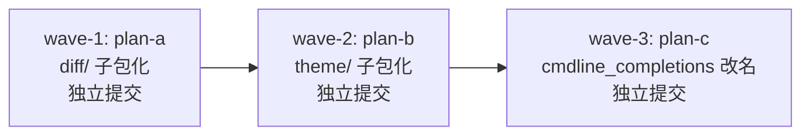
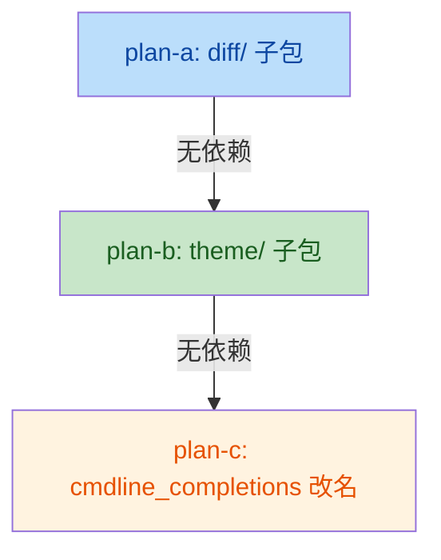

# editor_components 结构重组（issue IKSF4R）

## 目标

按「同域互引 >=2 文件 / 收拢减少跨域引用 / 域有独立演进点」三判据的全仓结构评审
结论，落地三处机械性重组：

1. **wave-1 (plan-a)**：`editor_components/diff/` 子包化
   （`diffview.py` -> `diff/screen.py`、`diff_pane.py` -> `diff/pane.py`）
2. **wave-2 (plan-b)**：`editor_components/theme/` 子包化
   （`theme.py` -> `theme/__init__.py`、`themes.py` -> `theme/themes.py`、
   `theme_files.py` -> `theme/files.py`；`cells.py` 留根）
3. **wave-3 (plan-c)**：`flows/prompt_completion.py` -> `flows/cmdline_completions.py`
   （函数 `prompt_completions()` 同步改名 `cmdline_completions()`）

## 非目标

- `editor.py` big-module-split（已登记豁免，另行立项）
- `services/yxp.py`、`tools/pack/wiki.py` 拆分（已登记豁免）
- `flows/`、`services/`、叶包内部任何分组重组
- 用户可见行为、键位、命令、rc 选项零变化
- 七个叶包（`editor_core` / `editor_lsp` / `editor_syntax` / `editor_term` /
  `keyproto` / `editor_sprites` / `services/*`）与 flows 其余模块维持不动

## 存档声明（issue IKSF4R 归档节）

全仓结构评审已对以下分组维持不动的结论做了存档：七个叶包内部不分组、
flows 其余模块不重组、services 维持现有扁平结构、根平铺的 cells.py 等
单文件模块不因不整齐重启重组。本 issue 只动 diff/theme/prompt_completion
三处。未来不得仅因「不整齐」重启重组——如需再动，必须重新满足三判据并
新开 issue。

## 子计划索引

| 子计划 | 文件 | 波次 | 独占文件 |
|---|---|---|---|
| plan-a | [ec-structure-reorg-diff-subpackage-plan-a.md](ec-structure-reorg-diff-subpackage-plan-a.md) | wave-1 | diffview.py / diff_pane.py / diff/__init__.py（新增） |
| plan-b | [ec-structure-reorg-theme-subpackage-plan-b.md](ec-structure-reorg-theme-subpackage-plan-b.md) | wave-2 | theme.py / themes.py / theme_files.py / theme/__init__.py（新增） |
| plan-c | [ec-structure-reorg-cmdline-rename-plan-c.md](ec-structure-reorg-cmdline-rename-plan-c.md) | wave-3 | flows/prompt_completion.py -> flows/cmdline_completions.py |

## 执行波次

波次间串行：上一波全部门禁通过（含独立提交）才进入下一波。
A 与 B 无文件交集但按 issue 要求串行（均触碰 R15 守卫验证，串行避免混淆
演练结论）。

## 依赖关系

三波之间无代码依赖，纯按 issue 指定的串行序执行。

## 关键调研事实

### 旧名全仓引用计数（yate/ + tests/ + tools/，不含 .trae/ 历史文档）

| 旧名 | 引用数 | 分布 |
|---|---|---|
| `editor_components.diffview` | 7 | overlay_flows(1) + test_diffview(3) + test_diff_integration(1) + test_command_path_args(1) + smoke_test/diffview(1) |
| `editor_components.diff_pane` | 7 | diffview.py 内部(1) + test_diffview(3) + test_diff_integration(1) + test_command_path_args(1) + smoke_test/diffview(1) |
| `editor_components.themes` | 8 | theme.py(1) + theme_files.py(1) + terminal.py(1) + manual.py(1) + test_theme_trust(2) + test_theme_files(1) + test_theme_palettes(1) + smoke_test/modules(1) |
| `editor_components.theme_files` | 5 | theme.py(1) + test_theme_trust(1) + test_theme_files(2) + smoke_test/modules(1) |
| `flows.prompt_completion` | 7 | editor.py(1) + test_prompt_completion(1) + test_app_find(1) + config.py(2) + api.py(1) + smoke_test/guards(1) |
| `prompt_completions` 函数 | 8 | editor.py(2) + test_prompt_completion(4) + test_app_find(2) |

### 守卫集合需同步的键

- `tests/test_architecture.py:233` — `UI_FROZEN_FILES["flows/overlay_flows.py"]` 含
  `"yate.editor_components.diffview"` -> 改为 `"yate.editor_components.diff.screen"`
- `tests/test_architecture.py:324-327` — `SIZE_EXEMPT_FILES` 注释提及 diffview.py / theme.py
  拆分历史（注释性，不阻塞；可选更新）
- `.trae/rules/architecture-boundaries.md` — 行 21/129/135/259/275/288/367-374/467 含旧名

### 文件体量（splitlines 口径）

| 文件 | 行数 |
|---|---|
| `editor_components/diffview.py` | 581 |
| `editor_components/diff_pane.py` | 488 |
| `editor_components/theme.py` | 193 |
| `editor_components/themes.py` | 599 |
| `editor_components/theme_files.py` | 137 |
| `editor_components/cells.py` | 148 |
| `flows/prompt_completion.py` | 52 |

全部低于 800 行阈值，不涉及 `SIZE_EXEMPT_FILES` 变更。

## 执行记录回填（2026-11-03）

### 提交清单（分支 ref/ec-structure-reorg，基于 master bbefdd3）

| 提交 | 波次 | 内容 |
|---|---|---|
| `aca2c91` | wave-1 | refactor(editor-components): subpackage diff/ (screen + pane) |
| `d3a9a55` | wave-2 | refactor(editor-components): subpackage theme/ (facade + themes + files) |
| `91ae192` | wave-3 | refactor(flows): rename prompt_completion to cmdline_completions |
| `57f4f2a` | 评审返工 | refactor(editor-components): update leftover diff subpackage path references（M1：test_architecture 注释 / smoke 场景 docstring / diff-view.tcss 头注 3 处） |
| `d4309d1` | 评审返工 | refactor(flows): rename leftover prompt_completion test module（m1：test_prompt_completion.py -> test_cmdline_completions.py，git mv 100%） |

### 各波验收实测（执行者 + 主代理独立复核）

- wave-1：pyright 0 / 架构 37 passed / 全量绿 / smoke 121 场景 1463 checks / 残留 grep 0 / R15 负向演练通过（载体 diff/pane.py，计划原定 screen.py 不在守卫匹配面，已按实测改载体并登记偏离）。
- wave-2：pyright 0 / 架构 37 passed / 全量绿 / 门面导入 sanity 通过 / 残留 grep 0；coverage 轮由执行者后台运行，主代理收尾全量复核覆盖（见下）。执行者中断于提交步，主代理代为完成提交（已独立复跑全部验收命令）。
- wave-3：pyright 0 / 架构 37 passed / 全量绿 / coverage 92.82% / smoke 121/1463 / 残留 grep（含 .trae/rules/）0。

### 评审结论（code-review-expert）

无 blocker；1 major（M1 注释级旧路径残留 3 处）+ 2 minor（m1 测试文件名、m2 计划文档未提交）已全部修复/落实；2 nit 登记不处理（n1 `diff/__init__.py` 缺 future import 纯一致性、n2 场景/测试文件名沿旧词不设守卫面）。机械性核查结论：三提交全部为 import 行 / 路径字符串 / docstring / 文档，零运行时行为变化、零依赖方向变化，守卫与规则文本均同提交更新。

### 收尾全量门禁（主代理，2026-11-03）

| 命令 | 结果 | 退出码 |
|---|---|---|
| `pyright yate/ tests/ tools/ pack/` | 0 errors, 0 warnings, 0 informations | 0 |
| `pytest tests/ -q -n auto` | 全绿（3 skip） | 0 |
| `pytest tests/test_architecture.py -q` | 37 passed | 0 |
| `pytest tests/ -q -n auto --cov=yate --cov-branch` | TOTAL 93%（19273 stmts / 1098 miss），92.80% >= 75 门槛 | 0 |
| `python -m tools.smoke_test run --jobs 4` | 121/121 场景、1463 checks 基线持平（80.06s） | 0 |

### 残留 grep 终态

- `editor_components.diffview|editor_components.diff_pane`（yate/ tests/ tools/）：0 命中（M1 修复后）
- `editor_components.theme_files|editor_components\.themes`：0 命中（theme/themes.py 自身除外）
- `prompt_completion`（yate/ tests/ tools/ .trae/rules/）：0 命中
- 豁免面（changelog 历史注记、`.trae/documents/` 历史文档）不在此列。
