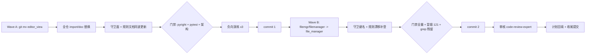

# editor-components-rename-plan

来源 issue：Gitee IKSEXJ（refactor: editor_view 更名 editor_components、filemgr 更名 file_manager —— 命名统一、守卫与规则文档同步）。

## 一、目标与非目标

### 目标

1. **Wave A**：`yate/editor_view/` 包级 `git mv` 为 `yate/editor_components/`，全仓（`yate/` + `tests/` + `tools/` + `yaterc.example` + 活跃文档）import / 路径字符串 / docstring 同步；守卫面（`tests/test_architecture.py` 的 `UI_FROZEN_FILES` 值、R15 扫描路径、层秩 `_LAYER_RANKS`）与规则文档（`.trae/rules/architecture-boundaries.md`）同波更新。
2. **Wave B**：Python 侧 file manager 命名统一为 `file_manager`：
   - `yate/editor_components/filemgr/` → `yate/editor_components/file_manager/`（子模块名不变）；
   - `yate/flows/filemanager_flows.py` → `yate/flows/file_manager_flows.py`；
   - `Editor.filemanager_flows` → `file_manager_flows`；`Editor.bind_filemanager_exit` → `bind_file_manager_exit`；
   - `tests/test_filemgr*.py` / `test_app_filemgr.py` ×4 → `test_file_manager*.py`（文件名 + 导入）；
   - `tools/smoke_test/scenarios/filemanager.py` → `file_manager.py`（含 `scenarios/__init__.py` 聚合行）；场景名 `filemanager_startup_navigation` → `file_manager_startup_navigation`；基线 `smoke_baselines/filemanager_startup_navigation.json` 随场景名同步；`harness.new_app(filemanager_dir=...)` 形参 → `file_manager_dir`；
   - widget id `#filemgr-*` → `#file-manager-*`（screen 内部自持，同步 `filemgr-screen.tcss` → `file-manager-screen.tcss`、冒烟 query、测试 query）；
   - 守卫 `UI_FROZEN_FILES` 键 `flows/filemanager_flows.py` → `flows/file_manager_flows.py`（值随 Wave A 已换新包名）、`SIZE_EXEMPT_FILES` 键换名并按 `splitlines()` 口径复测行数更新注记；
   - `architecture-boundaries.md` §一 L3 清单 / R11 flows 枚举 / §三.8 以 `file_manager_flows.py` **首次补登**（修复规则漂移）。
3. **负向演练**：R3 向上导入拦截、R15 递归扫描、层秩 `UPWARD_EDGES_FROZEN` 三个被改扫描路径/正则的守卫，改名后各做一次临时回填违规 → 确认拦截 → 还原。
4. **文档同步**：`yate/docs/*.md`（yaterc / themes 双语手册）、`yaterc.example`、`architecture-boundaries.md` 全量；`extensions` 手册禁令表述同步新名。

### 非目标（硬性纪律）

- 零运行时行为变化、零依赖方向变化：diff 仅允许 import 行、路径字符串、id/资源名、docstring 与文档；
- `FileManagerFlows` 类名保留；`:file-manager` 命令 / `--file-manager` CLI / 手册用户面连字符表述不动；
- 不回改 `yate/resources/changelog.*` 历史注记、`tools/changelog/zh_overrides.json`（历史 commit 翻译表）、`.trae/documents/` 历史计划与评审记录；
- 不拆分 `file_manager/screen.py`（体量豁免仅换键名，行数注记同步）；
- 不动 extensions 插件 API 面（插件本就禁止 import editor_view，仅规则文本同步新名）；
- 发现的既有问题一律登记另案，禁止借机顺手改。

## 二、备选方案与否决理由

| 备选 | 否决理由 |
|---|---|
| 一次提交合并两波改名 | issue 执行序建议明确要求分笔提交保 rename 追踪与可回滚性；合笔会让 Wave B 的 filemgr 目录 mv 混进 editor_view 大 mv，git rename 检测易错乱 |
| `python -m py` 脚本批量替换后手工修边 | 替换面含 docstring、注释、tcss、json，盲目全局替换会误伤 changelog 历史注记与 `editor-view.tcss` 等连字符名；按文件清单逐处替换 + grep 兜底更可控 |
| 用 sed/正则一次性处理 `filemanager` → `file_manager` | `FileManagerFlows` 类名须保留、用户面 `file-manager` 不动，大小写敏感的映射需人工判定，机械替换风险大于收益 |
| 派子代理执行改名 | subagent-workflow §一.3：子代理不得修改产品源码 `yate/`；本次改动主体在 `yate/`，由主代理亲自执行（同 rule §三 兜底路径） |

## 三、实施步骤

### Wave A：editor_view → editor_components（单笔提交）

1. `git mv yate/editor_view yate/editor_components`；
2. 全仓文本替换 `editor_view` → `editor_components`（`yate/**/*.py`、`tests/**/*.py`、`tools/**/*.py`、`yate/yaterc.example`、`yate/docs/*.md`、`.trae/rules/architecture-boundaries.md`；**排除** `yate/resources/changelog.*`、`tools/changelog/zh_overrides.json`）；
3. 守卫同步：`UI_FROZEN_FILES` 值、R15 `rglob("yate/editor_view/**/*.py")` 路径、`_LAYER_RANKS`、`SIZE_EXEMPT_FILES` 键（本波先改 `editor_components/filemgr/screen.py`，Wave B 再换 `file_manager`）；
4. 门禁：pyright 0 诊断 + pytest 全量 + 架构测试 + 负向演练 ×3；
5. 提交 `refactor(components): rename editor_view package to editor_components`。

验收命令：

```powershell
.venv\Scripts\python.exe -m pyright yate/ tests/ tools/ pack/
.venv\Scripts\python.exe -m pytest tests/ -q -n auto
.venv\Scripts\python.exe -m pytest tests/test_architecture.py -q
```

### Wave B：file manager 命名统一（单笔提交）

1. `git mv yate/editor_components/filemgr yate/editor_components/file_manager`；`git mv yate/flows/filemanager_flows.py yate/flows/file_manager_flows.py`；`git mv yate/resources/filemgr-screen.tcss yate/resources/file-manager-screen.tcss`；测试 ×4 与冒烟场景文件 `git mv`；基线 json `git mv`；
2. 文本替换：`filemgr` → `file_manager`（Python/tcss/测试/冒烟，含 `#filemgr-*` id）、`filemanager` → `file_manager`（保留 `FileManagerFlows` 类名与用户面 `file-manager`/`--file-manager` 不动）；
3. 守卫同步：`UI_FROZEN_FILES` 键、`SIZE_EXEMPT_FILES` 键（实测行数更新注记）；
4. `architecture-boundaries.md` L3 清单 / R11 / §三.8 以 `file_manager_flows.py` 首次补登；
5. 门禁全量 + 冒烟 121 场景 + 残留 grep 三连；
6. 提交 `refactor(file-manager): unify python-side file manager naming`。

验收命令（在 Wave A 基础上追加）：

```powershell
.venv\Scripts\python.exe -m pytest tests/ --cov=yate --cov-branch -n auto --cov-fail-under=75
.venv\Scripts\python.exe -m tools.smoke_test run --jobs 4
```

残留 grep（豁免 changelog 历史注记与 `.trae/documents/` 历史文档）期望 0：
`editor_view` / `filemgr` / `filemanager`（`FileManagerFlows` 保留者逐一登记）。

## 四、风险清单与回滚

| 风险 | 缓解 |
|---|---|
| rename 漏改导致运行时 import 错误 | grep 残留三连 + pyright + 全量 pytest 双保险 |
| git mv 未保 rename 追踪 | 严格 `git mv`（非删建），提交后 `git log --follow` 抽查 |
| 守卫改哑（扫描路径换了但集合没换） | 负向演练 ×3（R3 / R15 / 层秩），临时回填违规确认拦截后还原 |
| 冒烟基线因场景名变更失配 | 场景名与基线文件名同波改名；基线内容若内嵌场景名需实测核对（harness 以 `scenario.name` 取名） |
| 架构测试行数豁免口径漂移 | Wave B 用 `splitlines()` 实测 `file_manager/screen.py` 行数并更新 `SIZE_EXEMPT_FILES` 注记 |

回滚路径：分支上两笔独立提交，`git revert` 单笔回滚；worktree 独立沙箱，不影响主仓。

## 五、执行形态（偏离记录）

- 用户显式指示「无人值守，所有问题无须过问」→ 闭环第 3 步【批准】由用户预授权豁免，本计划落盘即执行；
- 改名主体在 `yate/`，按 subagent-workflow §一.3 由主代理亲自执行；【审核】环节派发 `code-review-expert`（若派发失败按 §三 兜底由主代理自查并如实登记）；
- 每步产物按 git-commit-message.md 单独提交，只提交不推送。



## 六、执行结果回填（2026-11-02）

### 提交清单

| 提交 | 内容 |
|---|---|
| `7721b06` | `docs(plan): add editor-components-rename plan`（本计划） |
| `860ae95` | Wave A `refactor(components): rename editor_view package to editor_components`（169 文件，rename 追踪 97–100%） |
| `b01a376` | Wave B `refactor(file-manager): unify python-side file manager naming`（22 文件，git mv 12 + 内容替换 10；含 id 字面量滑移修复，见下） |
| `ff2254b` | 评审跟进 `refactor(file-manager): rename leftover filemgr test module`（`tests/test_workspace_filemgr.py` → `test_workspace_file_manager.py`，纯文件名） |

### 门禁实测（HEAD = `ff2254b`）

| 门禁 | 实测 |
|---|---|
| pyright（`yate/ tests/ tools/ pack/`） | 0 errors / 0 warnings / 0 informations |
| `pytest tests/ -q -n auto` | 全绿（3345 collected，仅存量 skip），exit 0 |
| `pytest tests/test_architecture.py -q` | 37 passed |
| `--cov=yate --cov-branch --cov-fail-under=75` | 92.82%（达标） |
| `tools.smoke_test run --jobs 4` | 121/121 场景、1463/1463 checks，`file_manager_startup_navigation` 17/17 PASS |
| 负向演练 ×3（R3 / R15 / 层秩） | 临时回填违规均被拦截，已还原复测绿 |
| 残留 grep | `editor_view` / `filemgr` / `filemanager` 在 yate/ + tests/ + tools/ 零残留；豁免集：changelog 历史注记、`zh_overrides.json`、`.trae/` 历史文档；`FileManagerScreen` / `FileManagerFlows` 类名按计划保留 |

### 偏离与过程记录

1. **批准环节豁免**（§五 已登记）：用户预授权无人值守。
2. **Wave B 发现并修复一处替换滑移**：`screen.py` 事件处理器 id 比较误写成 `"file_manager-list"` / `"file_manager-input"`（下划线-连字符混排），与真实 widget id `#file-manager-list` / `#file-manager-input` 不匹配，导致高亮预览 / 过滤 / 输入提交静默失效——3 个 Pilot 测试（dir_preview / filter_keystrokes / mutations_drop）确定性失败暴露；经插桩定位后修正 5 处（含 worker group 名一并统一为 `file-manager-preview`），随 Wave B 提交。
3. **评审结论**：code-review-expert 实测门禁后 **Approve**，唯一 minor（`test_workspace_filemgr.py` 文件名残留）已由 `ff2254b` 修复；评审自我批判剔除了 3 项误报（`namespace="file_manager_row"` 为 Textual 处理器名合法性所需、worker group 内部自洽、changelog 历史冻结）。
4. **规则文档首次补登**：`architecture-boundaries.md` §一 L3 清单 / R11 / §三.7 豁免行 / §三.8 以 `file_manager_flows.py` 补登（历史波次名 filemgr-wrapup 按口径保留）。
5. **另案登记（未改）**：`tests/test_app_panes.py::test_pane_regions_stay_visible_after_split` 并行时序 flake（串行复核两次通过）——与本次改名无关，待专项处理。

