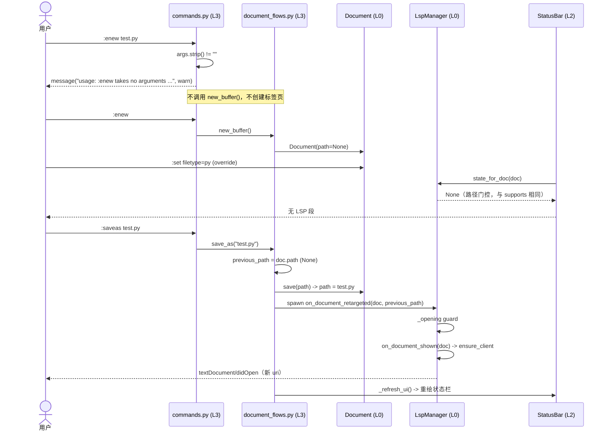
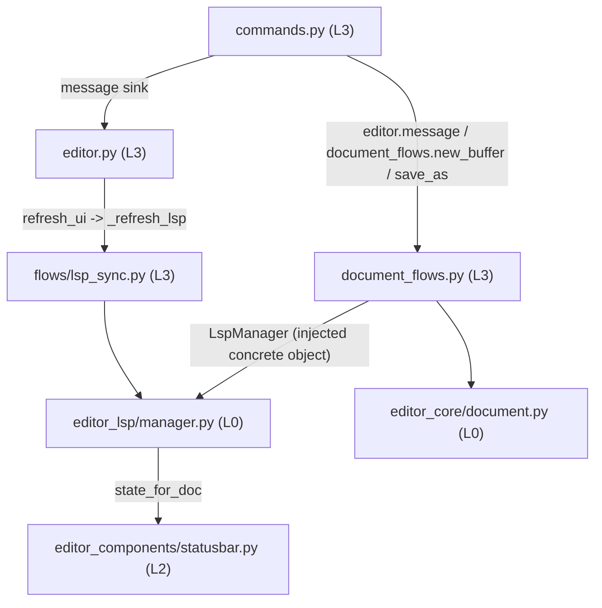

# 无路径 buffer 的 LSP attach 修复计划 —— `:enew` 参数处理与无路径 buffer 的 LSP attach

Issue: <https://gitee.com/jermaine/yate/issues/IKSFS7>（来源笔记：
[`enew-args-lsp-attach-issue-notes.md`](enew-args-lsp-attach-issue-notes.md)）。
Branch: `fix/enew-args-lsp-attach` · worktree: `../yate-enew-args-lsp-attach`（相对于主仓库）。

## 0. 流程状态（闭环，`task-orchestration.md` §二）

| 步骤 | 状态 | 证据 |
|---|---|---|
| 1 领会 | 完成 | 从 `master` `8e60598` 创建 worktree + 分支；在 worktree 中重建 `.venv` 并自证（worktree 本地的 `yate` 包）；issue 笔记提交于 `7011ff2` |
| 2 方案 | 完成（本文档 + `enew-args-lsp-attach-plans/`） | plan-architect-designer 两次 spawn 失败，报 `Model "qwen-3.7-plus" not found`（按 §一.3.5 重试已耗尽）；**主代理直接执行了该角色脚本 —— 子代理零产出**，按 §三 记录 |
| 3 批准 | 已豁免 | 用户于 2026-11-06 明确要求无人值守模式（"进入无人值守模式，所有问题无须过问"）；按工作区规则 §二.5 不发起任何批准/询问；该计划视为已批准 |
| 4 执行 | 完成 | wave-1：`df91f5c` + `429ff18`；wave-2：`c7fb803` + `383affe`；wave-3：`28a5fdf`；主代理独立重跑了每个波次的 tests/pyright/architecture（均 exit 0）；见 [`enew-args-lsp-attach-plans/overview.md`](enew-args-lsp-attach-plans/overview.md) |
| 5 审核 | 完成（2 轮） | 第 1 轮：**0 blocker / 2 major / 4 minor**（[记录](../reviews/2026-11-06-enew-args-lsp-attach-review.md)）；迭代后第 2 轮：**0 blocker / 0 major / 2 minor**（[记录](../reviews/2026-11-06-enew-args-lsp-attach-iteration-review.md)）；两轮均运行了全部五个门禁命令，均 exit 0 |
| 6 迭代 | 完成 | 2 个 major → 在 §3 C' + [`enew-args-lsp-attach-plans/enew-args-lsp-attach-review-plan-e.md`](enew-args-lsp-attach-plans/enew-args-lsp-attach-review-plan-e.md) 中重新设计 step-2；minor #3/#4/#6 并入该波次，#5 由 `< 800` 行数断言处理；第 2 轮 minor#1 通过 step-7 回填解决，minor#2 登记为待办（§6） |
| 7 收尾 | 完成 | 主代理运行了完整门禁（§7），回填了每个子计划的执行记录，归档了两份评审记录，按步骤提交，未 push |

## 1. 目标 / 非目标

### 目标

1. `:enew FILE` 绝不能静默丢弃其参数：应在消息行发出用法警告且不创建任何 buffer；裸 `:enew` 保持其当前行为。
2. `LspManager.state_for_doc` 必须使用与 `supports` / `ensure_client` 相同的门控：无路径（`path is None`）的文档没有服务器状态，因此状态栏不能宣传一个永远不会启动的已配置服务器。
3. 当一个 buffer 首次获得路径后（`:saveas FILE`，包括从 `:w` 到达的 `Save as: ` 提示），LSP 生命周期必须真正接管：为新 URI 发送 `didOpen`，当路径改变时为之前打开的 URI 发送 `didClose`，即使在并发刷新事件下也只发送一次 `didOpen`。
4. 使用户手册和冒烟覆盖与这三种行为保持同步。

### 非目标

- 不新增 `:enew FILE` 的"创建并绑定"命令变体；`:e FILE` 已经提供了该语义（§3）。
- 不尝试为仍无路径的文档 attach LSP 服务器（LSP 需要文档 URI）；在无路径 buffer 上通过 `:set filetype=` 进行语法高亮保持原样。
- 不改动 LSP 线路协议、增量同步、诊断存储、`:e` 打开流程或 `EditorSession.new_buffer()` 签名。
- 不编辑 CHANGELOG：`CHANGELOG.md` / `CHANGELOG.zh.md` 声明它们由 `python -m tools.changelog` 生成；生成器不在范围内。
- 闭环内不执行 `git push`。

## 2. 调研事实（file:line，worktree HEAD `8e60598`）

| # | 事实 | 位置 |
|---|---|---|
| F1 | `_enew(args: str)` 完全忽略 `args` 并调用 `new_buffer()`；注册描述为 "open a new empty buffer" | `../../yate/commands.py:344-345`, `:383` |
| F2 | 命令表的错误上报约定是使用 `editor.message(..., kind="warn")`，并以 `usage: :...` 为前缀 | `../../yate/commands.py:405-411`, `:543-548`, `:564-568` |
| F3 | `_strip_quotes` 去除一对包围的引号；`:e FILE` 和 `:saveas FILE` 使用它，`:saveas` 对提示路径接受 `None` | `../../yate/commands.py:142-151`, `:269-270`, `:328-333` |
| F4 | 当 `path is None` 时 `Document.name` 为 `[no name]`；除非设置了 `filetype_override`，否则 `filetype` 回退到 `plaintext` | `../../yate/editor_core/document.py:221-238` |
| F5 | `supports` 要求 `doc.path is not None and config_for(...) is not None`；`ensure_client` 和 `on_document_shown` 都在 `path is None` 时提前返回 | `../../yate/editor_lsp/manager.py:210-216`, `:286-292`, `:347-353` |
| F6 | `state_for_doc` 只看 `doc.filetype`，因此一个带 `:set filetype=py` 的无路径 buffer 会报告 `CONFIGURED`/`READY`/`FAILED`，而实际上没有任何客户端能够启动；`states()` 的基线是对每次注册都是 `CONFIGURED` | `../../yate/editor_lsp/manager.py:218-238` |
| F7 | `state_for_doc` 唯一的生产消费者是 `StatusBar._lsp_segment`；它还渲染 `config_for(doc.filetype)` 和 `counts_for(doc)` | `../../yate/editor_components/statusbar.py:266-290` |
| F8 | `on_document_shown` 在 `await ensure_client` *之前*检查 `is_open`，因此两个重叠的刷新 worker 可能为同一 URI 都发送 `didOpen` | `../../yate/editor_lsp/manager.py:347-383` |
| F9 | `on_document_closed` 负责 URI 拆除（`_open`、定时器、锁、uri 缓存、`didClose`），以文档的*当前*路径为键 —— 在 `:saveas` 重定向文档后它无法关闭旧 URI | `../../yate/editor_lsp/manager.py:385-408` |
| F10 | `_uri(doc)` 按 `Path` 缓存 `path_to_uri`；`_drop_uri_cache(uri)` 按值移除缓存条目 | `../../yate/editor_lsp/manager.py:728-736`, `:184-188` |
| F11 | `Document.save(path)` 以原子方式写入，且仅在之后才赋值 `self.path = target`；保存失败会保留原路径不变 | `../../yate/editor_core/document.py:321-325`, `:355-369` |
| F12 | `_submit_save_as` 不记录原路径、不 spawn LSP 通知、不调用 `_refresh_ui()`；它只发出 `DOCUMENT_SAVED` | `../../yate/flows/document_flows.py:457-509` |
| F13 | `save_document`（`:w`）会 spawn `lsp.notify_saved`（didSave）并调用 `_refresh_ui()`；无路径 buffer 被路由到 `prompt_save_as()` → `_submit_save_as` | `../../yate/flows/document_flows.py:402-436`, `:438-455` |
| F14 | `Editor.refresh_ui` → `_refresh_lsp` → `LspSync.doc_shown_later` → `on_document_shown`，受 `supports(doc)` / `is_open(doc)` 门控；卸载时 `refresh_ui` 是空操作 | `../../yate/editor.py:432-438`, `:484-488`; `../../yate/flows/lsp_sync.py:69-77` |
| F15 | `DocumentFlows` 已经拥有 `lsp: LspManager`、`_spawn` 和一个注入的 `refresh_ui` 可调用对象，因此从保存路径 spawn 一个 manager 协程是既有模式 | `../../yate/flows/document_flows.py:67-105`, `:426-429` |
| F16 | 命令别名冒烟场景驱动裸 `:enew`；`:saveas` 冒烟场景断言重定向到 `renamed.txt` | `../../tools/smoke_test/scenarios/aliases.py:60-67`; `../../tools/smoke_test/scenarios/files.py:298-329` |
| F17 | 无头命令测试使用桩编辑器 + `register_commands`，见 `tests/test_cmd_cd.py` | `../../tests/test_cmd_cd.py:61-115` |
| F18 | `tests/test_lsp.py` 已经用伪客户端钉住了 FAILED 客户端的 `state_for_doc` 以及 didOpen/didSave/didClose 生命周期 | `../../tests/test_lsp.py:651-656`, `:778-807`, `:1071-1082` |
| F19 | 手册在两种语言中都描述了 `:enew`、`:saveas` 以及 "unnamed buffers are unaffected" 的 LSP 规则 | `../../yate/resources/manual.en.md:774`, `:1417-1418`; `../../yate/resources/manual.zh.md:708`, `:1269`; `../../yate/docs/lsp.en.md:25-28`, `:94-95`; `../../yate/docs/lsp.zh.md:21-23`, `:82-83` |

### 架构影响说明

所有被改动的产品模块都保持其现有的依赖方向：

- `../../yate/editor_lsp/manager.py` 是 L0，只使用 `editor_core` / `editor_lsp` 内部实现 + `logs`（R4，§一 L0 叶节点行）；
- `../../yate/commands.py` 是 L3 内置命令表（R5/R7），调用已注入的 `editor.message`；
- `../../yate/flows/document_flows.py` 是 L3（R11），调用注入的 L0 `LspManager` —— 没有新的向上导入；
- 未引入新的 `Protocol`、`TYPE_CHECKING`、`Any`、`# type: ignore`、`print()`、`self.app`、类级滚动条补丁或 widget 样式绘制（R2、R6、R12、R13、§五 清单）。
- 未新增导入边，因此 `tests/test_architecture.py` **不需要新的守卫用例**；现有的 37 个守卫必须保持通过。行为契约（路径门控一致性、单次 didOpen、saveas attach）改由所属测试文件中的单元测试钉住。

## 3. 备选方案与否决理由

### A. `:enew FILE` —— 选定：以用法警告拒绝

选定的实现：在 `../../yate/commands.py:344` 中，若 `args.strip()` 非空，则调用 `editor.message("usage: :enew takes no arguments; use :e FILE to open/create a named buffer or :saveas FILE to name this buffer", kind="warn")` 并返回；否则调用 `editor.document_flows.new_buffer()`。
`:enew` 的注册描述追加 "(no arguments)"。

否决的备选方案：

- **A1 —— 通过创建 `Document(Path(args))` 来支持 `:enew FILE`（通过 `EditorSession` + `DocumentFlows` 增加 `new_buffer(path)`）**：否决。
  (a) `Document(path)` 意味着 "this buffer is bound to that file"；在一个*已存在的* `test.py` 上创建空白 buffer 会静默遮蔽它，下一次 `:w` 将覆盖真实内容。(b) `:e FILE` 已经精确实现了命名新 buffer 的路径（`../../yate/flows/document_flows.py:150-158` 为不存在的文件创建 `Document(path)`），因此该功能会在第二个更不安全的入口点被重复实现。(c) 它需要修改 L1 的 `session.py`、L3 的 `document_flows.py` 以及 LSP 的 shown-path 生命周期，为一个 vim 刻意不具备的行为（`:enew` 不接受参数）跨越三层。(d) issue 明确允许走报错路线。
- **A2 —— 静默接受但记录一条 debug 日志**：否决；这个 bug 恰恰在于参数被静默丢弃。没有 `YATE_TRACE=1` 时 `log.debug` 是看不到的。
- **A3 —— 从命令处理器抛出异常**：否决；ex 命令表通过 `editor.message(..., kind="warn")` 上报用户错误（F2），而异常会逸出 Textual 事件处理器。

### B. 状态栏门控 —— 选定：当 `path is None` 时 `state_for_doc` 返回 `None`

选定的实现：当 `doc.path is None` 时 `../../yate/editor_lsp/manager.py:235-238` 返回 `None`，否则返回既有的 `states().get(cfg.name)`。这与 `supports`（F5）完全一致。

否决的备选方案：

- **B1 —— 修改状态栏 widget 以检查 `doc.path`**：否决；不一致存在于 L0 manager 的查询 API 中（也可通过嵌入器/扩展访问），因此每个消费者都得重复该检查。L2 不得拥有 LSP 策略（R13，§二 L2 行）。
- **B2 —— 移除 `supports` / `ensure_client` 中的 `path` 门控，使无路径 buffer 也能启动服务器**：否决；LSP 的 `didOpen` 需要文档 URI（`_uri` 断言 `doc.path is not None`，F10），而捏造一个合成 URI 会使诊断、补全和 `didSave` 与真实文件失同步。
- **B3 —— 返回一个新的 `ServerState` 值，如 `NO_FILE`**：否决；该枚举是面向插件的状态 API（`api.lsp.statuses()`）的一部分，新增一个值会连锁影响 `states()`、`StatusBar`、`diagnostics.py` 和 Lua 桥接，却没有任何行为收益 —— `None` 已经表示 "no LSP segment"。

### C. `:saveas` attach —— 选定：一个 manager 协程 `on_document_retargeted`

选定的实现：

1. `../../yate/editor_lsp/manager.py`：将 `on_document_closed` 中的 URI 拆除提取为 `async def _close_uri(self, uri: str) -> None`；新增 `async def on_document_retargeted(self, doc: Document, previous_path: Path | None) -> None`，当 `previous_path == doc.path` 时 (i) 调用 `notify_saved(doc)`，否则 (ii) 当 `previous_path is not None` 时 `await self._close_uri(protocol.path_to_uri(previous_path))`，然后 `await self.on_document_shown(doc)`。
2. `../../yate/editor_lsp/manager.py::on_document_shown`：增加一个进行中集合 `_opening: set[str]`，使并发的 `doc_shown_later` worker 在 `ensure_client` 等待握手期间无法发送重复的 `didOpen`（F8）。
3. `../../yate/flows/document_flows.py::_submit_save_as`：在 `doc.save(path)` 之前捕获 `previous_path = doc.path`，并在写入成功时于既有 `lsp-sync` worker 组中 spawn `partial(self.lsp.on_document_retargeted, doc, previous_path)`，然后在该方法末尾调用 `self._refresh_ui()`（与 `save_document` 一致）。失败时不 spawn；`finally` 中的锁恢复保持不变。

否决的备选方案：

- **C1 —— 只增加 `_refresh_ui()` 并依赖 `doc_shown_later`**：因不完整而否决。它对首次获得路径有效（F14），但当 `:saveas` 重定向一个已命名的文档时，旧 URI 的 `didOpen` 状态仍然存在（F9），并且在无头/未挂载上下文中它什么也不做。它还放大了重复的 `didOpen` 竞态（F8）。
- **C2 —— 在 `:saveas` 时发出 `didSave`（issue 的措辞）而不发 `didOpen`**：否决；在 `didOpen` 之前服务器没有 URI 条目，因此 `didSave` 要么被 `notify_saved` 丢弃（`_open` 未命中，F12），要么被服务器拒绝。
- **C3 —— 将重定向编排放入 `LspSync`**：否决；保存路径已经拥有 `LspManager`、spawn 动作和原路径（F12/F15）。经由 `LspSync` 路由需要新的注入回调和事件名，增加间接层却没有新的消费者（§四 1:1 操作 → 对具体协作者的直接调用）。
- **C4 —— 将每次 `:saveas` 都视为 `didClose` + `didOpen`，即使路径相同**：否决；在相同路径上重启服务器端文档会无缘无故丢弃诊断。`previous_path == doc.path` 分支保留了现有的 `didSave` 行为。

### C' 评审第 1 轮边界裁决（step-6 迭代，wave-3）

step-5 评审第 1 轮在选定的 C 方案中发现两个 major，均由把 `Path` 相等当作文档身份所致。设计已修订（完整细节见 [`enew-args-lsp-attach-plans/enew-args-lsp-attach-review-plan-e.md`](enew-args-lsp-attach-plans/enew-args-lsp-attach-review-plan-e.md)）：

1. **URI 身份**：`previous_path` 和 `doc.path` 通过 `protocol.path_to_uri(...)` 比较，后者会解析路径（F10）。`sub/../a.py` 和 `a.py` 是同一个服务器文档，因此走被否决方案 C4 所要求的 didSave 分支；旧拼写形式的 `_uri_cache` 键被丢弃以避免重复键。
2. **URI 归属**：当 `_open[new_uri]` 属于另一个标签页时（因为 `EditorSession` 允许两个标签页在 `:saveas` 后共享同一路径），先关闭该条目，使 `on_document_shown` 能打开重定向后的文档，而不是在 `uri in self._open` 处短路。
3. **关闭优先于进行中的打开**：`_close_uri` 将该 URI 从 `_opening` 中丢弃，且 `on_document_shown` 在两次 await 之后、写入 `_open` 之前重新检查归属，从而关闭那个狭窄的幽灵条目窗口。
4. **此处否决**：在 `DocumentFlows` 中对保存路径做规范化/符号链接解析（会改变保存目标文件）、拆分 `editor_lsp/lifecycle.py`（manager 有 783 行，就地改写保持在 800 行 §三.7 守卫以下），以及禁止 `:saveas` 到已打开的路径（属于本 issue 之外的产品行为变更；残留的 "two tabs, one URI" 限制登记为后续项）。

四个评审 minor 的处理如下：#3 由裁决 3 修复，#4 由三个新增的无路径/通知失败测试处理，#6 由一个多参数 `:enew` 测试处理，#5 由 wave-3 验收命令中显式的 `< 800` 行数断言处理。没有任何 minor 被静默丢弃。

### D. 手册/冒烟更新 —— 选定：双语手册同步 + 一项冒烟检查

选定：更新 `manual.en.md` / `manual.zh.md`（`:enew` 命令表行、LSP 章节注释）和 `lsp.en.md` / `lsp.zh.md`（无路径 buffer 规则 + save-as 后的 attach）；向既有 `command_alias_roundup` 冒烟场景增加一项 `:enew test.py` 检查，并仅重新生成该基线。

否决：全新冒烟场景（需要新基线文件、新场景注册和重复的应用搭建）；仅有文档变更而无冒烟覆盖（该 bug 可通过命令行被用户看到）。

## 4. 设计 / 数据流



依赖 / 归属图（无新增导入边）：



## 5. 子计划索引与波次

完整波次表、独占文件矩阵和各波次验收命令见 [`enew-args-lsp-attach-plans/overview.md`](enew-args-lsp-attach-plans/overview.md)。摘要：

| 波次 | 子计划 | 范围 |
|---|---|---|
| wave-1（∥） | [`enew-args-lsp-attach-guard-plan-a.md`](enew-args-lsp-attach-plans/enew-args-lsp-attach-guard-plan-a.md) | `:enew` 参数守卫 + 无头命令测试 |
| wave-1（∥） | [`enew-args-lsp-attach-state-plan-b.md`](enew-args-lsp-attach-plans/enew-args-lsp-attach-state-plan-b.md) | `state_for_doc` 门控、`_close_uri` 提取、`on_document_retargeted`、单次 `didOpen` 守卫 + LSP 测试 |
| wave-2（∥） | [`enew-args-lsp-attach-saveas-plan-c.md`](enew-args-lsp-attach-plans/enew-args-lsp-attach-saveas-plan-c.md) | `:saveas`/`Save as:` 接线 + DocumentFlows 测试 |
| wave-2（∥） | [`enew-args-lsp-attach-docs-plan-d.md`](enew-args-lsp-attach-plans/enew-args-lsp-attach-docs-plan-d.md) | 双语手册 + 冒烟检查/基线 |

只有在**两个** wave-1 计划都通过其验收命令后，wave-2 才启动。

## 6. 风险与回滚

| 风险 | 缓解措施 | 回滚 |
|---|---|---|
| `:enew FILE` 上的警告破坏了传参的脚本/键位映射 | 没有随附的 keymap/扩展会传参（F16 是裸 `:enew`）；检查 `tests/test_action_table.py` 和冒烟别名场景；警告是非破坏性的（不创建 buffer） | 回退 `../../yate/commands.py:344-345` + 描述 + `tests/test_cmd_enew.py` |
| `state_for_doc` 返回 `None` 会隐藏无路径 buffer 上合法处于 FAILED 的服务器 | 按设计，没有路径就无法启动服务器（F5）；现有的 FAILED 状态测试使用命名文档（`../../tests/test_lsp.py:1071-1075`）并保持通过 | 回退 `../../yate/editor_lsp/manager.py:235-238` + 新测试 |
| `_close_uri` 提取改变了现有 `didClose` 行为 | 保持当前完全相同的语句顺序和状态（`_open`、定时器、锁、uri 缓存、尽力通知）；增加断言现有关闭行为的回归测试；运行完整 `tests/test_lsp.py` | 回退该提取，保持 `on_document_closed` 内联 |
| save-as 后因 `_refresh_ui` 也调度了 `doc_shown_later` 而产生重复 `didOpen` | `_opening` 进行中集合加上 `is_open` 检查；plan-b 中的并发测试；冒烟覆盖 UI 路径 | 回退 `_opening` 守卫和 plan-c 中额外的 spawn |
| 保存失败仍 spawn 重定向 / 丢失 `previous_path` | 仅在 `saved = True` 之后的成功 `try` 分支内 spawn；`Document.save` 失败时不改动 `path`（F11）；plan-c 中的失败路径测试 | 回退 plan-c 的改动（`finally` 锁恢复保持不变） |
| 重定向后 `_uri_cache` 保留陈旧条目 | `_close_uri` 调用 `_drop_uri_cache(old_uri)`（F10）；命名→命名测试断言旧 URI 已消失、新 URI 生效 | 同上 |
| 新冒烟检查导致手册基线漂移 | 仅用 `snapshot --scenario command_alias_roundup` 重新生成受影响的那个基线，然后验证 `compare`；不要批量重新生成基线 | 回退场景 + 基线文件 |
| 文件大小守卫（§三.7，>800 行） | 所有改动模块均低于 800 行且每个增长 <60 行；执行者用 `python -c "len(Path(...).read_text().splitlines())"` 重新测量 | 不适用 |
| **评审 major#1**：`:saveas` 到一个已被另一个标签页占用的 URI，会使服务器绑定到错误的文档 | wave-3 裁决 2 在重新打开前关闭原占用者的 `_open` 条目；由 `test_on_document_retargeted_to_uri_owned_by_another_document_reopens_for_new_owner` 钉住 | 回退 wave-3 提交（major 回归；必须重做第 2 轮评审） |
| **评审 major#2**：同一路径的不同拼写形式（`sub/../a.py`）触发不必要的 didClose+didOpen 并分裂 `_uri_cache` 键 | wave-3 裁决 1 比较 URI 并丢弃旧拼写形式的缓存键；由两个新增的同 URI 测试钉住 | 同上 |

残留待办（已登记，本 issue 未修复）：`:saveas` 后绑定到同一路径的两个标签页仍共享单个 LSP URI，因此非当前占用者的标签页可能针对另一个标签页的 `OpenDocState` 发送 didChange。`EditorSession` 目前允许重复路径；禁止 save-as 到已打开路径属于产品行为变更，需要单独立 issue。

第 2 轮评审 minor#2（已登记，按 §二.6 "minor-only → backlog" 未修复）：当 `previous_uri == new_uri` 时 `on_document_retargeted` 走 didSave 分支；若该 URI 从未进入 `_open`，`notify_saved` 会静默返回，且不创建任何客户端/didOpen。第 2 轮评审实测：`_open == []`、`is_open == False`、`_clients == 0`。正常 UI 路径由 `_submit_save_as` 末尾的 `_refresh_ui()` → `doc_shown_later()` → didOpen 覆盖，因此评为 minor。未来修复应在 `new_uri not in self._open` 时回退到 `on_document_shown(doc)` 并用测试钉住，同时遵守 `manager.py` 的 800 行 §三.7 守卫（当前 797 行）。

通用回滚：每个波次对应一笔提交；对波次提交执行 `git revert <sha>` 即可恢复到先前状态，而不触碰无关的 worktree。

## 7. 验收与回填（在 step 7 填入真实数字）

门禁命令（主代理，worktree 根目录，并行 CI 口径）：

```powershell
.venv\Scripts\python.exe -m pyright yate/ tests/ tools/ pack/
.venv\Scripts\python.exe -m pytest tests/ -q -n auto
.venv\Scripts\python.exe -m pytest tests/test_architecture.py -q
.venv\Scripts\python.exe -m pytest tests/ --cov=yate --cov-branch --cov-fail-under=75 -n auto
.venv\Scripts\python.exe -m tools.smoke_test run --jobs 4
```

| 检查项 | 基线（之前） | 结果（之后，主代理 step 7） | 退出码 |
|---|---|---|---|
| pyright | 0 errors | `0 errors, 0 warnings, 0 informations`（`yate/ tests/ tools/ pack/`） | 0 |
| pytest `-n auto` | 3093 时代的 master 基线 | `3422 passed, 10 skipped` | 0 |
| 架构 | 37 passed | `37 passed` | 0 |
| 覆盖率 | master ≥75% | `3422 passed, 10 skipped`；`TOTAL 19425 / 1097 miss / 6206 branch / 93%`；`Total coverage: 92.86%`（满足 `--cov-fail-under=75`；第 2 轮评审测得 92.97%，均高于阈值） | 0 |
| 冒烟 | 较旧 master 上为 117/117 | `121/121 scenarios`、`1464/1464 checks (100%)`、76.84s | 0 |

额外的 step-7 测量：`manager.py` 797 行（`< 800`，未登记 `SIZE_EXEMPT_FILES`）；`-n 1` 聚焦复查与 `-n auto` 一致；`git diff --check` 干净；冒烟 `compare --scenario command_alias_roundup` MATCH 18/18。

与本计划的偏离，均有证据支撑并记录在所属子计划的执行记录中：

1. plan-c 用例 #4 使用 `cast(Any, fx.flows)._submit_save_as(...)` 以满足 pyright strict 的 `reportPrivateUsage`（仅测试用）。
2. plan-d 的完整 `run --jobs 4` 被移出并行 wave-2 窗口（Textual 试点干扰），改由第 1 轮评审和上述 step-7 门禁执行；没有跳过任何门禁。
3. plan-e 用例 #2 按新 URI 的载荷过滤 didOpen（计划已要求 "filter by new URI"）；主代理追加了一个额外测试以覆盖第二个 `_opening` 重新检查分支。
4. step-5 第 1 轮评审产生 2 个 major，迫使 step-2 重新设计为 §3 C' / wave-3 plan-e。当前的 `on_document_retargeted` 遵循 plan-e（URI 身份），而非 plan-b 原先的 `Path` 相等代码片段。
