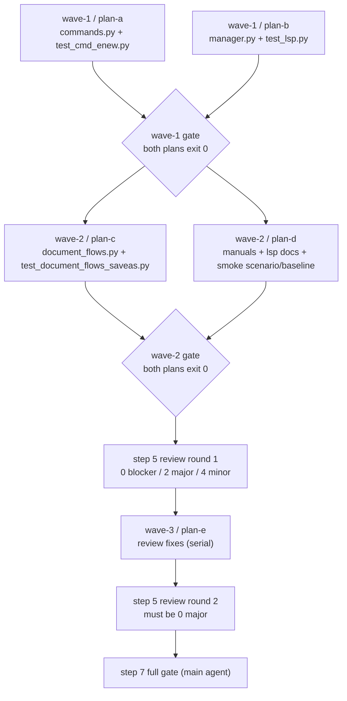

# Unnamed-buffer LSP attach sub-plan overview — `:enew` args / unnamed-buffer LSP attach

Main plan: [`../enew-args-lsp-attach-plan.md`](../enew-args-lsp-attach-plan.md) · issue notes:
[`../enew-args-lsp-attach-issue-notes.md`](../enew-args-lsp-attach-issue-notes.md).
Worktree root: `../yate-enew-args-lsp-attach` (relative to the main repo); every command in
the sub-plans runs from that root with `.venv\Scripts\python.exe`.

## 1. Goals / non-goals

See §1 of the main plan. In one line: reject `:enew FILE` loudly, make
`state_for_doc` obey the same `path is not None` gate as `supports` /
`ensure_client`, and make a successful `:saveas` (including the `Save as: `
prompt) really `didOpen` the new URI on the language server, without duplicate
or stale `didOpen` state. No new LSP server for pathless buffers, no
`:enew FILE` create-and-bind variant, no CHANGELOG edits, no push.

## 2. Sub-plan index

| Plan | Wave | Title | Exclusive files |
|---|---|---|---|
| a | wave-1 | `:enew` argument guard | [`enew-args-lsp-attach-guard-plan-a.md`](enew-args-lsp-attach-guard-plan-a.md) |
| b | wave-1 | L0 manager: path gate, URI retarget, single didOpen | [`enew-args-lsp-attach-state-plan-b.md`](enew-args-lsp-attach-state-plan-b.md) |
| c | wave-2 | `:saveas` wiring in `DocumentFlows` | [`enew-args-lsp-attach-saveas-plan-c.md`](enew-args-lsp-attach-saveas-plan-c.md) |
| d | wave-2 | bilingual manuals + smoke check/baseline | [`enew-args-lsp-attach-docs-plan-d.md`](enew-args-lsp-attach-docs-plan-d.md) |
| e | wave-3 (serial) | review round-1 major/minor fixes | [`enew-args-lsp-attach-review-plan-e.md`](enew-args-lsp-attach-review-plan-e.md) |

## 3. Execution waves (strictly customized; no re-ordering at runtime)



| Wave | Plans (parallel) | Start condition | Exclusive-file overlap | Per-wave commit (main agent) |
|---|---|---|---|---|
| wave-1 | plan-a ∥ plan-b | plan approved (waived in unattended mode) | none: a touches `yate/commands.py` + `tests/test_cmd_enew.py`; b touches `yate/editor_lsp/manager.py` + `tests/test_lsp.py` | `fix(commands): ...` and `fix(lsp): ...` — one commit per plan product (done: `df91f5c`, `429ff18`) |
| wave-2 | plan-c ∥ plan-d | both wave-1 plans' acceptance commands exit 0 | none: c touches `yate/flows/document_flows.py` + `tests/test_document_flows_saveas.py`; d touches `yate/resources/manual.{en,zh}.md`, `yate/docs/lsp.{en,zh}.md`, `tools/smoke_test/scenarios/aliases.py`, `tools/smoke_test/smoke_baselines/command_alias_roundup.json` | `fix(flows): ...` and `docs(manual): ...` — one commit per plan product (done: `c7fb803`, `383affe`) |
| wave-3 | plan-e (single, serial) | step 5 round 1 produced 2 majors; step 2 redesign committed | sequential: e rewrites `yate/editor_lsp/manager.py`, appends to `tests/test_lsp.py` and `tests/test_cmd_enew.py` after wave-1/2 are committed, so there is no concurrent writer | `fix(lsp): ...` — one commit after independent verification |

Batch size is 2 for wave-1/2 (within the 2~3 per batch rule of
`subagent-workflow.md` §五.5) and 1 for the serial review-fix wave. Files
inside one wave never overlap; the runner must not create shared temp files
inside the worktree. plan-c depends on plan-b's new
`on_document_retargeted` symbol, plan-d's smoke assertion depends on plan-a's
guard — both dependencies are satisfied only by starting wave-2 after the
wave-1 gate. wave-3 is a step-6 iteration: it starts only after step 5 review
round 1 and the step-2 design amendment are recorded, and review round 2 must
confirm 0 blocker/major before step 7.

## 4. Exclusive-file matrix (single source of truth for task books)

| File | a | b | c | d | e |
|---|:---:|:---:|:---:|:---:|:---:|
| `yate/commands.py` | W | — | — | — | — |
| `tests/test_cmd_enew.py` (new) | W | — | — | — | W (append 1 case) |
| `yate/editor_lsp/manager.py` | — | W | — | — | W (in-place rewrite) |
| `tests/test_lsp.py` | — | W | — | — | W (append 7 cases) |
| `yate/flows/document_flows.py` | — | — | W | — | — |
| `tests/test_document_flows_saveas.py` (new) | — | — | W | — | — |
| `yate/resources/manual.en.md` / `manual.zh.md` | — | — | — | W | — |
| `yate/docs/lsp.en.md` / `lsp.zh.md` | — | — | — | W | — |
| `tools/smoke_test/scenarios/aliases.py` | — | — | — | W | — |
| `tools/smoke_test/smoke_baselines/command_alias_roundup.json` | — | — | — | W | — |

Wave e is serial and runs only after waves a-d are committed, so its reuse of
three earlier files creates no concurrent writer.

Anything not listed is read-only for every plan (in particular `.trae/**`
documents, `.trae/rules/**`, `tests/test_architecture.py`, `pyproject.toml`).
Sub-plan executors must not edit product source outside their own column; if a
needed change falls outside, stop and report (plan-executor script §1.4).

## 5. Shared acceptance contract

Every plan runs its own listed commands and reports exit codes. In addition,
each wave gate re-runs (main agent, independent verification):

```powershell
.venv\Scripts\python.exe -m pyright yate/ tests/ tools/ pack/
.venv\Scripts\python.exe -m pytest tests/ -q -n auto
.venv\Scripts\python.exe -m pytest tests/test_architecture.py -q
```

Local/partial coverage runs must add `--cov-fail-under=0`. Parallel failures
must be re-checked with `-n 1` and fixed if they are a real timing assumption;
never record a flake as "retry and it passes".

Step 7 (main agent only) additionally runs the smoke `run --jobs 4` and the
full coverage command with `--cov-fail-under=75`, then backfills §7 of the main
plan with real before/after numbers and exit codes.

## 6. Progress backfill (done at step 7)

All five sub-plans (a-e) now contain measured execution records (commands,
exit codes, negative drills and deviations); the main plan §0/§6/§7 carries the
process state, review conclusions, residual backlog and final gate numbers;
both review rounds are archived under `.trae/reviews/` and indexed in its
README (#59, #60). Execution facts:

| Wave | Commit(s) | Independent main-agent verification |
|---|---|---|
| wave-1 | `df91f5c`, `429ff18` | 143 passed / pyright 0 / architecture 37 |
| wave-2 | `c7fb803`, `383affe` | 74 passed (focused) / pyright 0 / architecture 37 / smoke `compare` MATCH 18/18 |
| wave-3 | `28a5fdf` | 96 passed (focused) / pyright 0 / architecture 37 / `manager.py` 797 lines |

Step-7 full gate (main agent, all exit 0): pyright 0 errors; pytest `-n auto`
3422 passed / 10 skipped; architecture 37 passed; coverage `--cov-fail-under=75`
`Total coverage: 92.86%`; smoke `run --jobs 4` 121/121 scenarios, 1464/1464
checks. Review round 2: 0 blocker / 0 major / 2 minor (one backfill obligation
resolved here, one residual backlog registered in main plan §6). Deviations in
thresholds, scope or selection are recorded per plan with evidence
(`plan-before-execute.md` §二.4).
