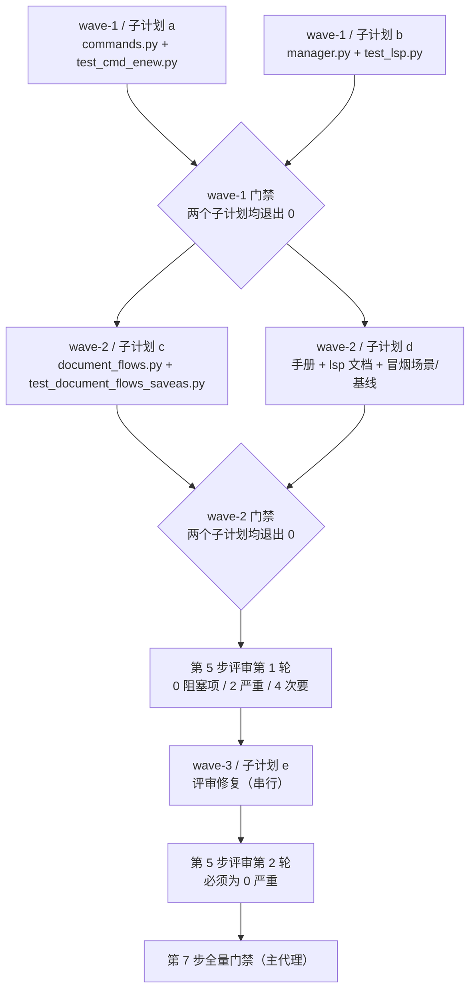

# 无名称缓冲区 LSP 接入子计划总览 — `:enew` 参数 / 无名称缓冲区 LSP 接入

主计划：[`../enew-args-lsp-attach-plan.md`](../enew-args-lsp-attach-plan.md) · issue 记录：
[`../enew-args-lsp-attach-issue-notes.md`](../enew-args-lsp-attach-issue-notes.md)。
worktree 根目录：`../yate-enew-args-lsp-attach`（相对于主仓库）；子计划中的每条命令
都在该根目录用 `.venv\Scripts\python.exe` 运行。

## 1. 目标 / 非目标

见主计划 §1。一句话概括：明确拒绝 `:enew FILE`，让
`state_for_doc` 遵循与 `supports` /
`ensure_client` 相同的 `path is not None` 闸门，并使成功的 `:saveas`（包括 `Save as: `
提示）真正在语言服务器上 `didOpen` 新 URI，且不产生重复或陈旧的 `didOpen` 状态。不为无路径缓冲区新增 LSP 服务端，不新增
`:enew FILE` 的创建并绑定变体，不改 CHANGELOG，不推送。

## 2. 子计划索引

| 子计划 | 波次 | 标题 | 独占文件 |
|---|---|---|---|
| a | wave-1 | `:enew` 参数守卫 | [`enew-args-lsp-attach-guard-plan-a.md`](enew-args-lsp-attach-guard-plan-a.md) |
| b | wave-1 | L0 管理器：路径闸门、URI 重定向、单次 didOpen | [`enew-args-lsp-attach-state-plan-b.md`](enew-args-lsp-attach-state-plan-b.md) |
| c | wave-2 | `DocumentFlows` 中的 `:saveas` 接线 | [`enew-args-lsp-attach-saveas-plan-c.md`](enew-args-lsp-attach-saveas-plan-c.md) |
| d | wave-2 | 双语手册 + 冒烟检查/基线 | [`enew-args-lsp-attach-docs-plan-d.md`](enew-args-lsp-attach-docs-plan-d.md) |
| e | wave-3（串行） | 评审第 1 轮严重/次要项修复 | [`enew-args-lsp-attach-review-plan-e.md`](enew-args-lsp-attach-review-plan-e.md) |

## 3. 执行波次（严格定制；运行时不得重排）



| 波次 | 子计划（并行） | 启动条件 | 独占文件重叠 | 每波次提交（主代理） |
|---|---|---|---|---|
| wave-1 | 子计划 a ∥ 子计划 b | 方案已批准（无人值守模式下豁免） | 无：a 改动 `yate/commands.py` + `tests/test_cmd_enew.py`；b 改动 `yate/editor_lsp/manager.py` + `tests/test_lsp.py` | `fix(commands): ...` 与 `fix(lsp): ...` —— 每个子计划的产品各一笔提交（已完成：`df91f5c`、`429ff18`） |
| wave-2 | 子计划 c ∥ 子计划 d | 两个 wave-1 子计划的验收命令均退出 0 | 无：c 改动 `yate/flows/document_flows.py` + `tests/test_document_flows_saveas.py`；d 改动 `yate/resources/manual.{en,zh}.md`、`yate/docs/lsp.{en,zh}.md`、`tools/smoke_test/scenarios/aliases.py`、`tools/smoke_test/smoke_baselines/command_alias_roundup.json` | `fix(flows): ...` 与 `docs(manual): ...` —— 每个子计划的产品各一笔提交（已完成：`c7fb803`、`383affe`） |
| wave-3 | 子计划 e（单个，串行） | 第 5 步第 1 轮产生 2 项严重问题；第 2 步重新设计已提交 | 顺序执行：在 wave-1/2 提交之后，e 重写 `yate/editor_lsp/manager.py`，并向 `tests/test_lsp.py` 和 `tests/test_cmd_enew.py` 追加用例，因此没有并发写入者 | `fix(lsp): ...` —— 独立验证后一笔提交 |

wave-1/2 的批大小为 2（符合 `subagent-workflow.md` §五.5 每批 2~3 的规则），串行评审修复波次为 1。同一波次内的文件
从不重叠；运行者不得在 worktree 内创建共享临时文件。子计划 c 依赖子计划 b 新增的
`on_document_retargeted` 符号，子计划 d 的冒烟断言依赖子计划 a 的
守卫 —— 这两个依赖只有在 wave-1 门禁之后启动 wave-2 才能满足。wave-3 是第 6 步的迭代：只有在第 5 步评审第 1 轮和第 2 步设计修订都已记录后才启动，且第 7 步之前评审第 2 轮必须确认 0 阻塞项/严重问题。

## 4. 独占文件矩阵（任务书的唯一事实来源）

| 文件 | a | b | c | d | e |
|---|:---:|:---:|:---:|:---:|:---:|
| `yate/commands.py` | W | — | — | — | — |
| `tests/test_cmd_enew.py`（新建） | W | — | — | — | W（追加 1 个用例） |
| `yate/editor_lsp/manager.py` | — | W | — | — | W（就地重写） |
| `tests/test_lsp.py` | — | W | — | — | W（追加 7 个用例） |
| `yate/flows/document_flows.py` | — | — | W | — | — |
| `tests/test_document_flows_saveas.py`（新建） | — | — | W | — | — |
| `yate/resources/manual.en.md` / `manual.zh.md` | — | — | — | W | — |
| `yate/docs/lsp.en.md` / `lsp.zh.md` | — | — | — | W | — |
| `tools/smoke_test/scenarios/aliases.py` | — | — | — | W | — |
| `tools/smoke_test/smoke_baselines/command_alias_roundup.json` | — | — | — | W | — |

波次 e 是串行的，且仅在波次 a-d 提交之后运行，因此它复用三个更早的文件不会产生并发写入者。

未列出的任何内容对所有子计划均为只读（尤其是 `.trae/**`
文档、`.trae/rules/**`、`tests/test_architecture.py`、`pyproject.toml`）。
子计划执行者不得编辑自己那一列之外的产品源码；若所需改动超出范围，则停下并上报（plan-executor 脚本 §1.4）。

## 5. 共用验收契约

每个子计划运行自己列出的命令并报告退出码。此外，每个波次门禁都会重跑（主代理独立验证）：

```powershell
.venv\Scripts\python.exe -m pyright yate/ tests/ tools/ pack/
.venv\Scripts\python.exe -m pytest tests/ -q -n auto
.venv\Scripts\python.exe -m pytest tests/test_architecture.py -q
```

本地/部分覆盖率运行必须加上 `--cov-fail-under=0`。并行失败必须用 `-n 1` 复核，若确为真实的时序假设则加以修复；绝不能把偶发抖动记为“重试就通过”。

第 7 步（仅主代理）还会运行冒烟 `run --jobs 4` 和带 `--cov-fail-under=75` 的全量覆盖率命令，然后用真实的改动前/改动后数字和退出码回填主计划 §7。

## 6. 进度回填（在第 7 步完成）

五个子计划（a-e）现在都包含实测执行记录（命令、退出码、负向演练和偏差）；主计划 §0/§6/§7 承载流程状态、评审结论、遗留待办和最终门禁数字；
两轮评审均已归档到 `.trae/reviews/` 并在其 README 中登记（#59、#60）。执行事实：

| 波次 | 提交 | 主代理独立验证 |
|---|---|---|
| wave-1 | `df91f5c`、`429ff18` | 143 通过 / pyright 0 / 架构 37 |
| wave-2 | `c7fb803`、`383affe` | 74 通过（聚焦集合） / pyright 0 / 架构 37 / 冒烟 `compare` MATCH 18/18 |
| wave-3 | `28a5fdf` | 96 通过（聚焦集合） / pyright 0 / 架构 37 / `manager.py` 797 行 |

第 7 步全量门禁（主代理，全部退出 0）：pyright 0 错误；pytest `-n auto`
3422 通过 / 10 跳过；架构 37 通过；覆盖率 `--cov-fail-under=75`
`Total coverage: 92.86%`；冒烟 `run --jobs 4` 121/121 场景、1464/1464
检查。评审第 2 轮：0 阻塞项 / 0 严重 / 2 次要（一项回填义务在此解决，一项遗留待办登记在主计划 §6）。阈值、范围或选型上的偏差均逐子计划记录并附证据
（`plan-before-execute.md` §二.4）。
