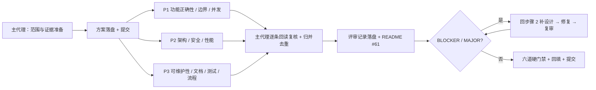

# 合并前 PR 预评审方案 — `fix/enew-args-lsp-attach`

- **Date**：2026-11-07
- **Mode**：`review`（[pr-review SKILL](../skills/pr-review/SKILL.md) Step 2 默认：全六维度 + Verdict + Action plan）
- **Scope**：`master...HEAD` **三点差异**；`merge-base` = `8e60598`，master tip `3e92532`。
  master 独有 1 笔提交（`3e92532 docs(plan): backfill the full gate results for the
  highlight flake fix`），只改 `.trae/documents/windows-py313-highlight-flake-plan.md`；
  与 PR 改动文件 **零重叠**，`git merge-tree 8e60598 master HEAD` exit 0 无冲突面。
- **PR 体量**：17 提交 / 24 文件 / +3111−44；工作区 clean、无上游、未推送。
- **Sources**：[pr-review SKILL](../skills/pr-review/SKILL.md)、
  [code-review-expert 剧本](../agents/code-review-expert.md)、`.trae/rules/` 八份规则、
  [主计划](enew-args-lsp-attach-plan.md)、[子计划总纲](enew-args-lsp-attach-plans/overview.md)、
  [命名迁移方案](enew-args-lsp-attach-naming-plan.md)、
  [#59 首轮评审](../reviews/2026-11-06-enew-args-lsp-attach-review.md)、
  [#60 迭代复审](../reviews/2026-11-06-enew-args-lsp-attach-iteration-review.md)、
  [评审索引](../reviews/README.md)。
- **Noise filter**（skill Step 1，一次性声明）：三点 diff 内无 `.pyc` / lock / 二进制 /
  `.venv` / 生成物；`smoke_baselines/command_alias_roundup.json` 是**行为基线**（含新增
  `enew_rejects_args` 断言），不属噪声，须评审；无纯重排 / 纯格式 hunk。

## 0. 流程状态（`task-orchestration.md` §二）

| Step | State |
|---|---|
| 1 领会 | done: skill + 8 规则加载，三点范围 / merge-base / 冲突面 / 门禁口径实测 |
| 2 方案 | done: 本文档 |
| 3 批准 | waived: 用户既有无人值守授权（「所有问题无须过问」），按总纲 §二.5 不发起询问或审批 |
| 4 执行 | done: 3 名只读审查员一波并行；P2 首轮零产出，按 `subagent-workflow.md` §五.4 变更粒度重试一次，最终 3/3 有效交付 |
| 5 审核 | done: 主代理逐条回读复核（1 MAJOR 保留 / 1 MAJOR 降级 / 2 MINOR 删除 / 其余登记）；[评审记录](../reviews/2026-11-07-pr-review-fix-enew-args-lsp-attach.md) + README #61 落盘 |
| 6 迭代 | done: §6 迭代设计（`5bf3eb8`）→ 修复波（`623422e`）→ 修复后 `0 BLOCKER / 0 MAJOR`，APPROVE |
| 7 收尾 | done: 六道硬门禁全 exit 0、§4 回填、按步提交、`git status --short` 空、不推送 |

`plan-architect-designer` 依既有记忆（frontmatter `qwen-3.7-plus` 在本运行时未注册、任务书
指定模型无效）不再重复 spawn；本方案由主代理按 `task-orchestration.md` §三 亲自产出，
**如实标注该环节子代理零产出**。

## 1. 目标 / 非目标

目标：

1. 对 `master...HEAD` 的**全部**改动做 PR 级预评审：功能正确性、安全、性能、
   可维护性、架构边界（R1–R15）、六道硬门禁。
2. 产出 `Overall: [APPROVE | REQUEST_CHANGES | BLOCKED]` 结论 + 分级 findings +
   Strengths，落盘为 `.trae/reviews/2026-11-07-pr-review-fix-enew-args-lsp-attach.md`
   （`doc-conventions.md` §二.1：`YYYY-MM-DD-<topic>.md`，同日以主题区分、无 `-2`），
   并在索引登记 #61。
3. 发现 BLOCKER/MAJOR 时按闭环修复并复审至归零；MINOR 尽量当轮销账，其余按理由登记。
4. 主代理亲自跑全量六道门禁并回填真实数字与退出码。

非目标：

- 不评审三点 diff 之外的代码 / 规则源 / CI 配置（skill Step 1「只评审 diff」）。
- 不合并、不推送、不改写历史（无 rebase / amend / force）。
- 不重审 #59/#60 已裁定并闭环的两个功能 minor（已登记为主计划 §6 residual backlog）；
  但须复核其登记仍在位、未被本 PR 后续文档改动抹掉。
- 不因「更 Pythonic」重写已验证逻辑（skill Decision Guidance）。

## 2. 备选方案与否决理由

| 备选 | 否决理由 |
|---|---|
| A. 只评审命名迁移 6 笔提交 | pr-review 的对象是整条 PR；产品代码 11 笔才是风险主体，且 `misc-rules.md` §三 纯文档豁免在混合变更下不适用。 |
| B. 用 `master..HEAD` 两点差异 | 包含 master 独有 1 笔文档改动作为「反向 diff」，会把本 PR 未改的文件算进范围；skill Step 1 明确三点 `merge-base...HEAD`。 |
| C. 单审查员全维度 | 历史 #56/#58 惯例为 3 名只读审查员并行分维度，主代理逐条回读复核；单人易漏维度且无交叉印证。 |
| D. 审查员各自跑全量 pytest / 覆盖率 | `subagent-workflow.md` §三.3：并发跑 pytest / Textual pilot 互相干扰；门禁由主代理在独立轮次亲跑（§二.7），审查员零门禁、零写盘。 |
| E. 复用 #59/#60 结论直接 APPROVE | 两轮只覆盖原修复的两段范围，未做 PR 级六维度评审、未覆盖命名迁移 6 笔与最终态全量门禁。 |

## 3. 分步实施



### Step 1 — 方案（本文档）

输入：skill + 规则 + 范围实测。输出：本文件。验收：
`git status --short` 只显示本新增文件；`git diff --check` exit 0；提交
`docs(plan): add pre-merge PR review plan for unnamed-buffer LSP attach`。

### Step 2 — 三审查员并行（只读）

输入：本文档 + skill + 规则 + 三点 diff。一波 3 个 `code-review-expert`
（[剧本](../agents/code-review-expert.md)，`bypassPermissions`），各自**只读、零写盘、
零全量门禁**，只领自己维度的取证：

| 审查员 | 维度 | 重点文件 |
|---|---|---|
| P1 | 功能正确性 / 边界 / 并发 / 异常处理 | `yate/editor_lsp/manager.py`、`yate/flows/document_flows.py`、`yate/commands.py`、`tests/test_lsp.py`、`tests/test_cmd_enew.py`、`tests/test_document_flows_saveas.py` |
| P2 | 安全 / 性能 / 架构边界 R1–R15 | 同上产品代码的依赖方向、URI / 路径构造、O(n²) 与 I/O 模式、`SIZE_EXEMPT_FILES`（`manager.py` 应 <800 行）、无新增 `Protocol` / `Any` / `TYPE_CHECKING` / 向上连线 |
| P3 | 可维护性 / 测试与基线 / 文档 / 流程纪律 | 双语手册 `manual.{en,zh}.md` + `docs/lsp.{en,zh}.md` 同步、smoke 场景与 baseline、计划/评审文档相对链接与如实汇报、17 笔提交信息、`pyproject.toml` 未改动、`python-coding-style.md` §五 清单 |

任务书统一要求：`file:line` 证据、三级 `[BLOCKER|MAJOR|MINOR]`、修复建议、
强制自我批判登记（`code-review-expert.md` §强制自我批判）、命令与退出码；
只报有依据的问题，宁漏不误报；不得修改任何文件。
验收：3 份报告全部交付；任一零产出则按 `subagent-workflow.md` §五.3 判死后
由主代理按剧本兜底，并如实标注。

### Step 3 — 主代理复核、归档、索引

输入：3 份报告。主代理对**每条** finding 独立回读原文与上下文，删除误报、降级、
登记不修理由，合并同源项；产出：

- `.trae/reviews/2026-11-07-pr-review-fix-enew-args-lsp-attach.md`（只读事实记录，
  Verdict / Findings / 复核删除降级 / Strengths / 硬门禁表 / 修复后复核）；
- `.trae/reviews/README.md` 追加 #61 增量段（不动 #59/#60 既有段）。

验收：记录内所有相对链接可解析；`git diff --check` exit 0；提交
`docs(review): record pre-merge PR review for unnamed-buffer LSP attach`。

### Step 4 — 迭代（条件触发）

有 BLOCKER/MAJOR → 回步骤 2 在本方案补「迭代设计」小节，按独占文件修复，
先红后绿的负向演练，复审至 0 BLOCKER / 0 MAJOR；仅 MINOR 则按 §二.6 登记待办。
产物按步提交，不合并到其它步骤。

### Step 5 — 收尾（主代理亲跑）

在 worktree 根目录、独立轮次执行（四路径 pyright 按 `task-orchestration.md` §二.7 与
`pyproject.toml` `[tool.pyright] include`；覆盖率阈值 75 单源于
`[tool.coverage.report] fail_under`）：

```powershell
.venv\Scripts\python.exe -m pyright yate/ tests/ tools/ pack/
.venv\Scripts\python.exe -m pytest tests/ -q -n auto
.venv\Scripts\python.exe -m pytest tests/test_architecture.py -q
.venv\Scripts\python.exe -m pytest tests/ --cov=yate --cov-branch -n auto
.venv\Scripts\python.exe -m tools.smoke_test run --jobs 4
.venv\Scripts\python.exe -m tools.changelog check
git diff --check master...HEAD
```

`-q` 无汇总行时以 exit code 为权威信号；并行 flake 用 `-n 1` 复核并修用例，
不得记成「偶发」。回填评审记录与本方案 §4（真实数字 / 退出码 / 偏离），
提交 `docs(review): backfill pre-merge PR review gate results`；
终态 `git status --short` 空、无 push。

## 4. 执行记录（收尾回填真实数字）

| 项 | 结果 | 退出码 |
|---|---|---|
| 三点范围 / merge-base / 冲突面 | `8e60598`；17 提交 / 24 文件 / +3111−44；master 零重叠、merge-tree exit 0 | 0 |
| 3 名审查员 | 3/3 有效交付；P2 首轮交付上下文压缩摘要（零产出），变更任务粒度重试一次后交付 APPROVE / 2 MINOR | — |
| 复核后 Verdict | 基线 `REQUEST_CHANGES` 0 BLOCKER / 1 MAJOR / 4 MINOR → 修复后 `APPROVE` 0 BLOCKER / 0 MAJOR | — |
| pyright（四路径） | `0 errors, 0 warnings, 0 informations`（`yate/ tests/ tools/ pack/`） | 0 |
| pytest `-n auto` | exit 0；`-q` 无汇总行，`--junitxml` 取回 `tests=3432 failures=0 errors=0 skipped=10` | 0 |
| 架构 37 守卫 | 37 passed | 0 |
| 覆盖率 `--cov-branch` | `3422 passed, 10 skipped in 147.12s`；`TOTAL 19425/1093/6206/570 = 93%`；`Required test coverage of 75.0% reached. Total coverage: 92.90%` | 0 |
| 冒烟 `--jobs 4` | `121/121 scenarios passed`、`1464/1464 checks (100%)`、79.05s | 0 |
| changelog check | `released changelog sections are up to date`；unreleased 滞后为发布期刷新 | 0 |
| `git diff --check master...HEAD` | 无空白错误 / 冲突标记 | 0 |
| 终态 `git status --short` | 空（`-uall` 复核） | 0 |

Deviations（逐条如实登记）：

1. `plan-architect-designer` 未 spawn：既有记忆显示其 frontmatter 模型在本运行时
   未注册、任务书指定模型无效，故由主代理按 `task-orchestration.md` §三亲自产出
   方案，如实标注「该环节子代理零产出」。
2. P2 首轮零产出（交付上下文压缩摘要而非评审报告），按 `subagent-workflow.md`
   §五.4 变更任务粒度重试 **一次** 后交付；未原样重试、未重建团队。
3. 审查员零全量门禁（`subagent-workflow.md` §三.3 并发干扰），六道门禁由主代理
   在独立轮次亲跑（§二.7）。
4. `pytest -q -n auto` 无汇总行，按既有记忆以 exit code 为权威信号，另用
   `--junitxml` 取回精确计数；临时 XML 落 `%TEMP%` 并已删除。
5. 混合变更（含产品代码）**不适用** `misc-rules.md` §三 纯文档豁免；命名迁移三轮
   评审的豁免记录已在 `enew-args-lsp-attach-naming-plan.md` §4 注明豁免在 PR 级失效。
6. 评审记录归档发生在修复与门禁之后，故一次性写入完整实测数据；步骤 3/5 产物在
   最终态合并为一份只读事实文档（#61）。
7. MAJOR-2（盘符路径）未做批量脱敏，沿用命名迁移 round-1/2/3 三轮在案裁决；
   仅采纳其「自我矛盾」子点订正措辞（§6.1）。

## 5. 风险与回滚

| 风险 | 缓解 | 回滚 |
|---|---|---|
| 审查员零产出 / 判死 | 一波 3 个（硬上限 6），`bypassPermissions`；同名任务不原样重试 | 主代理按 `code-review-expert.md` 剧本兜底，标注「子代理零产出」 |
| 并发跑测试互相干扰 | 审查员零门禁；主代理门禁拆独立轮次 | 失败用 `-n 1` / `--jobs 1` 复核，修用例而非改断言 |
| `%TEMP%` 积压拖慢 / 触发 safe-delete 钩子 | 不在仓库内用 `--basetemp`；不擅自批量清理积压 | 门禁失败先取证再决定，分批处置 |
| master 分叉导致合并冲突 | 已实测零重叠 + merge-tree exit 0；评审只覆盖三点 diff | 若合并期出现冲突，另案处理，不在本 PR 改写历史 |
| 发现 MAJOR 需改产品代码 | 回步骤 2 补迭代设计、独占文件、负向演练先红后绿 | `git revert` 修复提交，保留评审记录 |
| 评审记录含修复排期 | `doc-conventions.md` §二.1：记录只写事实，改法 / 验收 / 回滚留在本方案 | 拆出排期段落到本方案 |

General rollback：`git revert` 本轮新增的文档提交；评审记录为只读事实文档，
不删改既有 #59/#60 段。无历史改写、无 push。

## 6. 迭代设计（步骤 5 回到步骤 2）

触发：3 名审查员报告 + 主代理逐条回读复核，基线 `REQUEST_CHANGES`
（P3 报 2 MAJOR / 3 MINOR，P1 报 3 MINOR，P2 首轮零产出、重试后 2 MINOR）。
按 `task-orchestration.md` §二.6 回到步骤 2，本节是重设计，批准仍按总纲 §二.5 豁免。

### 6.1 主代理复核裁定（逐条引反证）

| 来源 | 初判 | 复核 | 依据 |
|---|---|---|---|
| P3-1 | MAJOR：`naming-plan.md:50-51` 称「12 条既有 subject 不含 issue 编号名」 | **确认保留（MAJOR）** | `git log --format=%s 8e60598..9c90c8d` 实测 12 条中 **6 条含 `IKSFS7`**（`7011ff2`/`68a1ada`/`2c6989b`/`20e6b9c`/`6ec91ec`/`0619086`），断言与事实相反 |
| P3-2 | MAJOR：`naming-plan.md` 11 行盘符路径违反 `doc-conventions.md` §五 | **降级 Deferred，不翻案** | 命名迁移 round-1/2/3 三轮一致性评审已就同一事实裁定不成立：这些是 worktree 迁移的**目标产物路径**与实测输出证据，§五 约束的是仓库内文件引用与环境信息；§6 命令块若改占位符即失去可执行性（`plan-before-execute.md` §二.2）；§五 末条存量迁移。**采纳其自我矛盾点**：订正 §2 末段措辞，写明 portable-wording 承诺只针对主计划 §0 的证据行 |
| P3-3 | MINOR：`tests/test_cmd_enew.py` 的 `_Enrew*` 拼写 | **确认保留（修）** | 实测 9 处 `_Enrew`；`enew` 词根应拼 `_Enew*` |
| P3-4 | MINOR：冒烟未断言 usage 警告文本 | **登记 Deferred** | `tests/test_cmd_enew.py` 已精确断言警告全文；新增 check 需重新生成 `command_alias_roundup.json` 基线，属已知风险面（SVG 行 / mtime 锚定），无行为收益 |
| P3-5 | MINOR：`§二.5` 引用在 `.trae/rules/` 零命中 | **降级为措辞澄清（修）** | 引用的是 **always-applied workspace 总纲 §二.5**（无人值守 bypass），不是 git 跟踪的 `.trae/rules/`；两处引用补明来源以消除歧义 |
| P1-1 | MINOR：等价路径 save-as 后 `_uri_cache` 被销毁、每次按键重算 `resolve()` | **删除（误报）** | `manager.py:454` 的 `new_uri = self._uri(doc)` 在 `:458` 的 `pop` **之前**已按新 spelling 建键；`tests/test_lsp.py:2485-2493` 断言去重后 `values.count(uri) == 1` 且旧键不在缓存 → 缓存命中，不存在重复 syscall |
| P1-2 | MINOR：same-URI 且从未 shown 的路径无测试 | **登记 Deferred** | 与 #60 minor#2 同源，主计划 §6 residual backlog 已在位；补测试会把待修行为固化 |
| P1-3 | MINOR：`previous_path` 捕获时机无负向演练 | **删除（误报）** | `tests/test_document_flows_saveas.py:180-181` 同时断言 `work.args == (doc, source)` 与 `doc.path == renamed`；实现若把捕获放到 `doc.save()` 之后会拿到 `renamed`，用例即红，已是差异化验证 |
| P2-1（重试） | MINOR：`_uri_cache` 单条旧键延迟清理 | **登记 Deferred** | 审查员自述「有测试背书、可接受不动」；`_drop_uri_cache` 按 URI 值清理，非无界增长 |
| P2-2（重试） | MINOR：同 client 的 didClose+didOpen 空转 | **登记 Deferred** | `enew-args-lsp-attach-review-plan-e.md` §7 已登记「旧 URI 让位 / close wins」为显式设计取舍 |

复核后基线：**0 BLOCKER / 1 MAJOR / 4 MINOR**（4 MINOR 中 2 条修、2 条登记；
另有 4 条审查员 MINOR 经反证删除或降级 Deferred）。「吞异常」候选由 P2 重试
以 `path_to_uri` 的 4 个异常输入探针（NUL / 孤立代理码位 / 3000 字符 / UNC）
实测全部不抛错，且 `on_document_shown` 同类路径风险不高于改动前 → 不成立。

### 6.2 修复设计（独占文件）

| 文件 | 改动 | 验收 |
|---|---|---|
| `.trae/documents/enew-args-lsp-attach-naming-plan.md` | ① §1 非目标改为「6 条 subject 仍含 issue 编号，属已知且接受的偏离，不改写历史」；② §2 末段明确 portable-wording 承诺范围；③ §0 与 §6 两处 `§二.5` 补明 always-applied 总纲来源；④ §4 追加偏离 #9；⑤ §4 结尾补 pr-review 修复一句 | `git diff --check` 0；全文不再出现 `contain no issue-number name`；相对链接 0 断链 |
| `tests/test_cmd_enew.py` | 9 处 `_Enrew` → `_Enew` | `pytest tests/test_cmd_enew.py -q` exit 0（6 passed）；`pyright` 四路径 0 诊断 |
| `.trae/reviews/README.md` | 追加 #61 索引段 | 相对链接目标存在 |

**不改动**：`yate/**` 产品代码、`tools/smoke_test/**`、10 份既有计划/评审文档、
既有提交信息（无 amend / rebase / force）。

### 6.3 复审与门禁

修复仅涉及文档措辞与测试替身重命名，无产品代码，故复审由**主代理**执行
（不再派子代理，避免重复开销）：局部 `pytest tests/test_cmd_enew.py -q` +
pyright 四路径 + `git diff --check` + 一致性扫描；随后按 §3 Step 5 亲跑
六道全量门禁（本 PR 为混合变更，`misc-rules.md` §三 豁免不适用）。
六道门禁全 exit 0 且 MAJOR 归零 → 修复后 `APPROVE`。

### 6.4 风险与回滚

| 风险 | 缓解 | 回滚 |
|---|---|---|
| 文档订正引入新的不实陈述 | 每条订正附实测命令与哈希；复核者可按命令复现 | `git revert` 修复提交 |
| 测试替身重命名漏改 | 全局计数从 9 → 0；`pytest` 与 pyright 双验 | 反向替换 |
| 门禁并行 flake | 独立轮次串行发起；失败用 `-n 1` / `--jobs 1` 复核并修用例 | 不记成「偶发」 |
