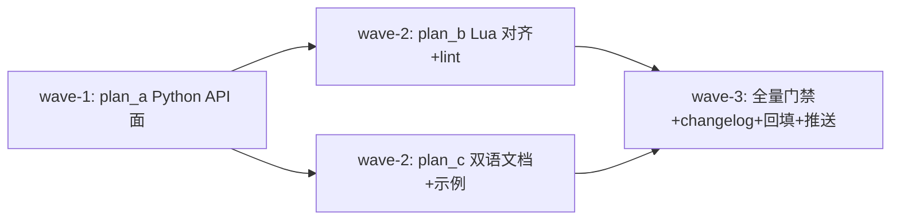

# ext-api-parity — 扩展系统 API 面扩展与 Lua/Python 对齐（Gitee IKK4K6 NEXT STEPS）

## 背景与目标

issue IKK4K6 note_51570814（REVIEWS & NEXT STEPS）四点要求：

1. **API 面**：扩展系统开放的 api 对应大部分模块的公共成员（theme / clipboard / docs / actions 缺口）。
2. **重绑快捷键、加 command**：bind_key 只能绑回调；缺“键 → 具名 action”重绑与解绑、缺按名运行 action。
3. **Lua/Python 同成员**：`_yate.lua` 缺 events / ui / theme / clipboard / docs / actions / bind_action / unbind_key / keymaps。
4. **Lua 过 IDE lint**：无 `.luarc.json`、无 `---@meta` 定义文件，用户脚本里 `yate` 全局在 lua-language-server 下是 unknown-global。

## 现状锚点（取证结论）

- Python 侧：`yate/services/extension_api.py`（accessors: app/buffer/doc/workspace/keymaps/lsp/highlight/syntax/sprites/ui/events；registrars: register_action/bind_key/command/register_command；services: message/shell/open_path/save）。
- Lua 侧：`yate/extensions/_yate.lua` 仅 message/register_command/register_action/bind_key/shell/open_path/save/buffer()/doc()/workspace() + 原样透传（api/highlight/sprites/lsp/syntax）。
- `Keymap.add_binding` 的 action 参数已是 `str | ActionFunc`（`yate/keymaps/base.py:273`），`bind_action` 有现成底层。
- `KeyUi.execute_action: ActionRunner`（`yate/keymaps/base.py:222`）即按名运行 action，返回 bool。
- `editor.py:400` `extension_context()` 装配 ExtensionContext；`ed.key_ui` 已建（`editor.py:321`）。
- loader 跳过 `_` 前缀文件（`extension_loader.py:74`）→ `_yate.d.lua` 不会被装载。
- 层级约束 R4：services（L3）禁止 import `yate.editor_view`（L2）→ theme 桥必须经 ExtensionContext 回调注入（editor.py 属 L4 可 import theme）。
- R6：全分支 0 处 TYPE_CHECKING / Any / ignore（lua/runtime.py 的既有 noqa 除外，不得新增）。

## 子计划与波次

| 波次 | 子计划 | 文件域 | 内容 |
| --- | --- | --- | --- |
| wave-1 | plan_a | extension_bridges.py / extension_api.py / editor.py / test_extension_bridges.py / test_extension_api.py | Python API 面：theme/clipboard/docs/actions 四桥 + add_segment 工厂 + EditorEvent 再导出 + bind_action/unbind_key + ExtensionContext 回调 |
| wave-2 | plan_b | _yate.lua / _yate.d.lua（新） / .luarc.json（新） / lua.example / test_lua_extensions.py / test_lua_defs.py（新） | Lua 全成员镜像 + `---@meta` 定义文件 + 仓库级 lua lint 配置 + 漂移守卫测试 |
| wave-2 | plan_c | docs/extensions.en.md / .zh.md / example_ext.py.example | 双语手册新章节 + Python 示例模板换用新 API |
| wave-3 | 收尾（主控） | CHANGELOG / yate/resources/changelog.* / 计划回填 | 全量门禁 + changelog 再生成 + 评审记录回填 + 推送 |

## 全局门禁

- `python -m pyright`（strict，0 诊断）
- `python -m pytest tests`（全绿；架构测试含 R1-R13 守卫）
- `python -m pytest tests --cov=yate --cov-branch --cov-report=term-missing --cov-fail-under=75`
- `python -m tools.smoke_test compare`（基线 0 漂移）
- changelog：`python -m tools.changelog` 再生成（release 流程约束）

## 约定

- 计划内路径均为相对仓库根的相对路径。
- `.lua` / `lua.example` 注释与注解一律英文（规则 377）。
- 新代码禁新增 Any / TYPE_CHECKING / ignore（R6）；禁模糊命名。
- 分支：`enh/ext-api-parity`（栈叠于 STEP 1 `enh/extension-system-enhance` tip 8e852b3，该分支未合入 master）。

## 执行记录（2026-10-13 回填）

| 波次 | 提交 | 内容 |
| --- | --- | --- |
| 计划 | `e35220f` | docs(plans): 四份计划落盘 |
| wave-1 | `7be8064` | plan_a Python API 面（四桥 + add_segment + EditorEvent 再导出 + bind_action/unbind_key） |
| （master 同步） | `c0f7ccb` | 执行者并入 origin/master（PR !79 pack-lupa），见"过程注记" |
| wave-2 | `d1bc7c7` | plan_c 双语手册 §4.10-4.14 修订/新增 + example_ext 迁移新 API |
| wave-2 | `1b721d8` | plan_b Lua 全镜像（23 函数 + 6 透传）+ _yate.d.lua + .luarc.json + 漂移守卫 |
| pyright 修复 | `291048b` | 剪贴板 monkeypatch stub 注解化（strict 0） |
| changelog | `559af88` | tools.changelog 再生成（Unreleased 收录本波次） |
| pr-review 修复 | `56284d8` | theme 桥 KeyError 错误契约测试 |

## 全量门禁实测（终版代码树）

- `python -m pyright`：**0 errors**，2 warnings（clipboard.py 的 pyperclip reportMissingModuleSource，存量）
- `python -m pytest tests --cov=yate --cov-branch --cov-fail-under=75 -q`：**exit 0**，coverage **91.94%**（门槛 75%）；修复 291048b/56284d8 后受影响文件复跑全绿（bridges 20 + api 24 + events 12 + lua 26 + defs 3 + examples 9 + ui_contributions）
- `python -m tools.smoke_test compare`：**1352/1352 checks、112/112 scenarios、exit 0**（0 漂移）
- lupa 已装入开发 venv（yate[lua] 可选依赖）：**26 个 live-lua 用例实跑通过**（此前为 skip）
- changelog：`python -m tools.changelog generate` 通过；missing-zh 为存量滞后（Unreleased 容忍，与 STEP 1 先例一致）

## 评审记录（pr-review skill，review 模式，round 1）

评审域 `e35220f..HEAD` 的 5 个本任务提交（master !79 合并内容与生成物按噪音剔除）。

| 级别 | 位置 | 发现 | 处置 |
| --- | --- | --- | --- |
| MINOR | tests/test_extension_bridges.py | theme 桥 docstring 承诺 KeyError 直通，但无契约测试（后续若有人给 set() 加 try/except 降级不会被测出） | **已修** `56284d8`（新增 test_theme_bridge_set_propagates_unknown_theme） |
| MINOR（不修，登记） | extension_bridges.py:420 `add_segment(self, id, ...)` | `id` 遮蔽内建；与 StatusSegment.id 字段名及 Lua 位置参数 API 一致，改名反致三面漂移 | 保留 |
| INFO | .luarc.json `runtime.version: "Lua 5.4"` | lupa 内嵌更高版本（runtime.py 的 require stop-value 注释），LLS 尚不支持；5.4 为最近可用档，缺口不影响库文件 lint | 手册 §4.14 已述，无动作 |
| INFO（过程注记） | 提交 `c0f7ccb` | 某 wave 执行者未在报告中披露即并入 origin/master（PR !79）；分支拓扑仍为预期的栈叠形态，内容无污染 | 登记，无需返工 |

**结论：APPROVE**（AI pre-review；合并决策归人工）。六维检查：功能正确（A13 全路径回滚、Lua nil 惯用法含 0 真值语义正确）、安全（无新 sink、bind 前置校验响亮失败）、性能（无热点改动）、可维护性（桥类命名/文档对齐既有五桥）、架构边界（R4 实证无 editor_view import；R6 全 0；R13 theme 仅经 set_theme 广播）、硬门禁全绿。

## 偏离登记（均已在执行者报告披露）

1. plan_a：`set_theme` 注入用局部 `_set_theme` 适配器（theme.set_theme 返回 Theme，pyright strict 拒绝值返回 lambda 入 None 槽位）；ExtensionContext 新增必填字段同步了 6 个清单外测试文件的构造点（数据类必填字段的连带，任务书授权范围）。
2. plan_b：`error("unknown event: " .. tostring(name))`（防 nil 串接异化）；`_yate.lua` 头部"单一事实来源"表述与 `_yate.d.lua` 产物矛盾处同步改写；lupa 缺装时沿用 skip 机制（后已装 lupa 实跑）。
3. plan_c：§6 两处既有表述与新增 API 矛盾的一致性修正（"不随包分发 .d.lua"、"events/ui 只能走原始桥"）。
