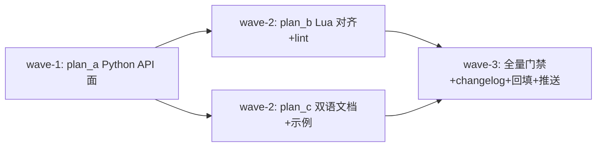

# ext-api-parity — 扩展系统 API 面扩展与 Lua/Python 对齐（Gitee IKK4K6 NEXT STEPS）

## 背景与目标

issue IKK4K6 note_51570814（REVIEWS & NEXT STEPS）四点要求：

1. **API 面**：扩展系统开放的 api 对应大部分模块的公共成员（theme / clipboard / docs / actions 缺口）。
2. **重绑快捷键、加 command**：bind_key 只能绑回调；缺“键 → 具名 action”重绑与解绑、缺按名运行 action。
3. **Lua/Python 同成员**：`_yate.lua` 缺 events / ui / theme / clipboard / docs / actions / bind_action / unbind_key / keymaps。
4. **Lua 过 IDE lint**：无 `.luarc.json`、无 `---@meta` 定义文件，用户脚本里 `yate` 全局在 lua-language-server 下是 unknown-global。

## 现状锚点（取证结论）

- Python 侧：`yate/services/extension_api.py`（accessors: app/buffer/doc/workspace/keymaps/lsp/highlight/syntax/sprites/ui/events；registrars: register_action/bind_key/command/register_command；services: message/shell/open_path/save）。
- Lua 侧：`yate/extensions/_yate.lua` 仅 message/register_command/register_action/bind_key/shell/open_path/save/buffer()/doc()/workspace() + 原样透传（api/highlight/sprites/lsp/syntax）。
- `Keymap.add_binding` 的 action 参数已是 `str | ActionFunc`（`yate/keymaps/base.py:273`），`bind_action` 有现成底层。
- `KeyUi.execute_action: ActionRunner`（`yate/keymaps/base.py:222`）即按名运行 action，返回 bool。
- `editor.py:400` `extension_context()` 装配 ExtensionContext；`ed.key_ui` 已建（`editor.py:321`）。
- loader 跳过 `_` 前缀文件（`extension_loader.py:74`）→ `_yate.d.lua` 不会被装载。
- 层级约束 R4：services（L3）禁止 import `yate.editor_view`（L2）→ theme 桥必须经 ExtensionContext 回调注入（editor.py 属 L4 可 import theme）。
- R6：全分支 0 处 TYPE_CHECKING / Any / ignore（lua/runtime.py 的既有 noqa 除外，不得新增）。

## 子计划与波次

| 波次 | 子计划 | 文件域 | 内容 |
| --- | --- | --- | --- |
| wave-1 | plan_a | extension_bridges.py / extension_api.py / editor.py / test_extension_bridges.py / test_extension_api.py | Python API 面：theme/clipboard/docs/actions 四桥 + add_segment 工厂 + EditorEvent 再导出 + bind_action/unbind_key + ExtensionContext 回调 |
| wave-2 | plan_b | _yate.lua / _yate.d.lua（新） / .luarc.json（新） / lua.example / test_lua_extensions.py / test_lua_defs.py（新） | Lua 全成员镜像 + `---@meta` 定义文件 + 仓库级 lua lint 配置 + 漂移守卫测试 |
| wave-2 | plan_c | docs/extensions.en.md / .zh.md / example_ext.py.example | 双语手册新章节 + Python 示例模板换用新 API |
| wave-3 | 收尾（主控） | CHANGELOG / yate/resources/changelog.* / 计划回填 | 全量门禁 + changelog 再生成 + 评审记录回填 + 推送 |

## 全局门禁

- `python -m pyright`（strict，0 诊断）
- `python -m pytest tests`（全绿；架构测试含 R1-R13 守卫）
- `python -m pytest tests --cov=yate --cov-branch --cov-report=term-missing --cov-fail-under=75`
- `python -m tools.smoke_test compare`（基线 0 漂移）
- changelog：`python -m tools.changelog` 再生成（release 流程约束）

## 约定

- 计划内路径均为相对仓库根的相对路径。
- `.lua` / `lua.example` 注释与注解一律英文（规则 377）。
- 新代码禁新增 Any / TYPE_CHECKING / ignore（R6）；禁模糊命名。
- 分支：`enh/ext-api-parity`（栈叠于 STEP 1 `enh/extension-system-enhance` tip 8e852b3，该分支未合入 master）。
