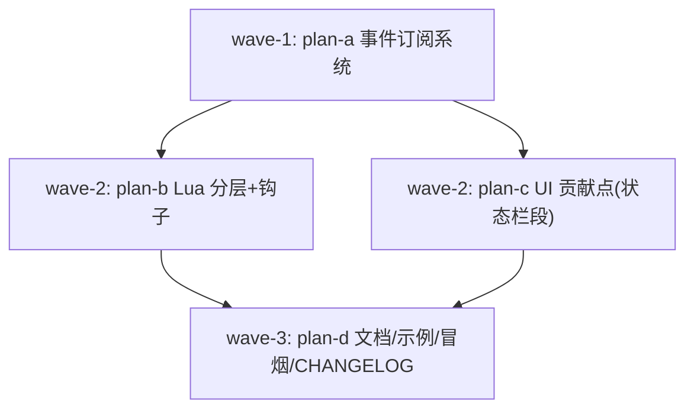

# 扩展系统增强 STEP 1 — 主计划（Gitee issue #IKK4K6）

任务：`extension-system-enhance`　分支：`enh/extension-system-enhance`　
worktree：`../yate-extension-system-enhance`（沙箱 venv 已重建并自证）

来源：`https://gitee.com/jermaine/yate/issues/IKK4K6`（Enhance - 扩展系统增强 STEP 1）

## 一、目标与非目标

### 目标（STEP 1 范围）

1. **事件订阅系统**：扩展可订阅编辑器事件（文档保存/打开/关闭/激活、诊断更新、
   键位方案切换、主题切换），回调受护栏保护、支持退订与 A13 回滚。
2. **UI 贡献点（首个：状态栏段）**：扩展经 `api.ui` 注册状态栏文本段
   （align/priority/provider），StatusBar（L2）自渲染，A13 回滚覆盖。
3. **Lua 扩展镜像 Python 模型**：
   - Python 侧 `services/lua_extensions.py` 拆为 `services/lua/` 包
     （library.py / runtime.py，服务包根不 re-export，§三.5）；
   - Lua 脚本支持显式 `setup(api)` / `teardown(api)` 钩子（保留
     "顶层即 setup" 旧语义，向后兼容）；
   - `_yate.lua` 补 EmmyLua 类型注解（`开放 pyi` 的 Lua 等价物，供
     lua-language-server 补全），不另发 `.d.lua` 副本（单一事实源）。
4. **A18 复核**：核对 L3 流程模块装配摩擦与接入文档现状，结论登记本文 §八。
5. **文档与示例**：双语手册同步（events / ui / lua hooks），示例模板更新，
   CHANGELOG 双语，冒烟场景扩展。

### 非目标（后续 STEP）

- 自定义 widget / 面板 / 菜单等更深 UI 贡献点；
- `api.theme` 注册桥（theme_dirs 机制已覆盖）；
- `BUFFER_MODIFIED` 逐键事件（需要 editor_core TextBuffer 钩子设计，单独评审）；
- Lua API 的多文件包化（`_yate.lua` 保持单文件库）；
- 扩展管理 UI（`:extensions` 面板）。

## 二、调研事实清单（文件:行号）

| # | 事实 | 位置 |
|---|---|---|
| F1 | 插件 API 仅 setup/teardown 两钩子，无事件订阅 | `yate/services/extension_api.py:73-334`（全 API 面） |
| F2 | `api.app` 直曝 ExtensionContext 是唯一逃生口（A12） | `yate/services/extension_api.py:156-159` |
| F3 | A13 回滚 scope 机制成熟：`start_scope`/`rollback_scope`，action/command/bind_key 均记录 undo | `yate/services/extension_api.py:89-152, 271-289` |
| F4 | 四个 `api.*` 桥（lsp/highlight/syntax/sprites）是既有分层范式 | `yate/services/extension_bridges.py` |
| F5 | Lua 走 lupa：每扩展独立 runtime，顶层即 setup，全局 teardown 被提取 | `yate/services/lua_extensions.py:129-147`；loader `_load_lua` `yate/services/extension_loader.py:156-183` |
| F6 | Lua API 库为单文件 `_yate.lua`（138 行，平铺函数 + raw passthrough），无注解 | `yate/extensions/_yate.lua` |
| F7 | StatusBar 已接收 `extension_loader` 具体对象（L2 依赖 L0 服务先例） | `yate/editor_view/statusbar.py:69-83`；`yate/editor.py:146-149` |
| F8 | 文档流发射点：`_open_document`/`activate_doc`/`save_document`/`open_path_later` | `yate/flows/document_flows.py:108-237` |
| F9 | 诊断事件入口：`lsp_sync.on_event` 判 `event == "diagnostics"` | `yate/flows/lsp_sync.py:76-85` |
| F10 | 键位/主题切换点：`Editor.select_keymap` / `Editor.set_theme` | `yate/editor.py:778-784, 809-834` |
| F11 | 会话关闭钩子：`EditorSession(on_closed=...)` → lsp_sync | `yate/editor.py:83-85`；`yate/session.py:36-37` |
| F12 | L3 装配：`editor.py` 30 类属性声明 + `OverlayFlows` 16 参、`DocumentFlows` 12 参手工注入 | `yate/editor.py:220-297, 324-354` |
| F13 | 架构规则禁全局 EventBus 与字符串事件名；新增信号门槛（≥3 处动态订阅场景）已满足（扩展动态增删 × 7 种事件） | `architecture-boundaries.md` §四 |
| F14 | A18 接入清单已在架构规则 §三.8 成文（6 步） | `architecture-boundaries.md` §三.8 |

## 三、备选方案与否决理由

| 决策点 | 采用 | 否决路线及理由 |
|---|---|---|
| 事件标识 | `EditorEvent` 枚举成员（非字符串） | 字符串事件名被 §四 明令禁止；枚举成员是身份不是临时字符串，补全友好 |
| 事件枢纽归属 | L0 `services/events.py` 的 `EventHub` 实例，由 Editor 构造注入（非模块级单例） | 模块级全局 EventBus 被禁止；会话层 L1 放不下（要被 L3 flows 发射） |
| 载荷形态 | 每事件一个冻结 dataclass（`DocumentSaved(doc)` 等），回调 `Callable[..., object]` | 共享 Protocol 载荷被 §三.1 禁止；`Any` 载荷丢失类型信息 |
| `BUFFER_MODIFIED` | STEP 1 不做 | TextBuffer（L0，豁免名单文件）需新增内容变更钩子，且 `Document.open` 绕过 session 创建 buffer，挂钩点不收敛——单独立项 |
| 状态栏段渲染 | pull 模型：StatusBar 每次 `refresh_status` 向注册表拉取 provider 文本 | push 模型（`segment.set_text`）需段对象持 widget 引用并处理失效时序，复杂度高；pull 与 StatusBar 既有刷新节奏一致 |
| 状态栏段归属 | `UiExtensionBridge` 放 `extension_bridges.py`（沿 F4 范式），StatusBar 经构造注入该具体对象 | 新建 `services/ui_contributions.py` 单独文件（仅一类一表，过度拆分）；StatusBar 持 loader 再下钻（加深耦合） |
| Lua 显式 setup | chunk 执行后若全局 `setup` 可调用则调用之；否则维持"顶层即 setup" | 强制迁移（破坏存量脚本）；或删顶层语义（同左） |
| pyi | `_yate.lua` 内联 EmmyLua 注解 | 另发 `yate.d.lua` 副本（双源维护漂移）；Python 侧无需 pyi（yate 可安装，类型自可得） |
| 装配摩擦（F12） | 维持现状 + A18 结论登记 | 共享 context 类型被 §三.1 红线禁止；构造注入是有意设计 |
| 事件/段回滚 | setup 期间的 subscribe/add 记入 A13 scope，失败自动撤销 | 不回滚会让失败扩展残留幽灵监听/段 |

## 四、执行波次



- **wave-1**：plan-a（独占 `editor.py`、`extension_api.py`、`document_flows.py`、
  `lsp_sync.py`）。
- **wave-2**：plan-b（独占 `services/lua*`、`extension_loader.py`、`_yate.lua`）∥
  plan-c（独占 `statusbar.py`；`extension_api.py`/`editor.py` 由 wave-1 串行让出）。
  **文件不重叠验证**：plan-b 不触 editor.py / extension_api.py。
- **wave-3**：plan-d（文档、示例、smoke、CHANGELOG）。
- 每波验收命令全绿（exit 0）才开下一波。

## 五、风险与回滚

| 风险 | 缓解 | 回滚 |
|---|---|---|
| 事件回调拖慢按键/保存热路径 | 同线程同步派发 + 护栏；文档写明性能契约；事件只挂低频点（保存/打开/切换/诊断） | 单事件摘除，或整体 revert plan-a 提交 |
| StatusBar 拉取扩展段抛错 | provider 经 `_guarded_callback` 包裹，失败显示占位并上 message | 段注册可移除 |
| Lua 包拆分破坏 loader 导入 | loader 同步改 import；`is_lua_available` 等入口路径在测试锁定 | 还原 `lua_extensions.py`（git 单文件还原） |
| 架构测试新增守卫面 | `services/lua/` 落入 `services/*` 守卫（实现时核对 glob 形态，必要时登记） | 按测试输出修正 |
| editor.py 超豁免行数 | 修改时同步更新 §三.7 豁免名单行数与 `SIZE_EXEMPT_FILES` | — |
| 双语手册漂移 | en/zh 同步提交，双语同步硬约束 | — |

## 六、验收门禁（全波共用）

```text
.venv\Scripts\python.exe -m pyright yate/ tests/ tools/        # 0 诊断
.venv\Scripts\python.exe -m pytest tests/ -q                    # 全绿
.venv\Scripts\python.exe -m pytest tests/test_architecture.py -q
.venv\Scripts\python.exe -m pytest tests/ -q --cov=yate --cov-branch --cov-report=term-missing --cov-fail-under=75
.venv\Scripts\python.exe -m tools.smoke_test run                # UI 变更必跑
```

## 七、提交切分（每步单独提交，不推送）

1. `docs(plans): add extension-system-enhance plan for gitee issue IKK4K6`
2. `feat(events): add extension event subscription system`（plan-a）
3. `refactor(lua): split lua bridge into package and mirror setup hooks`（plan-b）
4. `feat(ui): add status segment contribution point`（plan-c）
5. `docs(extensions): document events, status segments and lua hooks`（plan-d）
6. `test(smoke): ...` / `docs(changelog): ...`（plan-d 内如需拆分）

## 八、A18 复核结论（收尾回填）

待填：L3 装配摩擦实测（OverlayFlows/DocumentFlows 参数计数）、接入文档
（architecture-boundaries §三.8 六步清单）现状判定。

## 九、审核与迭代记录（收尾回填）

- code-review-expert 各轮结论与修复：待填
- pr-review（.trae/skills/pr-review）结论与修复：待填
- 偏离记录：待填
