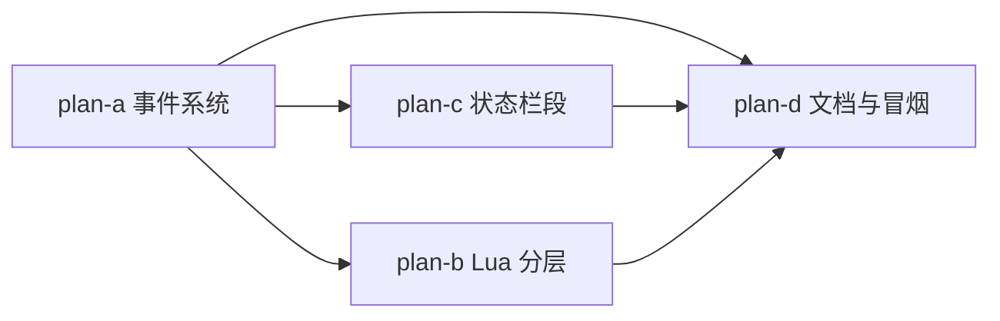

# 扩展系统增强 STEP 1 — 子计划总纲（issue #IKK4K6）

主计划：[../extension-system-enhance-plan.md](../extension-system-enhance-plan.md)

## 子计划索引

| 子计划 | 主题 | 波次 | 独占文件 |
|---|---|---|---|
| [plan-a](extension-system-enhance-plan-a.md) | 事件订阅系统（L0 EventHub + api.events + 发射点） | wave-1 | events.py(新)、extension_api.py、editor.py、document_flows.py、lsp_sync.py、session.py |
| [plan-b](extension-system-enhance-plan-b.md) | Lua 桥分包 + setup/teardown 镜像 + 注解 | wave-2 | services/lua/(新)、lua_extensions.py(删)、extension_loader.py、_yate.lua |
| [plan-c](extension-system-enhance-plan-c.md) | UI 贡献点：状态栏段 | wave-2 | statusbar.py、extension_bridges.py |
| [plan-d](extension-system-enhance-plan-d.md) | 文档/示例/冒烟/CHANGELOG | wave-3 | docs/extensions.*.md、示例模板、tools/smoke_test.py、CHANGELOG* |
| [plan-e](extension-system-enhance-plan-e.md) | Lua 模块表入口形态（追加波） | wave-4 | services/extensions/lua/runtime.py、tests/test_lua_extensions.py、_yate.lua、lua.example、docs/extensions.*.md |

注：plan-a 与 plan-c 都需要 `extension_api.py` / `editor.py`，靠波次串行保证独占；
plan-b 的文件与两者零交集，故可与 plan-c 同波并行。

## 依赖图

## 验收口径

每波收尾运行主计划 §六 门禁命令，全部 exit 0 才进入下一波；测试新增按子计划
各自"新增测试"节执行；覆盖率保持 ≥75%（当前基线 91.62%）。
