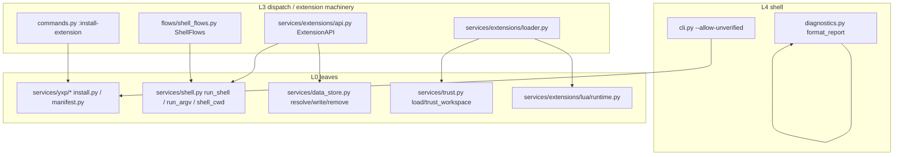
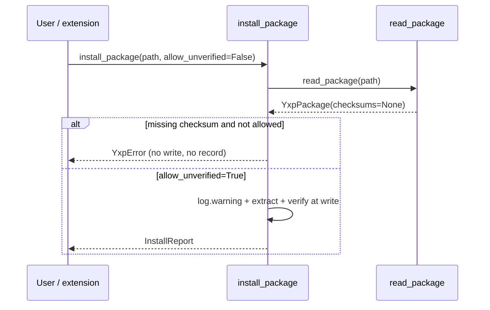

# IKTF4Y 扩展执行边界与信任模型加固 — 主计划

> 状态：【方案】已落盘，无人值守批准视为通过（用户 2026-11-07 指令「所有问题无须过问」）。
> 任务分支 `enh/extension-trust-hardening`，parent `develop` @ `af81d11`
> （`git rev-list --left-right --count develop...origin/develop` = `0 0`）。
> worktree 为同级目录 `yate-extension-trust-hardening`，独立 `.venv` 已自证
> `import yate` 指向该 worktree。素材见
> [extension-trust-hardening-issue.md](extension-trust-hardening-issue.md) 与
> [extension-trust-hardening-inventory.md](extension-trust-hardening-inventory.md)。

## 一、目标与非目标

**目标**：按 Gitee issue IKTF4Y 的 8 项静态审计发现，收敛扩展执行边界的
信任模型歧义与可本地利用的缺口，并满足 issue §五 四条建议验收标准。

1. S-01：Lua 运行时注释不再暗示「无 Lua 文件 I/O」；应用内手册明确 Lua 与
   Python 同为完全受信任代码；消除 chunkname 字符串插值这一未来注入点。
2. S-02：无 `checksum` 的 `.yxp` 默认拒绝安装，提供显式 `--allow-unverified`
   开关，新增默认拒绝 / 允许开关 / 无副作用回归用例，双语指南同步。
3. S-05：`api.data` 对解析后逃出 `~/.yate/data` 的符号链接路径，写入 /
   读取 / 删除 / 列目录一律拒绝，新增符号链接回归用例。
4. S-03 / S-04 / S-06 / S-07 / S-08：分别给出代码加固、文档澄清或另案登记，
   每项有可验证产物与否决理由（见 §三 裁决表）。
5. 全量门禁照常通过（pyright strict 0、pytest 全绿、架构 37、覆盖率 ≥75、
   冒烟、changelog check）。

**非目标**（本 issue 不做，理由见 §三）：

- 不做 Lua 沙箱 / API 白名单 / `register_builtins=False`（会破坏随包 Lua 游戏
  与共享模块，且与「用户主动安装即受信任」的现行设计冲突）。
- 不引入 lockfile / `--require-hashes` / CI `pip-audit` / `osv-scanner` 工作流。
- 不改 `tools/pack/wiki` 的 `shell=True` 实现，不改 `translate_via_cmd` 协议。
- 不实现 trust 内容指纹、Windows ACL、`:trust` 二次确认 UI（产品交互级另案）。
- 不删除 `--diag` 的路径 / 环境诊断信息，不修改 tracing 的 argv 记录语义。
- 不自动推送、不合并 `develop`、不 promote `master`（闭环纪律：只提交不推送）。

## 二、备选方案与否决理由

| 路线 | 描述 | 裁决 |
|---|---|---|
| A. Lua 沙箱化 | `register_builtins=False` + 移除 `io`/`os`/`package`/`debug`/`python` + `attribute_filter` + `max_memory` | **否决**：issue S-01 允许二选一；现行设计把扩展视为受信任代码，随包 `game_engine.lua` / `engine_json` / `engine_layout` 及 `yate/extensions/*.lua` 依赖标准库与 Python 桥接，裁剪会让内置游戏与插件手册示例失效；lupa 的 attribute_filter 亦非可靠安全边界。采用「文档 + 注释 + 契约钉桩」路线。 |
| B. 在 `read_package` 层强制 checksum | 让 `YxpPackage.checksums` 不可能为 `None` | **否决**：`tools/yxp --verify`、格式文档与 `test_read_package_without_checksum_member` 都把缺失 checksum 视为合法（仅不可信）；读取层拒绝会破坏「先读再判断」的格式契约。改在 `install_package` 决策层拒绝，保留格式可读性。 |
| C. 全局 `allow_unverified` 默认值 `True` + 仅 CLI 检查 | 保持库 API 向后兼容 | **否决**：`:install-extension` 与任何未来调用方都会绕过；默认安全必须在拥有写盘权的 `install_package` 上。 |
| D. 新增 `ExtensionContext` 必填回调接线 argv 变体 | 在 `editor.py::extension_context()` 增加 `run_shell_argv` | **否决**：`yate/editor.py` 实测 800 行（`splitlines()` 口径），恰为体量守卫阈值；新增一行即触发 #28 `test_source_files_within_size_threshold`。改为在 `ExtensionAPI` 直接调用 L0 `services.shell.run_argv`，并用 L0 纯函数 `shell_cwd` 与 `ShellFlows._cwd()` 共用 cwd 语义，零跨层新连线、零死代码。 |
| E. `--diag` 全量路径脱敏 | 把所有绝对路径替换为 `~` 或 `<redacted>` | **否决**：`~/.yate` 在测试中被 `isolated_home` 指向 tmp 目录，全量替换会破坏 `test_rc_and_ext_dir_candidates_are_listed` 等断言；且 `--diag` 的首要用途是定位资源目录，抹掉路径会削弱可诊断性。采用「报告头显式隐私提示 + 手册告知 tracing 记录 argv/cwd」。 |
| F. trust 记录目录内容指纹 | 每次启动对受信任目录的 `*.py` / `*.lua` / `yaterc` 计算摘要，变化即撤销信任 | **否决（另案）**：用户在受信任工作区里编辑扩展 / 主题 / rc 是核心工作流，任何保存都会使信任失效并要求重复 `:trust`；且启动路径新增 O(目录文件数) 哈希。需先设计「新增可执行文件二次确认」的产品交互，非本 issue 可闭环。 |
| G. 提交 lockfile + CI SCA | 生成 `requirements.lock` 并在两份 CI 增加 `pip-audit` | **否决（另案）**：跨平台（Windows / Linux，py3.12 / 3.13）锁文件与 grammar 可选组策略需独立选型；CI 引入联网审计会让门禁受外部服务可用性影响。本轮以双语依赖政策说明 + 明确另案登记收敛。 |

## 三、8 项发现处置裁决表

| # | 优先级 | 处置 | 代码产物 | 文档 / 登记 | 子计划 |
|---|---|---|---|---|---|
| S-01 | P1 | 走「受信任代码」路线：修正失真注释、消除 chunkname 插值、钉桩「标准库可用」契约 | `runtime.py` | `manual.{en,zh}.md` Lua 章节 + `extensions.{en,zh}.md` 交叉引用 | d / g |
| S-02 | P1 | 默认拒绝无 checksum 安装 + `--allow-unverified` | `install.py` / `manifest.py` 注释 / `cli.py` | `extensions.{en,zh}.md` §7 + manual 命令节 | a / g |
| S-03 | P2 | 新增 `shell=False` argv 变体（`run_argv` / `api.shell_argv` / `yate.shell_argv`），不改 `run_shell` | `shell.py` / `shell_flows.py` / `api.py` / 两个 Lua 面 | 双语手册 + 扩展指南标注完全权限接口 | e / g |
| S-04 | P2 | POSIX chmod 失败显式告警、符号链接 trust store 拒绝读取、模块 docstring 说明永久路径授权 | `trust.py` | 双语 trust 章节；内容指纹 / Windows ACL 登记另案 | c / g |
| S-05 | P2 | `resolve()` 真实路径校验 + 写 / 删前二次复核 | `data_store.py` | `bridges.py` docstring 由 plan_b 一并说明 | b |
| S-06 | P3 | 不改依赖声明 / CI | — | `README.md` + `README.zh.md` 环境与 wiki 章节增补依赖供应链政策与另案提示 | g |
| S-07 | P3 | `--diag` 报告头隐私提示（不改字段值） | `diagnostics.py` | `manual.{en,zh}.md` `--diag` 节说明 tracing 记录 argv/cwd | f / g |
| S-08 | P3 | 不改构建工具 | — | `README.md` + `README.zh.md` wiki 章节明确 `--translate-cmd` 等价于命令执行 | g |

**issue §五 验收标准映射**：#1 → plan_d + plan_g（注释 + 手册，沙箱路线按 A 否决，故不需要「全局不可用」守卫，改为「标准库可用」契约钉桩）；#2 → plan_a；#3 → plan_b；#4 → 步骤 7 主代理亲自跑全量门禁。

## 四、架构与依赖边界

- 所有新增 import 均为 L3 → L0 或 L0 内部：`api.py` / `shell_flows.py` →
  `services/shell.py`；`install.py` → `services/yxp/manifest.py`（同包子模块，既有）。
- `services/extensions/__init__.py` 的 R14 门面 14 名冻结不变：新增能力是
  `ExtensionAPI.shell_argv` **方法**，不是新门面导出名；Lua 侧通过既有
  `api.*` 转发，`tests/test_lua_defs.py` 的 `PYTHON_SURFACE` / `LUA_SURFACE`
  同步扩面并继续由三条静态守护锁定。
- 不新增 `Protocol` / `TYPE_CHECKING` / `Any` / `# type: ignore`；不改
  `editor.py`（800 行阈值）；不改 `tests/test_architecture.py` 任何豁免集合。
- 日志全部沿用模块级 tracing logger，惰性 `%` 格式；`print()` 不新增，
  `PRINT_EXEMPT_SITES` 不变。





## 五、风险清单与回滚路径

| 风险 | 影响 | 缓解 / 回滚 |
|---|---|---|
| `install_package` 新增关键字参数破坏既有调用 | `:install-extension` / `tools/yxp` 安装失败 | 参数带默认值 `False`，既有调用零改动；全量 `tests/test_yxp.py` + `tests/test_cli.py` + `tests/test_tools_yxp.py` 回归 |
| `data_store.resolve()` 新增 `.resolve()` 校验误伤合法嵌套路径 | 游戏存档写失败 | `root = data_root()` 与 `target.resolve()` 同取 `root.resolve()`，HOME 本身是符号链接的合法环境仍放行；既有 10 条用例全回归 |
| `run_argv` 重构抽出 `_capture` 改变 `run_shell` 超时语义 | `:!` 卡死 | `_capture` 原样搬运 communicate / `_kill_tree` / 有界排水逻辑；`tests/test_shell.py` 全量回归（含 timeout 与 taskkill 契约） |
| Lua `_compile_chunk` 改为全局传值 | 共享模块 / 扩展 chunk 编译失败 | 两个全局在 `finally` 清空；`tests/test_lua_engine.py` + `tests/test_lua_extensions.py` 全量回归，lupa 缺失时相关用例 skip |
| trust store 符号链接拒绝读取 | 用户手工软链 `~/.yate/trusted_workspaces` 失效 | 仅拒绝 store 文件本身为链接，记录 warning；文档明示；`tests/test_trust.py` 与三处调用点测试回归 |
| 双语文档不同步 / 机器路径泄漏 | 文档规则违例 | plan_g 成对修改 + `tools.mdlint --auto-lang --check` + 相对路径引用；不写盘绝对路径 |
| 本机 safe-delete 钩子杀 pytest | 门禁假失败 | 每道门禁拆独立工具调用轮次；症状查 `[safe-delete]`；`cmd /c rmdir /s /q` 分批清 `%TEMP%\pytest-of-Administrator\garbage-*` |
| 子代理零产出 | 计划 / 评审 / 执行断档 | 按 `task-orchestration.md` §三 主代理兜底；评审另派只读审查员 + 主代理逐条复核 |

**回滚**：每子计划独占文件，单波失败即 `git checkout -- <该子计划独占文件>`；
波次间串行，前一波验收命令退出码全 0 才进入下一波；整任务回滚为删除
`enh/extension-trust-hardening` 分支与 worktree（提交均在分支上，develop 不动）。

## 六、执行记录回填（占位，步骤 4-7 填写）

| 波次 | 子计划 | 执行者 | 验收命令退出码 | 提交 | 偏离 |
|---|---|---|---|---|---|
| wave-1 | a / b / c | `plan-executor` ×3（回报 `No result found`，落盘完整） | 主代理复核：pyright 0 / 366 passed·1 skipped / 局部覆盖率 0 | `01a80d3` | 三个执行者回报丢失但 10 个独占文件已落盘，按「只认落盘结果」继续；不判死、不重试 |
| wave-2 | d / e / f | `plan-executor` ×3（回报完整） | 主代理复核：pyright 0 / 241 passed·2 skipped / 架构 37 / 覆盖率 0 | `3a93570` | plan_d 用 `runtime.execute` 取代计划里的 `eval`（lupa `eval` 不接受 `return`，有首轮失败证据）；plan_d 行内 `# pyright: ignore` 违规，主代理改为仓库既有文件级 `reportPrivateUsage=false` |
| wave-3 | g | `plan-executor` ×1（回报完整） | 主代理复核：mdlint 1（父提交基线同为 1，归一化差异 0）、双语锚点 3/3、55 passed、changelog check 0 | `9112a91` | 计划写的「mdlint 退出码 0」不可达（存量 199 条），已按实测改为基线归一化对比；执行者报告误读退出码，主代理订正；手册无 `:install-extension` 命令表，改在 §15 增补 |
| wave-4 | 评审迭代 | 待填 | 待填 | 待填 | 待填 |

## 七、收尾门禁（主代理亲自执行）

```powershell
.venv\Scripts\python.exe -m pyright yate/ tests/ tools/ pack/
.venv\Scripts\python.exe -m pytest tests/ -q -n auto
.venv\Scripts\python.exe -m pytest tests/test_architecture.py -q
.venv\Scripts\python.exe -m pytest tests/ --cov=yate --cov-branch -n auto
.venv\Scripts\python.exe -m tools.smoke_test run --jobs 4
.venv\Scripts\python.exe -m tools.changelog check
```

- 局部覆盖率运行一律加 `--cov-fail-under=0`；并行口径与 CI 一致。
- 时序 flake 必须 `-n 1` 复核并修用例，不得记为偶发。
- 评审发现 blocker / major → 回到步骤 2 补设计并落 `extension-trust-hardening-review-fixes-plan.md`；
  仅 minor 登记待办。

## 八、子代理零产出登记（如实）

`plan-architect-designer` 按 `task-orchestration.md` §一.3 指定 `Hy4 preview`
两次 spawn（第二次变更任务粒度并显式给 `subagent_path`）均返回
`Model "qwen-3.7-plus" not found`；与本机既有事实一致（frontmatter 模型按角色
解析，任务书指定模型无效）。按 §三 由主代理亲自按
[plan-architect-designer](../../.trae/agents/plan-architect-designer.md) 剧本
完成调研、任务分析与本方案及全部子计划，标注「规划子代理零产出」，不修改
agent 定义文件。
