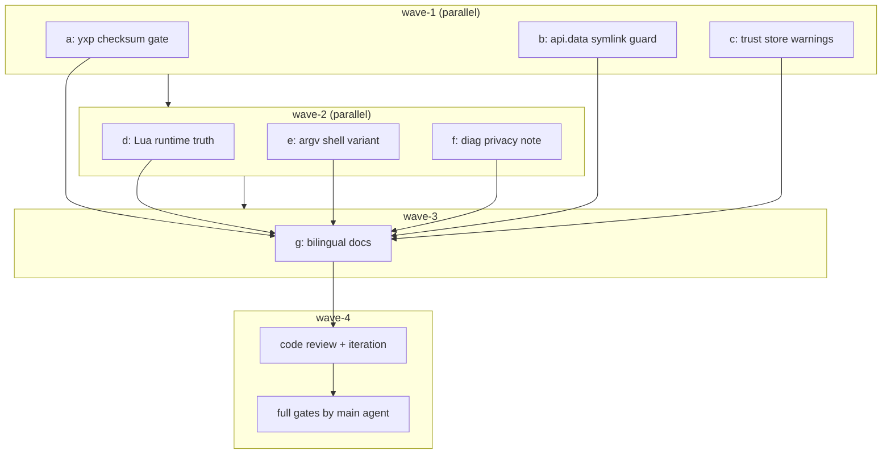

# IKTF4Y 加固子计划总纲（执行波次唯一依据）

> 主计划见 [extension-trust-hardening-plan.md](../extension-trust-hardening-plan.md)；
> 素材见 [extension-trust-hardening-issue.md](../extension-trust-hardening-issue.md) 与
> [extension-trust-hardening-inventory.md](../extension-trust-hardening-inventory.md)。
> 唯一规范来源 = 主计划 + 本总纲 + 对应子计划；执行者不得凭常识扩大范围。

## 一、目标 / 非目标

目标与非目标完全继承主计划 §一，本总纲只补充切分与调度。8 项发现 S-01…S-08
的处置裁决见主计划 §三；issue §五 四条验收标准由 plan_d+plan_g / plan_a /
plan_b / 步骤 7 门禁分别承接。

## 二、子计划索引

| 波次 | 子计划 | 主题 | 独占文件（相对 worktree 根） | 文档 |
|---|---|---|---|---|
| wave-1 | a | S-02 `.yxp` 默认拒绝 + CLI 开关 | `yate/services/yxp/install.py`、`yate/services/yxp/manifest.py`、`yate/cli.py`、`tests/test_yxp.py`、`tests/test_cli.py` | [extension-trust-hardening-yxp-checksum-plan-a.md](extension-trust-hardening-yxp-checksum-plan-a.md) |
| wave-1 | b | S-05 `api.data` 符号链接写穿 | `yate/services/data_store.py`、`tests/test_data_store.py`、`tests/test_extension_bridges.py` | [extension-trust-hardening-data-store-plan-b.md](extension-trust-hardening-data-store-plan-b.md) |
| wave-1 | c | S-04 trust store 读侧加固与告警 | `yate/services/trust.py`、`tests/test_trust.py` | [extension-trust-hardening-trust-store-plan-c.md](extension-trust-hardening-trust-store-plan-c.md) |
| wave-2 | d | S-01 Lua 运行时真值 + chunkname 安全化 | `yate/services/extensions/lua/runtime.py`、`tests/test_lua_engine.py` | [extension-trust-hardening-lua-boundary-plan-d.md](extension-trust-hardening-lua-boundary-plan-d.md) |
| wave-2 | e | S-03 argv 形态 shell 变体（含 Lua 面） | `yate/services/shell.py`、`yate/flows/shell_flows.py`、`yate/services/extensions/api.py`、`yate/extensions/_yate.lua`、`yate/extensions/_yate.d.lua`、`tests/test_shell.py`、`tests/test_shell_flows.py`、`tests/test_extension_api.py`、`tests/test_lua_defs.py` | [extension-trust-hardening-argv-shell-plan-e.md](extension-trust-hardening-argv-shell-plan-e.md) |
| wave-2 | f | S-07 `--diag` 隐私提示 | `yate/diagnostics.py`、`tests/test_diagnostics.py` | [extension-trust-hardening-diagnostics-plan-f.md](extension-trust-hardening-diagnostics-plan-f.md) |
| wave-3 | g | 双语文档同步（S-01/02/03/04/06/07/08 文案） | `yate/docs/extensions.en.md`、`yate/docs/extensions.zh.md`、`yate/docs/themes.en.md`、`yate/docs/themes.zh.md`、`yate/resources/manual.en.md`、`yate/resources/manual.zh.md`、`README.md`、`README.zh.md` | [extension-trust-hardening-docs-plan-g.md](extension-trust-hardening-docs-plan-g.md) |
| wave-4 | 评审迭代 | `code-review-expert` 评审 + blocker/major 修复 | 评审后按发现另立 `extension-trust-hardening-review-fixes-plan.md`，独占清单在该文档内裁定 | 主计划 §七 |

## 三、执行波次表（硬性）

| 波次 | 并行子计划 | 允许启动条件 | 波内文件重叠 | 波末验收 |
|---|---|---|---|---|
| wave-1 | a ∥ b ∥ c | 方案批准（无人值守视为通过） | 无 | 三个子计划各自验收命令退出码全 0，主代理复核后单独提交 |
| wave-2 | d ∥ e ∥ f | wave-1 全部回收且全绿 | 无（d 不跑 `test_lua_defs.py`，e 不跑 `test_lua_engine.py`） | 同上 |
| wave-3 | g | wave-2 全部回收且全绿 | 无 | mdlint + 双语锚点校验 + 纯文档变更豁免口径 |
| wave-4 | 评审 / 迭代 | wave-3 完成 | 按修复计划重划 | 主代理亲跑六道门禁，blocker/major 归零 |

- 同一波次最多 3 个执行者（≤6 硬上限，实践按 2~3 一批）；
- 波次间**串行**：上一波全部验收命令退出码 0 才进入下一波；
- 每波提交独立一笔（scope 取该波主题），只提交不推送；
- 波内验收命令只跑计划指定范围；全量门禁由主代理在步骤 7 统一执行；
- 局部覆盖率运行必须带 `--cov-fail-under=0`；
- 确需调整波次须回填本表并写明实测依据，不得口头重排。

## 四、依赖关系图

## 五、调度与验收纪律

- 任务书必须写明：唯一规范来源、独占文件清单、可直接复制的验证命令、
  报告格式（改动清单 + 实跑命令与退出码 + 未解决项）；成员一律
  `bypassPermissions`（无人值守时段）。
- 成员回报的数据主代理独立复核（重跑其名下测试与 pyright）；只认落盘结果，
  声称完成但文件无变化 = 零产出。
- 子代理 spawn 失败 / 零产出时按 `task-orchestration.md` §三 主代理兜底，
  如实标注，不阻塞主任务。
- 评审步骤不可省略：主代理自审（紧贴自己刚写的修复）会漏契约层反向影响；
  判死门槛 = 超过 30 分钟无回信且无任何落盘产物。
- 并行跑 Textual pilot / 冒烟若出现时序失败，先 `-n 1` 复核再下结论，
  不得直接改断言或记为偶发。

## 六、执行记录（步骤 4-7 回填）

| 波次 | 回收状态 | 主代理复核结果 | 提交 | 偏离 |
|---|---|---|---|---|
| wave-1 | 3 个执行者回报 `No result found`，10 个独占文件全部落盘 | pyright 0 / 366 passed·1 skipped / 覆盖率命令 0 | `01a80d3` | 回报丢失不等于零产出，按落盘结果验收，未重试 |
| wave-2 | 3 个执行者回报完整，13 个独占文件 | pyright 0 / 241 passed·2 skipped / 架构 37 / 覆盖率 0 | `3a93570` | `runtime.eval`→`execute`；行内 pyright ignore 改文件级配置（主代理修） |
| wave-3 | 1 个执行者回报完整，8 个文档 | mdlint 1（基线同为 1，归一化差异 0）/ 锚点 3/3 / 55 passed / changelog 0 | `9112a91` | mdlint 验收口径按实测订正；手册锚点缺失的最小化处理 |
| wave-4 | 评审 #64 BLOCKED（1 blocker / 1 major / 4 minor）→ F1/F2 修复 → 复审 #65 两路 APPROVE（0 blocker / 0 major） | 终轮六道全量门禁全绿：pyright 0 / 3479 collected（3469 passed·10 skipped）/ 架构 37 / 覆盖率 92.96% / 冒烟 121/121·1464 / changelog 0 / diffcheck 0 | `24f3ba4`、`f526733`、`323d3b6`、`aa112a0`、`d83a9ce` | 索引 #64/#65/#66；首轮 4 minor（修 2 / 勘误 1 / 登记 1）+ 复审 5 minor（修 3 / 登记 2）；#66 主代理自审 MAJOR（流程/纪律类，产品 0 blocker/0 major）已落盘并订正归因与文档路径；工作树干净、未推送 |
