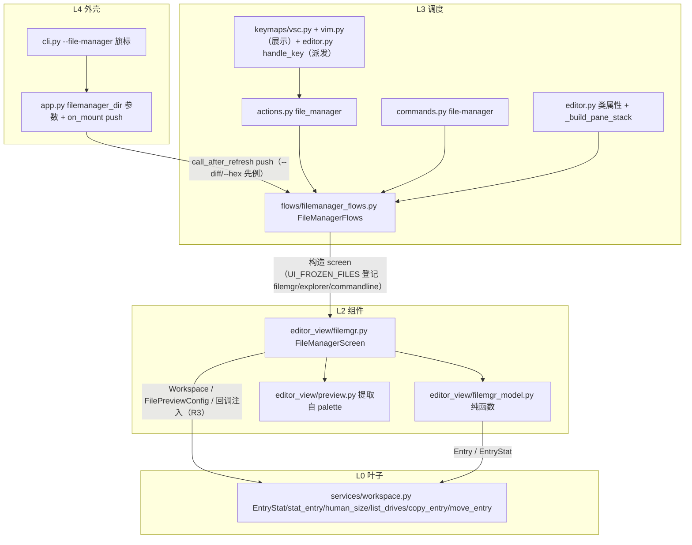

# file-manager 总纲（issue IKRZ41：LF 风格终端文件管理器，双形态）

> 状态：已执行完毕（无人值守模式，2026-10-31 用户指令「无须过问直接执行」）。
> 规划者：主代理兜底（plan-architect-designer 两次 spawn 模型未注册零产出，
> 依 task-orchestration.md §一.3.5 / §三 由主代理按剧本执行）。
> 代码事实取证：code-explorer 69 次工具调用报告（文件:行号 级）+ 主代理补充 grep。
> 执行记录与最终门禁见文末 §九。

## 一、目标

在 yate 内集成 lf 风格终端文件管理器，两种形态共享同一 L2 组件：

1. **浮层**：编辑器内 `Alt+Shift+F`（vsc+vim）或 `:file-manager` 打开，`ModalScreen`
   大浮层（宽 90% / 高 80%，对齐 palette `.with-preview` 尺寸先例
   `yate/resources/palette-screen.tcss:27-32`），`Esc`/`q` 关闭且编辑器状态无损还原；
2. **全屏**：`yate --file-manager [path]` 启动进入全屏形态（同一组件 + CSS 类切换），
   选中后按 R3 语义转入编辑器主界面，`q`/`Ctrl+C` 退出进程。

三栏布局（父目录 | 当前目录 | 预览）+ 底部状态栏；图标/主题/滚动条与 explorer
同源；完整鼠标支持；P0 键位全量；双语手册同步。

## 二、非目标

- P2 项不做：hex 预览、`?` 键位速查面板（which-key 复用）、yaterc 可配置项
  （默认排序/浮层尺寸比例）、状态栏点击排序、中栏万级条目的增量刷新
  （评审 M3：P0 修复仅覆盖过滤路径缓存复用，目录级增量 stat/scandir 另行立项）、
  file manager 内 dirty 三态确认（Q1 终裁为提示阻塞，见 §三）。
- 跨盘符移动/复制**不设限**（评审 m4 修正：`shutil.move` 天然跨卷透明处理，
  内部复制后删除源，无进度显示）；「同名冲突确认」不做交互式流程，
  冲突时报错于输入行。
- 不改动 `Workspace.Entry` 数据类本身（元数据经新增 `stat_entry` 旁路获取，
  explorer/list_dir 主路径零额外 stat 成本）。

## 三、开放问题裁决（Q1-Q5 + 键位冲突，含执行期终裁）

| # | 问题 | 终裁 | 理由 |
|---|---|---|---|
| Q1 | 未保存缓冲区 | **终裁（wave-4 实测降级）**：存在 dirty → report 警告 `N unsaved changes - save or discard first` + 切换被拒；浮层此际已按 palette `_choose` 先例 dismiss（flows 侧无法保持打开，filemgr.py 回调类型为 fire-and-forget）。不静默丢弃满足 issue 验收 6；恢复「保持打开」需改 L2 回调签名为 `-> bool`，收益不抵时序返工，登记 P2 候选。dirty 检测 = `any(doc.modified for doc in session.docs)`（editor.py:1201 :q 同款） | issue Q1 倾向的「既有 :q 语义」即阻塞+提示+用户显式处理；三态确认引入批量丢弃语义面，plan-e 初稿已否决 |
| Q2 | 多选混合文件+目录 | **终裁（wave-4）**：集合经 `sorted()` 字母序，取**字母序第一个**目录进入，其余忽略并 report 提示；纯文件集合按序全开 tab | 光标序在 L2 set 侧不可恢复（filemgr.py `sorted(self._marked)`）；字母序行为确定、可测试；多选多目录为少见场景 |
| Q3 | 浮层内选中文件 | **关闭并切换**（关闭浮层→按 R3 切换工作区），与全屏形态一致 | issue 字面语义；「保留 workspace 开新 tab」与 explorer 既有 open_path 无差异，无新价值 |
| Q4 | Windows 盘符 | **做**：根层（文件系统根）`h`/`Left` 切换到盘符虚拟层——**中栏**列出 `Workspace.list_drives()`（executed F1 终稿：盘符在中栏、可 `l`/`Enter` 进入，左栏占位），`l` 进入盘符目录 | Windows 体验完整；评审 M1 修复让盘符层可导航（原实现只能看不能进） |
| Q5 | 预览缓存 | 沿用 palette 16 条 FIFO；**每屏独立** `PreviewCache()` 实例（非与 palette 共享——评审 m4 修正） | 目录浏览局部性强；手册已按实际行为修正 |
| r 键 | 刷新 vs 重命名 | P0 刷新 = `r` / `F5`；P1 重命名 = **`R`**（大写） | 避免 lf `r` 惯例与刷新冲突；无前缀机制 |
| 命令名 | `:` 命令 | `file-manager`（连字符） | 先例 `:project-replace` / `:install-extension` |
| Entry 元数据 | size/mtime 来源 | `Workspace.stat_entry(path) -> EntryStat`（L0）+ `human_size()`；组件只消费 | 列举/过滤/忽略已在 `list_dir`，stat 元数据同样下沉 L0 |
| 预览复用 | palette 管线 | 提取共享 `editor_view/preview.py`（PreviewData/PreviewLog/load_preview/load_preview_worker/PreviewCache），palette.py 改引用（711→586 行） | issue R4 硬性要求语法高亮管线复用；组合优于复制；19 用例回归兜底 |
| alt+shift 派发 | 键位真实派发点 | vsc/vim 键位表条目仅为帮助展示；真实派发在 `Editor.handle_key` 按键名拦截（先例 alt+shift+p/s）——plan-f 执行期发现并补齐（D1） | keyproto/legacy.py 无 alt+shift 组合弦裸字节形态 |
| 体量豁免 | filemgr.py 888 行 | A11 豁免登记（SIZE_EXEMPT_FILES + architecture-boundaries.md §三.7 两处同步）：三栏屏单一职责，拆预览段/ListView 会切断屏状态内聚 | 先例 editor.py/buffer.py/vim.py；F1 净增 84 行（B1 接线+M1 状态机+回调注入）越线 |

## 四、架构落点（对照 architecture-boundaries.md，实测最终形态）

- **R3**：`filemgr.py` 构造只注入协作者（`Workspace`/`FilePreviewConfig`）与回调
  （`open_selected`/`close`/`on_renamed`/`on_deleted`/`on_show_hidden_changed`），
  不 import `yate.editor`/`yate.app`（守卫通过）。
- **R11**：`UI_FROZEN_FILES["flows/filemanager_flows.py"] =
  {"commandline", "explorer", "filemgr"}`（按实际 import 三条全名登记）。
- **R13/R15**：theme.attach + apply_scrollbar_theme 三栏重染；三个滚动容器
  on_mount（`_wire_mount`）apply_slim_scrollbars——守卫 #37 通过。
- **能力注入**：flows 不持 App 句柄（守卫通过）；`exit_app` 经 `bind_exit`
  晚绑定（对齐 bind_hex_opener）；`spawn` 死参数已在 F1 移除（m1）。
- **会话同步回调**（F1/M2）：rename/delete/隐藏切换经 `on_renamed`/
  `on_deleted`/`on_show_hidden_changed` 走 `session.retarget`/`close_under`
  + `explorer_tree.refresh_tree()`（对齐 explorer.py:518/535 先例）。

## 五、子计划索引与执行波次（已全部执行）

| 波次 | 子计划 | 独占文件 | 状态 |
|---|---|---|---|
| wave-1 | plan-a L0 workspace 扩展 | `yate/services/workspace.py`、`tests/test_workspace_filemgr.py` | 完成（8605e62） |
| wave-1 | plan-b 预览管线提取 | `yate/editor_view/preview.py`、`yate/editor_view/palette.py`、`tests/test_palette_preview.py` | 完成（07c982a） |
| wave-2 | plan-c L2 纯函数模型 | `yate/editor_view/filemgr_model.py`、`tests/test_filemgr_model.py` | 完成（6bcfd5b） |
| wave-3 | plan-d L2 Screen 组件 | `yate/editor_view/filemgr.py`、`filemgr_keys.py`、`filemgr-screen.tcss`、`tests/test_filemgr.py` | 完成（aa73c33） |
| wave-4 | plan-e L3 flows + editor 接线 | `yate/flows/filemanager_flows.py`、`flows/__init__.py`、`yate/editor.py`、`tests/test_filemgr_flows.py` | 完成（0f633b6） |
| wave-5 | plan-f L4 全量接线 | `yate/actions.py`/`commands.py`/`keymaps/*`/`cli.py`/`app.py`、`tests/test_architecture.py`、`tests/test_app_filemgr.py` | 完成（ea5d1c5） |
| wave-6 | plan-g 双语文档 | `yate/docs/file-manager.{en,zh}.md`、`yate/docs/README.md` | 完成（271294c） |
| F1 | 评审修复（B1/M1/M2/M3/M4/m1-m5） | filemgr/flows/editor/handbook/豁免两处 | 完成（3331c7a..b4a54cf） |
| F2 | 评审修复 m6 冒烟场景 | `tools/smoke_test/scenarios/filemanager.py`、`scenarios/__init__.py`、harness `track()` | 完成（74a5096·5eb134c） |

执行结构：wave-1 双发并行，wave-2..6 串行单发；F1 三发并行（fix-d 屏 /
fix-e flows / fix-g 手册，接口冻结三回调），F2 单发。执行期主代理接管：
72B 状态栏视觉对齐（wave-2 后）、docstring 计数中性化（wave-5）、
B1 豁免裁决与登记、`Editor.handle_key` alt+shift+f 拦截裁决（D1）、
场景 pyright 修复（harness.track 公共化 + DOM 断言）。

## 六、R7 键位定稿（双语手册与 `:help` 以此为准）

**导航（P0）**：`j`/`Down`、`k`/`Up` 光标；`h`/`Left`/`Backspace` 返回父目录
（光标落原目录项，lf 语义，经 `_dir_memory`）；`l`/`Enter`/`Right` 进入/打开；
`g` `g`/`Home` 顶部；`G`/`End` 底部；`Ctrl+d`/`Ctrl+u` 半页滚动。

**过滤与视图（P0）**：`/` 或 `f` 增量过滤（底部 Input 实时收窄，`Esc` 清除）；
`H` 或 `.` 切换隐藏文件（读写 `Workspace.show_hidden`，经回调同步文件树）；
`s` 循环排序 name→size→mtime（目录始终在前，升降序提示状态栏）；
`r` / `F5` 强制刷新（`Workspace.invalidate()` + 重列）。

**多选（P0）**：`Space` 切换标记（光标不动）；`v` 反选全部；`Esc` 两级退出
（有过滤先清过滤，否则清选择）；`l`/`Enter` 打开选中集（Q2 终裁）。

**文件操作（P1）**：`a` 新建文件；`A` 新建目录；`R` 重命名（预填原名，同步会话）；
`d` 删除（`y` 确认，目录递归显式确认，同步会话与文件树）；
`y` / `x` 复制/剪切标记；`p` 粘贴到当前目录（同名冲突报错于输入行）。

**退出（P0）**：`q`/`Esc`（浮层关闭还原 / 全屏退出进程）。

## 七、验收标准核对（issue 原文 + 门禁）

| # | 验收点 | 结果 |
|---|---|---|
| 1 | Alt+Shift+F 与 command palette 打开浮层、Esc/q 无损还原 | ✓（test_app_filemgr + 冒烟场景） |
| 2 | --file-manager 全屏选中进编辑/目录设 root/q 退出 | ✓（B1 修复后 + m6 场景） |
| 3 | 三栏+图标+状态栏与参考一致、主题实时跟随、细滚动条 | ✓（R13/R15 守卫 + 主题切换用例） |
| 4 | 隐藏/ignore 过滤与 explorer 一致、H/. 切换 | ✓（H 经回调同步文件树） |
| 5 | P0 键位全生效、鼠标可用 | ✓（双击经 300ms 窗口——Textual 单击即 Selected 的预案） |
| 6 | 未保存缓冲区不静默丢弃 | ✓（Q1 终裁：警告+拒绝） |
| 7 | 架构守卫全绿 | ✓（37/37，UI_FROZEN_FILES/R13/R15/体量豁免） |
| 8 | pyright/pytest/覆盖率/冒烟 + 双语手册 | ✓（§九门禁五项） |

## 八、风险与回滚（执行后回望）

| 风险 | 实际结果 |
|---|---|
| palette 提取回归 | 19 用例 + smoke palette_preview 全绿，无回归 |
| filemgr.py 超 800 行 | 触发一次（F1 后 888 行），走豁免登记（§三裁决表） |
| Textual 双击行为 | 实测单击即 Selected → on_click 300ms 窗口预案落地（已测试覆盖） |
| 全屏启动竞态 | 评审 B1 实锤（负载 2/3 红）→ call_after_refresh + is_attached 守卫，3 连跑 + 收尾门禁全绿 |
| stat 慢 | M3 轻量修复（过滤路径缓存复用）；增量刷新登记 P2 |
| pytest 时序 flake | F1 期间 fix-e 报 2 次 MountError → 实为 B1 二轮加固前的旧快照；终版后无复发 |

## 九、执行记录与最终门禁（2026-11-01 收尾）

- 分支 `feat/file-manager`（worktree `D:\Programming\yate-file-manager`），
  630b7e6..5eb134c 共 19 笔提交（评审记录 0d5901a + 修复波 7 笔 + 文档若干），
  未推送（按无人值守纪律留用户推送）。
- 评审：code-review-expert（DeepSeek-V4.1-Flash，reviewer-fm）交付
  1 blocker / 4 major / 6 minor（`.trae/reviews/2026-10-31-file-manager.md`），
  全部闭环（B1/M1/M2/M3 轻量/M4/m1-m6 修复，M3 增量刷新与 Q1 保持打开
  登记 P2）。
- 收尾门禁（主代理亲跑，2026-11-01）：
  1. pyright `yate/ tests/ tools/` → 0 errors，exit 0；
  2. pytest `tests/ -q -n auto` → 全绿 exit 0（3277+ 用例，9 skipped 既有平台跳过）；
  3. pytest `tests/test_architecture.py -q` → 37/37 exit 0；
  4. pytest `--cov=yate --cov-branch --cov-fail-under=75` → **92.68%** exit 0；
  5. `tools.smoke_test run --jobs 4` → **121/121 场景 / 1463 checks** exit 0。
- B1 验收 3 连跑（-n auto）全绿 ×3。
- CHANGELOG：`tools.changelog generate` 重新生成（4 文件），本任务 19 笔提交
  已登记 zh override（Unreleased 缺 zh 79→60，余为 master 存量）。
- 遗留（另行立项候选）：中栏万级条目增量刷新（M3 完整版）、Q1「保持打开」
  的 `-> bool` 回调改造、harness `new_app` 的 filemanager_dir 形参、
  file-manager SVG 基线（snapshot 命令）。
