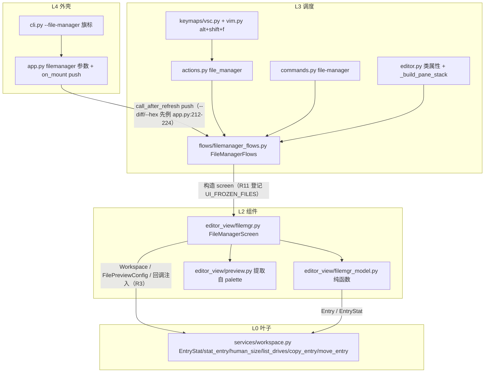

# file-manager 总纲（issue IKRZ41：LF 风格终端文件管理器，双形态）

> 状态：已批准（无人值守模式，2026-10-31 用户指令「无须过问直接执行」）。
> 规划者：主代理兜底（plan-architect-designer 两次 spawn 模型未注册零产出，
> 依 task-orchestration.md §一.3.5 / §三 由主代理按剧本执行）。
> 代码事实取证：code-explorer 69 次工具调用报告（文件:行号 级）+ 主代理补充 grep。

## 一、目标

在 yate 内集成 lf 风格终端文件管理器，两种形态共享同一 L2 组件：

1. **浮层**：编辑器内 `Alt+Shift+F`（vsc+vim）或 `:file-manager` 打开，`ModalScreen`
   大浮层（宽 90% / 高 80%，对齐 palette `.with-preview` 尺寸先例
   `yate/resources/palette-screen.tcss:27-32`），`Esc`/`q` 关闭且编辑器状态无损还原。
2. **全屏**：`yate --file-manager [path]` 启动进入全屏形态（同一组件 + CSS 类切换），
   选中后按 R3 语义转入编辑器主界面，`q`/`Ctrl+C` 退出进程。

三栏布局（父目录 | 当前目录 | 预览）+ 底部状态栏；图标/主题/滚动条与 explorer
同源；完整鼠标支持；P0 键位全量；双语手册同步。

## 二、非目标

- P2 项不做：hex 预览、`?` 键位速查面板（which-key 复用）、yaterc 可配置项
  （默认排序/浮层尺寸比例）、状态栏点击排序。
- 不做跨盘符移动/复制（`copy_entry`/`move_entry` 限同卷；跨卷场景提示 unsupported）。
- 不改动 `Workspace.Entry` 数据类本身（元数据经新增 `stat_entry` 旁路获取，
  explorer/list_dir 主路径零额外 stat 成本）。

## 三、开放问题裁决（Q1-Q5 + 键位冲突）

| # | 问题 | 裁决 | 理由 |
|---|---|---|---|
| Q1 | 未保存缓冲区 | **终裁（wave-4 实测降级）**：存在 dirty → report 警告 `N unsaved changes - save or discard first` + 切换被拒；浮层此际已按 palette `_choose` 先例 dismiss（flows 侧无法保持打开，filemgr.py 回调类型为 fire-and-forget）。不静默丢弃满足 issue 验收 6；恢复「保持打开」需改 L2 回调签名为 `-> bool`，收益不抵时序返工，登记 P2 候选。dirty 检测 = `any(doc.modified for doc in session.docs)`（editor.py:1201 :q 同款） | issue Q1 倾向的「既有 :q 语义」即阻塞+提示+用户显式处理；三态确认引入批量丢弃语义面，plan-e 初稿已否决 |
| Q2 | 多选混合文件+目录 | **终裁（wave-4）**：集合经 `sorted()` 字母序，取**字母序第一个**目录进入，其余忽略并 report 提示；纯文件集合按序全开 tab | 光标序在 L2 set 侧不可恢复（filemgr.py:658 `sorted(self._marked)`）；字母序行为确定、可测试；多选多目录为少见场景 |
| Q3 | 浮层内选中文件 | **关闭并切换**（关闭浮层→按 R3 切换工作区），与全屏形态一致 | issue 字面语义；「保留 workspace 开新 tab」与 explorer 既有 open_path 无差异，无新价值 |
| Q4 | Windows 盘符 | **做**：到达根层后 `h`/`Left` 列出盘符虚拟层（`Workspace.list_drives()`，POSIX 返回空列表显示占位） | Windows 上体验完整；探测 = 盘符字母 + `Path.exists()`，纯 stdlib |
| Q5 | 预览缓存 | 沿用 palette 16 条 FIFO（`PREVIEW_CACHE_SIZE`），P0 不加配置 | 目录浏览局部性强，实测容量足够（test_palette_preview.py 已覆盖 FIFO 语义） |
| r 键 | 刷新 vs 重命名 | P0 刷新 = `r` / `F5`；P1 重命名 = **`R`**（大写，P0 无占用） | 避免 lf `r` 惯例与刷新冲突；无前缀机制、单键直达 |
| 命令名 | `:` 命令 | `file-manager`（连字符） | 既有先例 `:project-replace` / `:install-extension`（commands.py:355,554） |
| Entry 元数据 | size/mtime 来源 | 新增 `Workspace.stat_entry(path) -> EntryStat`（L0）+ `human_size()`；组件只消费 | 「文件系统逻辑归 L0」精神：列举/过滤/忽略已在 `list_dir`，stat 元数据同样下沉 L0；不污染 explorer 主路径 |
| 预览复用 | palette 管线 | 提取共享模块 `editor_view/preview.py`（PreviewData / PreviewLog / load_preview / PreviewCache），palette.py 改引用 | issue R4 硬性要求语法高亮管线复用；组合优于复制；palette 测试回归兜底等价性 |

## 四、架构落点（对照 architecture-boundaries.md）

- **R3 红线**：`filemgr.py` 构造只注入具体协作者（`Workspace` / `FilePreviewConfig`）
  与回调（`open_selected` / `close` / `message`），不 import `yate.editor` / `yate.app`。
- **R11 登记**：`tests/test_architecture.py` `UI_FROZEN_FILES` 新增
  `"flows/filemanager_flows.py": {"filemgr"}`（plan-f 执行）。
- **R13 主题自持**：`theme.attach(self, _apply_theme)` + `apply_scrollbar_theme`
  （对齐 palette.py:134 / explorer.py:249 先例）。
- **R15 滚动条**：三栏容器（ListView/PreviewLog 命中 `SCROLLABLE_BASES`）挂载时
  `apply_slim_scrollbars`——守卫 #37 自动扫 `editor_view/*.py`，新文件必须接线。
- **R12**：模块级 `log = tracing.get_logger(__name__)`。
- **能力注入**：flows 不持 App 句柄（守卫 `test_flow_modules_hold_no_app_handle`）；
  全屏退出为动词注入 `exit_app: Callable[[], None]`（`app.exit` 绑定方法，
  经 `bind_exit` 晚绑定，对齐 `bind_hex_opener` 先例 editor.py:299-296）。
- **回调别名**：新别名一律 PEP 695 `type` 语句，flows 域共享词汇放
  `yate/flows/__init__.py`（既有 MessageFn/SpawnFn/OverlayPusher/StateQuery 同处）。
- **pyright strict**：`ModalScreen[None]` 精确形态；无 Any / type: ignore / Protocol /
  TYPE_CHECKING；`from __future__ import annotations` 全模块。
- **ASCII 注释**（misc-rules §四）；文件 >800 行须拆分或登记豁免
  （filemgr.py 设计目标 <700 行，超标则拆 `filemgr_keys.py` 并回填总纲）。

## 五、子计划索引与执行波次

| 波次 | 子计划 | 独占文件 | 依赖 |
|---|---|---|---|
| wave-1 | plan-a L0 workspace 扩展 | `yate/services/workspace.py`、`tests/test_workspace_filemgr.py` | — |
| wave-1 | plan-b 预览管线提取 | `yate/editor_view/preview.py`（新）、`yate/editor_view/palette.py`、`tests/test_palette_preview.py`（回归） | — |
| wave-2 | plan-c L2 纯函数模型 | `yate/editor_view/filemgr_model.py`（新）、`tests/test_filemgr_model.py` | plan-a |
| wave-3 | plan-d L2 Screen 组件 | `yate/editor_view/filemgr.py`（新）、`yate/resources/filemgr-screen.tcss`（新）、`tests/test_filemgr.py` | plan-a/b/c |
| wave-4 | plan-e L3 flows + editor 接线 | `yate/flows/filemanager_flows.py`（新）、`yate/flows/__init__.py`、`yate/editor.py`、`tests/test_filemgr_flows.py` | plan-d |
| wave-5 | plan-f L4 全量接线 | `yate/actions.py`、`yate/commands.py`、`yate/keymaps/vsc.py`、`yate/keymaps/vim.py`、`yate/cli.py`、`yate/app.py`、`tests/test_architecture.py`、`tests/test_app_filemgr.py` | plan-e |
| wave-6 | plan-g 双语文档 | `yate/docs/file-manager.en.md`、`yate/docs/file-manager.zh.md`、`tools/changelog` 产物核对 | plan-f |

- 同波文件互不重叠；波间串行，上一波验收命令全部退出码 0 才进下一波。
- wave-1 一批 2 个并行（subagent-workflow §五.5 批大小），其余单发串行。

## 六、R7 键位定稿（双语手册与 `:help` 以此为准）

**导航（P0）**：`j`/`Down`、`k`/`Up` 光标；`h`/`Left`/`Backspace` 返回父目录
（光标落原目录项，lf 语义，经 `_dir_memory`）；`l`/`Enter`/`Right` 进入/打开；
`g` `g`/`Home` 顶部；`G`/`End` 底部；`Ctrl+d`/`Ctrl+u` 半页滚动。

**过滤与视图（P0）**：`/` 或 `f` 增量过滤（底部 Input 实时收窄，`Esc` 清除）；
`H` 或 `.` 切换隐藏文件（读写 `Workspace.show_hidden`，与 explorer 同步语义）；
`s` 循环排序 name→size→mtime（目录始终在前，升降序提示状态栏）；
`r` / `F5` 强制刷新（`Workspace.invalidate()` + 重列）。

**多选（P0）**：`Space` 切换标记（光标不动）；`v` 反选全部；`Esc` 两级退出
（有过滤先清过滤，否则清选择）；`l`/`Enter` 打开选中集（Q2 裁决）。

**文件操作（P1）**：`a` 新建文件；`A` 新建目录；`R` 重命名（预填原名）；
`d` 删除（确认行 `type y to confirm`，目录递归显式确认）；
`y` / `x` 复制/剪切标记；`p` 粘贴到当前目录（同名冲突确认行）。

**退出（P0）**：`q`/`Esc`（浮层关闭还原 / 全屏退出进程）。

## 七、验收标准（issue 原文 + 门禁）

1. `Alt+Shift+F` 与 command palette 打开浮层，`Esc`/`q` 关闭后编辑器状态无损还原；
2. `yate --file-manager` 全屏启动，选中文件→进入编辑、目录→设为 workspace root，
   `q` 退出；
3. 三栏布局、图标、状态栏与 lf 参考一致；主题实时跟随；细滚动条随主题；
4. 隐藏/`.gitignore`/`.yateignore` 过滤与 explorer 一致，`H`/`.` 切换；
5. 全部 P0 键位生效；鼠标单击/双击/滚轮可用；
6. 未保存缓冲区不静默丢弃（Q1 三态确认）；
7. 架构守卫全绿（UI_FROZEN_FILES 登记生效、R13/R15 落实）；
   pyright 0 / pytest 全绿 / 覆盖率 ≥75% / 冒烟 117+ 全绿；
8. 双语手册同步（CHANGELOG 由 `tools/changelog` 流程处理，plan-g 核对）。

## 八、风险与回滚

| 风险 | 缓解 | 回滚 |
|---|---|---|
| palette 提取回归破坏 | test_palette_preview.py 17 用例全量回归；提取为纯搬运+改名 | revert preview.py + palette.py 单笔提交 |
| filemgr.py 超 800 行 | 预拆 filemgr_model.py；实测超标再拆 keys 模块 | 计划内拆分，无回滚 |
| Textual ListView 双击行为与预期不符（双击 Selected 事件） | plan-d 验收含 pilot 双击用例；不符则 on_click 计时实现 | 实现层切换，无接口变更 |
| Windows stat 慢（大目录） | EntryStat 旁路不阻塞 list_dir；目录切换一次 stat 批量完成 | 状态栏 size 列降级懒加载 |
| 全屏形态与主界面初始化竞态 | 对齐 --diff 先例 `call_after_refresh` push（app.py:212-224） | 无 |
| 并行 pytest 时序 flake | 键位/过滤用例禁真实睡眠，`wait_until` 轮询（python-coding-style §4.7） | `-n 1` 复核修用例 |
