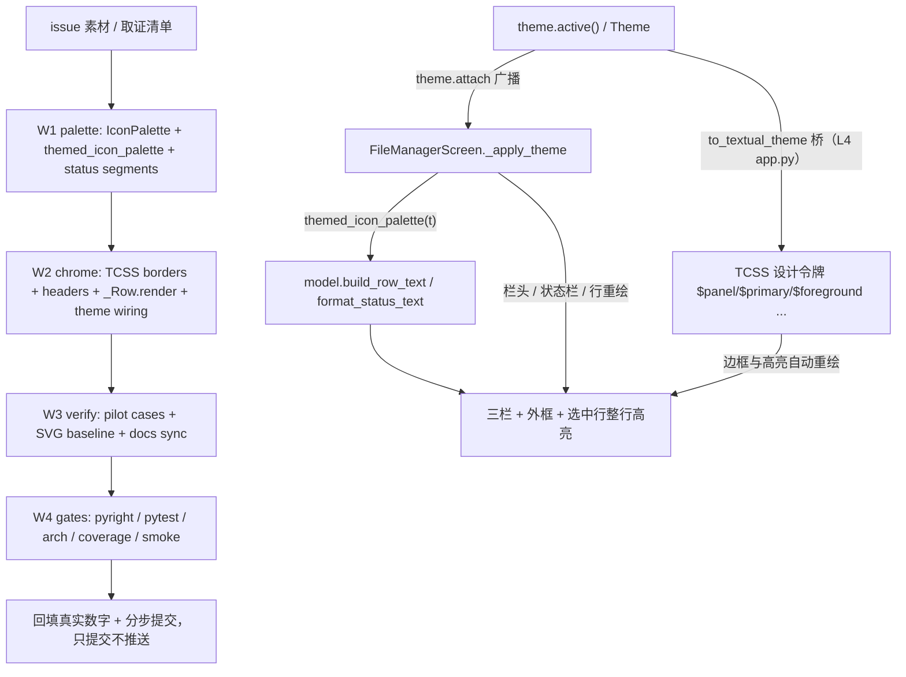

# filemgr-theme-beautify 实施总纲

## 一、状态与事实来源

- 任务：按 issue 附件预览图（lf/ranger 风格三栏）美化文件管理器；**配色必须与主题对齐**、**必须有边框**。
- worktree `../yate-filemgr-theme-beautify`，分支 `enh/filemgr-theme-beautify`，独立 `.venv` 已重建并自证
  （`yate.__file__` 指向本 worktree）。主仓 `75bccfa` 干净。
- 【领会】产物：`.trae/documents/filemgr-theme-beautify-issue.md`（提交 `859ed8b`），是需求原文与取证情报的唯一来源。
- 【批准】：用户显式「进入无人值守，所有问题无须过问」→ 方案审批按通过处理。
- 【方案 / 执行】角色：两次 spawn 均被运行时按注册定义强制解析为未注册模型
  `qwen-3.7-plus`（任务书指定 hy4 与 `.trae/agents/*-hy4.md` 派生副本均无效），
  按 `task-orchestration.md` §一.3.5 / §三 由主代理兜底亲自按剧本执行，如实标注
  **「子代理零产出」**。
- 【审核】角色：`code-review-expert` 本轮由运行时按会话模型 **Hy4 preview** 成功派发
  （剧本 frontmatter 的 `DeepSeek-V4.1-Flash` 未生效），落盘
  `.trae/reviews/2026-11-06-filemgr-theme-beautify.md`（289 行，
  0 blocker / 3 major / 8 minor）。
- 用户指定 `model=hy4` 在【方案 / 执行】环节因运行时模型注册限制未能落地、在【审核】
  环节落地；未修改任何既有 agent 定义文件，hy4 派生副本为未跟踪临时文件、收尾已删除。

## 二、目标与非目标

**目标**

1. 边框体系：外框、三栏分隔、栏头分隔、状态区上边框；浮层与全屏形态都保留边框。
2. 版式：每栏主题色栏头（父目录 / 当前目录 / 预览标题）、选中行整行反色、底部状态栏三段式。
3. 配色：所有可见颜色来自 `Theme` 或 Textual 桥接设计令牌；文件图标色改为主题派生；
   主题切换（内置 8 套 + 自定义主题）后即时跟随。
4. 验收：`screenshots/file-manager.svg` 基线更新、新增用例、全量门禁五项全绿。

**非目标**

- 不改三栏 1:2:2 比例、不新增第四栏、不改键位 / 导航 / 标记 / 文件操作 / 预览 worker / 缓存。
- 不改 explorer 及任何其它组件的图标色与边框；不改 `Theme` 字段与桥映射。
- 不引入硬编码色板、不引入新依赖；不做「中栏万级条目增量刷新」等既有遗留项。
- 不改 widget id（R9，人工评审项）；不改 `format_status` 的既有字符串语义（既有模型用例零改动）。

## 三、取证清单（只读取证，均为本 worktree 内相对仓库根路径）

| # | 事实 | 证据 |
| --- | --- | --- |
| F1 | 三栏 1:2:2；`compose()` 仅 `Horizontal#file-manager-body` + `Input` + `Static#file-manager-status` | `yate/editor_components/file_manager/screen.py:201-213`、`yate/resources/file-manager-screen.tcss:18-33` |
| F2 | 边框只有 `border: tall $panel`（外框）与 `border-left: tall $panel`（右栏）；全屏态 `border: none` | `yate/resources/file-manager-screen.tcss:10,13-17,31` |
| F3 | 无栏头 / 路径条；无 `ListItem` 高亮定制；`_Row` 是 `Static(Text)`，行文本带 Rich span 显式色 | `screen.py:77-99,410-420`、`yate/editor_components/file_manager/model.py:151-192` |
| F4 | 图标色为固定 Seti hex；`icon_color` 默认行为被 explorer 共享 | `yate/editor_components/icons.py:99-114,170-179` |
| F5 | Textual 8.2.8 `ListView > ListItem.-highlight` 默认用 `$block-cursor-background` / `foreground`（实证为 `accent2` 与 `fg`），`watch_index` 同步置 `-highlight` 后才发 `Highlighted` 消息 | `.venv` 探针：`textual.__version__ == 8.2.8`；`ListView.watch_index` 源码；`screen.py:625-630` 已有 `on_list_view_highlighted` |
| F6 | `Theme` 34 色字段；`to_textual_theme` 桥映射 12 字段（`$primary`←`accent2`、`$secondary`←`accent`、`$panel`←`panel` 等）；`border` / `on_accent` / `fg_bright` 未进桥 | `yate/editor_components/theme/themes.py:66-121,566-599` |
| F7 | `Theme.border` ≠ CSS `$border`；`$border` 是 Textual 派生令牌，改 `panel` / `fg` / `accent*` 才能影响边框 | `themes.py:566-599`、`yate/resources/diff-view.tcss:31`、`yate/editor_components/scrollbars.py:114-130` |
| F8 | 组件自持链路已达标：`apply_slim_scrollbars` + `apply_scrollbar_theme` + `theme.attach` | `screen.py:223-258`；R13 / R15 |
| F9 | 测试契约：`#file-manager-status` 必须是 `Static`（`_status_text` 读 `.content`）；`format_status` 有精确字符串断言 | `tests/test_file_manager.py:108-110`、`tests/test_file_manager_model.py:163-206` |
| F10 | `screen.py` 在 `SIZE_EXEMPT_FILES`，规则文本登记 963 行，改文件须同步登记新行数 | `.trae/rules/architecture-boundaries.md:311-323`、`tests/test_architecture.py:355-360` |
| F11 | 截图基线 `python -m tools.screenshots --only file-manager`；冒烟 `compare` 默认丢弃 `svg_rows` | `tools/screenshots/scenarios.py:402-426`、`screenshots/README.md:167-173` |
| F12 | `Static(Text).content` 是 `rich.text.Text`；`Widget.border_title` 可写；`Styles` 暴露 `border*` / `border_title_*` | `.venv` 探针实证 |

## 四、备选方案与否决理由

| 方案 | 内容 | 裁决 |
| --- | --- | --- |
| **A（选定）** | 组件自持 TCSS 令牌重做边框/栏头/高亮；`_Row.render()` 在高亮态剥离 Rich span 色，让 `ListItem.-highlight` 的主题色接管整行；图标色经 `icons.py` 可选 palette 参数由 file manager 侧注入主题派生色 | 选定：零硬编码、零桥改动、零 explorer 影响，全部复用既有机制 |
| B | 给 `to_textual_theme` 新增 `$on-accent` / `$fm-border` 变量，让边框直接读 `Theme.border` / `on_accent` | 否决：改桥映射要同步 `tests/test_theme_palettes.py` 逐字段断言与全部主题，影响面超出本屏；且 `Theme.border` 语义是滚动条 thumb，混用会破坏 F7 契约 |
| C | 照抄预览图的蓝/绿配色写死 hex | 否决：直接违反 issue 硬性约束「配色必须与主题对齐」 |
| D | 修改 `icons.py` 的 `SETI_COLORS` 全局默认值使其跟随主题 | 否决：explorer 共享该调色板，会改变其它组件既有外观（非目标） |
| E | 把 `#file-manager-status` 改成 `Horizontal` + 三个 `Static`，用真正 CSS 边框分段 | 否决：F9 测试契约要求该 id 是 `Static`；改测试结构属于扩大范围。替代：单个 `Static` 内用主题 `fg_dim` 的 `│` 段分隔 + 状态区 `border-top`，并在计划中显式登记这一处实现取舍 |
| F | 用 `theme.active().on_accent` 之类 Rich 内联色画整行高亮 | 否决：主题切换时内联样式必须手动重刷（R13），且 `on_accent` 未桥接；改用 CSS 变量 + 剥离 span 后由 Textual 自动重绘 |

## 五、执行波次（波间串行，波内文件独占且互斥）

| 波 | 子计划 | 独占文件 | 依赖 |
| --- | --- | --- | --- |
| W1 | `filemgr-theme-beautify-palette-plan-a.md` | `yate/editor_components/icons.py`、`yate/editor_components/file_manager/model.py`、`tests/test_file_manager_model.py` | 无 |
| W2 | `filemgr-theme-beautify-chrome-plan-b.md` | `yate/resources/file-manager-screen.tcss`、`yate/editor_components/file_manager/screen.py` | W1 的 `IconPalette` / `themed_icon_palette` / `format_status_text` API |
| W3 | `filemgr-theme-beautify-verify-plan-c.md` | `tests/test_file_manager.py`、`screenshots/file-manager.svg`、`screenshots/README.md`、`.trae/rules/architecture-boundaries.md` | W1 + W2 |
| W4 | 主代理收尾 | `.trae/documents/filemgr-theme-beautify-plans/*.md`（回填）、本目录 `overview.md` | W1-W3 |

## 六、风险清单与回滚路径

| 风险 | 触发条件 | 处置 / 回滚 |
| --- | --- | --- |
| R1 `-highlight` 类变化时 `_Row.render()` 未重绘 | 光标移动后高亮行仍带 span 色 | `on_list_view_highlighted`（F5 已证类先于消息同步）显式 `refresh()` 旧/新两行；新增用例断言旧行有 span、新行无 span |
| R2 TCSS 选择器不生效或语法错误 | pilot 抛样式解析异常 / 截图无边框 | 先跑最小 pilot 再铺开；回滚 tcss 到 HEAD 版本（单文件 `git checkout`） |
| R3 全屏态边框占 1 行导致既有 `region.size == (100,30)` 断言变化 | F2 去掉 `border:none` | 该断言测的是容器 region（含边框），实测验证；若失败改断言而非恢复无边框（issue 硬性要求） |
| R4 状态栏新增文本破坏既有 `in` 断言 / 冒烟 checks | `tests/test_file_manager.py` 或 `smoke compare` 红 | `format_status` 保持原样，新增 `format_status_text` 只用于 UI；跑 `compare` 确认 checks 不漂移 |
| R5 `screen.py` 越过 800 行豁免登记 | F10 | 收尾用 `splitlines()` 实测行数，同步 `.trae/rules/architecture-boundaries.md` 的登记文字（守卫集合不变） |
| R6 本机 safe-delete 钩子杀全量门禁 | 单轮删除 >9999 文件 / 同一轮串跑多道 pytest | 每道门禁拆到独立工具调用轮次；症状先看 `[safe-delete]` 行；不擅自清 `%TEMP%` 积压 |
| R7 主题切换残留固定色 | 自定义主题覆盖 `panel`/`accent`/`fg` 后边框或图标不变 | 新增用例覆盖内置 + `replace(THEMES[...])` 自定义主题；所有 TCSS 颜色只用桥接令牌 |

## 七、验收命令（解释器统一 `.venv\Scripts\python.exe`，工作目录为 worktree）

- W1：`-m pytest tests/test_file_manager_model.py -q`；`-m pyright yate/editor_components/icons.py yate/editor_components/file_manager/model.py`
- W2：`-m pytest tests/test_file_manager.py -q`；`-m pyright yate/editor_components/file_manager/screen.py`；`-m tools.screenshots --only file-manager`（临时产物，确认可渲染）
- W3：`-m pytest tests/test_file_manager.py tests/test_file_manager_model.py tests/test_theme_palettes.py -q`；`-m tools.screenshots --only file-manager`；`python -m tools.smoke_test compare --scenario file_manager_startup_navigation`
- W4（主代理亲跑，各道独立轮次）：`-m pyright yate/ tests/ tools/ pack/`；`-m pytest tests/ -q -n auto`；`-m pytest tests/test_architecture.py -q`（37）；`-m pytest tests/ --cov=yate --cov-branch -n auto`；`-m tools.smoke_test run --jobs 4`

## 八、回填记录（收尾时填写真实数字，禁留空）

| 项 | 结果 |
| --- | --- |
| 【领会】提交 | `859ed8b` |
| 【方案】提交 | `5b4f1a0` |
| W1 / W2 / W3 提交 | `b6bd077` / `6eef8c9` / `81c1eed` |
| 【审核】评审记录提交 | `c64dc64` |
| 【迭代】评审修复提交 | `c2f3ae0` |
| 【收尾】回填提交 | 即含本表的本笔提交（哈希自指不填，以 `git log -1` 为准） |
| pyright | `yate/ tests/ tools/ pack/`：0 errors / 0 warnings / 0 informations，exit 0 |
| pytest | 全量 `tests/ -q -n auto` exit 0；收集 3414 条（3404 passed / 10 skipped） |
| 架构 | `tests/test_architecture.py` 37 passed，exit 0 |
| 覆盖率 | `--cov=yate --cov-branch -n auto --cov-fail-under=75`：TOTAL 92.86%，`Required test coverage of 75% reached`，exit 0 |
| 冒烟 | `run --jobs 4`：121/121 scenarios、1463/1463 checks (100%)，exit 0 |
| 场景对比 | `compare --scenario file_manager_startup_navigation`：MATCH、17/17 checks，exit 0 |
| 截图 | `--only file-manager`：generated 1/1、failed 0，exit 0；重生成后 `git diff` 显示 SVG 与基线字节一致 |
| 偏离计划与依据 | 见下方逐条登记 |

### 偏离与依据（逐条）

1. **【方案 / 执行】子代理零产出**：两次 spawn 被运行时按注册定义强制解析为未注册模型
   `qwen-3.7-plus`；按 `task-orchestration.md` §一.3.5 / §三 由主代理亲自按剧本执行。
   用户指定 `model=hy4` 在该环节未能落地；【审核】环节 `code-review-expert` 以
   `Hy4 preview` 成功派发。hy4 派生副本未入库、收尾已删除。
2. **W2 正向偏离（1 行高容器 border 吃掉内容行）**：原设计把 `border-bottom` /
   `border-top` 放在高 1 的栏头 / 状态栏上，探针与 SVG 实证其文字完全不可见。
   改为由 `height: 1fr` 的 `#file-manager-body` 承载 `border-top` / `border-bottom`，
   栏头与状态栏保持单行文本；W3 用例断言随之改到 body，并新增「SVG 中栏头标题可见」
   守卫。regen 后的 SVG 实测：`y=44.4` 三栏头、`y=68.8` / `y=678` 横线、
   `y=703.2` 三段状态栏。
3. **双语说明来源偏离**：W3 计划写 `screenshots/README.md`，实际该文件由
   `tools/screenshots/gallery.py` 从 `scenarios.py` 的 `desc_en` / `desc_zh` 生成，
   直接改 README 会被每次重生成覆盖。改到唯一来源 `tools/screenshots/scenarios.py`，
   并用 `render_gallery` 重生成 README；同时修正 gallery 头部把 Markdown 占位符写成
   XML 实体的问题（评审 m7）。
4. **评审 M3**：给 `#file-manager-input.active` 补 `height: 2 + border-top:
   solid $foreground 12%`，并新增「边框令牌 + SVG 中占位符可见」用例；height 2 是
   为避免 1 行高控件被自身边框吃掉文本（同偏离 2 的教训）。
5. **评审 M1 / M2 / m1 / m2 / m3 / m8**：状态栏按宽度分级截断（右段优先，
   `format_status` 纯字符串契约不变）；恢复误删的目录组排序断言；空列表时状态栏也随
   主题重刷；条件表达式加括号；防御分支文档化 + 越界/非 Text 回退用例；R9 新增
   `#file-manager*` 组 id 在 `architecture-boundaries.md` 登记。
6. **评审 m4 / m6**：`probe_w2.py` 与三个 `*-hy4.md` 临时文件已删除；
   审核、迭代、收尾三笔新提交均带 body（前 5 笔不追溯改写历史）。
7. **评审未解决项 2**：`tools/screenshots/driver.py` 的 `_FIXTURE_PREFIX_RE`
   字符类补下划线，避免 TEMP 目录名含 `_` 时 scrub 失效把机器路径写进公开 SVG；
   实测 `yate-screenshots-_rp9ycuv` 可被匹配。
8. **不改手册**：`yate/resources/manual.{en,zh}.md` 与 `yate/docs/` 只描述命令与行为，
   本次未触碰键位 / 导航 / 文件操作语义，故按 W3 计划不改。
9. **遗留（另案）**：smoke / diag 报告类截图内容随重生成变化、`format_status` 的
   单行字符串语义、中栏万级条目增量刷新，均不在本任务范围。
10. **2026-11-06 用户视觉修订（覆盖原 §二.1 / 验收 2）**：按实机截图去掉最上面的
    路径行（`border_title`）、把页头 / 页脚背景由 `$panel` 调浅为 `$surface`、
    删除最外层 `border: tall $panel`；浮层与全屏均只保留三栏竖向分隔与
    `#file-manager-body` 上下横向规则。对应改动落在 `file-manager-screen.tcss`、
    `screen.py`（删 border_title 赋值）、`tests/test_file_manager.py`（改 3 条断言）与
    `screenshots/file-manager.svg`（重生成）。重生成 SVG 实测：首行即三栏头、
    `▔` / `▁` 计数 0、`#181825` 计数 0、`#313244` 计数 237。详见
    `filemgr-theme-beautify-issue.md` §四。
11. **2026-11-06 用户反馈第二波（本轮）**：两条独立缺陷，均属既有验收项的
    「实现未达标」修复，非新需求：
    - **command palette 重复**：`palette.py::_build_command_entries` 用**精确名**去重，
      而 action 用 snake_case、`:` 命令用 kebab-case，导致 `file_manager` /
      `file-manager` 同时出现（截图实锤），`project_replace` / `project-replace`
      是同类对撞。方案：新增 `_fold_name()` 做**等长折叠**（小写化 + `-` → `_`），
      仅在 commands 模式用于三处：去重集合、`_set_entries` 的 display / hint 镜像、
      `refilter` 的 query；files 模式路径保持原样，不折叠。折叠不改长度，
      `_match_lowered` 返回的 hits 仍可索引原显示串，因此两种拼写都命中同一行，
      且保留 `:command` 拼写与快捷键 hint。否决「重命名 action / 命令」（破坏
      keymap 与 `:file-manager` 兼容）、否决「在 files 模式折叠路径」（带连字符的
      文件名会被下划线查询误匹配）。
    - **页眉 / 页脚文字垂直下坠**：Textual 8.2.8 的 1 行盒 `content-align: left top`
      是默认且 `middle` 在 `height=1` 时为 no-op（`strip.py:212-218` 实证：
      `vertical_excess_space=0`）；探针实测 `height=2 + middle` 文字落第 1 行、
      `height=3 + middle` 文字落在第 2 行（上下各 1 行留白）。方案：取
      **`height: 3` + `content-align: left middle`**（保留水平左对齐，只修垂直），
      文字落在条带正中；三栏头 `Static` 与状态栏 `Static` 同步，配色仍全走主题令牌。
      代价：浮层 80% 高度下内容区少 4 行。
    - **实测几何**（100×30 pilot，只读取证脚本）：head `region.y=0, height=3`、
      status `region.y=27, height=3`；三栏头文字在 SVG `y=44`，上下 `y=20` / `y=68`
      为空白行；状态栏文字在 `y=703`，上方 `y=678` 为空白行，下方一行完全空白
      （无 `<text>` 元素）。`screenshots/file-manager.svg` 在 worktree 沙箱内重生成
      两次，diff 稳定在 17/17 行；`screenshots/README.md` 无差异。
    - **验收追加**：`tests/test_app_palette.py` 两条用例（去重 + 折叠索引对齐）；
      `tests/test_file_manager.py` 一条用例，断言 `height=3` / `left middle`，并用
      SVG 断言标题上下各有一行空白、状态栏文字上方有一行空白（防止回退到贴边
      渲染）。面板查询结果中 `file` 只出现一条 `file-manager`（命令），
      `file_manager` 不再出现；`project` 同理。

### 第二波迭代回填（2026-11-06，真实数字）

| 项 | 结果 |
| --- | --- |
| 【方案】 | 本轮方案登记在 §八 偏离 11；issue 整理稿追加 §五；chrome 子计划追加「第二次视觉修订」 |
| 【执行】提交 | `4c2c782`（palette 去重 + 2 条用例）、`7c31b80`（页眉页脚居中 + 1 条用例 + SVG 基线） |
| 【审核】 | 既有闭环内的用户反馈迭代波：主代理按 `code-review-expert` 剧本自审本轮 7 个文件的 diff（无新增 blocker / major），并亲跑全量门禁；未单独派发评审子代理，与上一轮视觉修订波一致。首轮评审记录 `../../reviews/2026-11-06-filemgr-theme-beautify.md` 是时点快照，仍为本轮基线 |
| pyright | `yate/ tests/ tools/ pack/`：0 errors / 0 warnings / 0 informations，exit 0 |
| pytest | `tests/ -q -n auto` exit 0；3407 passed / 10 skipped（较首轮 +3 条用例） |
| 架构 | `tests/test_architecture.py` 37 passed，exit 0 |
| 覆盖率 | `--cov=yate --cov-branch -n auto --cov-fail-under=75`：TOTAL 92.88%，`Required test coverage of 75% reached`，exit 0 |
| 冒烟 | `run --jobs 4`：121/121 scenarios、1463/1463 checks (100%)，exit 0 |
| 场景对比 | `compare --scenario file_manager_startup_navigation`：MATCH、17/17 checks，exit 0 |
| 截图 | `--only file-manager` 在 worktree 沙箱内重生成两次：generated 1/1、failed 0、exit 0；SVG diff 稳定 17/17 行，`screenshots/README.md` 零差异 |
| 清理与核查 | 一次性取证脚本 `probe_iter.py` 已删除（未入库）；`git diff --check` exit 0；沙箱自证 `import yate` 指向本 worktree |
| 【收尾】提交 | 即含本表的本笔提交（哈希自指不填，以 `git log -1` 为准） |

12. **2026-11-07 用户反馈第三波（覆盖偏离 11 的居中方案）**：用户看完 3 行条带的
    实机效果后要求「那行数太宽了，一行即可」。裁定：紧凑优先，
    `#file-manager-head`、`#file-manager-head > Static`、`#file-manager-status` 全部
    回到 `height: 1`，删除两处 `content-align: left middle`。依据：Textual 8.2.8 的
    1 行盒 `vertical_excess_space=0`，`middle` 不改变字形位置；要「上下留白」必然要
    额外行高，与本轮要求直接冲突，故如实放弃居中、接受文字与相邻内容行同基线，
    不伪造。否决「用 `offset` / 半行 padding 微调」：`offset` 以单元格为单位，
    1 行内平移会裁切字形或把文字推出条带。代价：浮层内容区较 3 行版本多 4 行。
    - **实测几何**（100×30 全屏 pilot）：head `region.y=0, height=1`、
      status `region.y=29, height=1`；三栏头 `y=20` → 上横线 `y=44`（差 24），
      下横线 `y=703` → 状态文字 `y=727`（差 24），条带内无填充行。截图基线
      `--only file-manager` 重生成 1/1，首行 / 末行同上，README 零差异。
    - **验收改写**：`test_file_manager_header_and_footer_are_vertically_centered`
      更名为 `test_file_manager_header_and_footer_are_single_row_bands`，断言 4 个
      widget 的 `height=1`、head / status `region.height=1`，并保留 W2「栏头文字仍绘制」
      守卫（1 行容器被自身 border 吃掉内容行的历史缺陷）。

### 第三波迭代回填（2026-11-07，真实数字）

| 项 | 结果 |
| --- | --- |
| 【方案】 | 本轮方案登记在 §八 偏离 12；issue 追加 §六；chrome 子计划追加「第三次视觉修订」并校正用例名 |
| 【执行】提交 | `4179939`（一行条带 + 用例改写 + SVG 基线）、`aa75782`（并行时序 flake 修复） |
| 【审核】 | 同第二波：既有闭环迭代波，主代理按 `code-review-expert` 剧本自审 diff 并亲跑全量门禁，未单独派发评审子代理；首轮评审记录为基线 |
| 并行 flake 处置 | 首次 `tests/ -q -n auto` 在 `test_file_palette_filters_and_opens` 失败（`doc.name` 仍为 `[no name]`）；`-n 1` 复核通过，按 §二.7 改 `wait_until` 轮询（未按偶发放过）；其后纯 pytest 与覆盖率两次全量 `-n auto` 均 exit 0 |
| pyright | `yate/ tests/ tools/ pack/`：0 errors / 0 warnings / 0 informations，exit 0 |
| pytest | `tests/ -q -n auto` exit 0；3407 passed / 10 skipped |
| 架构 | `tests/test_architecture.py` 37 passed，exit 0 |
| 覆盖率 | `--cov=yate --cov-branch -n auto --cov-fail-under=75`：TOTAL 92.87%，`Required test coverage of 75% reached`，exit 0 |
| 冒烟 | `run --jobs 4`：121/121 scenarios、1463/1463 checks (100%)，exit 0 |
| 场景对比 | `compare --scenario file_manager_startup_navigation`：MATCH、17/17 checks，exit 0 |
| 截图 | `--only file-manager`：generated 1/1、failed 0、exit 0；SVG diff 17/17 行，`screenshots/README.md` 零差异 |
| 清理与核查 | 一次性取证脚本 `probe_band.py` 已删除（未入库）；`git diff --check` exit 0 |
| 【收尾】提交 | 即含本表的本笔提交（哈希自指不填，以 `git log -1` 为准） |

13. **2026-11-07 用户反馈第四波（覆盖偏离 11 / 12 的页眉条款）**：用户指出上一波
    「一行即可」的本意是**只留页脚一行**——页眉整行仍未被删除，页脚要「恢复成和
    原先一样的布局」。取证 `master`：`compose()` 只有三栏 + `Input` + `Status`；
    `#file-manager-status` 的 `height: 1; padding: 0 1; background: $surface` 与
    当前**逐字相同**。裁定：删除页眉整行（`compose` 的 `#file-manager-head` 与三个
    `*-head` `Static`、TCSS 5 条规则、`_refresh_headers()` 及其调用、`_apply_theme`
    docstring），页脚样式与内容一字不改；R9 冻结 id 组同步移除页眉，行数豁免
    1041 → 1018。否决「回退状态栏三段式 / 删除内容区上下横线」：用户本轮只点名
    页眉与「页脚布局」，页脚样式已在原始版本中核实，推翻首轮需求属超范围。
    - **实测**：截图基线重生成 1/1，首行 `y=20` 已由三栏头变为 body 上横线，
      内容首行 `y=44`，末行 `y=727` 仍为状态栏文字；`screenshots/README.md`
      双语描述去掉「栏头 / column headers」。
    - **验收改写**：`test_file_manager_headers_and_theme_driven_borders` →
      `test_file_manager_theme_driven_borders_without_header`（断言无
      `#file-manager-head` / `#file-manager-list-head`）；
      `test_file_manager_header_and_footer_are_single_row_bands` →
      `test_file_manager_footer_is_the_only_single_row_band`（断言页脚 1 行 +
      状态栏文字仍绘制）；自定义主题用例去掉栏头色 / 背景断言，保留选中行、
      容器、状态栏、图标色与状态栏 spans 的主题断言。

### 第四波迭代回填（2026-11-07，真实数字）

| 项 | 结果 |
| --- | --- |
| 【方案】 | 本轮方案登记在 §八 偏离 13；issue 追加 §七；chrome 子计划追加「第四次视觉修订」；R9 冻结 id 组与行数豁免同步 |
| 【执行】提交 | `ab64565`（删页眉 + 用例改写 + 截图基线 / 双语说明） |
| 【审核】 | 同前三波：既有闭环迭代波，主代理按 `code-review-expert` 剧本自审 diff 并亲跑全量门禁，未单独派发评审子代理；首轮评审记录为基线 |
| pyright | `yate/ tests/ tools/ pack/`：0 errors / 0 warnings / 0 informations，exit 0 |
| pytest | `tests/ -q -n auto` exit 0；3407 passed / 10 skipped |
| 架构 | `tests/test_architecture.py` 37 passed，exit 0（R9 / 行数豁免同步后） |
| 覆盖率 | `--cov=yate --cov-branch -n auto --cov-fail-under=75`：TOTAL 92.93%，`Required test coverage of 75% reached`，exit 0 |
| 冒烟 | `run --jobs 4`：121/121 scenarios、1463/1463 checks (100%)，exit 0 |
| 场景对比 | `compare --scenario file_manager_startup_navigation`：MATCH、17/17 checks，exit 0 |
| 截图 | `--only file-manager`：generated 1/1、failed 0、exit 0；SVG 75 行变化（首行由栏头变 body 上横线），`screenshots/README.md` 双语说明 2 行变化 |
| 清理与核查 | 本轮未新建探针；`git diff --check` exit 0 |
| 【收尾】提交 | 即含本表的本笔提交（哈希自指不填，以 `git log -1` 为准） |
