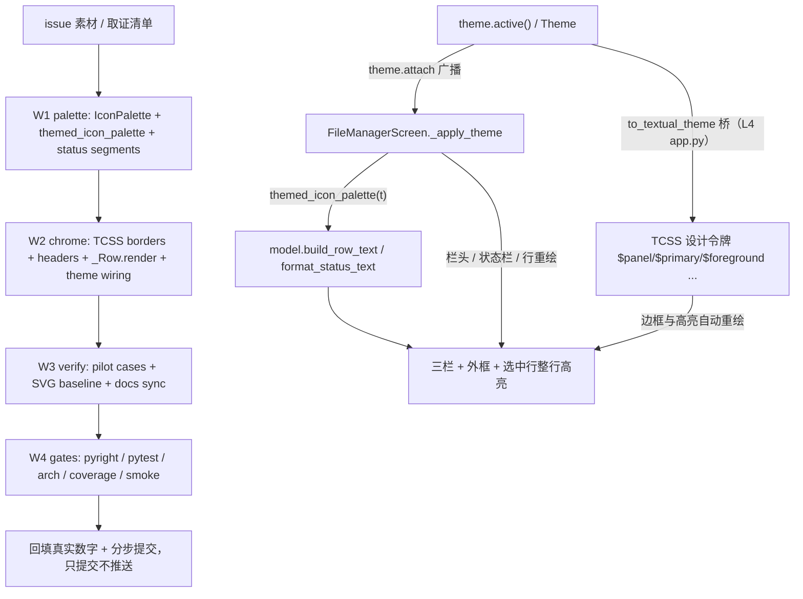

# filemgr-theme-beautify 实施总纲

## 一、状态与事实来源

- 任务：按 issue 附件预览图（lf/ranger 风格三栏）美化文件管理器；**配色必须与主题对齐**、**必须有边框**。
- worktree `../yate-filemgr-theme-beautify`，分支 `enh/filemgr-theme-beautify`，独立 `.venv` 已重建并自证
  （`yate.__file__` 指向本 worktree）。主仓 `75bccfa` 干净。
- 【领会】产物：`.trae/documents/filemgr-theme-beautify-issue.md`（提交 `859ed8b`），是需求原文与取证情报的唯一来源。
- 【批准】：用户显式「进入无人值守，所有问题无须过问」→ 方案审批按通过处理。
- 【方案 / 执行 / 审核】角色：两次 spawn 均被运行时按注册定义强制解析为未注册模型
  `qwen-3.7-plus`（任务书指定 hy4 与 `.trae/agents/*-hy4.md` 派生副本均无效），
  按 `task-orchestration.md` §一.3.5 / §三 由主代理兜底亲自按剧本执行，如实标注
  **「子代理零产出」**。用户指定 `model=hy4` 未能落地的原因如实登记；未修改任何既有
  agent 定义文件，派生副本为未跟踪临时文件、收尾删除。

## 二、目标与非目标

**目标**

1. 边框体系：外框、三栏分隔、栏头分隔、状态区上边框；浮层与全屏形态都保留边框。
2. 版式：每栏主题色栏头（父目录 / 当前目录 / 预览标题）、选中行整行反色、底部状态栏三段式。
3. 配色：所有可见颜色来自 `Theme` 或 Textual 桥接设计令牌；文件图标色改为主题派生；
   主题切换（内置 8 套 + 自定义主题）后即时跟随。
4. 验收：`screenshots/file-manager.svg` 基线更新、新增用例、全量门禁五项全绿。

**非目标**

- 不改三栏 1:2:2 比例、不新增第四栏、不改键位 / 导航 / 标记 / 文件操作 / 预览 worker / 缓存。
- 不改 explorer 及任何其它组件的图标色与边框；不改 `Theme` 字段与桥映射。
- 不引入硬编码色板、不引入新依赖；不做「中栏万级条目增量刷新」等既有遗留项。
- 不改 widget id（R9，人工评审项）；不改 `format_status` 的既有字符串语义（既有模型用例零改动）。

## 三、取证清单（只读取证，均为本 worktree 内相对仓库根路径）

| # | 事实 | 证据 |
| --- | --- | --- |
| F1 | 三栏 1:2:2；`compose()` 仅 `Horizontal#file-manager-body` + `Input` + `Static#file-manager-status` | `yate/editor_components/file_manager/screen.py:201-213`、`yate/resources/file-manager-screen.tcss:18-33` |
| F2 | 边框只有 `border: tall $panel`（外框）与 `border-left: tall $panel`（右栏）；全屏态 `border: none` | `yate/resources/file-manager-screen.tcss:10,13-17,31` |
| F3 | 无栏头 / 路径条；无 `ListItem` 高亮定制；`_Row` 是 `Static(Text)`，行文本带 Rich span 显式色 | `screen.py:77-99,410-420`、`yate/editor_components/file_manager/model.py:151-192` |
| F4 | 图标色为固定 Seti hex；`icon_color` 默认行为被 explorer 共享 | `yate/editor_components/icons.py:99-114,170-179` |
| F5 | Textual 8.2.8 `ListView > ListItem.-highlight` 默认用 `$block-cursor-background` / `foreground`（实证为 `accent2` 与 `fg`），`watch_index` 同步置 `-highlight` 后才发 `Highlighted` 消息 | `.venv` 探针：`textual.__version__ == 8.2.8`；`ListView.watch_index` 源码；`screen.py:625-630` 已有 `on_list_view_highlighted` |
| F6 | `Theme` 34 色字段；`to_textual_theme` 桥映射 12 字段（`$primary`←`accent2`、`$secondary`←`accent`、`$panel`←`panel` 等）；`border` / `on_accent` / `fg_bright` 未进桥 | `yate/editor_components/theme/themes.py:66-121,566-599` |
| F7 | `Theme.border` ≠ CSS `$border`；`$border` 是 Textual 派生令牌，改 `panel` / `fg` / `accent*` 才能影响边框 | `themes.py:566-599`、`yate/resources/diff-view.tcss:31`、`yate/editor_components/scrollbars.py:114-130` |
| F8 | 组件自持链路已达标：`apply_slim_scrollbars` + `apply_scrollbar_theme` + `theme.attach` | `screen.py:223-258`；R13 / R15 |
| F9 | 测试契约：`#file-manager-status` 必须是 `Static`（`_status_text` 读 `.content`）；`format_status` 有精确字符串断言 | `tests/test_file_manager.py:108-110`、`tests/test_file_manager_model.py:163-206` |
| F10 | `screen.py` 在 `SIZE_EXEMPT_FILES`，规则文本登记 963 行，改文件须同步登记新行数 | `.trae/rules/architecture-boundaries.md:311-323`、`tests/test_architecture.py:355-360` |
| F11 | 截图基线 `python -m tools.screenshots --only file-manager`；冒烟 `compare` 默认丢弃 `svg_rows` | `tools/screenshots/scenarios.py:402-426`、`screenshots/README.md:167-173` |
| F12 | `Static(Text).content` 是 `rich.text.Text`；`Widget.border_title` 可写；`Styles` 暴露 `border*` / `border_title_*` | `.venv` 探针实证 |

## 四、备选方案与否决理由

| 方案 | 内容 | 裁决 |
| --- | --- | --- |
| **A（选定）** | 组件自持 TCSS 令牌重做边框/栏头/高亮；`_Row.render()` 在高亮态剥离 Rich span 色，让 `ListItem.-highlight` 的主题色接管整行；图标色经 `icons.py` 可选 palette 参数由 file manager 侧注入主题派生色 | 选定：零硬编码、零桥改动、零 explorer 影响，全部复用既有机制 |
| B | 给 `to_textual_theme` 新增 `$on-accent` / `$fm-border` 变量，让边框直接读 `Theme.border` / `on_accent` | 否决：改桥映射要同步 `tests/test_theme_palettes.py` 逐字段断言与全部主题，影响面超出本屏；且 `Theme.border` 语义是滚动条 thumb，混用会破坏 F7 契约 |
| C | 照抄预览图的蓝/绿配色写死 hex | 否决：直接违反 issue 硬性约束「配色必须与主题对齐」 |
| D | 修改 `icons.py` 的 `SETI_COLORS` 全局默认值使其跟随主题 | 否决：explorer 共享该调色板，会改变其它组件既有外观（非目标） |
| E | 把 `#file-manager-status` 改成 `Horizontal` + 三个 `Static`，用真正 CSS 边框分段 | 否决：F9 测试契约要求该 id 是 `Static`；改测试结构属于扩大范围。替代：单个 `Static` 内用主题 `fg_dim` 的 `│` 段分隔 + 状态区 `border-top`，并在计划中显式登记这一处实现取舍 |
| F | 用 `theme.active().on_accent` 之类 Rich 内联色画整行高亮 | 否决：主题切换时内联样式必须手动重刷（R13），且 `on_accent` 未桥接；改用 CSS 变量 + 剥离 span 后由 Textual 自动重绘 |

## 五、执行波次（波间串行，波内文件独占且互斥）

| 波 | 子计划 | 独占文件 | 依赖 |
| --- | --- | --- | --- |
| W1 | `filemgr-theme-beautify-palette-plan-a.md` | `yate/editor_components/icons.py`、`yate/editor_components/file_manager/model.py`、`tests/test_file_manager_model.py` | 无 |
| W2 | `filemgr-theme-beautify-chrome-plan-b.md` | `yate/resources/file-manager-screen.tcss`、`yate/editor_components/file_manager/screen.py` | W1 的 `IconPalette` / `themed_icon_palette` / `format_status_text` API |
| W3 | `filemgr-theme-beautify-verify-plan-c.md` | `tests/test_file_manager.py`、`screenshots/file-manager.svg`、`screenshots/README.md`、`.trae/rules/architecture-boundaries.md` | W1 + W2 |
| W4 | 主代理收尾 | `.trae/documents/filemgr-theme-beautify-plans/*.md`（回填）、本目录 `overview.md` | W1-W3 |

## 六、风险清单与回滚路径

| 风险 | 触发条件 | 处置 / 回滚 |
| --- | --- | --- |
| R1 `-highlight` 类变化时 `_Row.render()` 未重绘 | 光标移动后高亮行仍带 span 色 | `on_list_view_highlighted`（F5 已证类先于消息同步）显式 `refresh()` 旧/新两行；新增用例断言旧行有 span、新行无 span |
| R2 TCSS 选择器不生效或语法错误 | pilot 抛样式解析异常 / 截图无边框 | 先跑最小 pilot 再铺开；回滚 tcss 到 HEAD 版本（单文件 `git checkout`） |
| R3 全屏态边框占 1 行导致既有 `region.size == (100,30)` 断言变化 | F2 去掉 `border:none` | 该断言测的是容器 region（含边框），实测验证；若失败改断言而非恢复无边框（issue 硬性要求） |
| R4 状态栏新增文本破坏既有 `in` 断言 / 冒烟 checks | `tests/test_file_manager.py` 或 `smoke compare` 红 | `format_status` 保持原样，新增 `format_status_text` 只用于 UI；跑 `compare` 确认 checks 不漂移 |
| R5 `screen.py` 越过 800 行豁免登记 | F10 | 收尾用 `splitlines()` 实测行数，同步 `.trae/rules/architecture-boundaries.md` 的登记文字（守卫集合不变） |
| R6 本机 safe-delete 钩子杀全量门禁 | 单轮删除 >9999 文件 / 同一轮串跑多道 pytest | 每道门禁拆到独立工具调用轮次；症状先看 `[safe-delete]` 行；不擅自清 `%TEMP%` 积压 |
| R7 主题切换残留固定色 | 自定义主题覆盖 `panel`/`accent`/`fg` 后边框或图标不变 | 新增用例覆盖内置 + `replace(THEMES[...])` 自定义主题；所有 TCSS 颜色只用桥接令牌 |

## 七、验收命令（解释器统一 `.venv\Scripts\python.exe`，工作目录为 worktree）

- W1：`-m pytest tests/test_file_manager_model.py -q`；`-m pyright yate/editor_components/icons.py yate/editor_components/file_manager/model.py`
- W2：`-m pytest tests/test_file_manager.py -q`；`-m pyright yate/editor_components/file_manager/screen.py`；`-m tools.screenshots --only file-manager`（临时产物，确认可渲染）
- W3：`-m pytest tests/test_file_manager.py tests/test_file_manager_model.py tests/test_theme_palettes.py -q`；`-m tools.screenshots --only file-manager`；`python -m tools.smoke_test compare --scenario file_manager_startup_navigation`
- W4（主代理亲跑，各道独立轮次）：`-m pyright yate/ tests/ tools/ pack/`；`-m pytest tests/ -q -n auto`；`-m pytest tests/test_architecture.py -q`（37）；`-m pytest tests/ --cov=yate --cov-branch -n auto`；`-m tools.smoke_test run --jobs 4`

## 八、回填记录（收尾时填写真实数字，禁留空）

| 项 | 结果 |
| --- | --- |
| 【领会】提交 | `859ed8b` |
| 【方案】提交 | 待回填 |
| W1 / W2 / W3 / W4 提交 | 待回填 |
| pyright / pytest / 架构 / 覆盖率 / 冒烟 | 待回填 |
| 偏离计划与依据 | 待回填 |
