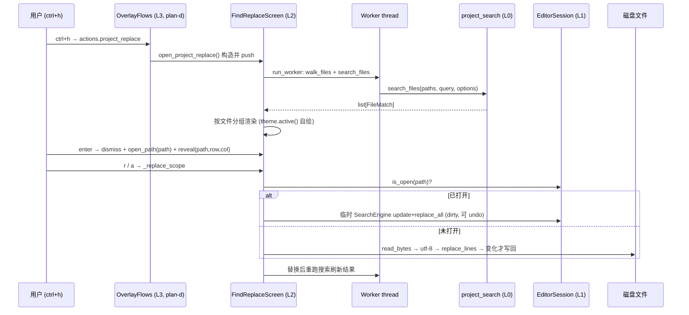

# plan-c：Find & Replace View（wave-2，与 plan-b 并行）

> 总纲见 [overview.md](overview.md)。波次：wave-2；依赖 plan-a 的
> `search_files` / `replace_lines` API。

## 一、输入

- 总纲 D3/D6/D7、F14/F15/F16；
- plan-a 定稿的 `project_search.search_files(paths, query, *,
  case_sensitive, use_regex, whole_word, max_file_bytes, max_matches,
  progress) -> list[FileMatch]` 与 `replace_lines(lines, pattern,
  replacement) -> tuple[list[str], int]`；
- [palette.py](../../yate/editor_view/palette.py) 范式：`DEFAULT_CSS =
  load_tcss(...)`、`theme.attach` 自持（R13）、`run_worker(partial(...),
  group, exclusive=True, exit_on_error=False)`（L404-409 / L578-583）、
  worker 内 `asyncio.to_thread`。

## 二、独占改动文件清单

| 文件 | 动作 |
|---|---|
| `yate/editor_view/find_replace.py` | 新建（≤500 行） |
| `yate/resources/find-replace-screen.tcss` | 新建（≤80 行） |
| `tests/test_app_find_replace.py` | 新建（测试文件；本波独占——plan-b 的用例在 `test_app_find.py`） |

不改动：`tests/test_architecture.py`（新文件自动受守卫，无新增冻结面
——本波不改 flows）。

## 三、交互设计（sequence 总览，细节见 §四）



## 四、具体设计

### 4.1 `yate/resources/find-replace-screen.tcss`（新建）

选择器与高度（全部 screen 局部 id，不进外壳 app.tcss，R9 不触发）：

- `#find-replace`：全屏 Vertical，`background: $surface; padding: 1 2;`
- `#fr-inputs`：Horizontal，height 3——内含 `#fr-find` / `#fr-replace`
  （Input，各占 1fr）与 `#fr-options`（Static，width auto）
- `#fr-results`：结果区，`height: 1fr`

颜色一律 Textual design tokens（`$surface` / `$primary` / `$accent`），
随 Textual dark/light 变量自动切换（与 palette-screen.tcss 同法）。

### 4.2 `yate/editor_view/find_replace.py`（新建，≤500 行）

```python
"""Project-wide find & replace overlay screen (ctrl+h).

Pure L2: collaborators and callbacks are constructor-injected; searching
runs in a worker thread over ``editor_core.project_search`` primitives.
"""

from __future__ import annotations
...

#: Reveal callback: focus (path, row, col) after the document opens.
type RevealFn = Callable[[Path, int, int], None]
```

**类**：`class FindReplaceScreen(ModalScreen[None])`。

**构造注入**（具体对象 / Callable，R2/R3）：

```python
def __init__(
    self,
    workspace: Workspace,
    session: EditorSession,
    *,
    open_path: Callable[[Path], None],
    reveal: RevealFn | None = None,
    message: MessageFn,
    readonly_notice: Callable[[], None],
    refresh: Callable[[], None],
) -> None: ...
```

**成员与行为**：

1. `BINDINGS`：`("<alt-c>", "toggle_case", "match case")`、
   `("<alt-w>", "toggle_word", "whole word")`、
   `("<alt-r>", "toggle_regex", "regex")`（VS Code 惯例）、
   `("escape", "dismiss_screen", "Close")`。
2. `DEFAULT_CSS = load_tcss("find-replace-screen.tcss")`。
3. 状态字段：`self._case = self._word = self._regex = False`；
   `self._results: list[FileMatch] = []`；
   `self._flat: list[tuple[Path, LineMatch]] = []`（扁平游标表）；
   `self._cursor = 0`；`self._debounce: asyncio.TimerHandle | None`。
4. `compose()`：`with Vertical(id="find-replace")` 内 yield
   `#fr-inputs`（`Input(placeholder="find", id="fr-find")` +
   `Input(placeholder="replace with", id="fr-replace")` +
   `Static(id="fr-options")`）与 `Static(id="fr-results")`。
5. `on_mount()`：`theme.attach(self, self._apply_theme)`（R13）+
   `query_one("#fr-find", Input).focus()` + `_render_options()`。
   `on_unmount()`：`theme.detach(self)` + 取消防抖句柄。
6. `_apply_theme()`：options/results 的前景与选项激活态取
   `theme.active()`（对齐 palette 的 Rich style 用法）。
7. `on_input_changed`（`#fr-find`）：0.3s 防抖——
   `asyncio.get_running_loop().call_later(0.3, self._start_search)`（§四
   防抖惯例）；新键入先 `self._debounce.cancel()`。
8. `_start_search()`：
   ```python
   self.run_worker(
       partial(self._search_worker, self._query()),
       group="fr-search", exclusive=True, exit_on_error=False,
   )
   ```
   `_search_worker(query)` 为 async 方法：`paths = self.workspace.walk_files()`
   → `await asyncio.to_thread(project_search.search_files, paths, query,
   case_sensitive=..., use_regex=..., whole_word=...)` → 回调段
   `if not self.is_mounted: return` 后存 `_results` / 重建 `_flat` /
   `_cursor = 0` / `_render_results()`。query 为空 → 直接清空结果区。
9. `_render_results()`（最长函数，行数超预算先裁这里）：按文件分组——
   文件名行（相对 `workspace.root` 的路径 + 匹配数）；每匹配一行
   `{row + 1}: {前缀}[高亮匹配]{后缀}`（片段截断 ±40 列，游标行加标记）。
   结果写 `#fr-results` 的 Rich Text（样式经 `_apply_theme` 的主题色）。
10. `on_key`（仅当焦点在 `#fr-results`，`isinstance(event, Key)` 且
    `self.focused is results` 时处理；消费即
    `event.stop() + event.prevent_default()`，R10）：
    - `up` / `down`：`_cursor` ±1（clamp），重渲染；
    - `enter`：`_open_current()`；
    - `r`：`_replace_scope([当前游标文件])`；
    - `a`：`_replace_scope([全部结果文件去重])`；
    - 其余 fall-through。
    焦点在 Input 时：`#fr-find` 的 `Input.Submitted` → `_open_current()`；
    `#fr-replace` 的 `Input.Submitted` → 焦点移到结果区（使 r/a/enter 可达）。
11. `_open_current()`：游标处 `(path, match)` → `self.dismiss()` →
    `self._open_path(path)` → `self._reveal and self._reveal(path,
    match.row, match.start)`（reveal 由 plan-d 的 `editor.reveal_match`
    提供，缺省 None 时仅 open_path）。
12. `_replace_scope(paths: list[Path])`（r/a 共用）：
    - guard find 与 replace 输入非空，空则 `self._message(..., "warn")`；
    - `pattern = project_search.compile_query(find, ...)`，None → warn；
    - 对每个 path：
      - `doc = self._session.is_open(path)` 命中 → 构造临时
        `SearchEngine`（选项同步），`update + replace_all(doc.buffer,
        replacement)`；`BufferReadOnlyError` → `self._readonly_notice()`
        并跳过该文件（F1/F2 的 engine guard 语义）；
      - 未命中 → 读 bytes、utf-8 解码、`splitlines(keepends=False)`、
        `replace_lines`，**返回对象 `is` 原列表则跳过写盘**（plan-a 免写盘
        契约）；写回 `"\n".join(new_lines) + ("\n" if 原文以换行结尾 else "")`；
        `OSError` → 计数不中断；
    - `self._message(f"replaced {n} occurrence(s) in {k} file(s)", "ok")`
      + `self._refresh()` + `_start_search()`（重跑搜索刷新结果）。
    - 磁盘读写放 worker 线程（`asyncio.to_thread`），避免大文件卡 UI。
13. 动作方法 `action_toggle_case/word/regex`：翻标志 → `_render_options()`
    → `_start_search()`；`action_dismiss_screen()`：`self.dismiss()`。
14. 行数预算 ≤500：结果渲染与 `_replace_scope` 各 ~120 行，其余 ~260。

### 4.3 测试用例（新建 `tests/test_app_find_replace.py`，范式 F23）

Screen 直构（不经 plan-d 接线）：`YateApp()` + `app.editor.workspace`
指向 tmp_path（通过 app 暴露的启动参数或直接替换 `editor.workspace.root`，
以 conftest 现有 tmp_path workspace 用例为准）→
`app.push_screen(FindReplaceScreen(workspace=..., session=app.editor.session,
open_path=lambda p: app.editor.document_flows.open_path_later(p), ...))`。

| 用例 | 前置与操作 | 断言 |
|---|---|---|
| `test_screen_compose_focuses_find_input` | push 后 `pilot.pause()` | `app.focused.id == "fr-find"` |
| `test_live_search_renders_grouped_results` | tmp_path 两文件各含 needle；输入 needle；`wait_until` | 结果区含两个文件名与 `row+1` 行号；匹配片段样式段存在 |
| `test_option_toggles_rerun_search` | 输入 needle 后 `alt+w` | `needles` 中的子串不再命中（结果收缩） |
| `test_enter_opens_and_reveals_match` | 单文件单匹配；焦点在结果区 `enter` | screen 已 dismiss；文档打开且 `buffer.cursor` == 匹配终点 |
| `test_replace_all_writes_unopened_files` | 两文件含 needle 均未打开；输入 find/replace；结果区 `a` | 两文件 `read_text()` 均含替换文本；消息含 replaced |
| `test_replace_updates_open_buffer_and_keeps_dirty` | 文件已打开（session.is_open 命中）；`a` | buffer 文本已换、`doc.modified is True`、磁盘未变 |
| `test_replace_skips_read_only_buffer` | read-only 文档 + 正常文档；`a` | read-only 未变、正常文档已换、readonly 提示出现 |
| `test_replace_no_change_skips_disk_write` | 文件无匹配（或替换后内容相同） | mtime/内容不变（免写盘契约） |
| `test_escape_closes_screen` | 任意焦点 `escape` | screen 弹出 |
| `test_binary_and_oversize_absent_from_results` | 二进制/超限文件 | 结果区不含对应文件名 |
| `test_results_up_down_move_cursor` | 多匹配；结果区 `down` | 游标标记移到第二项 |
| `test_replace_r_current_file_only` | 两文件有匹配；游标在文件 1；`r` | 仅文件 1 被替换 |

## 五、输出

- 组件可独立 pilot 验证（不经接线）；无入口（plan-d 接线）；
- `tests/test_app_find_replace.py` 建立（plan-e 在其上追加接线用例）。

## 六、验收命令（该波结束应全绿）

```powershell
.venv\Scripts\python.exe -m pytest tests/test_app_find_replace.py -q
.venv\Scripts\python.exe -m pytest tests/test_architecture.py -q
.venv\Scripts\python.exe -m pyright yate/
```

通过判定：三条退出码 0。

## 七、风险与回滚

- R4 卡 UI：worker + exclusive group + 上限 + 防抖；
- R5 超行数：预算 ≤500，超限先裁 `_render_results`；
- 焦点可达性风险（r/a 需结果区聚焦）：`#fr-replace` submit 后焦点移入
  结果区 + 测试锚定；回滚：单提交 revert（纯新增文件）。
