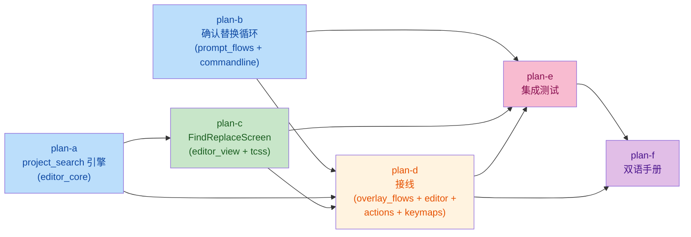

# find-replace-complete 总纲（issue IKL7AT）

> Gitee issue IKL7AT「Feat - 完整实现查找替换功能」。子计划目录结构遵循
> `.trae/rules/doc-conventions.md` §一（总纲 `overview.md` + 子计划
> `find-replace-complete-<subtask>-plan-<a|b|...>.md`，字母序即波次序）；
> 内容格式遵循 `.trae/rules/plan-before-execute.md` §二。
> 工作目录：worktree `feat/find-replace-complete`，解释器
> `.venv\Scripts\python.exe`。

## 一、目标与非目标

### 目标

1. **逐个确认式替换**：`F4`（`replace`）两步输入完成后进入单键确认循环
   `[i/N] replace 'x' with 'y'? (y)es (n)o (a)ll (q)uit`，逐个替换 / 跳过 /
   剩余全替换 / 退出（plan-b）。
2. **全项目查找替换**：新快捷键 `ctrl+h`（vsc 与 vim 同一 action
   `project_replace`），打开 FindReplaceScreen：workspace 级搜索、按文件
   分组结果、enter 跳转、`r` 替换当前文件 / `a` 替换全部（plan-c/d）。
3. **主题自持染色**（R13）：View 与确认提示由组件侧经 `theme.attach` /
   `theme.active()` 上色，L3 不碰 `.styles.*`。
4. **同一套操作逻辑**：vsc / vim 绑同一 action；确认循环走共享的
   PromptBar，对两种 keymap 行为一致。

### 非目标

- 不做搜索结果语法高亮（只做匹配片段高亮）；
- 不做项目级替换的统一 undo（磁盘替换无 undo，见风险 R3）；
- 不让 vim **insert 模式**响应 ctrl+h（normal 模式生效即可，见
  plan-d §事实 F11 的静态论证）；
- 不改既有 `:s` 语义、不新增 Protocol / EventBus / 字符串事件名（R2/§四）。

## 二、备选方案与否决理由

| # | 议题 | 选定 | 否决与理由 |
|---|---|---|---|
| D1 | 确认循环载体 | `PromptBar.activate` 增加可选 `on_key` 单键回调（返回 True = 已消费），语义处理在 PromptFlows | keymap pending 状态：vim/vsc 两套状态机都要加分支，与"同一套操作逻辑"相悖；展示只能走 message 行，无进度 |
| D2 | 确认循环终止判据 | 固定处理计数：进入循环记 `total = len(matches)`，每步 `done += 1`，**先判 `done >= total` 再 advance** | 绕回起点检测：`replace_current` 内部 `update()` 重算（[search.py:131](../../yate/editor_core/search.py#L131)），`matches` 重建、`index = -1`，起点匹配对象失效。固定计数数学保证 `total` 步内终止 |
| D2b | `a`（all）的语义 | `replace_all` 全 buffer（含此前跳过的匹配），消息明示总数 | 只替换剩余：flow 侧需自维护匹配子列表并处理重算漂移，复杂度超最小集 |
| D3 | View 位置 | 新文件 `yate/editor_view/find_replace.py` | 复用 modals.py：`_OverlayScreen` 是简单展示型基类，塞入输入+选项+结果+worker 违反职责单一，且把 modals.py 推向 800 行阈值 |
| D4 | 引擎位置 | 新 L0 `yate/editor_core/project_search.py` 纯函数 API（调用方传行集/文件内容，engine 不碰 IO）；`SearchEngine._compile` 下沉为共用 `compile_query` 并薄委托 | 放 services：匹配替换是纯文本算法（editor_core 的既定分层）；放 services 会迫使横向依赖或复制编译语义（行为漂移源） |
| D4b | `replace_lines` 的 regex 语义 | 逐匹配拼接算法（对每处匹配文本 `pattern.sub(replacement, text)` 后拼接） | 直接 `pattern.sub(replacement, line)` 整行替换：`SearchEngine.replace_all` 的 backreference 语义是**相对单个匹配文本**（[search.py:158](../../yate/editor_core/search.py#L158)），整行 sub 在含空匹配的模式（如 `a*`）下行为不一致 |
| D5 | 项目替换编排入口 | `OverlayFlows.open_project_replace()`（构造 Screen + `self.push`） | 独立 `FindReplaceFlows`：A18 接入清单六步全要做，而新流程无独立状态（构造+push 是 OverlayFlows 既有模式），纯仪式成本 |
| D6 | 替换落盘策略 | `session.is_open(path)` 命中 → 内存 buffer（临时 SearchEngine `update + replace_all`，保持 dirty/undo）；未打开 → 磁盘读-改-写 | 全部磁盘写：绕过 undo、弄脏已打开文档的内存副本（分叉）、触发外部变更重载 |
| D7 | 搜索 worker | Screen 自有 `run_worker(partial(...), group=..., exclusive=True, exit_on_error=False)`（palette 范式，[palette.py:404-409](../../yate/editor_view/palette.py#L404-L409)） | 注入 SpawnFn：Screen 生命周期与 worker 天然绑定，注入只增加构造参数 |

## 三、子计划索引与波次表

| 波次 | 子计划 | 独占改动文件 | 依赖 |
|---|---|---|---|
| wave-1 | [plan-a](find-replace-complete-engine-plan-a.md) 引擎层 | `yate/editor_core/project_search.py`（新）、`yate/editor_core/search.py` | — |
| wave-2 | [plan-b](find-replace-complete-confirm-replace-plan-b.md) 逐个确认替换 | `yate/flows/prompt_flows.py`、`yate/editor_view/commandline.py`、`tests/test_app_find.py` | —（b 与 a 无数据依赖，调度方可酌情与 a 并行） |
| wave-2 | [plan-c](find-replace-complete-find-view-plan-c.md) Find & Replace View | `yate/editor_view/find_replace.py`（新）、`yate/resources/find-replace-screen.tcss`（新）、`tests/test_app_find_replace.py`（新） | a（`search_files` / `replace_lines` API） |
| wave-3 | [plan-d](find-replace-complete-wiring-plan-d.md) 接线 | `yate/flows/overlay_flows.py`、`yate/editor.py`、`yate/actions.py`、`yate/commands.py`、`yate/keymaps/vsc.py`、`yate/keymaps/vim.py`、`tests/test_architecture.py` | c（FindReplaceScreen 构造签名） |
| wave-4 | [plan-e](find-replace-complete-tests-plan-e.md) 集成测试 | `tests/test_app_find_replace.py`（追加）、`tests/test_app_find.py`（如有补漏） | a–d 全部 |
| wave-5 | [plan-f](find-replace-complete-docs-plan-f.md) 文档 | `yate/resources/manual.en.md`、`yate/resources/manual.zh.md` | d（键位定稿） |

> 测试文件独占划分（保证 wave-2 内 b∥c 文件不重叠）：b 的 pilot 用例进
> 既有 `tests/test_app_find.py`；c 的 pilot 用例进新建
> `tests/test_app_find_replace.py`；e 只做追加与全量回归。
> 波次调度依据 `subagent-workflow`：同一波次 2~3 个一批并行，上一波全部
> 验收命令退出码 0 才进下一波。

### 依赖关系图

## 四、架构边界影响（R 条款对照，全部波次汇总）

| 条款 | 影响 | 处置 |
|---|---|---|
| R2 | 无新 Protocol | 全部具体对象 / `Callable` / PEP 695 `type` 别名 |
| R6 | 无 TYPE_CHECKING | 新代码 `from __future__ import annotations` + 完整注解 |
| R9 | FindReplaceScreen 是 ModalScreen，自持 `DEFAULT_CSS`（`load_tcss`），id 不进外壳 app.tcss | 不触发；screen 内部 id（`#fr-find` 等）不与外壳冲突 |
| R10 | Screen 内 up/down/enter/r/a/escape、confirm 单键在本层消费后 `stop + prevent_default`，未识别键 fall-through | 设计约束 + pilot 用例锚定（plan-b / plan-c / plan-e） |
| R11 | overlay_flows.py 新增 `yate.editor_view.find_replace` 导入 | **`UI_FROZEN_FILES["flows/overlay_flows.py"]` 是精确模块集合，必须显式追加集合元素**（plan-d 改动文件之一） |
| R12 | 新模块日志 `log = tracing.get_logger(__name__)`，惰性 % 格式 | 守卫 #14/#15 自动覆盖 |
| R13 | FindReplaceScreen 经 `theme.attach` 自绘；PromptFlows 不碰 `.styles.*` | 守卫 #20 不受影响 |
| §三.7 | 新文件行数预算：project_search ≤ 250、find_replace ≤ 500、prompt_flows 增量 ≤ 120（现 145 行）、commandline.py 增量 ≤ 30 | 全部低于 800，无豁免 |
| §三.5 | `project_search` 不进 `editor_core/__init__.py` 包根（非插件公共 API 面） | 包根惰性保持 |
| §六 #29 | 包内绝对导入（`from yate.editor_core import project_search`） | 禁相对导入守卫覆盖 |
| 命名守卫 | 新标识符 `compile_query` / `LineMatch` / `FileMatch` / `FindReplaceScreen` / `open_project_replace` / `reveal_match` | 无 `*Feature/*Host/*Ops/*Delegate/*Controller`；流程编排为 OverlayFlows 动词方法 |

## 五、总风险清单与回滚路径

| # | 风险 | 缓解 | 回滚 |
|---|---|---|---|
| R1 | ctrl+h 与 backspace 的终端歧义（`\x08` 双义） | 已核实 keymaps/base.py `parse_key("<ctrl-h>")` 与 keyproto `event_to_raw` 两侧一致产出 `chr(8)`；pilot 用例锚定运行时路径 | 移除两张表的 binding 行（单行回滚；action 留守，命令面板可达） |
| R2 | 确认循环在替换文本自匹配时死循环 | D2 固定计数**先判后走** + 自匹配 start 恒 `< cursor`（cursor 停在替换文本末尾）被 `_nearest_index` forward 分支跳过；plan-a engine 测试锚定 | `_do_replace` 还原为直接 `replace_all`（单方法 revert） |
| R3 | 磁盘替换无 undo、写盘失败中断 | 仅未打开文件走磁盘；`replace_lines` 无变化免写盘；OSError 计数报告不中断；向用户披露（非目标栏） | 重跑 `a` 幂等收敛（替换后文本不再匹配） |
| R4 | 大 workspace 卡 UI / 结果爆炸 | worker 线程 + exclusive group + `max_matches=2000` / `max_file_bytes=2MB` 上限 + 0.3s 防抖（`call_later`，§四惯例） | 常量一行调整 |
| R5 | 新 Screen 超 800 行 | 行数预算 ≤500 写入 plan-c | 结果渲染拆 `find_replace_render.py`（备而不启） |
| R6 | `_compile` 下沉行为漂移 | 薄委托 + plan-a 四选项组合等价测试 | 还原 `_compile` 原实现（自包含 10 行），project_search 留本地副本并记偏离 |
| R7 | UI_FROZEN_FILES 漏登记 → 架构测试红 | plan-d 明确列出登记步骤 | 无需回滚，登记即修复 |
| R8 | confirm 态 `Input.Changed` 与键序竞态 | flow 的 `on_key` 钩子对 y/n/a/q/escape/ctrl+c/enter 与可打印键 `stop + prevent_default`，Input 不产生 Changed；plan-b 测试锚定 | 无 |

## 六、调研事实清单（已核实，`文件:行号`）

| # | 事实 | 位置 |
|---|---|---|
| F1 | `SearchEngine.replace_current`：替换活动匹配 → `update` 重算 → bool；guard read_only | [search.py:115-132](../../yate/editor_core/search.py#L115-L132) |
| F2 | `replace_all`：guard → update → snapshot → 按行批量（regex 对**单匹配文本** sub）→ cursor clamp → `commit(before, "step")` → 重算 | [search.py:134-174](../../yate/editor_core/search.py#L134-L174) |
| F3 | `_compile` 是唯一 query→`re.Pattern` 编译点（L41-51）；`update` 跳过 `start == end` 空匹配（L63） | [search.py:41-67](../../yate/editor_core/search.py#L41-L67) |
| F4 | `_nearest_index` forward 选 `>= (row, col)`，无则**回绕 0**；`next` 首调 nearest、后续 `(index ± 1) % len` | [search.py:71-105](../../yate/editor_core/search.py#L71-L105) |
| F5 | `PromptFlows._do_replace` 两步 prompt 后直接 `replace_all`；构造注入 session/panes/prompt/message/readonly_notice/refresh | [prompt_flows.py:94-103](../../yate/flows/prompt_flows.py#L94-L103) |
| F6 | `CommandInput.on_key`（L153-188）：escape/ctrl+c → cancel；tab → 补全；up/down → 历史；其余落 Input | [commandline.py:153-188](../../yate/editor_view/commandline.py#L153-L188) |
| F7 | `PREFIXES`（L36-50）无 replace_confirm；`activate(mode, *, initial, placeholder, on_submit, on_changed, refocus) -> bool` 带 `is_mounted` guard（L267-305）；`_show_message` 清 `_on_submit`/`_on_changed` 并隐藏 input（L317-326）——**confirm 循环的进度只能走 `input.placeholder`，不能用 `write()`** | [commandline.py](../../yate/editor_view/commandline.py) |
| F8 | vsc search 组 L97-100：`_k("<ctrl-f>", "find", ...)` 形态，无 ctrl+h | [vsc.py:97-100](../../yate/keymaps/vsc.py#L97-L100) |
| F9 | vim CMD 组 L178-190：`KeyBinding(parse_key("<f4>"), "replace", ..., CMD)`，无 ctrl+h；`CMD = "Vim: command"`（L80） | [vim.py:178-190](../../yate/keymaps/vim.py#L178-L190) |
| F10 | `parse_key("<ctrl-h>")` = `"\x08"`（C0 映射）；keyproto 驱动 `event_to_raw` 对 ctrl+h 同产 `chr(8)`——两侧一致 | keymaps/base.py `parse_key`、keyproto/legacy.py |
| F11 | **vim ctrl+h 生效路径（静态可证）**：`"\x08"` 不属于 `\x1f` 分支与 `_FUNCTION_KEYS`（仅 F1-F12，L71）→ `_handle_normal`（L452）→ 内置 normal 分支均不匹配 → 落 `_extension_binding`（L693）；它查全量 `_index` 且只排除字面 `category != "general"`（L231-244）——内置表 CMD 类是 `"Vim: command"` ≠ `"general"` → 命中 dispatch | [vim.py](../../yate/keymaps/vim.py) |
| F12 | `OverlayFlows.__init__` 16 参无 `session`（L38-74）；`push` 先 `prompt.idle()` 清 stale message（L76-89）；`_build_pane_stack` 构造处 [editor.py:239-256](../../yate/editor.py#L239-L256)，`open_path=ed.document_flows.open_path_later`（L251） | [overlay_flows.py](../../yate/flows/overlay_flows.py) |
| F13 | `UI_FROZEN_FILES["flows/overlay_flows.py"]` 是**精确模块集合**，新增 editor_view 导入必须显式追加元素 | tests/test_architecture.py |
| F14 | `Workspace.walk_files(limit=5000)` / `is_text_file`（后缀 + 字节嗅探）现成 | services/workspace.py |
| F15 | PaletteScreen 范式：`DEFAULT_CSS = load_tcss(...)`、`theme.attach` 自持、`run_worker(partial(...), group, exclusive=True, exit_on_error=False)`、worker 内 `asyncio.to_thread` | [palette.py](../../yate/editor_view/palette.py) |
| F16 | `session.is_open(path) -> Document | None`（L85）、`search = SearchEngine()`（L54）、`docs`（L52） | [session.py](../../yate/session.py) |
| F17 | `editor_core/__init__.py` 是带例外注明的再导出面；`project_search` 不进包根 | editor_core/__init__.py |
| F18 | CHANGELOG.md 头部「Generated by tools.changelog — do not edit by hand」（L3），**有 Unreleased 段（L6）但不可手编**——由 conventional commit 提交信息经工具收集 | [CHANGELOG.md](../../CHANGELOG.md) |
| F19 | 架构守卫自动扫 `yate/` 全部 `.py`（体量/命名/日志/R12 等），新文件零登记即受守卫 | tests/test_architecture.py |
| F20 | actions search 组 L196-204，`reg(name, lambda ctx: editor.<flows>..., desc)` 惯例 | [actions.py:196-204](../../yate/actions.py#L196-L204) |
| F21 | editor.py 已有 `message`（L547）/`refresh_ui`（L559）/`readonly_notice`（L750）；**无**现成 open+reveal 组合方法（prompt_flows.goto_line L128-144 的 `set_cursor + view.reveal_cursor()` 是最近参照） | [editor.py](../../yate/editor.py) |
| F22 | registries 的查询 API 是 `ActionRegistry.get(name)`（L53），非 `lookup` | [registries.py:53](../../yate/registries.py#L53) |
| F23 | pilot 测试范式：`asyncio.run(scenario())` + `YateApp(keymap="vim")` + `app.run_test(size=(100, 30))` + `pilot.press/pause`；conftest 提供 `message_text` / `wait_until` | [test_app_find.py](../../../tests/test_app_find.py) |

## 七、与任务描述调研清单的偏差修正（4 处）

1. **F11**：vim ctrl+h 不是"安排 pilot 验证的赌注"——`_extension_binding`
   只排除字面 `"general"`，内置表 category `"Vim: command"` 不受影响，
   静态可证生效；pilot 用例保留为回归锚点。
2. **F13**：`UI_FROZEN_FILES` 是精确模块集合，仅"overlay_flows 已在
   白名单"不成立，必须追加集合元素（plan-d 明确列出）。
3. **F18**：CHANGELOG 虽有 Unreleased 段但头部明令不可手编；plan-f 不改
   CHANGELOG，改依赖 conventional commit（`feat(search): ...`）由
   `tools.changelog` 收集。
4. **plan-d 文件清单**：`OverlayFlows.__init__` 加 `session` 参数必然牵动
   editor.py 构造处（F12），故 plan-d 独占清单必须含 `yate/editor.py`
   （含新增 `reveal_match` 方法，F21）。

## 八、手工验证清单（无法自动化部分，收尾执行）

1. 真实终端按 ctrl+h：View 打开、主题色随当前主题（`:theme` 切换后重开跟随）。
2. vim 模式 insert 状态按 ctrl+h：不打开 View（非目标栏已声明）。
3. 集成终端聚焦时按 ctrl+h：归终端面板（TOGGLE_KEYS 语义不变）。
4. `.gitignore` 深层文件不出现在项目搜索（`walk_files` 忽略规则）。
