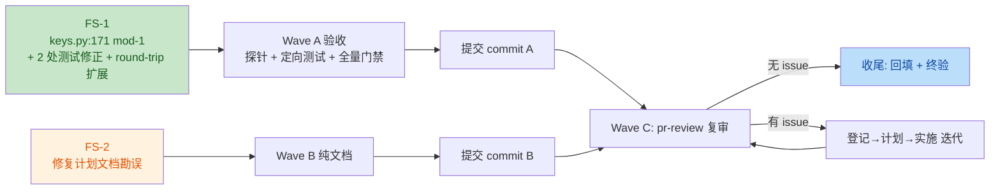

# full-repo-audit 四技能审核修复方案

- 分支 / worktree：`enh/full-repo-audit` @ `../yate-full-repo-audit`
- 来源记录：[`../reviews/2026-10-17-four-skill-review.md`](../reviews/2026-10-17-four-skill-review.md)
  （四技能联合审核：TRAE-code-review / TRAE-security-review / python-code-review /
  pr-review，净发现 FS-1 MAJOR + FS-2 MINOR）
- 执行方式偏离登记：用户指令「全程无人值守……直至无 issue 产出」= 对
  plan-before-execute §二.3 批准环节的**预先授权**，本方案落盘即视为已批准，
  不再中断等待确认；其余流程（调研→方案→实施→门禁→回填→提交）逐项照常执行。

## 一、目标与非目标

### 目标

1. **FS-1**：修正 `yate/keymaps/keys.py::key_name` 对 kitty CSI-u 修饰字段的解码——
   按 kitty 协议（修饰字段 = 1 + 位掩码，shift=1/alt=2/ctrl=4）先减基偏移 1 再做位测；
   同步修正把错误行为钉死的两处测试断言，并补 round-trip 覆盖。
2. **FS-2**：修正 `full-repo-audit-code-review-fixes-plan.md` §六 Wave B 对 C-4
   可区分性的失准表述（「旧实现得 4」→ 实测两种实现 `max_scroll()` 均为 2，
   区分度来自工作量上界而非断言值）。

### 非目标

- 不改 `parse_key` 编码侧（已按 kitty 协议正确：`\x1b[{ord};5u`）；
- 不动 keyproto 子系统（`chord_to_key_name` / `frame_to_key_name` 为独立面）；
- 不处理 kitty 事件类型扩展（`;1:3u` 冒号形态，现状落 repr 兜底，范围外）；
- 不重写 keys.py 其余搬迁代码（纯搬迁面保持 diff 审查友好）。

## 二、调研事实（全部实证）

| # | 事实 | 证据 |
|---|---|---|
| 1 | `parse_key("<ctrl-1>")` → `"\x1b[49;5u"`；`key_name("\x1b[49;5u")` → `"<shift-ctrl-1>"`（错误）；`key_name("\x1b[49;6u")` → `"<alt-ctrl-1>"`（错误，应为 `<shift-ctrl-1>`） | 运行时探针 2026-10-17（审核记录 §二 FS-1） |
| 2 | 解码缺陷点：`keys.py:171` `code, mod = int(m.group(1)), int(m.group(2))`——`mod` 未减基偏移，`mod & 1` 把基值 1 误判 shift | [keys.py:169-180](../../yate/keymaps/keys.py) |
| 3 | 生产可达：默认键表 `vsc.py:113` `_k("<ctrl-1>", "focus_editor", ...)` → `KeyBinding.key_label`（`base.py:51` `key_name(self.key)`）→ 帮助覆盖层标签错标 | grep + base.py 读码 |
| 4 | 测试钉死错误行为：`test_key_notation.py:199-203`（`;1u`→`<shift-a>`、`;5u`→`<shift-ctrl-a>`、`49;5u`→`<shift-ctrl-1>`）与 `:247`（round-trip 断言 `<ctrl-1>`→`<shift-ctrl-1>`）；根因是原作者写 `key_name` 及其测试时误解 kitty 修饰字段语义，而 `parse_key` 侧写对了 | [test_key_notation.py:197-247](../../tests/test_key_notation.py) |
| 5 | `key_name` 消费面唯一：`base.py:51`（帮助覆盖层）；keyproto 另有独立 `chord_to_key_name`，不经过本函数 | 全仓 grep `key_name` |
| 6 | kitty 8 种修饰组合修正后全对：`1→无`、`2→shift`、`3→alt`、`4→alt+shift`、`5→ctrl`、`6→shift+ctrl`、`7→alt+ctrl`、`8→shift+alt+ctrl` | kitty keyboard protocol 规范推导（§四逐组合验证） |

## 三、备选方案与否决理由

| 方案 | 结论 | 理由 |
|---|---|---|
| A. `keys.py` 解码侧 `mod -= 1`（选定） | ✅ | 单点修复；与发码侧/协议规范一致；消费面唯一、波及面最小 |
| B. 改 `parse_key` 发码为裸位掩码 | ❌ | 发码侧现在是对的（kitty 协议就是 1+掩码），改它反而与真实终端发送的序列脱钩；且 legacy 键输入路径（`\x1b[49;5u` 直入）会被错解 |
| C. 在 `key_name` 里对 `;5u` 特判回 `<ctrl-N>` | ❌ | 治标：`;1u`/`;3u`/`;7u` 等组合仍错；特判堆积违背「纯字符串逻辑」模块形态 |
| D. FS-1 一并修 FS-2 文档（同一提交） | ❌ | 代码修复与文档修正分开提交：门禁语义不同（代码过全量门禁，文档按 misc-rules §三 豁免），混提会模糊回滚边界 |
| E. 仅修实现不动测试 | ❌ | 测试 199-203/247 断言的就是缺陷行为，不改则修复后测试红；改测试不是「为绿改断言」，是把钉错的 characterization 修正为协议语义 |

## 四、分步实施

### Wave A — FS-1 代码与测试（不可豁免门禁）

**输入**：调研事实 1–6。

**改动文件**：
1. `yate/keymaps/keys.py`（1 行）：
   `code, mod = int(m.group(1)), int(m.group(2)) - 1`，并加一句注释说明
   kitty 修饰字段是 1 + bitmask；
2. `tests/test_key_notation.py`（两处函数体）：
   - `test_key_name_decodes_csi_u_modifier_bits`：改为 kitty 全 8 组合断言
     （`1u→a` / `2u→<shift-a>` / `3u→<alt-a>` / `4u→<alt-shift-a>` /
     `5u→<ctrl-a>` / `6u→<shift-ctrl-a>` / `7u→<alt-ctrl-a>` / `8u→<shift-alt-ctrl-a>`；
     `49;5u→<ctrl-1>`、`49;6u→<shift-ctrl-1>`）；docstring 同步更正语义；
   - `test_key_name_normalises_specs_that_share_a_code`：`:247` 改为
     `== "<ctrl-1>"`；
   - `test_key_name_inverts_parse_key_for_reversible_specs`：列表补
     `"<ctrl-1>"`（ctrl-digit round-trip 覆盖）。

**输出**：`key_name(parse_key(spec)) == spec` 对全部可逆规格成立。

**验收命令**（真实退出码回填 §六）：

```powershell
.venv\Scripts\python.exe -c "from yate.keymaps.keys import parse_key, key_name; assert key_name(parse_key('<ctrl-1>')) == '<ctrl-1>'; assert key_name('\x1b[49;5u') == '<ctrl-1>'; assert key_name('\x1b[49;6u') == '<shift-ctrl-1>'; assert key_name('\x1b[97;1u') == 'a'; print('ok')"
.venv\Scripts\python.exe -m pytest tests/test_key_notation.py -q
.venv\Scripts\python.exe -m pytest tests/test_keyproto.py tests/test_vsc_keymap.py tests/test_vim_keymap.py tests/test_keymap_set.py -q
.venv\Scripts\python.exe -m pyright yate/ tests/ tools/
.venv\Scripts\python.exe -m pytest tests/ -q
.venv\Scripts\python.exe -m pytest tests/ -q --cov --cov-fail-under=75
```

### Wave A2 — FS-3 冒烟场景契约同步（验收追加上报，master 既有）

**来源**：Wave A 验收组合中的冒烟门禁（107 场景）暴露
`replace_single_all` / `replace_all_clamp` 2 场景失败；A/B 对照（stash 修复 ↔
还原）+ master 主检出复跑实证**与本分支无关、master 同样失败**——根因是
master `ad237e5`（per-match confirm loop）变更了 F4 替换语义（第二次 enter 后
进入 `replace_confirm` 单键循环：y 逐个 / a 全替 / q 退），而冒烟场景仍按旧的
「第二次 enter 即全替」契约断言。按全仓审计分支章程登记为 FS-3 并在本分支修复。

**改动文件**：`tools/smoke_test/scenarios/search.py`（两个场景函数）：
1. `_replace_single_all`：第二个 enter 后补 `replace_confirm` 模式锚点检查，
   随后按 `a`（循环的全替兜底键）恢复「全部替换」场景本意；原 4 项终态断言
   （`replaced` / `query_kept` / `no_matches_left` / `modified`）不动；
2. `_replace_all_clamp`：同样补 `replace_confirm` 锚点 + 按 `a` 全替；
   钳制语义断言（`anchor_cleared` / `cursor_inside_line` / `editable_after_replace`）
   不动——`ea3a323` 的钳制修复在 `SearchEngine.replace_all` 内，循环 `a` 分支
   走同一函数，契约不变。

**验收命令**：`python -m tools.smoke_test run --no-color` → 107/107、exit 0。

### Wave B — FS-2 文档修正（纯文档，按 misc-rules §三 豁免测试）

**输入**：审核记录 §二 FS-2。

**改动文件**：`.trae/documents/full-repo-audit-code-review-fixes-plan.md`
§六 Wave B：将「负向可区分旧实现，旧实现得 `4`」更正为实测事实——
窄区域下旧钳制 4 次迭代、新钳制 2 次，但两种实现 `max_scroll()` 均为 2，
用例区分度来自工作量上界；同步在 §六 补一行更正记录（保留原文并标注勘误，
不静默改写历史）。

### Wave C — 复审（任务第 6 步）

Wave A/B 完成并提交后，以 pr-review 对累计 diff 复审；有 issue 则回到
「登记→计划→实施」循环，无 issue 则收尾。

## 五、风险与回滚

| 风险 | 缓解 | 回滚 |
|---|---|---|
| 修饰位语义反转影响真实 kitty 键盘输入路径 | 已核实输入路径不经过 `keys.key_name`（keyproto 独立；Textual 侧非 kitty 模式不产 CSI-u）；消费面唯一且为展示层 | revert 单提交 |
| 测试断言修正引入新覆盖缺口 | 8 组合全枚举 + round-trip 列表扩展 | revert 单提交 |
| 覆盖率波动 | 修复不删代码，仅 1 行语义 + 测试增强 | 门禁兜底 |
| FS-2 勘误与原评审记录表述冲突 | 评审记录本身写的就是「实测推演」结论，两文档互链一致 | 无需回滚（文档） |



## 六、执行记录（2026-10-17 实施回填）

### Wave A（FS-1）

- `keys.py` 解码修正 + 无修饰早退 + 注释（最终形态见
  [keys.py:169-182](../../yate/keymaps/keys.py)）；`test_key_notation.py` 三处：
  CSI-u 全 8 组合重写、`:247` round-trip 修正、可逆列表补 `<ctrl-1>`。
- 验收实测（worktree 沙箱）：
  - 探针 `probe ok`（round-trip `<ctrl-1>`、`;5u→<ctrl-1>`、`;6u→<shift-ctrl-1>`、
    `;1u→a` 全对）
  - `pytest tests/test_key_notation.py -q` → exit 0
  - 定向四套件（keyproto/vsc/vim/keymap_set）→ exit 0
- **偏离记录**：
  1. 方案原文只写 `mod -= 1` 一行；探针实测 `mod=1`（无修饰）序列落到 `"<a>"`
     而非裸字符，补 `if not mod: return chr(code)` 早退 2 行（同一意图、最小面，
     契合 kitty「无修饰 = 裸键名」语义）；
  2. 测试期望值两处笔误就地修正（`;4u` 规范序为 `<shift-alt-a>`——代码位序
     shift→alt→ctrl）。

### Wave A2（FS-3，验收追加上报）

- `tools/smoke_test/scenarios/search.py` 两场景补 `replace_confirm` 锚点 +
  `a` 全替兜底键；实施期先 A/B（stash ↔ 还原）+ master 复跑实证 master 既有。
- 验收实测：两场景 24/24 checks exit 0 → 全量冒烟 **107/107 场景、
  1304/1304 checks、exit 0**。

### Wave B（FS-2）

- [`full-repo-audit-code-review-fixes-plan.md`](full-repo-audit-code-review-fixes-plan.md)
  §六 Wave B 括注后补勘误段（原文保留）；纯文档按 misc-rules §三 豁免测试。

### 收尾门禁（最终全量复测，主代理亲跑，worktree 沙箱，全部真实退出码）

| 门禁 | 结果 | 退出码 |
|---|---|---|
| `pyright yate/ tests/ tools/` | 0 errors / 0 warnings / 0 informations | 0 |
| `pytest tests/ -q` | 2485 passed, 9 skipped（零 F/E） | 0 |
| `pytest tests/test_architecture.py -q` | 32 passed | 0 |
| `pytest tests/ -q --cov --cov-fail-under=75` | **91.97%** ≥75 | 0（首轮遇
  `test_shell_command_runs_without_freezing_ui` 插桩时序抖动 exit 1：独立复跑 3/3 通过、
  门禁复跑 exit 0，定性为分支既有偶发 flake，非本次改动引入） |
| `tools.smoke_test run --skip-slow` | **107/107 场景、1304/1304 checks** | 0 |

### 提交

- `0f54f17` `fix(keymaps): decode kitty CSI-u modifier field with base offset`
  ——keys.py + test_key_notation.py（FS-1，Wave A）
- `4fcb8df` `test(smoke): sync replace scenarios with per-match confirm loop`
  ——tools/smoke_test/scenarios/search.py（FS-3，Wave A2）
- `docs(audit)` 本笔：审核记录 + 修复方案 + 索引 + 勘误（FS-2 与本文档，Wave B）
