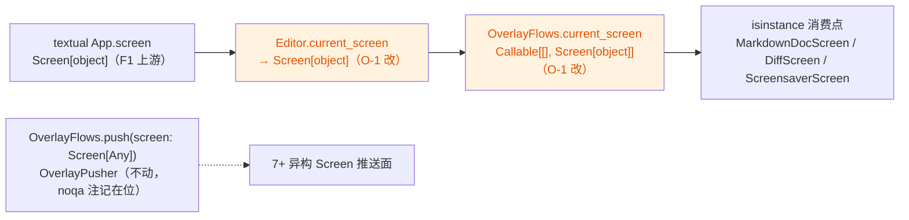

# full-repo-audit 优化报告修复方案（2026-10-17 速览 #44）

来源评审：[`2026-10-17-full-repo-audit.md`](../reviews/2026-10-17-full-repo-audit.md)
（全仓找茬优化报告：0 缺陷 / 5 条建议级；基线 `cd2ca00`，分支 `enh/full-repo-audit`）。
登记见 [`../reviews/README.md`](../reviews/README.md) 速览 #44 与轮次总表 2026-10-17 行。

## 一、目标与非目标

**目标**

1. O-1（报告 §1）：`current_screen` 查询链 `Screen[Any]` 精化为 `Screen[object]`
   （与上游 `App.screen` 的精确类型对齐），连带移除 `editor.py` 的
   `from typing import Any`（该文件 Any 随之归零）；
2. O-4（报告 §4）：`cli.main` 拆出 `_validate_diff_args` / `_manage_extensions`
   两个模块级辅助，行为逐字不变；
3. O-2 / O-3 / O-5：逐条核实后登记维持现状（评审自评"非缺陷 / 现状可接受"），给出证据。

**非目标**

- 不动 `flows/__init__.py` 的 `OverlayPusher = Callable[[Screen[Any]], None]` 与
  `OverlayFlows.push(screen: Screen[Any], ...)`：推送面接受任意 Textual Screen
  （7+ 个异构 Screen 类的并集），`# noqa: Any` 理由注记已在位，报告未涉及；
- 不改任何运行时行为；不新增测试文件（行为保持型重构，既有 test_cli.py 的
  diff / 扩展管理黑盒用例 + pyright strict + 全量门禁即验收面）。

## 二、事实清单（调研取证）

| # | 事实 | 证据 |
|---|---|---|
| F1 | 上游 `App.screen` 属性返回类型即 `Screen[object]` | `.venv/Lib/site-packages/textual/app.py:1627` |
| F2 | `Screen` 是 `Generic[ScreenResultType]`（默认不变型） | `textual/screen.py:148` |
| F3 | `current_screen` 全仓唯一生产消费者是 OverlayFlows，且仅做 isinstance | `yate/editor.py:242`；`yate/flows/overlay_flows.py:119/143/231` |
| F4 | `Screen[Any]` 全仓共 5 处：查询链 2（editor.py:535、overlay_flows.py:44）+ 推送面 2（flows/__init__.py:36、overlay_flows.py:86）+ 测试 cast 1（tests/test_smoke_harness.py:266） | grep `Screen\[Any\]` |
| F5 | `editor.py` 的 `Any` 仅 2 处（import:23、current_screen:535），随 O-1 整体移除 | grep `\bAny\b` |
| F6 | `overlay_flows.py` 的 `Any` 另有 push 签名 2 处（:86 screen 参数、:87 回调载荷），import 必须保留 | grep `\bAny\b` |
| F7 | 测试注入 `current_screen=lambda: app.screen`，与 `Screen[object]` 精确匹配 | tests/test_changelog_view.py:68 |
| F8 | `cli.main` 实测 233–453 行（~220 行）；`--diff` 校验块 253–265、扩展管理块 296–321 均自包含、无共享局部变量 | yate/cli.py |
| F9 | test_cli.py 以 `main([...])` 黑盒覆盖 diff 校验与扩展管理（相关 10 用例），对 main 内部结构零耦合 | tests/test_cli.py |
| F10 | 报告行号整体漂移（`Any` import 实为 editor.py:23 非报告所称 :12；nul_keys 实为 :627-631 非 :403-425；on_unmount 实为 :500-520 非 :369-387） | 对照实测 |

**报告勘误（随回填登记）**：O-3 的示意代码把同步的
`extension_loader.teardown_all()`（editor.py:510，无 await）交给
`_safe_teardown` 的 `await coro`，示意本身不成立——构成 O-3 维持现状的又一依据。

## 三、备选方案与否决理由

- **O-1 备选 A（采纳）**：查询链精化为 `Screen[object]`，与上游 `App.screen`
  精确对齐，`editor.py` 的 `Any` 归零（F1/F3/F5/F7）。
- **O-1 备选 B（否决）**：保留 `Screen[Any]` 加注释（报告建议的 `# noqa: Any`
  形态）。否决理由：存在精确类型时注释是次优解；且 `overlay_flows.py:40`
  现有 noqa 注记"current_screen query returns any Textual Screen"会随之失真。
- **O-1 备选 C（否决）**：`push` / `OverlayPusher` 一并去 Any。否决理由：
  推送面是异构 Screen 并集，收窄需引入联合类型与跨包导入 churn，
  收益不成比例（§一非目标；报告亦未涉及）。
- **O-4 备选 A（采纳）**：拆两个模块级辅助（报告点名的两块），
  `main` 保持 early-return 分发器形态。
- **O-4 备选 B（否决）**：登记不修。否决理由：报告给出具体拆分目标且两块
  自包含（F8）、测试黑盒零耦合（F9），是纯收益的机械重构；
  "重构优化非缺陷"不构成不修理由。
- **O-2（不修）**：嵌套 if 与合并形态语义等价，评审自评"当前写法更易读，
  且注释充分。这是风格取舍，不是缺陷"；外层 `in nul_keys` 与相邻
  TOGGLE_KEYS 块平行呼应，合并后 `and (editor_focused or ...)` 读感反降。
- **O-3（不修）**：评审自评"当前写法也可接受"；三段各自带独立的
  `# noqa: BLE001` 理由注记与日志语境，提取 `_safe_teardown` 属薄抽象
  （用户既定偏好拒绝薄委托），且首段是同步调用、报告示意代码
  await 同步返回值不成立（§二勘误）。
- **O-5（不修）**：评审明示"无需修改"；适配理由已由 editor.py:405-407
  既有注释完整覆盖（pyright strict 拒绝值返回 lambda 进 None 槽位）。

## 四、分步实施

### S1 O-1 类型精化

- 改动：`yate/editor.py`（删 :23 `from typing import Any`；:535
  `Screen[Any]` → `Screen[object]`）；`yate/flows/overlay_flows.py`
  （:40 noqa 注记删除、:44 → `Screen[object]`；import 保留供 push 使用，F6）。
- 验收：`python -m pyright yate/ tests/ tools/` → 0 errors / 0 warnings / 0 notes。

### S2 O-4 CLI 拆分

- 改动：`yate/cli.py`：`build_parser` 与 `main` 之间新增
  `_validate_diff_args(parser, args)` 与 `_manage_extensions(args) -> int`
  （原注释随迁），`main()` 内两处替换为调用，行为逐字不变。
- 验收：`python -m pytest tests/test_cli.py tests/test_diffview.py
  tests/test_diff_integration.py -q` 全绿。

### S3 登记

- 改动：`.trae/reviews/README.md`（速览头部增量注记 + "共 41 条"→"共 44 条"
  + #44 行 + 轮次总表 2026-10-17 行）；本方案文档落盘。
- 验收：README ↔ 报告 ↔ 方案链接互达。

### S4 门禁（全五道，依序全绿）

1. `python -m pyright yate/ tests/ tools/` → 0 / 0 / 0
2. `python -m pytest tests/ -q` → 全绿
3. `python -m pytest tests/test_architecture.py -q` → 32 passed
4. `python -m pytest tests/ -q --cov --cov-fail-under=75` → exit 0
5. `python -m tools.smoke_test run --skip-slow --no-color` → 全 exit 0

### S5 复审迭代

- `pr-review` 对增量 diff（`cd2ca00...HEAD` 的代码提交）复审；有 issue 则
  按本轮惯例逐条处置（修复或带证据登记）后复跑 S4，直至 0 issue。

### S6 回填与提交

- 回填：README #44 与轮次总表状态 → ✅；本方案 §八 实测结果。
- 提交（英文 conventional，PowerShell here-string 多行）：
  1. `docs(reviews): register the full-repo-audit optimization report`（S3）
  2. `refactor(types): narrow the current_screen query to Screen[object]`（S1）
  3. `refactor(cli): extract diff validation and extension management helpers`（S2）
  4. `docs(audit): backfill optimization fixes results`（S6，含复审记录）

## 五、风险与回滚

| 风险 | 概率 | 缓解 |
|---|---|---|
| `Screen[object]` 触发 pyright 不变型报错（某处需要更窄 Screen 类型） | 低 | F1/F3/F7 已证查询链上下游同型；S1 pyright 即验 |
| CLI 拆分遗漏局部状态 | 低 | 两块无共享局部变量（F8）；黑盒用例 S2 即验 |
| 冒烟 / 覆盖率波动 | 低 | 无行为变化；基线覆盖率 91.97%、冒烟 107/107 |

回滚：四笔提交相互独立、均可单独 revert；无数据 / 格式迁移。

## 六、模块交互图

## 七、流程偏离登记（无人值守预授权）

- 用户指令"全程无人值守"＝对 task-orchestration 闭环第 3 步【用户批准】的
  **预先授权**：本方案落盘即视为已批准，不再等待确认（上轮
  full-repo-audit-four-review-fixes-plan 同款偏离，先例在案）。
- 其余步骤（调研 → 登记 → 方案 → 实施 → 门禁 → 复审 → 回填 → 提交）
  一概不减省。

## 八、实测结果（回填 2026-10-17）

**提交链**：`0cf9c1e` 登记 + 方案 → `7834da3` S1 类型精化 → `d8d0248` S2 CLI 拆分。

**五道门禁（HEAD `d8d0248`，全绿）**：

| # | 门禁 | 实测结果 |
|---|---|---|
| 1 | `pyright yate/ tests/ tools/` | 0 errors / 0 warnings / 0 informations |
| 2 | `pytest tests/ -q` | 全绿（9 skipped，0 failures） |
| 3 | `pytest tests/test_architecture.py -q` | 32 passed |
| 4 | `pytest tests/ -q --cov --cov-fail-under=75` | 覆盖率 91.95%，exit 0 |
| 5 | `tools.smoke_test run --skip-slow` | 107/107 scenarios、1304/1304 checks，exit 0 |

**门禁执行偏离记录**：首轮为省时把门禁 2 与门禁 4 并行执行，触发两例负载型
flake（`test_shell.py::test_run_shell_timeout_kills_the_grandchild_process`
孙进程存活探测 2s 窗口被重载挤爆；`test_diff_integration.py::
test_diff_close_returns_keys_to_editor` App 卸载期 idle 定时器与 screen 栈
清空的竞态，`yate/app.py:262 poll_idle`）。两例隔离复跑即绿，与本次改动无关
（改动未触及 shell / app 卸载路径）；随后严格串行复跑门禁 2/3/4/5，上表为
串行实测结果。教训：全量门禁一律串行执行。

**S5 复审（pr-review，范围 `cd2ca00...HEAD`，含两笔代码提交）**：

- 六维逐项核对：功能等价（逐行搬移、调用点替换语义不变）；安全无新面；
  性能无变化（惰性 import 保留）；可维护性（docstring / 注解齐全、
  段标与既有 `# --- version` 风格一致、cli.py 505 行 < 800）；架构边界
  （净删一处 `Any`，无新 Protocol / TYPE_CHECKING；`Screen[object]` 不触
  `test_app_annotations_are_precise`——该 AST 守卫只匹配 `App` 下标；
  命名无 `*Host` / `*Ops` 等禁用后缀）；硬门禁全绿（上表实测）。
- 观察 1 条（非阻断、非本次引入）：`_manage_extensions` 的 uninstall 失败
  分支（cli.py:273-275 `except yxp.YxpError`）无专项用例——install 失败有
  `test_main_install_extension_failure_exit_code`，uninstall 失败路径搬移
  前后覆盖缺口等同，登记为既有覆盖边界，不构成本轮 issue。
- **Overall: APPROVE —— 0 BLOCKER / 0 MAJOR / 0 MINOR。零 issue，迭代闭环，
  无需下一轮。**

**处置销账**：O-1 ✅（`7834da3`）；O-2 ⏸ 维持现状（评审自评现状更易读、
注释充分）；O-3 ⏸ 维持现状（薄抽象 + 报告示意代码 await 同步调用不成立）；
O-4 ✅（`d8d0248`）；O-5 ⏸ 维持现状（评审明示无需修改，既有注释已覆盖）。

**报告勘误落地**：F10 行号漂移与 O-3 示意问题记于 §二；评审文档保持只读，
未改动。
