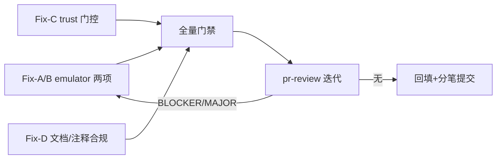

# full-repo-audit-review-fixes-plan

- 来源评审记录：[`../reviews/2026-10-16-full-repo-audit.md`](../reviews/2026-10-16-full-repo-audit.md)（互链）
- 总计划：[`full-repo-audit-plan.md`](full-repo-audit-plan.md)（Step 5 → Step 6 立项产物）
- 分支：`enh/full-repo-audit`（worktree `../yate-full-repo-audit`）
- 日期：2026-10-16
- 状态：无人值守执行（22:00–06:00 规则，方案批准按通过处理，本行即为批准登记）

## 一、目标与非目标

**目标**：修复评审记录确证的 3 个 MAJOR（F-1 / F-2 / F-4）+ 文档漂移级合规项
（F-5 / F-6 / F-8 / F-9），全部为审核确证的真问题，禁止顺手重构。

**非目标**：

- MINOR 登记项（F-3 / F-7 / F-10 / F-11 / F-12 / P-1~P-5 / lua runtime 观察项 /
  pb6 Popen）不在本轮修复，维持评审记录登记；
- 不拆分大文件、不新增架构规则、不做无 profiler 实测的性能改动。

## 二、备选方案与否决理由

- **Fix-C 方案 A（采纳）**：门控点收敛在 `yate/cli.py`（L4 外壳），workspace 判定统一用
  `Path.cwd()`（与 loader.py:279-293 的 `cwd_extensions` 门控及 `:trust` 命令
  （extension_flows.py:77-81 记录 cwd）同一根语义）：项目 rc 与 `cwd/themes` 仅在
  `is_trusted(cwd)` 时加载，跳过时按 loader 消息模式登记可读提示。理由：单判定根、
  单一 UX 动词（`:trust`），不改 `default_rc_paths` 纯发现语义（test_config.py
  既有契约不破坏），改动面最小。
- **Fix-C 方案 B（否决）**：按 rc 文件所在目录（`rc.parent`）逐个判定信任。
  否决理由：`:trust` 只记录 cwd（extension_flows.py:78-79），祖先目录 rc
  （monorepo 形态）将出现"无法通过任何 UX 动词信任"的死锁；且与 loader 的
  cwd 根语义分叉，两个信任判定根并存。
- **Fix-C 方案 C（否决）**：把信任判定下沉进 `yaterc.py`（L0）。
  否决理由：L0 叶子需要新增对 trust 服务的依赖与跳过语义，改变 `load_config`
  纯执行契约；CLI 层已有 rc 路径解析职责（`-u` / `NONE` 分支），门控属外壳策略。

## 三、分步实施计划

### Fix-A — emulator EL1 pen 态越界（评审 F-1，MAJOR）

- 独占文件：`yate/editor_term/emulator.py`、`tests/test_terminal_emulator.py`
- 改动：`_erase_line` 对 `col` 做一次钳制（`min(col, self.cols - 1)`），pen 挂起态
  （`col == self.cols`）下 EL0/EL1/EL2 均安全；补 pen 态守卫用例
  （`feed(b"0123456789")` 后 `feed(b"\x1b[1K")` 不崩且整行被清）。
- 验收：`.venv\Scripts\python.exe -m pytest tests/test_terminal_emulator.py -q` exit 0；
  复现脚本不再抛 IndexError。
- 提交：`fix(terminal): clamp EL erase against pending autowrap column`

### Fix-B — emulator S/T count 无上界（评审 F-2，MAJOR）

- 独占文件：`yate/editor_term/emulator.py`、`tests/test_terminal_emulator.py`（与 Fix-A 同文件，合并为同波执行、分笔提交）
- 改动：`_scroll_region_up` / `_scroll_region_down` 内对 `count` 钳制
  （`min(count, self.rows)`，与 `_insert_lines`/`_delete_lines` 的既有钳制风格一致）；
  补超大 count 守卫用例（`feed(b"\x1b[999999999S")` 立即返回）。
- 验收：同文件测试 exit 0；复现脚本不再挂死。
- 提交：`fix(terminal): clamp scroll region count from escape params`

### Fix-C — 项目 rc 与 cwd/themes 信任门控（评审 F-4，MAJOR）

- 独占文件：`yate/cli.py`、`yate/docs/yaterc.en.md`、`yate/docs/yaterc.zh.md`、
  `tests/test_cli.py`（如 themes 文档声明默认目录行为则同步 `yate/docs/themes.*.md`，执行期核实）
- 改动（方案 A）：
  1. `cli.py` 默认 rc 分支：`default_rc_paths(target)` 结果中非用户 rc 的路径
     （即项目 rc）仅当 `is_trusted(Path.cwd().resolve())` 时保留，否则跳过并按
     loader 消息模式登记提示（形态 `yaterc: skipped untrusted project rc <path>
     (run :trust in the workspace to load it)`，进入 `config.errors` 呈现面）；
     `-u <file>` 显式路径与 `NONE` 分支不变（deliberate user action）；
  2. `cli.py` 默认主题目录：`Path.cwd()/themes` 仅在 `is_trusted(cwd)` 时加载，
     `~/.yate/themes` 不变；cwd themes 存在但工作区未信任时登记
     `themes: skipped untrusted <path> (run :trust to load them)`（与 loader.py:290-293 同构）；
  3. 门控逻辑收敛为可单测的纯函数（输入 paths/workspace，输出保留路径与提示），
     `tests/test_cli.py` 补用例：未信任跳过+提示、信任后加载、`-u` 显式路径不受影响；
  4. 双语文档同步：`yaterc.en.md` / `yaterc.zh.md` 增加"项目 rc 与 cwd/themes
     受工作区信任门控（`:trust`）"小节（双语同时更新，doc-conventions §三）。
- 验收：`.venv\Scripts\python.exe -m pytest tests/test_cli.py tests/test_config.py -q` exit 0；
  `.venv\Scripts\python.exe -m pytest tests/test_architecture.py -q` exit 0（cli 导入
  `yate.services.trust` 为 L4→L0 合法方向，架构测试复核）。
- 提交：`fix(trust): gate project yaterc and cwd themes behind workspace trust`

### Fix-D — 文档漂移与注释级合规（评审 F-5 / F-6 / F-8 / F-9）

- 独占文件：`tests/test_workspace_filter.py`、`tools/yxp/__init__.py`、
  `yate/services/extensions/lua/__init__.py`、`yate/docs/extensions.en.md`
- 改动：
  1. `tests/test_workspace_filter.py:56` 注释改写，消除 `Optional[Path]` 字样（F-5）；
  2. `tools/yxp/__init__.py` 补 `from __future__ import annotations`（F-6，纯 docstring
     模块补行，零行为）；
  3. `yate/services/extensions/lua/__init__.py:10` docstring 中 `§三.5` 改英文表述（F-8）；
  4. `yate/docs/extensions.en.md:373` SCSS/LESS 理由对齐 zh 语义（限定 PyPI，F-9）。
- 验收：`.venv\Scripts\python.exe -m pyright yate/ tools/ tests/` exit 0（注释级改动防手滑）；
  纯文档部分按 misc-rules §三核对（混合变更不豁免，随 Step 4 全量门禁兜底）。
- 提交：`chore(style): align comments and docs with coding conventions`

### Step 4 — 全量门禁（主代理亲自跑，退出码全 0 才过）

- `.venv\Scripts\python.exe -m pyright yate/ tests/ tools/`
- `.venv\Scripts\python.exe -m pytest tests/ -q`（输出重定向长跑）
- `.venv\Scripts\python.exe -m pytest tests/ -q --cov --cov-fail-under=75`
- `.venv\Scripts\python.exe -m pytest tests/test_architecture.py -q`

### Step 5 — pr-review 技能审核迭代

- 对 `git diff master...HEAD` 全部改动按 `../skills/pr-review/SKILL.md` review 模式执行；
  存在 BLOCKER/MAJOR → 回对应 Fix 修复迭代，直至 `Overall: APPROVE`。

### Step 6 — 回填与提交

- 总计划 §七与评审记录回填真实结果；分笔提交（每 Fix 一笔 + 回填一笔）；
  全部完成且 pr-review 无 BLOCKER/MAJOR 后统一推送一次（总任务指令显式授权）。

## 四、风险清单与回滚路径

| 风险 | 缓解 / 回滚 |
|---|---|
| Fix-C 改变合法用户行为（未信任工作区的项目 rc / cwd themes 不再自动加载） | 这正是 trust.py 自声明不变量的要求；跳过时给可读提示指路 `:trust`；双语文档同步说明；既有单测契约（default_rc_paths 纯发现）不破坏 |
| Fix-C 触碰 cli 后架构守卫或 smoke 受影响 | L4→L0 导入方向合法；架构测试单独跑；test_cli main() 用例全走 `-u NONE` / 显式 rc，不受门控影响 |
| emulator 钳制改变合法转义序列行为 | EL 钳制仅在 pen 挂起态（col==cols）改变结果——原行为是崩溃，无合法语义损失；S/T 钳制与同文件四个原语风格一致；守卫用例锚定 |
| 注释级改动误触架构文本断言 | Fix-D 后跑 pyright + 架构测试复核 |
| 回滚 | 每 Fix 单独 commit，`git revert` 单笔回滚，无数据风险 |

## 五、执行记录回填（2026-10-16 终态）

- Fix-A/B：完成（与 Fix-C/D 并行执行；A/B 因同文件相邻区域合并为一笔提交
  `5601a7b`，偏离已登记总计划 §七）；守卫用例落地 4 个，81 passed。
- Fix-C：完成（`7bc9c4c`）；门控函数落地名 `gate_project_rc`（无下划线，
  pyright reportPrivateUsage 实测依据，偏离已登记）；测试 8 个新增用例
  （纯函数 3 + main() 集成 5），test_cli/test_config 153 passed。
- Fix-D：完成（`243afef`），4 处注释/文档级合规。
- 门禁终态：pyright 0/0/0；全量 pytest exit 0；架构测试 31 passed；
  覆盖率 91.98%（≥75%）。pr-review：**Overall: APPROVE**（无 BLOCKER/MAJOR）。
- 步骤-提交对照与全部偏离记录见总计划
  [`full-repo-audit-plan.md`](full-repo-audit-plan.md) §七。
