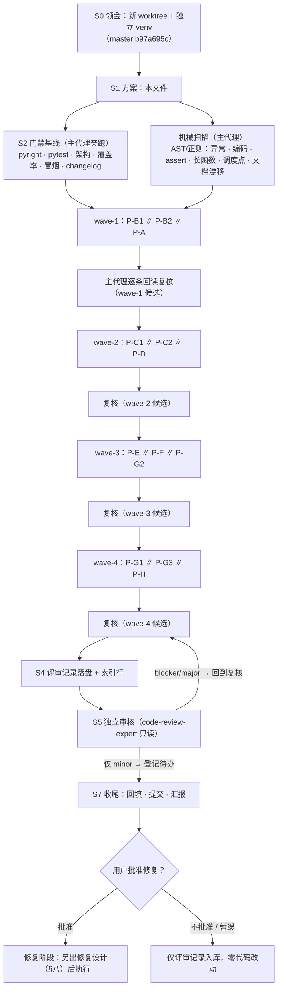

# 全仓库多维度评审方案（full-repo-review-plan）

> **状态**：🔄 评审阶段执行中 —— 2026-11-26（只读评审 + 记录落盘；**修复阶段待用户批准，批准前零代码改动**）
>
> **任务 worktree**：`yate-full-repo-review`，分支 `feature/enh-full-repo-review`
> （parent = `master` `b97a695c` = `origin/master`，`v0.2.18-268`）
>
> **方法**：[multi-dim-review 技能](../skills/multi-dim-review/SKILL.md) 的 audit scope
> （13 维度、只读 fan-out、主代理逐条复核并亲跑门禁）
>
> **评审记录**：[`../reviews/2026-11-26-full-repo-review.md`](../reviews/2026-11-26-full-repo-review.md)

## 一、目标与非目标

### 目标

1. 对 `master` `b97a695c` 做一轮**全仓库**只读评审：`yate/`、`tools/`、`pack/` 全部
   受控 Python 逐文件过 13 维度；`tests/` 按守卫质量 / 时序 / 断言强度做模式扫描
   与重点抽审；规则 / 技能 / agent 剧本 / 双语手册做漂移核对。
2. 产出 [doc-conventions.md §二.1](../rules/doc-conventions.md) 口径的评审记录
   （只读事实文档：findings / suspects / suggestions / verdict + 已登记项现状复核），
   并在 [`../reviews/README.md`](../reviews/README.md) 追加索引。
3. 对自上一轮全仓基线以来的增量给以加权审查（见 §二 F3）。
4. 为后续修复提供**可直接立项**的 finding 清单（每条带 `文件:行号` 与修复方向）。

### 非目标

- **不在本方案内修改任何产品代码 / 测试 / 规则 / 技能**：评审是只读流程；修复在
  评审完成后由主代理按 findings 另出修复设计（§八），**提请用户批准后**才执行。
- 不重复提已闭环或已登记不修 / 暂缓的项（无新证据）；只做现状复核清单。
- 不做真实 GUI 人工验证、不做性能 profiler 实测（常数因子类只列 Suspect）。
- 不合并、不推送（闭环流程内禁止 `git push`）。

## 二、关键事实清单（调研取证）

| # | 事实 | 证据 |
|---|---|---|
| F1 | 基线与 origin 同步：`master` = `origin/master` = `b97a695c`，工作树干净 | `git worktree add` 后 `git rev-parse HEAD master origin/master` 三值一致 |
| F2 | 规模：460 个受控 `.py` / 148115 行；`tests/` 81437 行 190 文件；`yate/` 约 48.5k 行；`tools/` 约 18.3k 行；`pack/` 206 行 | `git ls-files '*.py'` + `splitlines()` 统计 |
| F3 | 增量：距 2026-11-20 全仓扫描基线 `f7e34c34` 共 73 提交 / 120 文件 / +11274 −1143；其间含 LSP 导航（!146）、全仓扫描修复（!144 / !148）、LSP URI 归一（!147）、toggle-comment（!143） | `git log --oneline f7e34c34..HEAD`、`git diff --shortstat f7e34c34..HEAD` |
| F4 | 增量最重的产品文件：`yate/editor_lsp/manager.py`（+398 −33，现 1248 行）、`flows/lsp_navigation_flows.py`（新 635）、`editor_lsp/navigation.py`（新 544）、`services/extensions/bridges/`（新子包 808 行）、`services/workspace_ignores.py`（新 310）、`editor_core/diff.py`（+163 −16）、`keymaps/vim.py`（+138 −15）、`actions.py`（+70） | `git diff --numstat f7e34c34..HEAD -- '*.py'` |
| F5 | 体量豁免 7 文件（守卫口径）：`keymaps/vim.py` 1718、`file_manager/screen.py` 1017、`view.py` 891、`buffer.py` 1565、`langdefs.py` 841、`manager.py` 1248、`editor.py` 848 | [architecture-boundaries.md §三.7](../rules/architecture-boundaries.md) 行数表 + `tests/test_architecture.py::test_size_exemption_line_counts_match_rule` |
| F6 | 门禁命令与口径以 [task-orchestration.md §二.7](../rules/task-orchestration.md) 为准（pyright 四路径、并行口径、flake 须 `-n 1` 复核） | 规则正文命令块 |
| F7 | 评审框架：13 维度、Step 6 audit fan-out（≤3 维度/读者为先例形状，批 ≤3、并发硬上限 6）、Step 7 门禁、Step 8 输出、Step 9 豁免账本 | [multi-dim-review SKILL.md](../skills/multi-dim-review/SKILL.md) |
| F8 | 既往登记项与编号分歧（#59–#61 / #67–#72 等速览表缺行已登记暂缓） | [`../reviews/README.md`](../reviews/README.md) §一 |
| F9 | 上一轮记录格式与遗留：[`../reviews/2026-11-20-full-repo-review.md`](../reviews/2026-11-20-full-repo-review.md)（1 MAJOR / 6 MINOR，已由 !144 / !148 闭环） | 记录正文 + `git log f7e34c34..HEAD` |
| F10 | 子代理模型现实：`plan-architect-designer` 的 frontmatter 模型在本机运行时报未注册（本任务 spawn 两次均 `Model "qwen-3.8-plus" not found`），按 [task-orchestration.md §一.3.5 / §三](../rules/task-orchestration.md) 由主代理兜底并如实标注 | 本方案由主代理按 [plan-architect-designer 剧本](../agents/plan-architect-designer.md) 代笔 |

## 三、备选方案与否决理由

| 决策点 | 备选 | 结论与理由 |
|---|---|---|
| 技能选择 | `multi-dim-review` / `pr-review` / `python-code-review` | **选 `multi-dim-review`**：唯一覆盖 audit scope 与 13 维度的入口；`pr-review` 面向分支 diff（本任务基线即 master 本身，无 diff 可审）；`python-code-review` 面向单文件 / 片段 |
| 评审位置 | 主工作区 `master` 直接只读评审 vs 新 worktree | **新 worktree**：闭环流程【领会】硬性要求（独立沙箱、独立 venv，门禁不污染主环境）；产物（方案 / 记录 / 索引）需按步提交在任务分支上，不得直接落在 `master` 工作树；亦符合既往「审计任务用新 worktree」的口径 |
| fan-out 切分 | ① 按维度分组（技能 Step 6.1 先例形状：5 读者 × ≤3 维度，每人扫全仓） vs ② 按代码区域分区（每区套用全部 13 维度） | **选 ②**：正确性 / 健壮性 / 复杂度判断依赖对单个模块的连贯阅读，按维度切分会迫使每个读者把全仓 48k+ 行各读一遍（5 倍重复读取）且在轮次预算内必然退化为 grep 抽样；按区域切分后每个读者只读 4k–8k 行，可做到逐文件通读。维度完整性由「每区必须对 D1–D13 逐维给出 clean 或候选」保证 |
| 分区粒度 | 粗（5 区，每区 ~10k–13k 行） vs 细（12 区，每区 4k–8k 行） | **选细**：全仓已历经 ≥8 轮评审，残留问题多为需要连贯阅读才能发现的交互类缺陷；细分区提升单读者深度，代价是波次增多（4 波），可接受 |
| `tests/` 处理 | 逐行审（81k 行） vs 模式扫描 + 重点抽审 | **选后者**：测试代码的风险集中在少数模式（真实睡眠、嵌套 pytest、恒真 / 弱断言、守卫可绕过、全局状态泄漏），逐行读产出比低；重点抽审近 73 提交触碰的 35 个测试文件与 `conftest.py` / `test_architecture.py` |
| 审查员类型 | `code-review-expert`（.trae/agents 角色，带自我批判剧本） vs 内置 `code-explorer` | **首选 `code-review-expert`**（闭环流程子代理只认 `.trae/agents/`；剧本含逐条反证与漏报自查）；spawn 失败或零交付时按 [subagent-workflow.md §五.4](../rules/subagent-workflow.md) 变更配置重试一次，仍失败改由主代理按分区亲自抽审并如实登记「子代理零产出」 |
| 修复时机 | 评审与修复同波次进行 vs 先出记录、修复待批准 | **先出记录**：评审记录是只读事实文档（不放修复排期）；修复涉及跨层多文件，须独立设计并经用户批准 |

## 四、分区表与波次

行数为 `splitlines()` 口径。「重点」= 自 `f7e34c34` 以来变更或新增的文件。

| 分区 | 范围 | 文件 / 行数 | 重点文件 | 关注重点 |
|---|---|---|---|---|
| **P-A** 编辑内核与语法 | `yate/editor_core/**`、`yate/editor_syntax/**`、`yate/editor_sprites/**`（sprites 为纯数据，只核对数据契约） | 48 / 8368 | `editor_core/diff.py`、`editor_core/commenting.py` | 撤销 delta 语义、脏区间 take/peek 契约、diff3 单调游标、注释引擎可逆性、ts 树增量 edit、文本对象边界、每击键全文档工作 |
| **P-B1** 调度与模型 | `yate/editor.py`、`editor_compose.py`、`editor_dispatch.py`、`actions.py`、`commands.py`、`cmdline_completions.py`、`diagnostics.py`、`session.py`、`registries.py` | 9 / 3998 | `actions.py`、`commands.py`、`editor.py`、`editor_compose.py`、`editor_dispatch.py`、`diagnostics.py` | 窗格树不变量、按键一次派发与 fall-through（R10）、动作 / 命令表一致性、组装顺序与注入边界、诊断快照只读性 |
| **P-B2** 流程模块 | `yate/flows/**` | 17 / 4359 | `flows/lsp_navigation_flows.py`（新） | 不持有 App 句柄、在途请求过期与竞态、rename 两阶段预校验、工作区编辑落盘原子性、worker 异常可观测、`UI_FROZEN_FILES` 登记 |
| **P-C1** 渲染 / 主题 / 浏览组件 | `editor_components/{view,highlighting,wrap_layout,welcome,cells,chrome,canvas_screen,screensaver,icons,scrollbars,preview,manual}.py`、`editor_components/theme/**`、`editor_components/diff/**` | 18 / 6108 | `view.py`、`diff/pane.py` | render_line 每行成本、宽字符裁剪、wrap 缓存键、主题所有权（R13）、滚动条注入（R15）、diff 重算防抖与取消 |
| **P-C2** 交互部件 | `editor_components/{commandline,completion,explorer,find_replace,hexview,hover_popup,lsp_chooser,marks_palette,modals,palette,panes,statusbar,terminal,whichkey}.py`、`editor_components/file_manager/**` | 19 / 7473 | `completion.py`、`lsp_chooser.py`（新）、`commandline.py`、`modals.py` | 弹窗按键放行（吞键教训）、补全缓存有界性、`assert` 作运行时守卫、文件管理器自嵌套 / 盘符层、explorer 增量刷新、终端面板与 pty 生命周期 |
| **P-D** 服务层 | `yate/services/**`（含 `extensions/`、`yxp/` 子包） | 25 / 5892 | `services/extensions/bridges/**`（新子包）、`workspace.py`、`workspace_ignores.py`（新） | 信任门控（workspace 自带代码）、扩展 API 边界与 setup 回滚、Lua 桥类型收窄、yxp 成员校验与回滚、ignore 规则匹配复杂度、文件系统写入的编码与原子性 |
| **P-E** LSP / 终端 / 键协议 | `yate/editor_lsp/**`、`yate/editor_term/**`、`yate/keyproto/**` | 21 / 6264 | `editor_lsp/manager.py`、`navigation.py`（新）、`protocol.py` | 增量同步协议（didChange / range 补丁 / UTF-16 列换算）、诊断行索引封顶、导航请求竞态与过期、能力降级、ConPTY 句柄与线程生命周期、读循环异常、Windows 输入模式恢复 |
| **P-F** 键位 / 外壳 / 启动配置 | `yate/keymaps/**`、`yate/app.py`、`cli.py`、`config.py`、`yaterc.py`、`yaterc_options.py`、`logs.py`、`paths.py`、`dist_meta.py`、`__main__.py`、`__init__.py`、`yate/extensions/**` | 18 / 6079 | `keymaps/vim.py`、`keys.py`、`vsc.py`、`cli.py`、`yaterc_options.py` | vim 计数 / 操作符边界、键位双表一致性、rc 执行门控与选项校验、启动失败路径、日志脱敏与文件句柄、L4 不持业务状态 |
| **P-G1** 构建 / 发布 / 打包 | `tools/pack/**`、`tools/release/**`、`pack/_common.py`、`tools/yxp/**`、`tools/translate/**` | 24 / 4935 | — | zip slip / 越界路径 / 符号链接、锁文件与原子替换、子进程树终止、wiki 翻译子进程排水、错误码一致性、`except BaseException` 的理由注记 |
| **P-G2** 冒烟框架 | `tools/smoke_test/**`（harness / guards / report / cli / baselines 深读，scenarios 抽审） | 35 / 8305 | `scenarios/lsp_navigation.py`（新）、`scenarios/stress.py` | 场景失败是否可能被吞（基线只对照不判定）、临时目录与全局状态复原（主题 / 键位 / 种子）、并行调度负载敏感点、报告断言恒真 |
| **P-G3** 其余工具 | `tools/changelog/**`、`tools/mdlint/**`、`tools/screenshots/**`、`tools/probes/**`、`tools/*.py` | 33 / 4948 | — | 生成器确定性、网络失败降级、批处理 worker 的取消信号、截图工具的本机信息泄漏、lint 规则误报面 |
| **P-H** 测试与守卫质量 | `tests/`（`conftest.py`、`test_architecture.py` 深读；近 73 提交触碰的 35 个测试文件抽审；其余按模式扫描） | 190 / 81437（抽审） | `tests/test_architecture.py`（+199）、`tests/test_lsp_navigation*.py`（新） | 守卫是否可被绕过（文本断言 vs AST）、恒真 / 弱断言、真实睡眠与时序假设、嵌套 pytest、全局状态复原、skip 原因、低覆盖模块 |

### 波次表

| 波次 | 分区（同波次互不重叠，可并行） | 批大小 |
|---|---|---|
| wave-1 | P-B1 ∥ P-B2 ∥ P-A | 3 |
| wave-2 | P-C1 ∥ P-C2 ∥ P-D | 3 |
| wave-3 | P-E ∥ P-F ∥ P-G2 | 3 |
| wave-4 | P-G1 ∥ P-G3 ∥ P-H | 3 |



## 五、分步实施计划

所有命令在任务 worktree 根执行，解释器统一 `.venv\Scripts\python.exe`；门禁日志落
`.venv/gate-logs/`（已被忽略，不入库）。

### S0 【领会】环境准备（已完成）

- 输入：`master` 已与 `origin/master` 同步。
- 动作：`git worktree add ../yate-full-repo-review -b feature/enh-full-repo-review master`；
  worktree 内 `python -m venv .venv` + `pip install -e ".[dev]"`。
- 验收：

```powershell
git branch --show-current            # feature/enh-full-repo-review
git rev-parse HEAD master origin/master   # 三值一致
.venv\Scripts\python.exe -c "import yate; print(yate.__file__)"   # 指向本 worktree
```

- 改动文件：无（仓库内零改动）。

### S1 【方案】落盘（本文件）

- 改动文件（独占）：`.trae/documents/full-repo-review-plan.md`。
- 提交：`docs(plan): add full-repo review plan for the 2026-11-26 audit`。
- 规划子代理：`plan-architect-designer` 首次 spawn 与按规则的一次重试均报
  `Model "qwen-3.8-plus" not found`（见 F10）→ 判零产出，主代理按剧本代笔。

### S2 门禁基线（主代理亲跑，D13）

每道门禁独立工具调用轮次（规避本机 safe-delete 钩子按轮累计删除量杀进程）：

```powershell
$env:PATH = "$env:LOCALAPPDATA\pyright-python\nodeenv\Scripts;$env:PATH"
.venv\Scripts\python.exe -m pyright yate/ tests/ tools/ pack/
.venv\Scripts\python.exe -m pytest tests/ -q -n auto
.venv\Scripts\python.exe -m pytest tests/test_architecture.py -q
$env:COVERAGE_FILE = ".venv/gate-logs/.coverage"
.venv\Scripts\python.exe -m pytest tests/ --cov=yate --cov-branch -n auto
.venv\Scripts\python.exe -m tools.smoke_test run --jobs 4
.venv\Scripts\python.exe -m tools.changelog check
```

- 通过判定：全部退出码 0；并行失败必须 `-n 1` / `--jobs 1` 复核并修用例。
- 改动文件：无。

### S3 fan-out 只读评审（wave-1 … wave-4）

- 输入：§四 分区表 + §六 任务书要点 + S2 门禁结果（审查员不跑门禁）。
- 审查员：`code-review-expert`（只读；每批 3 个，同步并行）；零交付时按
  [subagent-workflow.md §五.4](../rules/subagent-workflow.md) 变更配置重试一次。
- 输出：候选清单（回到主代理，不落盘）+ 主代理逐条回读复核结论。
- 改动文件：无（审查员不得写任何文件）。
- 验收：12 个分区各有交付或如实登记「零产出」；每个候选都经主代理重读
  `文件:行号` 复核；每维 D1–D13 均有 clean 或 finding。

### S4 记录落盘

- 改动文件（独占）：
  - `.trae/reviews/2026-11-26-full-repo-review.md`（新建）；
  - `.trae/reviews/README.md`（仅追加：§一 一段增量说明 + §二 一行轮次）。
- 内容：`Overall` 一行结论 → 维度总表 → Findings（BLOCKER / MAJOR / MINOR）→
  Suspects → Suggestions / Deferred → 已登记项现状复核 → 豁免账本 → 审查员候选撤回
  （反证）→ 门禁实测 → Strengths。
- 提交：`docs(review): record 2026-11-26 full-repo multi-dimensional review`。
- 验收：

```powershell
git diff --check                                   # 0
git diff --stat master...HEAD                      # 仅 .trae/ 下 3 个文档
.venv\Scripts\python.exe -m tools.changelog check  # exit 0
```

### S5 独立审核（code-review-expert，只读）

- 输入：S4 的评审记录。
- 任务：对记录中每条 finding 做反证（证据是否在所指行、是否有使其不成立的上下文、
  严重度是否恰当）+ 漏报自查（13 维度反向扫一遍）。
- 零交付处理：主代理自行做第二轮反证并如实登记。
- 改动文件：无（审核员只读；主代理据其结论修订 S4 记录）。

### S6 【迭代】

- 审核提出 blocker / major 级**记录缺陷**（如 finding 不实、漏报重大问题）→ 回到
  S3 对应分区补审并修订记录，直至归零；minor 登记待办。

### S7 【收尾】

- 回填本文件 §九–§十一（执行日志、门禁实测、偏离记录）。
- 提交：`docs(plan): backfill execution log and gates for full-repo-review`。
- 门禁：本轮仓库改动**纯文档**（`.trae/` 下 3 个 Markdown），按
  [misc-rules.md §三](../rules/misc-rules.md) 豁免复跑测试；S2 的门禁实测即基线证据，
  汇报中显式声明豁免。
- 汇报：向用户呈现评审结论与 §八 修复建议，**等待批准**。

## 六、审查员任务书要点（每个分区一份，内容自包含）

1. **规范来源（先读后判）**：`.trae/agents/code-review-expert.md`、
   `.trae/skills/multi-dim-review/SKILL.md`、`.trae/rules/architecture-boundaries.md`、
   `.trae/rules/python-coding-style.md`、`tests/test_architecture.py` 的豁免集合、
   `.trae/reviews/README.md` 的登记项。
2. **逐文件通读**分区清单中的每个文件（不是只 grep），对每个文件套用 D1–D13；
   `clean` 必须写明检查了什么并给出至少一个被排除的代表候选。
3. **候选格式**：`文件:行号` → 证据（引用原文 1–3 行）→ 候选（问题 + 维度 +
   触发场景与影响）→ 自评（keep / demote-to-suspect / kill + 理由）→ 建议严重度 →
   一句话修复方向。审查员**不做最终定级**，最终由主代理复核裁定。
4. **必交附件**：维度总表（D1–D13 逐维）、豁免账本（被登记集合吸收的候选）、
   **未通读文件清单**（如实列出）、强制自我批判结果（确认保留 / 降级 / 删除）。
5. **禁止事项**：不得创建 / 修改 / 删除任何文件；不得执行写操作的 git 命令；不得
   运行门禁（全量或带 `--cov` / `-n` 的 pytest、pyright、冒烟、changelog）；允许读
   文件、`rg`、`git log/diff/show/blame`、`python -c` 只读探针，以及为确认**具体
   候选**的单文件 / 单用例 pytest（不带 `--cov` / `-n`）。
6. **严重度定义**（SKILL.md Step 8）：BLOCKER = 安全漏洞 / 架构违规 / 红门禁 /
   常规使用即崩溃；MAJOR = 边界缺陷 / 显著性能问题 / 吞异常 / 双语失配；
   MINOR = 风格 / 可读性 / 死代码 / 命名 / 文档漂移。常数因子调优类进 Suspect；
   复杂度类（D4）由构造直接定级。
7. **上下文管理**：context 达 90% 先落盘进度再压缩；本任务无法写文件，故把进度
   累积在最终回复里分段输出。

## 七、风险清单与回滚路径

| # | 风险 | 应对 |
|---|---|---|
| R1 | 审查员模型未注册 / 零交付 / 中途截断 | 首次失败后按 §五.4 变更配置重试一次；仍失败由主代理按分区亲自抽审，记录中如实登记「子代理零产出」与未覆盖文件 |
| R2 | 候选误报（行号漂移、忽略调用方保证、命中登记豁免） | 主代理逐条重读 `文件:行号`；撤回项写入「审查员候选撤回（反证）」并引用反证 |
| R3 | 分区过深导致审查员退化为抽样 | 要求交「未通读文件清单」；对未通读的重点文件由主代理补读 |
| R4 | safe-delete 钩子杀掉门禁进程（单轮删除 >9999） | 每道门禁独立工具调用轮次；覆盖率用独立 `COVERAGE_FILE`；出现 `[safe-delete]` 行即判环境伪影并分轮重跑 |
| R5 | 并行门禁时序 flake | `-n 1` / `--jobs 1` 复核；真实缺陷与负载时序假设都修用例，不记「偶发」 |
| R6 | 并发会话（其它 worktree 正在跑任务）争用 CPU 致冒烟 / 覆盖率波动 | 记录门禁时间戳；失败先复核再归因，不擅自清理 `%TEMP%` 积压 |
| R7 | 评审索引文件 `README.md` 是合并热点 | 只追加一段增量说明与一行轮次，不重排既有编号（编号分歧已登记暂缓） |
| R8 | 文档写入本机绝对路径（`doc-conventions.md §五`） | 评审记录与索引只写仓库相对路径；worktree 以名称指代 |
| R9 | 修复诱惑：评审中发现「顺手可修」的问题 | 一律不改；进入 findings / suggestions，由 §八 流程处置 |

**回滚路径**：本任务在批准前只有 3 个 `.trae/` 文档改动且逐文件独立提交——
`git revert <sha>` 即可单步回退；产品代码零改动，无需代码回滚。若整单放弃：
`git worktree remove ../yate-full-repo-review` + `git branch -D feature/enh-full-repo-review`
（须用户显式要求）。

## 八、修复阶段（待用户批准）

评审记录落盘后，由主代理按 findings 另出修复设计（落
`.trae/documents/full-repo-review-fixes-plan.md`，含独占文件清单、波次、验收命令与
回归用例），**呈报用户批准后**方可动代码；批准前零代码 / 测试 / 规则改动。
不批准或暂缓的项在记录的 Deferred 段登记理由。

## 九、执行日志（回填）

| 步骤 | 时间（本地） | 结果 |
|---|---|---|
| S0 领会 | 2026-11-26 06:35 | worktree + 分支 + 独立 venv 建立，`import yate` 指向本 worktree |
| S1 方案 | 07:06（提交 `8c805463`） | 规划子代理两次 spawn 均模型未注册 → 主代理代笔本文件 |
| S2 门禁 | 06:40–07:10 | 六道门禁全绿，主代理亲跑（见 §十） |
| S3 fan-out | 07:08–07:37 | 12 个只读分区审查员四波 fan-out；首个 P-B1 因通读长文档被上下文压缩零交付，改「最小读取清单」后重试交付；主代理逐条回读、探针实测、裁定 |
| S4 记录 | 08:23（提交 `516276b3`） | 评审记录 + README 追加；记录 mdlint 0 / README 76=master 基线；架构守卫复跑 47 passed；`git diff --check` 0 |
| S5 审核 | 08:30–20:20 | 3 名 `code-review-expert` 并行只读反证（共 535 次只读工具调用，全部交付、未跑门禁）+ 主代理逐条裁定 |
| S6 迭代 | 20:31（提交 `64f15a6d`） | M1 降 MINOR、撤回 #24 重开、m16 降 SUGGESTION；驳回 error_for 升 MAJOR 与 m4 降级；最终 5 MAJOR / 28 MINOR / 6 Suspects / 25 Suggestions，mdlint 0 |
| S7 收尾 | 20:31 起 | 回填本节 / §十 / §十一；README 计数校正；清理临时产物；提交后向用户汇报并等待修复批准 |

## 十、门禁实测（回填）

| 命令 | 结果 | 退出码 |
|---|---|---|
| `pyright yate/ tests/ tools/ pack/` | 0 errors | 0 |
| `pytest tests/ -q -n auto` | 4062 收集 · 0 failed · 10 skipped | 0 |
| `pytest tests/test_architecture.py -q` | 47 passed（S4 文档改动后复跑仍 47） | 0 |
| `pytest tests/ --cov=yate --cov-branch -n auto` | 覆盖率 92.76%（4052 passed · 10 skipped），阈值 75 | 0 |
| `tools.smoke_test run --jobs 4` | 128/128 场景 · 1554/1554 检查（93.87 s） | 0 |
| `tools.changelog check` | released 段一致 | 0 |

复核期另跑一次全量 `pytest --cov`（仅三模块，全新 basetemp）exit 0；首次尝试被本机
safe-delete 钩子在收尾清理阶段杀掉（100% 跑完、无 F/E，环境伪影），换全新 basetemp 后通过。
S5 审核员受只读约束未跑门禁，门禁数字仅由主代理背书。

## 十一、偏离记录（回填）

| # | 偏离 | 依据与处置 |
|---|---|---|
| D-1 | 【方案】未由 `plan-architect-designer` 子代理产出 | 该角色模型在本机未注册（两次 spawn 均 `Model "qwen-3.8-plus" not found`，`task` 工具无模型参数可改），按 `task-orchestration.md` §一.3.5 / §三 由主代理按剧本代笔，如实标注「子代理零产出」 |
| D-2 | 【审查】首个 P-B1 审查员零交付 | 通读 563 / 742 行长文档致上下文压缩，最终回复只有摘要；改「最小读取清单 + `rg` 定位分段读 + 先写候选清单 + 禁止通读长文档」后重试交付，已在评审记录 §九 登记 |
| D-3 | 【索引】README 追加 3 处而非方案 §五 S4 的「一段 + 一行」 | 多追加了 #81 编号行，与 #77 / #80 既有登记惯例一致（§一 表格留空编号会让索引失真）；未重排既有编号，不违反 R7 的合并热点控制 |
| D-4 | 【门禁】首次覆盖率探针被本机钩子杀掉 | `@safe-delete` 在 pytest 收尾清理 `%TEMP%` 积压时拦截批量删除（100% 通过后、无 F/E），退出码 1 属环境伪影；用全新 `--basetemp` 重跑 exit 0；`%TEMP%\yate-covprobe-*` 未擅清，仅在汇报中列出。`.venv/gate-logs/cov.xml` 实为 pytest JUnit 报告，非覆盖率 XML |
| D-5 | 【文档门禁】mdlint 基线不干净 | 新评审记录修订至 0 违规；README 现版 76 = master 基线 76（我的追加未新增违规）；方案文档 10 处 `YM002` 中 9 处是 Markdown 链接 `](../rules/...)` 的误报，1 处 `O(文档)` 已改写 |
| D-6 | 【独立审核】S5 两条提议被主代理驳回 | ① 「LSP 启动失败原因两条通道都不可达 → 升 MAJOR」：`manager.py:407,416` 有 `log.warning`，日志通道可达，改 SUGGESTION（UI 缺口）；② 「锁表误摘降级」：`sync.py:142` 先算版本、`:152` 才回写，同一当前 state 的两个并发发送者都能通过 `:140/:151`，维持 MINOR |
| D-7 | 【撤回重开】#24 `_render_parent` | 初版只在 `explorer.py` 检索符号并据「找不到」撤回，属事实错误；S5 在 `file_manager/screen.py:199,455` 找到符号并给出未缓存 `list_dir` 的反证，改记 SUSPECT（评审记录 §三 / §七） |
| D-8 | 【流程】本轮不推送、不合并 | 3 笔提交（方案 + 记录 + 修订）全部留在 `feature/enh-full-repo-review`，未推送；产品代码零改动；修复方案须用户批准后另立计划 |
