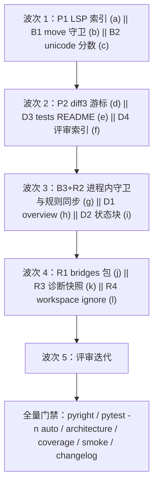

# 全仓库扫描修复：主计划

> **实施状态**：✅ 已实施 —— 2026-11-21（14 项 finding 全闭环、失败子任务重试与兜底完成、双轮七道门禁 exit 0、HEAD `a4a6a082`）

- Issue：<https://gitee.com/jermaine/yate/issues/IKWXU4>
- 需求来源：[full-repo-sweep-issue-brief.md](full-repo-sweep-issue-brief.md)（唯一来源；不从记忆推断任何需求）。
- Worktree / 分支：`yate-full-repo-sweep` / `feature/fix-full-repo-sweep`，父级本地 `master` 位于 `ebe8fee6`。
- 规划角色备注：`plan-architect-designer` spawn 失败，报错 `Model "qwen-3.8-plus" not found`（零产出）；依据 `task-orchestration.md` §三，主代理执行了规划角色并在此记录该偏离。`task-orchestration.md` §一.3 在此运行时不提供 spawn 参数的模型覆盖，因此若不编辑定义文件（禁止）就无法应用 §1.3.5 重试。

## 1. 目标与非目标

目标：关闭 issue 简报中的所有发现项 —— R1/R2/R3/R4、D1/D2/D3/D4、P1/P2/P3、B1/B2/B3 —— 并满足七项验收标准；每完成一批即提交；迭代评审直到不再有 blocker/major；保持所有门禁为绿。

非目标：更改所述修复之外的行为；增加或扩大架构豁免；添加 `Protocol` / `TYPE_CHECKING` / `Any`；重新开启 issue 中明确排除的集合；推送、合并或触碰主 worktree 中未提交的评审文件。

## 2. 已核实事实（当前 worktree，而非 issue 中的旧行号）

| ID | 证据 |
|---|---|
| P1 | `../../yate/editor_lsp/manager.py:106` 保存 `_diagnostics_by_row`；`:763-773` 在发布时重建它（唯一写入 `:734`）；`:780-784` 的 `diagnostics_for` 复制整张表；`:793-808` 的 `diagnostic_at` 扫描所有诊断；`:810-821` 的 `diagnostics_on_line` 在索引上为 O(1)。热路径 `../../yate/editor.py:447-453,499-503` -> `../../yate/flows/lsp_sync.py:95-101`。测试：`../../tests/test_lsp.py:916,949,1018`。 |
| P2 | `../../yate/editor_core/diff.py:133-200` 的 `diff3_regions` / 嵌套的 `classify`；`:261-297` 的 `_side_span` 重新扫描有序 opcode；`:161-169` 有四个 `any(...)`。顺序假设：difflib opcode 按基准行排序、互不重叠。测试：`../../tests/test_editor_core_diff.py:120-159`。 |
| B1 | `../../yate/services/workspace.py:519-545` 的 `copy_entry` 有 `relative_to` 自嵌套守卫；`:547-559` 的 `move_entry` 没有。调用方 `../../yate/editor_components/file_manager/screen.py:1007`。测试：`../../tests/test_workspace_file_manager.py:91,113,132,152,172`。 |
| B2 | `../../yate/yaterc_options.py:171-202` 的 `_parse_journey_fraction` 在 `:190-191` 使用 `isdigit()`、在 `:194-195` 使用 `int()`；`:484-487` 的提取顺序（screen_saver 在 file_preview / large_file 之前）；`../../yate/yaterc.py:213-216` 的兜底 except。测试：`../../tests/test_yaterc_options.py:216,253,278,294,384`。 |
| B3 | `../../tests/test_macro_wiring.py:95-125` 嵌套了 `subprocess.run([sys.executable, "-m", "pytest", ...])`；`:183-191` 还嵌套了 pyright（不在范围内：不是覆盖率 flake）。`../../tests/test_architecture.py:377-385` 的 `SIZE_EXEMPT_FILES`（7 项）、`:919-941` 的大小检查、`:1828-1844` 的注册守卫。 |
| R1 | `../../yate/services/extensions/bridges.py` 679 行、11 个自述领域、13 个公开类；`api.py:33-47` 导入 13 个名字；门面 `__init__.py:67-79,81-96` 重新导出冻结的 14 个；直接内部导入位于 `../../tests/test_extension_bridges.py:32`、`../../tests/test_extension_api.py:29`、`../../tests/test_ui_contributions.py:25`、`../../tests/test_ts_backend.py:30,429`。bridges/api/facade 之间没有真正的导入循环。 |
| R2 | `../rules/architecture-boundaries.md:331-337` 的规则文本称 `vim.py` 为 1595（实际 1679）、`:389-396` 称 `view.py` 为 824（实际 879）、`:67` 称 37 个守卫（实际 45；§六 `:508` 已写 45）。其他豁免文件漂移 +1：`editor.py` 845、`buffer.py` 1566、`langdefs.py` 842、`manager.py` 884、`file_manager/screen.py` 1018。`../../tests/test_macro_wiring.py:97-109` 只检查 `editor.py`。 |
| R3 | `../../yate/diagnostics.py:25` 导入 `Editor`；`:82,131,268,298,355,399` 有六处签名；`:271,299,368,371,375,382,400,401` 有属性读取。`../../yate/cli.py:31-32` 记录了 TUI 拖拽问题；`:507-525` 调用 `print_report(app.editor)`。`../../tests/test_diagnostics.py` 有 53+ 处调用点。 |
| R4 | `../../yate/services/workspace.py:19,35,39` 的 ignore 常量；`:117` 的 `_IgnorePattern`；`:139-146,183-195` 的状态；`:179-197` 的 `_load_root_ignores`；`:199-236` 的 `_parse_ignore`；`:238-265` 的 `_dir_ignores`；`:267-311` 的 `_is_ignored`；`:643` 的 `_anchored_match`。消费者：`list_dir :315-342`、`walk_files :344+`、`../../tests/test_workspace_filter.py`。无闭包；状态仅通过 `self.*` 加模块常量。 |
| D1 | `overview.md:13-14` 声称存在一个不存在的 `../../tools/_gen_index.py`（仓库中零命中）；`:21-27` 声称 147 篇文档；实测 500 个 markdown 文件、152 个带 `**实施状态**`；九篇最近的 2026-11 计划均为零索引命中。 |
| D2 | `toggle-comment-plan.md:7-10` 暴露了本地 worktree 路径且没有状态块；`macro-record-replay-unified-plans/overview.md:3-6`、`which-key-auto-trigger-plan.md:7`、`soft-wrap-plans/overview.md:3` 使用临时状态行；9/9 近期计划缺少统一块。 |
| D3 | `../../tests/README.md:15-16` 声称 98/134 个模块和 150 个 `.py`；实测 149 个非 `__init__` / 共 169 个。 |
| D4 | `../reviews/README.md:16,322-389` 的快速表格包含 #1–#75，但 #59–#61 和 #67–#72 未列入表格（正文在 `:78,86,97,215,224,233,246,256,264`）；编号分歧已在 `:181-183,198,308-318` 登记。 |
| P3 | 可疑项：`../../yate/editor_components/palette.py:272-302`；`../../yate/editor_components/completion.py:273-286,452-457`；`../../yate/editor_lsp/manager.py:769-773`；五处静默 `is_dir/stat` 兜底，包括 `../../yate/flows/document_flows.py:52-55`。 |

## 3. 备选方案与否决理由

- **P1**：(a) 保持全量扫描 —— 否决：同一类中已存在标准的 O(1) 索引（算法复杂度规则，无需 profiler）；(b) 在索引旁增加第二个缓存 —— 否决：失效路径重复。选定：复用 `_diagnostics_by_row`，保持 `_diagnostics` 为唯一事实来源。
- **P2**：(a) 保持重复扫描 —— 否决：明确的 O(k^2)，存在单调替代方案；(b) 每次发布预计算一张映射 —— 否决：diff3 是纯函数，没有发布钩子。选定：在现有有序序列循环内使用单调游标。
- **B3**：(a) 为嵌套进程清除 `COV_CORE_*` / `PYTEST_*` —— 否决：仍是嵌套 pytest 运行，且跨环境脆弱；(b) 进程内调用守卫的判定逻辑 —— 选定，由 `../../tests/test_architecture.py` 暴露一个共享辅助函数。
- **R1**：(a) 保留单个 679 行的文件 —— 否决：十一个无关的领域和 13 个名字的扇出；(b) 不使用门面直接拆分 —— 否决：R14 冻结了插件导入路径，且内部测试导入旧路径。选定：`bridges/` 包，其 `__init__` 重新导出每一个现有名字。
- **R3**：(a) 保持同层导入 —— 否决：这是一条未画出的依赖边，且会把 TUI 栈强加给无头诊断；(b) 定义一个窄 `Protocol` —— 被 R2/R8 否决。选定：在 L4 调用点构造具体的只读 `DiagnosticsInput` 数据类。
- **R4**：(a) 保持子系统内联 —— 仅当后续修改持续增大该文件时才否决；选定拆分且不改变行为，因为边界清晰且测试覆盖密集。
- **D4**：(a) 补齐缺失的九行 —— 否决：与已登记的按分支编号策略冲突；(b) 表头澄清 —— 选定，措辞与现有的分歧说明一致。

## 4. 执行波次

波次表（也是唯一的调度来源；同一波次内文件绝不重叠）：

| 波次 | 子计划 | 独占文件 | 验收命令 |
|---|---|---|---|
| 1a | `full-repo-sweep-lsp-diagnostics-plan-a.md` (P1) | `../../yate/editor_lsp/manager.py`, `../../tests/test_lsp.py` | `pytest ../../tests/test_lsp.py -q` |
| 1b | `full-repo-sweep-robustness-plan-b.md` (B1) | `../../yate/services/workspace.py`, `../../tests/test_workspace_file_manager.py` | `pytest ../../tests/test_workspace_file_manager.py -q` |
| 1c | `full-repo-sweep-yaterc-plan-c.md` (B2) | `../../yate/yaterc_options.py`, `../../tests/test_yaterc_options.py` | `pytest ../../tests/test_yaterc_options.py -q` |
| 2a | `full-repo-sweep-diff3-plan-d.md` (P2) | `../../yate/editor_core/diff.py`, `../../tests/test_editor_core_diff.py` | `pytest ../../tests/test_editor_core_diff.py -q` |
| 2b | `full-repo-sweep-tests-readme-plan-e.md` (D3) | `../../tests/README.md` | 仅文档评审 |
| 2c | `full-repo-sweep-review-index-plan-f.md` (D4) | `../reviews/README.md` | 仅文档评审 |
| 3a | `full-repo-sweep-test-guard-plan-g.md` (B3 + R2) | `../../tests/test_architecture.py`, `../../tests/test_macro_wiring.py`, `../rules/architecture-boundaries.md` | `pytest ../../tests/test_macro_wiring.py -q` + `pytest ../../tests/test_architecture.py -q` |
| 3b | `full-repo-sweep-doc-index-plan-h.md` (D1) | `overview.md` | 仅文档评审 |
| 3c | `full-repo-sweep-doc-status-plan-i.md` (D2) | 子计划中列出的四份计划文档 | 仅文档评审 |
| 4a | `full-repo-sweep-bridges-plan-j.md` (R1) | `../../yate/services/extensions/bridges/`、删除 `bridges.py` | 子计划中的扩展/架构测试集 |
| 4b | `full-repo-sweep-diagnostics-plan-k.md` (R3) | `../../yate/diagnostics.py`, `../../yate/cli.py`, `../../tests/test_diagnostics.py` | `pytest ../../tests/test_diagnostics.py -q` |
| 4c | `full-repo-sweep-workspace-plan-l.md` (R4) | `../../yate/services/workspace.py`、新增的 `../../yate/services/workspace_ignores.py` | `pytest ../../tests/test_workspace_filter.py ../../tests/test_workspace_file_manager.py -q` |
| 5 | 评审后新增的 review-fixes 子计划 | 按评审发现项 | 按评审发现项 |

波次 1 -> 2 -> 3 -> 4 串行执行；同一波次内的子计划可并行运行（每批最多 3 个）。每个子计划都在 `full-repo-sweep-plans/` 中自包含。

## 5. 风险与回滚

- P1：严重度排序或多行覆盖可能改变；通过针对诊断矩阵（包括 `doc.path is None`）的新旧等价测试缓解；回滚 = 恢复原始循环。
- P2：零长度的基准区间和插入边界很微妙；通过在游标辅助函数后保留 `_side_span` 语义并保留全部六个现有 diff3 测试来缓解；回滚 = 回退 `diff.py`。
- B1/B2：错误文本和提取顺序是可观察的；通过先写负向测试断言精确消息以及后续选项仍会运行来缓解；回滚 = 回退这两个函数。
- B3/R2：行数表故意设计得脆弱；计数只在所有代码波次完成后（波次 3 在波次 1–2 之后）采集，且最终门禁会重新核验；回滚 = 仅当并行覆盖率仍然失败时恢复子进程守卫。
- R1：导入路径兼容性；通过重新导出每一个旧名字并运行全部四个内部导入测试模块来缓解；回滚 = 恢复单个文件。
- R3：50+ 处测试调用点；通过单一的测试侧快照构造器并保持报告输出逐字节一致来缓解；回滚 = 恢复 `Editor` 签名。
- R4：ignore 缓存身份；通过不改变行为和密集的现有测试来缓解；回滚 = 恢复内联方法。
- 所有改动仅限于 worktree 本地；不推送、不合并。每个波次各自提交，因此可独立回退某个波次。

## 6. 验收映射

| 标准 | 负责子计划 | 验证 |
|---|---|---|
| P1 按行索引 + 等价性 + 大 D | a | `../../tests/test_lsp.py` 新增用例 + 全量门禁 |
| B1/B2 先写负向测试、后续选项仍被提取 | b, c | 针对性测试 + 全量门禁 |
| R2 三个数字 + 7 项逐一守卫 | g | 规则表 + architecture/macro-wiring 测试 |
| D1/D2/D3 计数、路径、状态块 | e, h, i | 文档评审 + 机械计数 |
| B3 `-n auto` == `-n 1` | g | 两条覆盖率命令 |
| 六道门禁 exit 0 | 全部 | 主代理的最终门禁运行 |
| P3 可疑项已登记 | overview.md | 带理由的明确可疑项登记表 |

## 7. 偏离 / 执行日志

- 2026-11-20：planner spawn 失败（`Model "qwen-3.8-plus" not found`），主代理兜底；无计划范围偏离。
- 批量提交：`8163fbe7` issue 简报、`ff5d095f` 计划、`ac4eda02` 波次 1（P1/B1/B2）、`19ecb116` + `78168722` 波次 2（D3/D4，然后是 P2）、`e6723300` 波次 3（B3/R2/D1/D2）、`dd61c63f` 波次 4（R1/R3/R4）、`7b59eccd` + `8a247d98` 波次 5 评审修复、`3c36359e` + `1d463896` 评审闭环与图修正、`6a9fefb9` + `ad505bf0` 角色重试计划与兜底验证、`a4a6a082` 评审者重试兜底报告，随后是仅文档的状态/索引闭环提交。不推送、不合并。
- 门禁结果（主代理，真实退出码）：pyright `yate/ tests/ tools/ pack/` = 0 错误 / exit 0；`pytest tests/ -q -n auto` = exit 0；架构测试 = 46 项测试 / exit 0；coverage `--cov-fail-under=75 -n auto` = 3981 passed / 10 skipped / 93.15% / exit 0；`-n 1` 同样 = 3981 passed / 10 skipped / 93.15% / exit 0；smoke `--jobs 4` = 124/124 场景 / 1511/1511 检查 / 82.09 s / exit 0；`tools.changelog check` = exit 0（unreleased 滞后 174 笔提交是生成器的 release-refresh 机制，不是失败）。
- 偏离：波次 2 的 P2 执行者引入了私有符号导入和 `pyright: ignore`；主代理将其替换为有文档说明的公开测试接缝以及 `getattr`/`cast` 探针，使 pyright strict 保持零诊断且无任何抑制。
- 偏离：波次 4 的 R1 执行者落地了包，但在删除旧文件和添加兼容性测试之前停止；在 >10 分钟零输出窗口后，主代理完成了这两步并重新运行了所有扩展/架构测试。
- 偏离：`code-review-expert` spawn 超过 30 分钟未产出报告也未生成文件（多次进度探询无应答）；依据 `subagent-workflow.md` §五判定为零产出并关闭，主代理执行了自审。该自审发现两项，均在波次 5 修复：CLI `--diag` 假编辑器未建模快照契约（真实回归，全量门禁失败），以及 `DiagnosticsInput.lsp_states` 尽管数据类被冻结仍可变。
- 环境产物（非产品失败）：两次中间的 coverage `-n 1` 运行退出 1，仅因 safe-delete 钩子拦截了 pytest 对 `%TEMP%` 和 `.coverage.*` 的批量清理（`SAFE_DELETE_BULK_CONFIRM_REQUIRED`，count 19950）。使用唯一 `COVERAGE_FILE` 重跑退出 0；上述最终的双模式覆盖率是干净的。
- D4 裁决：添加表头说明而非九行，与现有的按分支编号分歧登记一致。
- P3 可疑项：四项均在 `full-repo-sweep-plans/overview.md` 中登记了 profiler/真实负载理由；无产品改动。
- 后期执行者交接：R3 的执行者曾请主代理修正架构 Mermaid 边 `ED --> DIAG`；已在最终文档提交中完成，将其替换为 L4 快照注入边，并重新运行了 46 个架构守卫。
- issue 的所有验收复选框均已关闭；波次 5 后不再有 blocker/major。

## 8. 两个零产出角色的重试（2026-11-21）

用户要求继续失败的子任务。依据 `task-orchestration.md` §一.3.5 和
`subagent-workflow.md` §五.4，每个角色获得**一次**变更配置的重试：

| 角色 | 失败 | 变更的配置 | 独占产出 | 成功标准 |
|---|---|---|---|---|
| `plan-architect-designer` | spawn 错误 `Model "qwen-3.8-plus" not found` | 任务书中声明的 `[model: Hy4 preview]`；`bypassPermissions` | 仅向本文件追加 §9 验证 | 确认全部 14 项发现项 + 验收均有计划覆盖，或报告具体缺口 |
| `code-review-expert` | >30 分钟，无应答、无报告 | 缩小范围（仅最后 3 笔提交）、`acceptEdits` | 仅新增 `.trae/reviews/2026-11-21-full-repo-sweep-independent-review.md` | 结构化的 blocker/major/minor 列表，附 file:line 证据以及重跑的门禁数字 |

两者对产品代码均为只读。判死窗口：30 分钟内零应答**且**零文件改动。失败时，主代理记录 "subagent zero-output" 并自行兜底；不做同配置重启。

重试结果：planner 重试再次在 spawn 时失败，报错 `Model "qwen-3.8-plus" not found`；reviewer 重试成功 spawn，但第一次探活返回 `Recipient "reviewer-retry" not found. Known members: none`，这是一个立即判死条件。未尝试同配置重启。主代理执行了两次兜底；本轮最终提交为 `6a9fefb9`（重试计划）、`ad505bf0`（计划验证），以及最终的评审记录提交 `a4a6a082`。评审兜底记录于 `../reviews/2026-11-21-full-repo-sweep-independent-review.md`；所有门禁均于 2026-11-21 使用干净的 basetemp 重新运行。

## 9. 独立计划验证（重试）

Planner 重试再次在 spawn 时失败，报错 `Model "qwen-3.8-plus" not found`；该运行时没有 spawn 参数的模型覆盖，因此依据 `task-orchestration.md` §一.3.5 和 §三，主代理执行了本次验证。未尝试同配置重启。

| 发现项 | 子计划 | 闭环证据 |
|---|---|---|
| P1 | a | `ac4eda02`；按行索引 + 新旧等价性及 `../../tests/test_lsp.py` 中的大 D 测试 |
| B1 | b | `ac4eda02`；`../../tests/test_workspace_file_manager.py` 中的先写负向用例，守卫位于 `target.exists()` 之前 |
| B2 | c | `ac4eda02`；`../../tests/test_yaterc_options.py` 中的 Unicode 分数负向用例，尾部提取器仍会运行 |
| P2 | d | `78168722`；单调游标 + `../../tests/test_editor_core_diff.py` 中的生成输入预言 |
| D3 | e | `19ecb116`；`tests/README.md` 现指向架构守卫，而非过时的计数 |
| D4 | f | `19ecb116`；快速表格表头带有编号口径说明；正文分歧登记未改动 |
| B3 | g | `e6723300`；嵌套 pytest 替换为进程内守卫；双模式覆盖率均 exit 0 |
| R2 | g | `e6723300`；`../rules/architecture-boundaries.md:405-413` 的 7 行规则表，逐项守卫 |
| D1 | h | `e6723300`；生成器声明已移除，存在实测计数与 §6 验证说明 |
| D2 | i | `e6723300`；四份文档带有统一状态块，本地路径/仓库根措辞已移除 |
| R1 | j | `dd61c63f`；`bridges/` 包重新导出所有旧名字；门面仍为 14 个名字 |
| R3 | k | `dd61c63f` + `8a247d98`；L4 构造深度只读的 `DiagnosticsInput`，无头导入守卫 |
| R4 | l | `dd61c63f`；ignore 子系统移至 L0 模块，采用薄委托且缓存语义不变 |
| P3 | overview | 四项可疑项均在 `full-repo-sweep-plans/overview.md` 中登记了 profiler/真实负载理由 |

机械复核（2026-11-21）：`*.md` 582 / 状态块 171 / 架构守卫 46 /
规则表 7 行 / D4 说明存在 / `_gen_index.py` 声明不存在 / P3 登记存在；
所有分支提交均在 §7 逐项列出。验收映射 §6 与偏离日志 §7
包含全部七项标准的实测数字。**缺口：无。** reviewer 重试结果单独跟踪于
§8 及独立评审记录。
