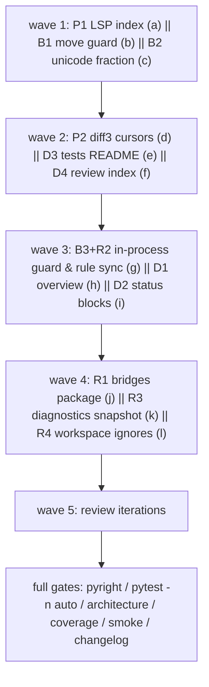

# Full-repo sweep fixes: master plan

> **实施状态**：🟡 部分实施 —— 方案已落盘（2026-11-20）

- Issue: <https://gitee.com/jermaine/yate/issues/IKWXU4>
- Requirement source: [full-repo-sweep-issue-brief.md](full-repo-sweep-issue-brief.md) (sole source; no requirement is inferred from memory).
- Worktree / branch: `yate-full-repo-sweep` / `feature/fix-full-repo-sweep`, parent local `master` at `ebe8fee6`.
- Planning role note: `plan-architect-designer` spawn failed with `Model "qwen-3.8-plus" not found` (zero output); per `task-orchestration.md` §三 the main agent executed the planning role and records this deviation here. `task-orchestration.md` §一.3 offers no spawn-parameter model override in this runtime, so the §1.3.5 retry could not be applied without editing a definition file (forbidden).

## 1. Goals and non-goals

Goals: close every finding in the issue brief — R1/R2/R3/R4, D1/D2/D3/D4, P1/P2/P3, B1/B2/B3 — with the seven acceptance criteria satisfied; commit each completed batch; iterate review until no blocker/major remains; leave all gates green.

Non-goals: changing behavior beyond the stated fixes; adding or widening architecture exemptions; adding `Protocol` / `TYPE_CHECKING` / `Any`; reopening the issue's explicit excluded set; pushing, merging, or touching the main worktree's uncommitted review files.

## 2. Verified facts (current worktree, not the issue's old line numbers)

| ID | Evidence |
|---|---|
| P1 | `../../yate/editor_lsp/manager.py:106` holds `_diagnostics_by_row`; `:763-773` rebuilds it on publish (sole write `:734`); `:780-784` `diagnostics_for` copies the whole table; `:793-808` `diagnostic_at` scans all diagnostics; `:810-821` `diagnostics_on_line` is O(1) on the index. Hot path `../../yate/editor.py:447-453,499-503` -> `../../yate/flows/lsp_sync.py:95-101`. Tests: `../../tests/test_lsp.py:916,949,1018`. |
| P2 | `../../yate/editor_core/diff.py:133-200` `diff3_regions` / nested `classify`; `:261-297` `_side_span` rescans ordered opcodes; four `any(...)` at `:161-169`. Order assumption: difflib opcodes sorted by base line, non-overlapping. Tests: `../../tests/test_editor_core_diff.py:120-159`. |
| B1 | `../../yate/services/workspace.py:519-545` `copy_entry` has `relative_to` self-nesting guard; `:547-559` `move_entry` has none. Caller `../../yate/editor_components/file_manager/screen.py:1007`. Tests: `../../tests/test_workspace_file_manager.py:91,113,132,152,172`. |
| B2 | `../../yate/yaterc_options.py:171-202` `_parse_journey_fraction` uses `isdigit()` at `:190-191` and `int()` at `:194-195`; `:484-487` extraction order (screen_saver before file_preview / large_file); `../../yate/yaterc.py:213-216` fallback except. Tests: `../../tests/test_yaterc_options.py:216,253,278,294,384`. |
| B3 | `../../tests/test_macro_wiring.py:95-125` nests `subprocess.run([sys.executable, "-m", "pytest", ...])`; `:183-191` also nests pyright (out of scope: not the coverage flake). `../../tests/test_architecture.py:377-385` `SIZE_EXEMPT_FILES` (7), `:919-941` size check, `:1828-1844` registration guard. |
| R1 | `../../yate/services/extensions/bridges.py` 679 lines, 11 self-described domains, 13 public classes; `api.py:33-47` imports 13 names; facade `__init__.py:67-79,81-96` re-exports the frozen 14; direct internal imports in `../../tests/test_extension_bridges.py:32`, `../../tests/test_extension_api.py:29`, `../../tests/test_ui_contributions.py:25`, `../../tests/test_ts_backend.py:30,429`. No real import cycle between bridges/api/facade. |
| R2 | Rule text at `../rules/architecture-boundaries.md:331-337` says `vim.py` 1595 (actual 1679), `:389-396` says `view.py` 824 (actual 879), `:67` says 37 guards (actual 45; §六 `:508` already says 45). Other exempt files drift by +1: `editor.py` 845, `buffer.py` 1566, `langdefs.py` 842, `manager.py` 884, `file_manager/screen.py` 1018. `../../tests/test_macro_wiring.py:97-109` checks only `editor.py`. |
| R3 | `../../yate/diagnostics.py:25` imports `Editor`; six signatures at `:82,131,268,298,355,399`; property reads at `:271,299,368,371,375,382,400,401`. `../../yate/cli.py:31-32` notes the TUI drag; `:507-525` calls `print_report(app.editor)`. `../../tests/test_diagnostics.py` has 53+ call sites. |
| R4 | `../../yate/services/workspace.py:19,35,39` ignore constants; `:117` `_IgnorePattern`; `:139-146,183-195` state; `:179-197` `_load_root_ignores`; `:199-236` `_parse_ignore`; `:238-265` `_dir_ignores`; `:267-311` `_is_ignored`; `:643` `_anchored_match`. Consumers: `list_dir :315-342`, `walk_files :344+`, `../../tests/test_workspace_filter.py`. No closures; state only via `self.*` plus module constants. |
| D1 | `overview.md:13-14` claims a nonexistent `../../tools/_gen_index.py` (zero repository hits); `:21-27` claims 147 docs; measured 500 markdown files, 152 with `**实施状态**`; all nine recent 2026-11 plans have zero index hits. |
| D2 | `toggle-comment-plan.md:7-10` exposes a local worktree path and has no status block; `macro-record-replay-unified-plans/overview.md:3-6`, `which-key-auto-trigger-plan.md:7`, `soft-wrap-plans/overview.md:3` use ad-hoc status lines; 9/9 recent plans lack the unified block. |
| D3 | `../../tests/README.md:15-16` claims 98/134 modules and 150 `.py`; measured 149 non-`__init__` / 169 total. |
| D4 | `../reviews/README.md:16,322-389` quick table holds #1–#75 with #59–#61 and #67–#72 absent from the table (prose at `:78,86,97,215,224,233,246,256,264`); numbering disagreement is already registered at `:181-183,198,308-318`. |
| P3 | Suspects: `../../yate/editor_components/palette.py:272-302`; `../../yate/editor_components/completion.py:273-286,452-457`; `../../yate/editor_lsp/manager.py:769-773`; five silent `is_dir/stat` fallbacks including `../../yate/flows/document_flows.py:52-55`. |

## 3. Alternatives and rejection reasons

- **P1**: (a) keep full scan — rejected: standard O(1) index already exists in the same class (algorithm-complexity rule, no profiler needed); (b) add a second cache beside the index — rejected: duplicate invalidation paths. Chosen: reuse `_diagnostics_by_row`, keep `_diagnostics` as the single source of truth.
- **P2**: (a) keep rescans — rejected: clear O(k^2) with monotonic alternative; (b) precompute a map on every publish — rejected: diff3 is pure and has no publish hook. Chosen: monotonic cursors inside the existing ordered-sequence loop.
- **B3**: (a) scrub `COV_CORE_*` / `PYTEST_*` for the nested process — rejected: still a nested pytest run and fragile across environments; (b) in-process call to the guard's decision logic — chosen, with a shared helper exposed by `../../tests/test_architecture.py`.
- **R1**: (a) keep one 679-line file — rejected: eleven unrelated domains and a 13-name fan-out; (b) split without facade — rejected: R14 freezes plugin import paths and internal tests import the old path. Chosen: `bridges/` package whose `__init__` re-exports every existing name.
- **R3**: (a) keep the same-layer import — rejected: it is an undrawn dependency edge and forces the TUI stack on headless diagnostics; (b) define a narrow `Protocol` — rejected by R2/R8. Chosen: concrete read-only `DiagnosticsInput` dataclass built at the L4 call site.
- **R4**: (a) keep the subsystem inline — rejected only if later edits keep growing the file; chosen split with no behavior change because the boundary is clean and test coverage is dense.
- **D4**: (a) add the nine missing rows — rejected: conflicts with the registered per-branch numbering policy; (b) table-header clarification — chosen, worded to agree with the existing disagreement note.

## 4. Execution waves

Wave table (also the single scheduling source; files never overlap inside a wave):

| Wave | Subplan | Exclusive files | Acceptance command |
|---|---|---|---|
| 1a | `full-repo-sweep-lsp-diagnostics-plan-a.md` (P1) | `../../yate/editor_lsp/manager.py`, `../../tests/test_lsp.py` | `pytest ../../tests/test_lsp.py -q` |
| 1b | `full-repo-sweep-robustness-plan-b.md` (B1) | `../../yate/services/workspace.py`, `../../tests/test_workspace_file_manager.py` | `pytest ../../tests/test_workspace_file_manager.py -q` |
| 1c | `full-repo-sweep-yaterc-plan-c.md` (B2) | `../../yate/yaterc_options.py`, `../../tests/test_yaterc_options.py` | `pytest ../../tests/test_yaterc_options.py -q` |
| 2a | `full-repo-sweep-diff3-plan-d.md` (P2) | `../../yate/editor_core/diff.py`, `../../tests/test_editor_core_diff.py` | `pytest ../../tests/test_editor_core_diff.py -q` |
| 2b | `full-repo-sweep-tests-readme-plan-e.md` (D3) | `../../tests/README.md` | document-only review |
| 2c | `full-repo-sweep-review-index-plan-f.md` (D4) | `../reviews/README.md` | document-only review |
| 3a | `full-repo-sweep-test-guard-plan-g.md` (B3 + R2) | `../../tests/test_architecture.py`, `../../tests/test_macro_wiring.py`, `../rules/architecture-boundaries.md` | `pytest ../../tests/test_macro_wiring.py -q` + `pytest ../../tests/test_architecture.py -q` |
| 3b | `full-repo-sweep-doc-index-plan-h.md` (D1) | `overview.md` | document-only review |
| 3c | `full-repo-sweep-doc-status-plan-i.md` (D2) | four plan documents listed in subplan | document-only review |
| 4a | `full-repo-sweep-bridges-plan-j.md` (R1) | `../../yate/services/extensions/bridges/`, deletion of `bridges.py` | extension/architecture test set in subplan |
| 4b | `full-repo-sweep-diagnostics-plan-k.md` (R3) | `../../yate/diagnostics.py`, `../../yate/cli.py`, `../../tests/test_diagnostics.py` | `pytest ../../tests/test_diagnostics.py -q` |
| 4c | `full-repo-sweep-workspace-plan-l.md` (R4) | `../../yate/services/workspace.py`, new `../../yate/services/workspace_ignores.py` | `pytest ../../tests/test_workspace_filter.py ../../tests/test_workspace_file_manager.py -q` |
| 5 | review-fixes subplan added after review | per review finding | per review finding |

Wave 1 -> 2 -> 3 -> 4 are serial; subplans inside a wave may run in parallel (max 3 per batch). Every subplan is self-contained in `full-repo-sweep-plans/`.

## 5. Risks and rollback

- P1: severity ordering or multi-line coverage could change; mitigated by an old-vs-new equivalence test over a diagnostic matrix, including `doc.path is None`; rollback = restore the original loop.
- P2: zero-length base spans and insertion edges are subtle; mitigated by preserving `_side_span` semantics behind cursor helpers and keeping all six existing diff3 tests; rollback = revert `diff.py`.
- B1/B2: error text and extraction order are observable; mitigated by negative-first tests asserting exact messages and that later options still run; rollback = revert the two functions.
- B3/R2: line-count table is intentionally brittle; the counts are captured only after all code waves finish (wave 3 follows waves 1–2), and the final gate re-verifies them; rollback = restore the subprocess guard only if parallel coverage still fails.
- R1: import-path compatibility; mitigated by re-exporting every old name and running all four internal-import test modules; rollback = restore the single file.
- R3: 50+ test call sites; mitigated by a single test-side snapshot builder and keeping the report output byte-identical; rollback = restore `Editor` signatures.
- R4: ignore-cache identity; mitigated by no behavior change and dense existing tests; rollback = restore inline methods.
- All changes are local to the worktree; no push or merge. Each wave is its own commit so a wave can be reverted independently.

## 6. Acceptance mapping

| Criterion | Owner subplan | Verification |
|---|---|---|
| P1 per-row index + equivalence + large D | a | `../../tests/test_lsp.py` new cases + full gate |
| B1/B2 negative-first tests, later options extracted | b, c | targeted tests + full gate |
| R2 three numbers + 7 itemized guards | g | rule table + architecture/macro-wiring tests |
| D1/D2/D3 counts, paths, status blocks | e, h, i | document review + mechanical counts |
| B3 `-n auto` == `-n 1` | g | both coverage commands |
| Six gates exit 0 | all | main agent's final gate run |
| P3 suspects registered | overview.md | explicit suspect register with reasons |

## 7. Deviation / execution log

- 2026-11-20: planner spawn failed (`Model "qwen-3.8-plus" not found`), main agent fallback; no plan-scope deviation.
- Batch commits: `8163fbe7` issue brief, `ff5d095f` plans, `ac4eda02` wave 1 (P1/B1/B2), `19ecb116` + `78168722` wave 2 (D3/D4, then P2), `e6723300` wave 3 (B3/R2/D1/D2), `dd61c63f` wave 4 (R1/R3/R4), `7b59eccd` + `8a247d98` wave 5 review fixes. No push or merge.
- Gate results (main agent, real exit codes): pyright `yate/ tests/ tools/ pack/` = 0 errors / exit 0; `pytest tests/ -q -n auto` = exit 0; architecture tests = 46 tests / exit 0; coverage `--cov-fail-under=75 -n auto` = 3981 passed / 10 skipped / 93.15% / exit 0; same with `-n 1` = 3981 passed / 10 skipped / 93.15% / exit 0; smoke `--jobs 4` = 124/124 scenarios / 1511/1511 checks / 82.09 s / exit 0; `tools.changelog check` = exit 0 (unreleased lag 174 commits is the generator's release-refresh mechanism, not a failure).
- Deviation: wave 2's P2 executor introduced private-symbol imports and a `pyright: ignore`; main agent replaced them with documented public test seams plus `getattr`/`cast` spies, keeping pyright strict at zero diagnostics with no suppression.
- Deviation: wave 4's R1 executor landed the package but stopped before deleting the legacy file and adding the compatibility test; after a >10-minute zero-output window the main agent completed those two steps and re-ran all extension/architecture tests.
- Deviation: `code-review-expert` spawn produced no report and no file for >30 minutes (multiple progress probes unanswered); per `subagent-workflow.md` §五 it was judged zero-output and shut down, and the main agent performed the self-review. That self-review found two items, both fixed in wave 5: CLI `--diag` fake editor did not model the snapshot contract (real regression, full gate failed), and `DiagnosticsInput.lsp_states` was mutable despite the frozen dataclass.
- Environment artifact (not a product failure): two intermediate coverage `-n 1` runs exited 1 solely because the safe-delete hook intercepted pytest's bulk cleanup of `%TEMP%` and `.coverage.*` (`SAFE_DELETE_BULK_CONFIRM_REQUIRED`, count 19950). Re-runs with a unique `COVERAGE_FILE` exited 0; final dual-mode coverage above is clean.
- D4 adjudication: table-header note added instead of nine rows, consistent with the existing branch-numbering disagreement register.
- P3 suspects: all four registered with profiler/real-load reasons in `full-repo-sweep-plans/overview.md`; no product change.
- Late executor handoff: R3's executor had asked the main agent to correct the architecture Mermaid edge `ED --> DIAG`; done in the final docs commit by replacing it with the L4 snapshot-injection edge, and the 46 architecture guards were re-run.
- All acceptance checkboxes of the issue are closed; no blocker/major remains after wave 5.
