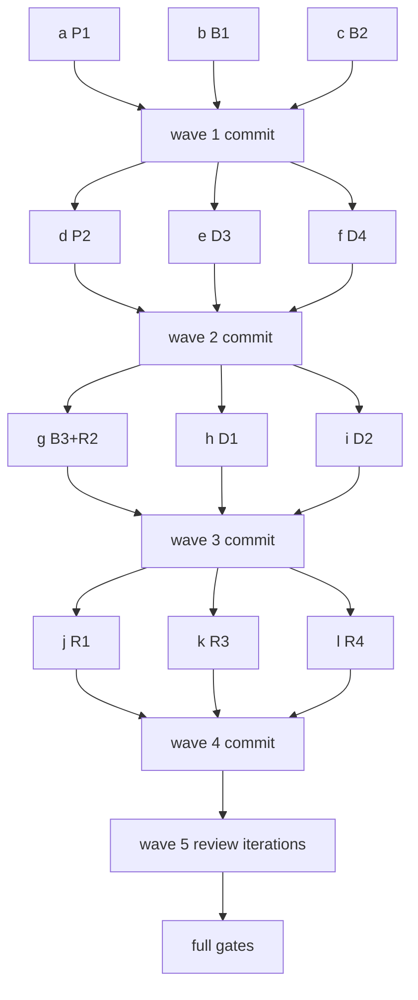

# Full-repo sweep fixes: sub-plan overview

> **实施状态**：✅ 已实施 —— 2026-11-20（波次 1-4 全闭环，全量门禁 exit 0）

Parent: [../full-repo-sweep-plan.md](../full-repo-sweep-plan.md). Requirement source: [../full-repo-sweep-issue-brief.md](../full-repo-sweep-issue-brief.md).

## Sub-plan index

| ID | Sub-plan | Finding | Exclusive files | Wave |
|---|---|---|---|---|
| a | [lsp-diagnostics](full-repo-sweep-lsp-diagnostics-plan-a.md) | P1 | `../../../yate/editor_lsp/manager.py`, `../../../tests/test_lsp.py` | 1 |
| b | [robustness](full-repo-sweep-robustness-plan-b.md) | B1 | `../../../yate/services/workspace.py`, `../../../tests/test_workspace_file_manager.py` | 1 |
| c | [yaterc](full-repo-sweep-yaterc-plan-c.md) | B2 | `../../../yate/yaterc_options.py`, `../../../tests/test_yaterc_options.py` | 1 |
| d | [diff3](full-repo-sweep-diff3-plan-d.md) | P2 | `../../../yate/editor_core/diff.py`, `../../../tests/test_editor_core_diff.py` | 2 |
| e | [tests README](full-repo-sweep-tests-readme-plan-e.md) | D3 | `../../../tests/README.md` | 2 |
| f | [review index](full-repo-sweep-review-index-plan-f.md) | D4 | `../../../.trae/reviews/README.md` | 2 |
| g | [test guard](full-repo-sweep-test-guard-plan-g.md) | B3 + R2 | `../../../tests/test_architecture.py`, `../../../tests/test_macro_wiring.py`, `../../rules/architecture-boundaries.md` | 3 |
| h | [doc index](full-repo-sweep-doc-index-plan-h.md) | D1 | `../../../.trae/documents/overview.md` | 3 |
| i | [doc status](full-repo-sweep-doc-status-plan-i.md) | D2 | four documents listed in the sub-plan | 3 |
| j | [bridges](full-repo-sweep-bridges-plan-j.md) | R1 | `../../../yate/services/extensions/bridges/` plus deletion of `bridges.py` | 4 |
| k | [diagnostics](full-repo-sweep-diagnostics-plan-k.md) | R3 | `../../../yate/diagnostics.py`, `../../../yate/cli.py`, `../../../tests/test_diagnostics.py` | 4 |
| l | [workspace ignores](full-repo-sweep-workspace-plan-l.md) | R4 | `../../../yate/services/workspace.py`, `../../../yate/services/workspace_ignores.py` | 4 |
| m | review fixes | review findings | added after the review step | 5 |

## Wave execution table

| Wave | Parallel batch | Gate before next wave |
|---|---|---|
| 1 | a ∥ b ∥ c | targeted pytest for each sub-plan, then diff self-review |
| 2 | d ∥ e ∥ f | targeted pytest for d; document review for e/f |
| 3 | g ∥ h ∥ i | `pytest ../../../tests/test_macro_wiring.py -q` and `pytest ../../../tests/test_architecture.py -q` for g; document review for h/i |
| 4 | j ∥ k ∥ l | targeted pytest per sub-plan + architecture tests |
| 5 | review findings | review until zero blocker/major |

No files overlap inside a wave. Waves are serial. Each wave is one commit; the final review-fix wave may add further commits.

## Suspect register (issue requirement 7)

| Suspect | Decision | Reason |
|---|---|---|
| Palette `refilter` full re-score + full `sort` (`../../../yate/editor_components/palette.py:272-302`) | not fixed | Candidate-size distribution is unknown; replacing `sort` with `heapq` is a constant-factor change requiring profiler evidence of candidate counts and score cost. |
| Completion per-line word-set union rebuilt (`../../../yate/editor_components/completion.py:273-286,452-457`) | not fixed | 120 ms debounce and `items[:64]` truncation bound the cost; profiler data on real word-set sizes is required. |
| File-spanning diagnostic expands across all rows (`../../../yate/editor_lsp/manager.py:769-773`) | not fixed | Requires real publish-load sampling; a bounded-range design change needs evidence of actual multi-line diagnostic frequency. |
| Five silent `is_dir/stat` `OSError` fallbacks (e.g. `../../../yate/flows/document_flows.py:52-55`) | not fixed | Benign downgrade with existing user feedback; whether `log.debug` adds value depends on measured frequency. |

## Status

Execution log and measured gate results are recorded in the parent plan's §7.
