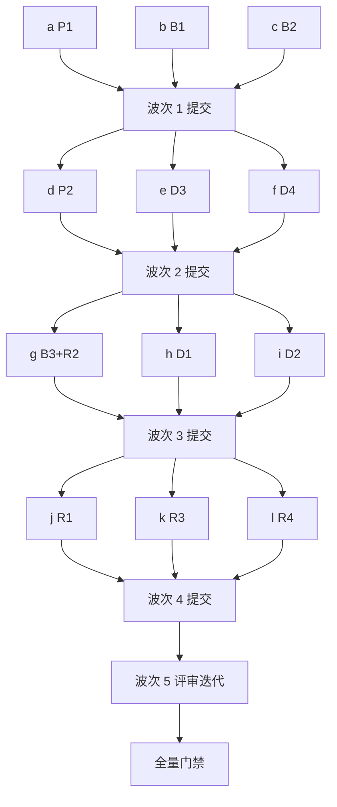

# 全仓库扫描修复：子计划总览

> **实施状态**：✅ 已实施 —— 2026-11-20（波次 1-4 全闭环，全量门禁 exit 0）

父计划：[../full-repo-sweep-plan.md](../full-repo-sweep-plan.md)。需求来源：[../full-repo-sweep-issue-brief.md](../full-repo-sweep-issue-brief.md)。

## 子计划索引

| ID | 子计划 | 发现项 | 独占文件 | 波次 |
|---|---|---|---|---|
| a | [lsp-diagnostics](full-repo-sweep-lsp-diagnostics-plan-a.md) | P1 | `../../../yate/editor_lsp/manager.py`, `../../../tests/test_lsp.py` | 1 |
| b | [健壮性](full-repo-sweep-robustness-plan-b.md) | B1 | `../../../yate/services/workspace.py`, `../../../tests/test_workspace_file_manager.py` | 1 |
| c | [yaterc](full-repo-sweep-yaterc-plan-c.md) | B2 | `../../../yate/yaterc_options.py`, `../../../tests/test_yaterc_options.py` | 1 |
| d | [diff3](full-repo-sweep-diff3-plan-d.md) | P2 | `../../../yate/editor_core/diff.py`, `../../../tests/test_editor_core_diff.py` | 2 |
| e | [测试 README](full-repo-sweep-tests-readme-plan-e.md) | D3 | `../../../tests/README.md` | 2 |
| f | [评审索引](full-repo-sweep-review-index-plan-f.md) | D4 | `../../../.trae/reviews/README.md` | 2 |
| g | [测试守卫](full-repo-sweep-test-guard-plan-g.md) | B3 + R2 | `../../../tests/test_architecture.py`, `../../../tests/test_macro_wiring.py`, `../../rules/architecture-boundaries.md` | 3 |
| h | [文档索引](full-repo-sweep-doc-index-plan-h.md) | D1 | `../../../.trae/documents/overview.md` | 3 |
| i | [文档状态](full-repo-sweep-doc-status-plan-i.md) | D2 | 子计划中列出的四份文档 | 3 |
| j | [bridges](full-repo-sweep-bridges-plan-j.md) | R1 | `../../../yate/services/extensions/bridges/` 以及删除 `bridges.py` | 4 |
| k | [diagnostics](full-repo-sweep-diagnostics-plan-k.md) | R3 | `../../../yate/diagnostics.py`, `../../../yate/cli.py`, `../../../tests/test_diagnostics.py` | 4 |
| l | [workspace ignores](full-repo-sweep-workspace-plan-l.md) | R4 | `../../../yate/services/workspace.py`, `../../../yate/services/workspace_ignores.py` | 4 |
| m | 评审修复 | 评审发现项 | 评审步骤后添加 | 5 |

## 波次执行表

| 波次 | 并行批次 | 下一波次前的门禁 |
|---|---|---|
| 1 | a ∥ b ∥ c | 每个子计划的定向 pytest，然后 diff 自审 |
| 2 | d ∥ e ∥ f | 对 d 做定向 pytest；对 e/f 做文档评审 |
| 3 | g ∥ h ∥ i | 对 g 运行 `pytest ../../../tests/test_macro_wiring.py -q` 和 `pytest ../../../tests/test_architecture.py -q`；对 h/i 做文档评审 |
| 4 | j ∥ k ∥ l | 每个子计划的定向 pytest + 架构测试 |
| 5 | 评审发现项 | 评审至阻塞项/严重项归零 |

同一波次内文件不重叠。波次间串行。每个波次一次提交；最后的评审修复波次可追加更多提交。

## 疑似项登记表（issue 要求 7）

| 疑似项 | 裁决 | 理由 |
|---|---|---|
| Palette `refilter` 全量重评分 + 全量 `sort`（`../../../yate/editor_components/palette.py:272-302`） | 未修复 | 候选集大小分布未知；将 `sort` 换成 `heapq` 属于常数因子改动，需要性能分析器给出候选数量和评分开销的证据。 |
| Completion 每行词集并集重建（`../../../yate/editor_components/completion.py:273-286,452-457`） | 未修复 | 120 ms 防抖和 `items[:64]` 截断限定了开销；需要真实词集大小的性能分析器数据。 |
| 跨文件 diagnostic 扩展到所有行（`../../../yate/editor_lsp/manager.py:769-773`） | 未修复 | 需要真实的 publish 负载采样；有界范围的设计改动需要实际多行 diagnostic 频率的证据。 |
| 五处静默的 `is_dir/stat` `OSError` 回退（例如 `../../../yate/flows/document_flows.py:52-55`） | 未修复 | 属于良性降级，且已有用户反馈；`log.debug` 是否有价值取决于实测频率。 |

## 状态

执行日志和实测门禁结果记录在父计划的 §7 中。
