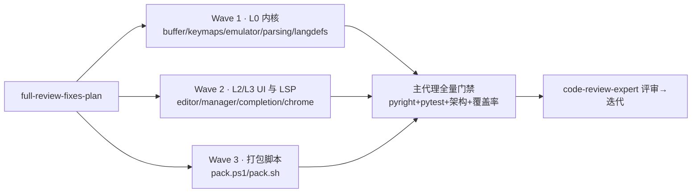

# full-review-fixes-plan（2026-10-12 全仓评审 issue 修复）

- 来源评审记录：[../reviews/2026-10-12-full-review.md](../reviews/2026-10-12-full-review.md)
- 来源 issue：Gitee `IKL6N5`（Bugfix - 修复审查列表里的issue）
- 基线 commit：`38c29ce`（master）；分支 `fix/full-review-fixes`；worktree `../yate-full-review-fixes`（独立 `.venv`）
- 执行模式：无人值守（用户预先授权，闭环第 3 步【批准】由用户指令代行，不再停等）

## 一、目标与非目标

**目标**：修复评审报告中采纳的全部条目（H1-H5、M2、M4、M5、L2、L3、L7），每项附回归测试；对不采纳条目（M1、M3、L1、L4、L5、L6）给出否决理由并留档。

**非目标**：M1 的可配置化（需新增 yaterc 选项面 + 双语文档 + smoke 矩阵，属独立功能任务）；不推送远端；不改双语手册（语义未变）。

## 二、采纳/否决总表

| 条目 | 处置 | 一句话方案 |
|---|---|---|
| H1 teardown_all 无异常保护 | 修复 | `on_unmount` 中 try/except 包裹 + `log.exception` |
| H2 `<ctrl-/>` 不可绑定 | 修复 | ctrl 分支特判 `/` → `\x1f` |
| H3 register_server 缺状态通知 | 修复 | 替换路径末尾 `_fire("state")` |
| H4 completion 缓存持已关闭 buffer | 修复 | `WeakKeyDictionary`（buffer → (version, rows)） |
| H5 `_delete_range` 缺位置校验 | 修复 | `start > end` 抛 `ValueError` |
| M2 TabBar 溢出无指示 | 修复 | 右端 `+N` 溢出指示器 |
| M4 pack 冒烟无超时 | 修复 | ps1 `Start-Process`+`WaitForExit(30s)`；sh `timeout 30` |
| M5 scrollback 清理 O(n) | 修复 | 批量清理（懒裁剪），**不用 deque**（见 §四） |
| L2 非整数坐标静默降级 | 修复 | 每批诊断 warn 一次 |
| L3 langdefs 导出私有名 | 修复 | 公开 `languages()` / `name_to_key()` 存取器，`__all__` 去私有 |
| L7 `_gutter_w` / `gutter_width` 重复 | 修复 | 删 `_gutter_w`，3 处调用点改 `gutter_width()` |
| M1 硬编码常量可配置化 | 否决 | 需新配置面，功能级任务，另行立项 |
| M3 wiki.py `_emit_mode` 全局 | 否决 | 2026-10-06 评审 R-10 已有意识接受（CLI 单进程单 run 不可达）；测试 AST 守护钉死该标识符，重构零行为收益 |
| L1 actions.py 命名函数与 lambda 混用 | 否决 | 现状即成文规则：单行委托→lambda，多行分支（多光标）→命名函数，统一是负收益churn |
| L4 release() 参数过多 | 否决 | 实测签名仅 4 参（`version` + 3 关键字参），评审描述与现状不符 |
| L5 `_FakeApp.__getattr__` 魔法 | 否决 | 设计意图明确且有用例钉死（`test_fake_app_unimplemented_hooks_become_recorded_noops`），白名单与文档化弹性相悖 |
| L6 textobjects 双反斜杠 | 否决 | 评审自评"与 vim 行为一致，可接受" |

## 三、分步实施（三波并行，文件独占）



### Wave 1 — L0 内核（H5 / H2 / M5 / L2 / L3）

**W1.1 H5** [yate/editor_core/buffer.py](../../yate/editor_core/buffer.py) `:385 _delete_range`
- 方法体首部加校验：`(r1, c1), (r2, c2) = start, end` 后，若 `(r1, c1) > (r2, c2)` 抛
  `ValueError(f"invalid delete range: start={start!r} > end={end!r}")`（tuple 比较即逐行逐列）。
- 执行者须先 grep 全部调用方（`_delete_range(` / `replace_range(`）确认现网均传规范区间；
  若发现任何可能传反区间的调用点（LSP range 类），在**该调用点**归一化，不改 `_delete_range` 语义。
- 测试（`tests/test_editor_core.py`）：反转区间 `pytest.raises(ValueError)`；正常区间回归不破。

**W1.2 H2** [yate/keymaps/base.py](../../yate/keymaps/base.py) `:130-145 ctrl 分支`
- `ch == " "` 特判后新增：`elif ch == "/": base = "\x1f"`，注释说明：`/`（0x2f）无 C0 字母映射，
  终端发送 ASCII US `\x1f`，与 `KEY_ALIASES["\x1f"] = "ctrl-/"`（`:84`）一致。
- 测试（`tests/test_key_notation.py`）：`parse_key("<ctrl-/>") == "\x1f"`；
  `key_name(parse_key("<ctrl-/>")) == "<ctrl-/>"` 回环。

**W1.3 M5** [yate/editor_term/emulator.py](../../yate/editor_term/emulator.py) `:29-30, 98, 174-177, 418-420`
- **否决 deque 方案**：`view_lines`（`:747-752`）按索引逐行读 scrollback，deque 索引 O(n)
  会把每帧渲染从 O(rows) 劣化为 O(rows×scrollback)，比 `del` 的偶发 O(n) 更糟。
- 采用评审备选「批量清理」：新增模块常量 `_SCROLLBACK_SLACK: int = 500`；新增实例方法
  `_trim_scrollback()`——`len(scrollback) > MAX_SCROLLBACK + _SCROLLBACK_SLACK` 时
  `del self.scrollback[: len(self.scrollback) - MAX_SCROLLBACK]`（裁回正好 MAX）；
  `resize` 收缩路径（`:174-177`）与 `_scroll_up`（`:418-420`）改调它。注释写明摊销依据与
  内存峰值 MAX+SLACK 行。
- 测试（`tests/test_terminal_emulator.py`）：灌入 MAX+SLACK+1 行换行输出，断言
  `len(scrollback) == MAX_SCROLLBACK`；继续灌 100 行仍稳定在 MAX；
  既有 `test_line_feed_scrolls_and_records_scrollback` 等不破。

**W1.4 L2** [yate/editor_lsp/parsing.py](../../yate/editor_lsp/parsing.py) `:193-197 _coord`
- 顶部按 R12 加 `log = tracing.get_logger(__name__)`（模块当前无 logger，`:18-24` 取证）；
  `parse_diagnostics` 内 `warned = False` + `_coord` 内 `nonlocal warned`：非 int（且非 bool）
  时首次 `log.warning("non-integer %r for %r from server; treating as 0", value, key)`，
  同批只告警一次（防坏 server 刷屏），返回值行为不变。
- 测试（`tests/test_diagnostics.py`）：字符串坐标 `"5"` → 位置 0 + caplog 恰 1 条 WARNING
  （caplog 惯例参照 `tests/test_tracing.py`）；第二批解析再次告警（warned 随批重置）。

**W1.5 L3** [yate/editor_syntax/langdefs.py](../../yate/editor_syntax/langdefs.py) `:22-33, 241, 246`
- 新增公开存取器 `languages() -> dict[str, LangSpec]` / `name_to_key() -> dict[str, str]`
  （docstring：返回**活体**注册表，供测试 `mock.patch.dict` 原地 patch 与内嵌器自省；
  禁止返回副本——big-module-split plan-a 钉死原地 clear/update 语义）。
- `__all__` 删除 `"_LANGUAGES"` / `"_NAME_TO_KEY"` 及其注释段。
- 测试改绑：`tests/test_ts_backend.py` `:450-451,772,895-896`、`tests/test_highlight.py`
  （`registry._LANGUAGES`/`_NAME_TO_KEY` 共 6 处）、`tests/test_extension_examples.py` `:79-89`
  ——统一改为 `langdefs.languages()` / `langdefs.name_to_key()`（patch.dict 对同一活体对象）。

### Wave 2 — L2/L3 UI 与 LSP（H1 / H3 / H4 / M2 / L7）

**W2.1 H1** [yate/editor.py](../../yate/editor.py) `:462-476 on_unmount`
- `self.extension_loader.teardown_all()`（`:469`）以
  `try: ... except Exception: log.exception("extension teardown failed")` 包裹，
  注明：teardown_all 已按扩展隔离，但调用本身（loader 状态异常）不得阻断终端/LSP 清理。
- 测试（`tests/test_app_lsp.py`）：pilot 拉起 App，monkeypatch
  `app.editor.extension_loader.teardown_all` 抛 RuntimeError，正常退出 App；
  断言 `app.editor.lsp.shutdown_all` 仍被调用（spy）。pilot 细节用 `textual-pilot-smoke` 技能。

**W2.2 H3** [yate/editor_lsp/manager.py](../../yate/editor_lsp/manager.py) `:126-155 register_server`
- 替换路径（`existing is not None` 分支收尾、`self._configs.append(config)` 之后）追加
  `self._fire("state")`；首次注册不发（`_fire` 存在性 `:650-652` 取证）。
- 测试（`tests/test_lsp.py`，邻近既有替换测试 `:993`）：`LspManager(on_event=events.append)`
  风格（构造参数名以现网为准）——注册→无事件；同名重注册→事件恰含一个 `"state"`。

**W2.3 H4** [yate/editor_view/completion.py](../../yate/editor_view/completion.py) `:287-310`
- `_row_word_cache` 改 `weakref.WeakKeyDictionary[TextBuffer, tuple[int, list[set[str]]]]`
  （`import weakref`）：键为 buffer 本体，值 `(content_version, rows)`；命中判 version，
  不符重算并覆盖单槽。删除 `_ROW_WORD_CACHE_MAX` 与淘汰循环（容量由活跃 buffer 数天然界定）。
  注释同步重写（`weakref` 键随 buffer 关闭自动消失）。
- 测试（`tests/test_completion_popup.py`）：① 缓存后 `del` 强引用 + `gc.collect()` →
  `weakref.ref(buf)() is None` 且 `len(_row_word_cache) == 0`；② version 失效重算
  （编辑后 rows 反映新文本）。

**W2.4 M2** [yate/editor_view/chrome.py](../../yate/editor_view/chrome.py) `:52-87 TabBar.build`
- 提取拟合内层为局部闭包 `_fit(budget)`；主流程：先 `_fit(width)` → `hidden = len(docs) - len(regions)`
  → 若 `hidden > 0`：指示器 `f" +{hidden}"`（dim on panel 色，`theme.cell_len` 计宽），
  放不下且已有可见 tab 时以 `width - ind_cells` 重拟合一次再放指示器；仍放不下（极窄）则省略。
  指示器不注册点击区。
- 测试（新建 `tests/test_chrome.py`）：构造 `EditorSession` + 多文档（构造方式参照
  `tests/test_session.py` / 既有 TabBar 用例若有）：窄宽 `build(w)` 断言文本含 `+N`
  且 regions 数 < 文档数；宽屏不出现 `+`；点击区域仍可命中可见 tab。

**W2.5 L7** [yate/editor_view/editor.py](../../yate/editor_view/editor.py) `:238,295,320-321,357`
- 删除 `_gutter_w`（`:320-321`），3 处调用点改 `gutter_width()`。全仓 grep 确认无外部引用
  （`diff_pane._gutter_width` 是另一类同名异体，不动）。

### Wave 3 — 打包脚本（M4）

**W3.1** [pack/pack.ps1](../../pack/pack.ps1) `:224-229`：`& $exe --version` 改
`Start-Process -FilePath $exe -ArgumentList '--version' -NoNewWindow -PassThru -RedirectStandardOutput <stage>\smoke-out.txt`
- `WaitForExit(30000)`，超时 `Kill()` 后 `Stop-WithMessage`；`$LASTEXITCODE` 判定改
`$proc.ExitCode`；输出读取自 smoke-out.txt 后删除。stderr 保持不上重定向（沿用既有 PS 5.1 规避注释）。
**W3.2** [pack/pack.sh](../../pack/pack.sh) `:195`：改 `timeout 30 "$stage/yate" --version`，超时即走既有失败分支。
- 验收：PS1 经 `[System.Management.Automation.Language.Parser]::ParseFile` 零解析错误；
  `bash -n pack/pack.sh`（bash 可用时）通过；不可用时如实登记。

## 四、备选方案与否决理由

| 备选 | 否决理由 |
|---|---|
| H4 用 WeakKeyDictionary[buffer, dict[version, rows]] 多版本槽 | 单 buffer 查询只针对当前 version，多版本槽是死重 |
| H5 用 `assert` | `-O` 下消失；buffer 完整性不变量值得真实异常 |
| M5 用 `deque(maxlen=...)` | `view_lines` 按索引读，deque 索引 O(n) 劣化每帧渲染（评审备选批量清理更优） |
| M2 下拉菜单组件 | 超出 bugfix 范围；`+N` 文本指示最小可用 |
| M3 contextvars 重构 | 前轮已接受 + AST 守护钉死，纯 churn（§二） |

## 五、风险与回滚

- **H5** 若存在未归一化调用方会由现网测试暴露 → 执行前调用方普查（计划内步骤）。
- **M5** 摊销使内存峰值 +SLACK 行（≈500 行 Cell，单行 ≤ 数 KB）——可接受，注释声明。
- **H4** 弱引用键要求 TextBuffer 可弱引用（普通类，成立）；pyright strict 全程把关。
- **M4** 仅发布脚本路径，无产品行为影响。
- 回滚：分支上逐 fix 提交（见 §六），单条 `git revert <sha>` 即可。

## 六、提交切分（只提交不推送）

1. `docs(review): link fix plan from 2026-10-12 full review record`
2. `docs(plan): add full-review-fixes plan for gitee issue IKL6N5`
3. `fix(core): harden buffer, keymap, terminal, lsp parsing and langdefs seams`（Wave 1）
4. `fix(editor): guard teardown, notify lsp state, weakref completion cache, tab overflow`（Wave 2）
5. `fix(pack): add smoke test timeout to pack scripts`（Wave 3）
6. 评审迭代修复提交（按实际）
7. `docs(plan): backfill full-review-fixes results`

## 七、验收命令（worktree 内执行）

```powershell
.venv\Scripts\python.exe -m pyright yate/ tests/ tools/
.venv\Scripts\python.exe -m pytest tests/ -q
.venv\Scripts\python.exe -m pytest tests/test_architecture.py -q
.venv\Scripts\python.exe -m pytest tests/ --cov=yate --cov=tools --cov-fail-under=75 -q
```

执行波内先行定向：`pytest tests/test_editor_core.py tests/test_key_notation.py tests/test_terminal_emulator.py tests/test_diagnostics.py tests/test_ts_backend.py tests/test_highlight.py tests/test_extension_examples.py tests/test_completion_popup.py tests/test_chrome.py tests/test_lsp.py tests/test_app_lsp.py -q` + 对涉改文件跑 pyright。

## 八、执行回填（2026-10-12，闭环完成）

### 流程记录

| 步骤 | 结果 |
|---|---|
| 1【领会】 | worktree `../yate-full-review-fixes` + 分支 `fix/full-review-fixes`（基线 `38c29ce`）；独立 `.venv` 重建并自证（`import yate` 指向 worktree） |
| 2【方案】 | 本文档落盘，commit `62c1a83`；评审记录互链 commit `c964b95` |
| 3【批准】 | **无人值守模式**：用户指令"进入无人值守"即预授权，未停等（偏离 plan-before-execute §二.3 停等要求，依据：用户显式指令） |
| 4【执行】 | 3 个 plan-executor 并行（Wave 1/2/3，文件独占，零越界）；主代理追修 H3 `_fire` 时序（移到 filetype 索引重建后，防同步重绘读陈旧映射） |
| 5【审核】 | code-review-expert 双 skill（python-code-review + TRAE-code-review）合并评审：**0 blocker / 1 major / 4 minor / 8 info**；门禁实测 pyright 0 诊断、pytest 全绿、架构 29 用例绿、覆盖率 81.16%、smoke 109/109 场景 1323/1323 checks（评审员亲跑） |
| 6【迭代】 | 1 轮收敛：M-1（TabBar 重拟合分支零覆盖）补用例 `test_indicator_that_does_not_fit_refits_once`（变异可红）；m-2/m-3/m-4/i-1 一并采纳修复；m-1（重拟合数字进位理论边界，现实不可达）登记待办不实施。commit `0cc63a7` |
| 7【收尾】 | 主代理全量门禁（数字见下），本文档回填，分步提交，**未推送** |

### 门禁实测（收尾，主代理复跑）

| 门禁 | 结果 | 退出码 |
|---|---|---|
| `pyright yate/ tests/ tools/` | 0 errors, 0 warnings, 0 informations | 0 |
| `pytest tests/ -q` | 全绿（2124+ 项；`test_shell` 进程击杀用例在高负载下出现过 1 次与本改动无关的偶发，隔离复跑通过） | 0 |
| `pytest tests/test_architecture.py -q` | 29 passed（含新登记 langdefs 豁免守卫） | 0 |
| `pytest tests/ --cov=yate --cov=tools --cov-fail-under=75 -q` | **81.16%** ≥ 75 | 0 |
| `tools.smoke_test run` | 109/109 scenarios, 1323/1323 checks（评审员实测） | 0 |
| pack.ps1 解析探针 | `Parser::ParseFile` 0 errors（bash 本机不可用，`bash -n pack/pack.sh` 未执行——机械性 `timeout 30` 前缀，如实登记） | 0 |

### 偏离计划记录（均有实测依据）

1. **langdefs.py 813 行越线**：方案 W1.5 在 796 行基线（距阈值 4 行）上加存取器必然越线。处置：按 §三.7 机制登记豁免（`SIZE_EXEMPT_FILES` + 规则文档两处同步，登记行数 813 = `splitlines()` 实测）；拆分触碰 plan-a 原地 patch 契约，零行为收益。
2. **H3 `_fire` 时序**：执行者按方案字面落在 `append(config)` 后、索引重建前；主代理复核发现同步消费方（`LspSync.on_event` 全视图重绘）可读陈旧 `_by_filetype`，移至重建后。
3. **L2 测试落点**：`_parse_diagnostics` 的既有同类用例在 test_lsp.py（经 LspManager seam）；`tests/test_diagnostics.py` 实测的是 `yate.diagnostics` 报告模块。按方案落点执行但改为直接导入 `_parse_diagnostics`；告警捕获用仓库既成惯例 `_LogCapture` handler（`yate` 根 logger `propagate=False` 使 caplog 不可见，方案引用 test_tracing.py 的 caplog 惯例与现状不符）。
4. **M5 测试输入**：纯 `\n` 不带 `\r` 时不满足"每 LF 恰滚一行"（实测 rows=2 灌 50 对产出 57 行），改用 `\r\n` 与既有用例一致。
5. **pyright 私有访问**：strict 门禁对 tests 生效，新增用例按仓库既有惯例以 `cast(Any, ...)` / `__all__` 豁免机制处理，未用 `# type: ignore`（遵守 R 系红线）。

### 新增回归测试清单（全部变异可红）

H5×2（test_editor_core）、H2×1（test_key_notation）、M5×1（test_terminal_emulator）、L2×2（test_diagnostics）、M2×5（test_chrome 新文件：溢出指示/宽屏无指示/点击区/极窄省略/重拟合）、H4×2（test_completion_popup）、H1×1（test_app_lsp）、H3×1（test_lsp）。

### 待办登记

- **m-1**（TabBar 重拟合后指示器数字进位的理论边界）：现实不可达（需 ≥1000 隐藏文档），后续如有真实场景再按评审建议加回退分支。
- **M1**（硬编码常量可配置化）：需新配置面设计，另行立项。
- pack.sh 的 `bash -n` 语法验证：待具备 bash 的环境补跑一次。

### 提交清单（分支 `fix/full-review-fixes`，未推送）

| commit | 内容 |
|---|---|
| `c964b95` | docs(review): 评审记录互链修复方案 |
| `62c1a83` | docs(plan): 本方案落盘 |
| `315e278` | fix(core): Wave 1（H5/H2/M5/L2/L3 + 测试改绑） |
| `1f4469c` | chore(arch): langdefs.py 813 行豁免登记（两处同步） |
| `a01ef20` | fix(editor): Wave 2（H1/H3/H4/M2/L7 + 测试） |
| `d7fd949` | fix(pack): Wave 3（M4 两脚本超时） |
| `0cc63a7` | fix(review): 迭代轮（M-1 补测 + m-2/m-3/m-4/i-1） |
| （待提交） | docs(plan): 本回填 |
