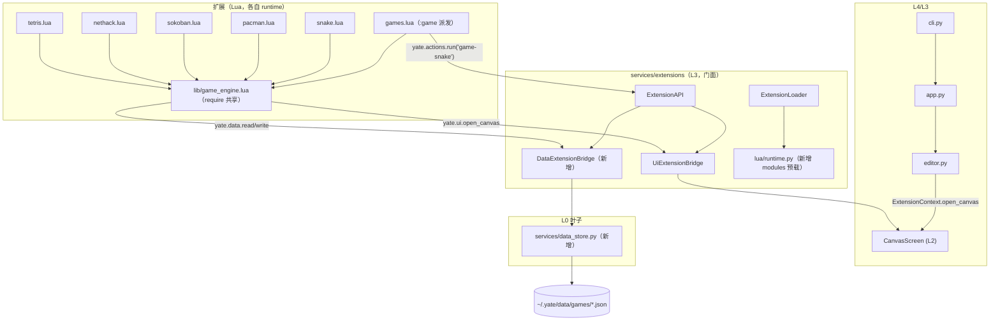
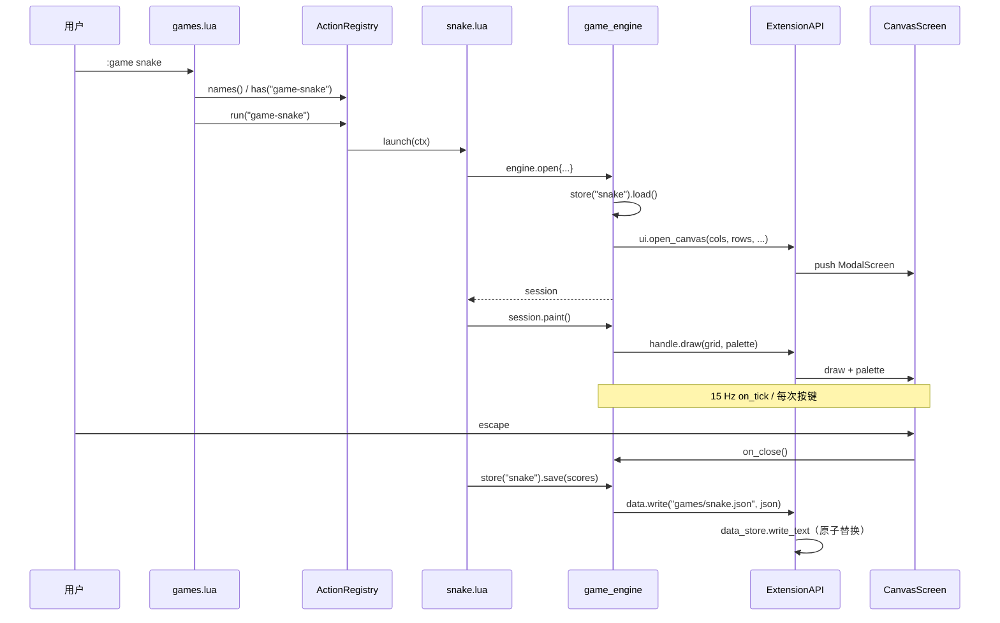

# games-pack：Lua 扩展随身游戏包（贪食蛇 / 吃豆人 / 推箱子 / NetHack / 俄罗斯方块）

- 分支：`feat/games-pack`（worktree `../yate-games`）
- 状态：方案（待批准）；子计划见 [games-pack-plans/overview.md](games-pack-plans/overview.md)
- 关联规则：`task-orchestration.md` §二 闭环、`plan-before-execute.md`、`architecture-boundaries.md` R1-R14、`python-coding-style.md`、`misc-rules.md` §四

## 〇、子计划索引（每份自带独占文件与验收命令）

| 波次 | 子计划 | 主题 |
|---|---|---|
| A | [plans/games-pack-data-api-plan-a.md](games-pack-plans/games-pack-data-api-plan-a.md) | Python 管道：`data_store` + `api.data` + 共享 Lua 模块预载 |
| B | [plans/games-pack-engine-plan-b.md](games-pack-plans/games-pack-engine-plan-b.md) | 公共引擎 `game_engine.lua` + 派发器 `games.lua` + 测试脚手架 |
| C | [plans/games-pack-snake-plan-c.md](games-pack-plans/games-pack-snake-plan-c.md) | 贪食蛇 |
| D | [plans/games-pack-pacman-plan-d.md](games-pack-plans/games-pack-pacman-plan-d.md) | 吃豆人 |
| E | [plans/games-pack-sokoban-plan-e.md](games-pack-plans/games-pack-sokoban-plan-e.md) | 推箱子 |
| F | [plans/games-pack-nethack-plan-f.md](games-pack-plans/games-pack-nethack-plan-f.md) | NetHack（nerd 图标） |
| G | [plans/games-pack-tetris-plan-g.md](games-pack-plans/games-pack-tetris-plan-g.md) | 俄罗斯方块重构 + 最高分 |
| H | [plans/games-pack-lint-plan-h.md](games-pack-plans/games-pack-lint-plan-h.md) | Lua lint 工具 |
| I | [plans/games-pack-docs-plan-i.md](games-pack-plans/games-pack-docs-plan-i.md) | 双语文档 + CHANGELOG 生成 |

下游子计划在**契约**上服从 [overview.md](games-pack-plans/overview.md) §三（`yate.data` 面、
engine 公共面、文案冻结表、存档文件），本文件 §五-§七 与之冲突时以 overview 为准（冲突已登记在 §十二）。

## 一、目标与非目标

### 1.1 目标

1. 一个可随 yate 分发的 **Lua 游戏随身包**：`snake`（贪食蛇）、`pacman`（吃豆人）、
   `sokoban`（推箱子）、`nethack`（地牢，nerd 图标）、`tetris`（既有俄罗斯方块），
   统一通过 `:game <英文游戏名>` 启动。
2. 抽出公共部分为 **`game_engine.lua`**：JSON 编解码、canvas 生命周期、绘制网格/边框、
   方向键解析、确定性随机、最高分榜、角色名、游戏注册与派发。
3. **持久化**：每个游戏一个 JSON 文件，落在 `~/.yate/data/games/` 下；推箱子记录关数、
   NetHack 记录深度/HP/楼层并可继续玩；其余记录最高分及其创造者、局数等。
4. 既有 `tetris.lua` 重构到引擎上，行为与布局保持（仅命令注册与最高分是新增语义）。
5. Lua 代码 **通过 lint**：新增 `tools/lint_lua.py`（语法 + 格式 + 禁项 + 全局泄漏 + require 白名单），
   并入收尾门禁。
6. 双语详细文档：游戏手册 `games.en.md` / `games.zh.md`；扩展手册补「共享 Lua 模块」与 `api.data`。

### 1.2 非目标

- 不做 `:game` 之外的 UI（不加侧边栏、不做按键向导、不改 statusbar）。
- 不实现联机 / 存档云同步 / 跨设备同步。
- 不引入 Lua 第三方库（无 luarocks、无 JSON 库），不引入新的 Python 依赖。
- 不改 canvas 的渲染契约（`cols`/`rows`/palette/`"*"` 字形语义保持原样）。
- 不做 NetHack 的完整规则（无职业/法术/背包负重），只做「地牢推进 + 战斗 + 物品 + 楼层存档」。

## 二、调研事实（动笔依据，逐条带证据）

| # | 事实 | 证据 |
|---|---|---|
| 1 | bundled 扩展**逐文件**装载，只扫描顶层 `*.py` / `*.lua`，下划线开头跳过，子目录不扫描 | `yate/services/extensions/loader.py:90-94` |
| 2 | 每个 `.lua` 扩展拿到**独立 Lua runtime**（互不可见），`yate` 库经 `package.preload` 发布 | `loader.py:184-189`、`yate/services/extensions/lua/runtime.py:85-97` |
| 3 | 共享代码的唯一现成通道是 `package.preload`（`_compile_chunk` 已在 Python 侧编译后注入） | `runtime.py:52-69`、`runtime.py:94-96` |
| 4 | Lua API 库与声明文件必须逐函数同步，并有机械守卫 | `yate/extensions/_yate.lua`、`_yate.d.lua`、`tests/test_lua_defs.py:33-88` |
| 5 | canvas：固定 15 Hz `on_tick`、`escape` 由屏幕自身消费、`draw(grid, palette)`、`"*"` 条目为「为所有有色格子画的字形」 | `yate/editor_view/canvas_screen.py:36`、`:117-137`、`:152-165`、`:167-185` |
| 6 | 现有扩展 API **没有任何文件读写能力**；`yate.shell` 是唯一进程通道 | `yate/services/extensions/api.py:520-535`、`_yate.lua:139-146` |
| 7 | `~/.yate/data` 目前只被日志/crash 使用，常量与目录创建在 `logs.py` | `yate/logs.py:79-80`、`:189-197` |
| 8 | bundled 目录整体以 PyInstaller `Tree` 打包，新增子目录自动随包 | `pack/_common.py:179-183` |
| 9 | `.luarc.json` 把 `yate/extensions` 设为 workspace library（新增 `lib/` 自动获得补全） | `.luarc.json:4` |
| 10 | tetris 现有布局/文案被测试逐字断言，重构必须同步改测试 | `tests/test_lua_tetris.py:239-262` |
| 11 | 扩展手册已有 canvas 小节、bundled 清单与函数表，需同步扩写 | `yate/docs/extensions.en.md:49-55`、`:608-650`、`:919-927` |
| 12 | `api.actions.run/names/has` 已能把「按名派发」跨扩展共享 | `yate/services/extensions/bridges.py:431-458` |

## 三、备选方案与否决理由

| 方案 | 否决理由 |
|---|---|
| A. 全部塞进单个 `games.lua` | 违反用户「抽出公共部分做成 game_engine.lua」；单文件预计 4000+ 行，无法按游戏并行开发，也无法单测 |
| B. `package.path` + Lua 侧 `io.open` 读共享模块 | Lua 侧文件 IO 在 PyInstaller onefile 下路径不可靠；把 IO 通道开给脚本等于绕开受控 API；`io` 本就该禁 |
| C. `yate.shell` 拼命令写存档（`echo > ~/.yate/...`） | 平台相关、转义地狱、无原子性、无法单测；且是「用 shell 绕开 API」的反模式 |
| D. 游戏逻辑放 Python（新增 Python 游戏模块 + canvas 后端） | 用户明确要求「用 Lua 扩展」；Python 侧实现会把游戏状态塞进 L3/L2，破坏 R13 组件自持 |
| **E（采纳）** | Python 侧只加两条**窄管道**（共享 Lua 模块预载 + `~/.yate/data` 文本读写），游戏与引擎全在 Lua |

用户可见的既有语义（`:game tetris`、canvas 15 Hz、`escape` 退出）在 E 下零变化。

## 四、最终架构

### 4.1 模块与数据流



### 4.2 一次「启动 + 存档」时序



## 五、数据契约（`~/.yate/data/games/`）

| 文件 | 内容 | 继续玩 |
|---|---|---|
| `profile.json` | `{"version":1,"player":"alice"}` | — |
| `snake.json` | `{"version":1,"player":"alice","high_scores":[{"score":28,"player":"alice","at":"2026-10-20T21:30:00"}],"stats":{"games":3,"best_length":12}}` | 否（只记最高分） |
| `pacman.json` | 同 snake（`stats.games`、`stats.levels`） | 否 |
| `tetris.json` | 同 snake（`stats.games`、`stats.lines`） | 否 |
| `sokoban.json` | `{"version":1,"level":3,"completed":[1,2],"moves":120,"pushes":30}` | **是**（恢复到 `level`，关卡内从头） |
| `nethack.json` | `{"version":1,"save":{"depth":5,"turn":210,"seed":123456,"hp":8,"max_hp":12,"gold":30,"floor":["####","#@.."]}}` | **是**（存在 save 即恢复；死亡清空） |

规则：

1. 全部 JSON 带 `"version":1`；读到坏 JSON / 未知版本时**静默回默认值**并 `yate.message` 一次提示，
   绝不把异常抛进 canvas 回调。
2. `high_scores` 按 `score` 降序、同分先到先留，**保留前 5**；`at` 为本地时间
   `os.date("%Y-%m-%dT%H:%M:%S")`。
3. 玩家名缺省取 `os.getenv("USERNAME")` → `os.getenv("USER")` → `"player"`；
   `:game player <name>` 写入 `profile.json`。
4. 路径安全全部收敛在 `yate/services/data_store.py`：只接受干净相对路径
   （拒绝绝对路径 / 盘符 / `..` / 空串，`ValueError`），写入走「同目录临时文件 + `Path.replace`」。

## 六、Lua 契约

### 6.1 新增 `yate.data`（Python 桥 + Lua 包装）

| Lua | Python | 语义 |
|---|---|---|
| `yate.data.read(name)` | `api.data.read(name)` | 返回文本；文件不存在返回 `nil` |
| `yate.data.write(name, text)` | `api.data.write(name, text)` | 原子写入，返回 `true` |
| `yate.data.remove(name)` | `api.data.remove(name)` | 删除，返回是否删掉了 |
| `yate.data.list(prefix)` | `api.data.list(prefix)` | 列某个子目录下的相对名（升序，Python list / 0-based） |

### 6.2 `game_engine.lua` 公共面（`require("game_engine")`）

```lua
engine.json.encode(value) -> string           -- 数组(空表按 []) / 对象 / 转义 / 数值布尔 null
engine.json.decode(text) -> value             -- 失败返回 nil, err
engine.store(name) -> {load(), save(t), clear()}
engine.store(name):load() -> table|nil        -- 内部固定前缀 "games/"
engine.scores(name) -> {entries(), best(), add(score) -> rank}
engine.player() -> string
engine.set_player(name) -> string
engine.register(name, launch)                 -- 注册 action "game-<name>"
engine.available() -> string                  -- 排序后的可用游戏名，空格分隔
engine.dispatch(args)                         -- :game 的完整语义（含文案冻结表）
engine.open(spec) -> session|nil              -- 单实例守卫；spec={name,cols,rows,draw,on_key,on_tick,on_close}
session.paint() / session.status(text) / session.close() / session.name
engine.box_top(title, inner) / box_bottom(inner) / center(text, width) / pad(text, width)
engine.frame(title, inner, lines) -> lines    -- 给 lines 套带标题边框
engine.panel(title, width, lines) -> lines    -- 侧栏面板
engine.direction(key) -> dx, dy|nil           -- 方向键 / hjkl / wasd
engine.rng(seed) -> {int(n), pick(t), state(), set(n)}
engine.utf8_char(code) -> string|nil          -- 字形原语；nerd/ascii 字形表归 nethack 自己
```

### 6.3 扩展模块表契约（每个游戏）

- 入口形式：模块表（`return mod`），`mod.setup(api)` 内 `engine.register("<name>", start)`，
  `mod.teardown(api)` 关闭遗留 canvas。
- 测试缝：`mod.snapshot()` 返回**纯标量表**（score / level / lives / pos / depth / hp ...）；
  `mod.set_seed(n)`（nethack/pacman/snake）固定随机；`mod.set_moves(...)`（pacman 幽灵计划，可选）。
- 状态栏：`session.status("<游戏状态>  escape quits")`。

### 6.4 文案冻结表（测试逐字断言）

| 场景 | 文本 |
|---|---|
| `:game` 无参数 / 空白 | `usage: :game <name> (games: nethack pacman snake sokoban tetris)` |
| 未知游戏 | `unknown game: chess (available: nethack pacman snake sokoban tetris)` |
| 已在运行 | `<name> is already running` |
| 玩家名查询 | `player: alice` |
| 玩家名设置 | `player: bob` |
| 状态栏后缀 | `  escape quits` |

## 七、五款游戏规格（验收条款）

| 游戏 | 画布 | 键位 | 计分 | 持久化 |
|---|---|---|---|---|
| snake | 42 x 22（30x18 棋盘，每格 2 字符，`"*"`→`█`） | 方向键/hjkl/wasd 转向（禁 180°）、`p` 暂停、`r` 重开 | 食物 +10；`max(3, 10 - score//50)` tick 走一步 | 最高分 + 创造者 + 局数 + 最长长度 |
| pacman | 21 x 24（19x21 迷宫 + 边框 + HUD） | 方向键/hjkl/wasd、`p` 暂停、`r` 重开 | 豆 10 / 能量豆 50 / 幽灵 200·2^n / 通关奖励 | 最高分 + 创造者 + 局数 + 通关数 |
| sokoban | 21 x 15（8 个内置经典关卡，1 字符/格） | 移动/推箱、`u` 撤销（≤200）、`r` 重开本关、`n` 下一关（过关后） | 步数/推动数，无分数 | **当前关 + 已完成关 + 累计步数/推动数** |
| nethack | 52 x 22（50x18 地图 + HUD 2 行 + 提示行） | 方向键/hjkl/wasd 移动/攻击、`g` 拾取、`enter` 楼梯、`space` 等待、`r` 死亡后重开 | HP / 深度 / 金币 | **深度 + HP + 楼层 + 回合（可继续玩）** |
| tetris | 59 x 22（既有布局不变） | 保持既有（L/R/D、↑/x、space、enter、p、r） | NES 表 100/300/500/800 × level | 最高分 + 创造者 + 局数 + 消行数 |

细节补充（子代理实现依据）：

- **snake**：蛇头 `@`、身体 `#`、食物 `*`，调色板 `["#"]="#4caf50"`、`["@"]="#c8e6c9"`、
  `["*"]="#e53935"`、`["*"]` 字形条目另给 `"*"` 键冲突不去用（改为 `food` 字符 `o`? 否：
  使用 `["*"]="█"` 时所有有色格子都画 `█`，故蛇身/头/食物**只用颜色区分**，字符本身取 `#` / `@` / `*`
  并在调色板里各自给色，`"*"` 只作为字形键出现一次（`["*"]="█"` 与食物字符冲突）→
  **实现定案**：不用 `"*"` 字形键；每格 2 列直接写两个相同字符（`"##"`/`"@@"`/`"▓▓"`），
  调色板按字符给色，`palette` 里 `"*"` 只用作食物字符 → **冲突，改食物字符为 `"o"`**。
  最终：身体 `#`、头 `@`、食物 `o`；`palette = {["#"]="#4caf50", ["@"]="#c8e6c9", ["o"]="#e53935"}`。
  网格每格输出 2 个字符，因此行宽 = 30*2 = 60；画布 62 列（含边框）。
- **pacman**：迷宫常量表给出 `#` 墙（`#1e3a8a`）、`.` 豆（`#f5f5dc`）、`o` 能量豆（`#f5f5dc`）、
  `-` 鬼门（`#f5f5dc`）；玩家 `C`（`#ffd54f`）、幽灵 `G`（`#e53935` / `#f06292` / `#4dd0e1` /
  `#ffb74d`），惊恐态幽灵 `g`（`#64b5f6`）。幽灵移动：BFS 取最短路径的下一步，方向并列时
  固定顺序 `up,left,down,right`（确定性）；惊恐 60 tick 内改为「远离玩家」的贪心步。
  被吃 → 眼 `"` 回鬼屋 20 tick 后复活。3 条命；吃完所有豆 → 过关（迷宫重置、速度 +1）。
- **sokoban**：8 关 ASCII 常量（每关给出 `name` 与行数组）；渲染把 5 种字符映射到字形 +
  颜色：`#`→`█`(蓝) / `$`→`▣`(棕) / `.`→`·`(灰) / `@`→`@`(黄) / `*`→`▩`(绿) / `+`→`@`(绿)；
  1 字符/格。撤销栈存 `{px,py,pushed}`（≤200 步）。过关 → `completed` 追加、自动进下一关；
  8 关全清 → 画布提示 `all levels cleared  r restarts` 后 `r` 重置到第 1 关。
- **nethack**：字形表归 nethack 自己（`nerd` / `ascii` 二元组，引擎只提供 `engine.utf8_char`）；
  只用 Nerd Fonts 的 Font Awesome 4 段码位（玩家 `0xf007`、墙 `0xf0c8`、地板 `0xf111` 等，
  见 [F 波子计划 §三](games-pack-plans/games-pack-nethack-plan-f.md)）。默认 `nerd`，
  游戏内 `v` 切换并写回存档（主计划原写「`:game nethack ascii`」，已改为 `v`：派发器只吃一个词）。
  地图 50x18，房间 4-6 个 + 走廊，`>` 楼梯在最后一个房间；怪物数量 `2 + depth`；
  物品 `$`(金) `!`(药水，+HP) `)`(武器，+1 攻击) `%`(食物，+2 HP)。每步一回合：玩家动 → 怪物动；
  撞怪攻击（`1-4 + 武器`），怪物反击 `1-3`；HP 0 → 墓碑画面，`r` 重开（清存档）。
  `enter` 在楼梯上下层：`depth+1`、新楼层、`max_hp+2`、回满 HP 的一半。
  **存档只存语义字符**（ASCII 语义集），字形是纯渲染层，`v` 切换不影响存档。
- **tetris**：既有玩法不变；`snapshot()` 暴露 `score/lines/level/over`；
  最高分与创造者在 game over 时写入。

## 八、分波实施计划

> 命令统一在 worktree 根执行，解释器 `.venv\Scripts\python.exe`；所有新增/修改的 `.py` / `.lua`
> 注释与 docstring 一律英文（`misc-rules.md` §四）。

### A 波：Python 管道（主代理亲自执行）

- 独占文件：`yate/services/data_store.py`（新）、`yate/services/extensions/lua/library.py`、
  `yate/services/extensions/lua/runtime.py`、`yate/services/extensions/loader.py`、
  `yate/services/extensions/bridges.py`、`yate/services/extensions/api.py`、
  `yate/extensions/_yate.lua`、`yate/extensions/_yate.d.lua`、
  `tests/test_data_store.py`（新）、`tests/test_lua_defs.py`、`tests/test_extension_bridges.py`
- 输入：第五节数据契约 + 6.1 API 表；输出：`api.data.*` 可用、`require("game_engine")` 可解析（模块为空缺省）。
- 验收：
  ```powershell
  .venv\Scripts\python.exe -m pyright yate/ tests/ tools/
  .venv\Scripts\python.exe -m pytest tests/test_data_store.py tests/test_lua_defs.py tests/test_extension_bridges.py -q
  ```

### B 波：引擎 + 派发器（主代理亲自执行，依赖 A）

- 独占文件：`yate/extensions/lib/game_engine.lua`（新）、`yate/extensions/games.lua`（新）、
  `tests/test_lua_engine.py`（新）、`tests/lua_game_harness.py`（新，录制型 fake api +
  内存版 data bridge，供 C/D/E/F/G 波复用）
- 输出：6.2 全部函数可用；dispatch 文案与冻结表一致；`engine.open` 单实例守卫。
- 验收：
  ```powershell
  .venv\Scripts\python.exe -m pytest tests/test_lua_engine.py -q
  .venv\Scripts\python.exe tools/lint_lua.py yate/extensions/lib yate/extensions/games.lua
  ```
  （lint 工具在 D 波落地；B 波先用 `pytest`，D 波完成后回补 lint 验证。）

### C 波：四款游戏（子代理并行，依赖 B；每批 2 个成员）

| 成员 | 独占文件 | 验收命令 |
|---|---|---|
| C1 | `yate/extensions/snake.lua`、`tests/test_lua_game_snake.py` | `pytest tests/test_lua_game_snake.py -q` |
| C2 | `yate/extensions/pacman.lua`、`tests/test_lua_game_pacman.py` | `pytest tests/test_lua_game_pacman.py -q` |
| C3 | `yate/extensions/sokoban.lua`、`tests/test_lua_game_sokoban.py` | `pytest tests/test_lua_game_sokoban.py -q` |
| C4 | `yate/extensions/nethack.lua`、`tests/test_lua_game_nethack.py` | `pytest tests/test_lua_game_nethack.py -q` |

每份任务书必须给：第七章对应规格 + 6.2/6.3 契约 + 冻结文案 + 复用 `tests/test_lua_games_support.py`
的 fake api，且**只改自己名下两个文件**。

### D 波：Lua lint（可与 C 并行）

- 独占文件：`tools/lint_lua.py`（新）、`tests/test_lua_lint.py`（新）
- 检查项：lupa 语法编译、Tab/行尾空白/行长 ≤100/结尾换行/无 CRLF、
  禁 `print(` `io.` `os.execute` `os.exit` `dofile` `loadfile`、
  顶层裸全局赋值白名单（`yate` `api` `mod` `setup` `teardown`）、
  `require("x")` 只允许 `yate` 与 `lib/*.lua` 的 stem。
- 验收：
  ```powershell
  .venv\Scripts\python.exe tools/lint_lua.py
  .venv\Scripts\python.exe -m pytest tests/test_lua_lint.py -q
  ```

### E 波：tetris 重构 + 文档（依赖 B/C 文案定稿）

- 独占文件：`yate/extensions/tetris.lua`、`tests/test_lua_tetris.py`、
  `yate/docs/extensions.en.md`、`yate/docs/extensions.zh.md`、
  `yate/docs/games.en.md`（新）、`yate/docs/games.zh.md`（新）、
  `CHANGELOG.md`、`CHANGELOG.zh.md`
- 输出：tetris 走引擎且行为不变（既有断言除文案外全绿）+ 最高分持久化；
  双语手册覆盖玩法/键位/存档结构/lint/引擎模块契约。
- 验收：
  ```powershell
  .venv\Scripts\python.exe -m pytest tests/test_lua_tetris.py tests/test_lua_engine.py -q
  .venv\Scripts\python.exe tools/lint_lua.py
  ```

### F 波：收尾门禁（主代理亲自跑）

```powershell
.venv\Scripts\python.exe -m pyright yate/ tests/ tools/
.venv\Scripts\python.exe -m pytest tests/ -q
.venv\Scripts\python.exe -m pytest tests/ -q --cov=yate --cov-report=term-missing --cov-fail-under=75
.venv\Scripts\python.exe tools/lint_lua.py
.venv\Scripts\python.exe -m yate --diag
```

## 九、测试矩阵（规格 → 证据）

| 规格 | 测试 |
|---|---|
| `api.data` 路径安全 / 原子写 / 缺文件 | `tests/test_data_store.py` |
| Lua 面与 Python 面同步、`data.*` 入册 | `tests/test_lua_defs.py` |
| `api.data` 桥转发 | `tests/test_extension_bridges.py` |
| JSON 往返、store 坏文件兜底、scores 前 5、dispatch 文案、单实例守卫 | `tests/test_lua_engine.py` |
| 共享模块 `require("game_engine")` 预载 | `tests/test_lua_engine.py`（真实 runtime）+ `tests/test_extension_bridges.py`（loader 侧） |
| snapke 转向/吃食/自撞/最高分 | `tests/test_lua_game_snake.py` |
| pacman 吃豆/能量豆吃鬼/撞鬼掉命/过关 | `tests/test_lua_game_pacman.py` |
| sokoban 推箱/撤销/过关推进/关卡续玩 | `tests/test_lua_game_sokoban.py` |
| nethack 移动攻击/拾取/下楼/死亡清档/读档续玩 | `tests/test_lua_game_nethack.py` |
| tetris 行为不回归 + 最高分 | `tests/test_lua_tetris.py` |
| Lua 代码通过 lint（实文件 0 issue + 违规样本必报） | `tests/test_lua_lint.py` |

## 十、风险与回滚

| 风险 | 影响 | 缓解 |
|---|---|---|
| nerd font 未安装 → 私用区显示 tofu | NetHack 不可读 | `ascii` 回退 + 文档明示；字形表集中一处 |
| 私用区字形在部分终端算双宽 → 网格错位 | 画面错行 | 只用「单宽私用区」码位；`ascii` 回退兜底 |
| 每回合写 nethack 存档 | 单帧 IO | 文件 < 4 KB、原子写；`store.save` 失败静默计数并降级为「退出时保存」 |
| 子代理产出不达规格 | 返工 | B 波先交付 fake api 与断言前缀；主代理逐条复核并重跑其测试 |
| `pyright strict` 对新 Python 模块报错 | 门禁红 | 新代码按 §三/§四 规范写全注解，`Any` 仅限 lupa 边界并带理由 |
| 新增 `yate/extensions/lib/` 被误当扩展装载 | 启动报错 | 只 glob 顶层（事实 1）；`tests/test_lua_engine.py` 断言 lib 不产生 LoadedExtension |

回滚：全量改动集中在 3 个 Python 文件 + 2 个 API 包装 + 1 个新 L0 模块 + 7 个 Lua 文件 + 文档；
`git revert` 单笔提交即可回到「只有 tetris」的状态（`tetris.lua` 重构与引擎同批提交）。

## 十一、架构合规性

| 条款 | 结论 |
|---|---|
| R1 / R5 / R6 / R7 | 不涉及；无新 Protocol、无 `TYPE_CHECKING` |
| R3 / R4 / R13 | `data_store.py` 归 L0（`services/*`），不 import `editor_view`；canvas 渲染契约不变，主题仍归组件 |
| R11 | 不新增 `flows` 模块，不触 `UI_FROZEN_FILES` |
| R14 | 只在门面暴露 `DataExtensionBridge`（14 名冻结清单**不扩**：`ExtensionAPI.data` 是属性，不进门面 `__all__`；方案执行时以 `tests/test_architecture.py` 实际断言为准） |
| §三.5 包根惰性 | `services/` 不 re-export；`data_store` 为独立模块，按绝对路径导入 |
| §三.7 文件体量 800 行 | `data_store.py` < 200 行、`bridges.py` 现 631 行 + ~60 行仍 < 800；`game_engine.lua` 目标 < 700 行（`tests/test_architecture.py` 只扫 `.py`，Lua 不受阈值守卫，但按同口径自律） |
| §六 35 守卫用例 | 预计全绿；`test_extension_machinery_hides_behind_facade` 只禁直引子模块，`api.data` 走门面 |
| misc §四 | 所有代码内注释与 docstring 英文；文档正文中文 |

## 十二、待裁决 / 偏离登记

1. tetris 现有 `:game` 文案（`usage: :game tetris` 等）会变为包级文案，`tests/test_lua_tetris.py`
   的 3 条断言随之更新（`tests/test_lua_tetris.py:239-262`）——属规格变更，不是回归。
2. `tests/test_lua_defs.py` 的 `LUA_SURFACE` / `PYTHON_SURFACE` 是冻结集合，本任务按计划扩入
   `data.read/write/remove/list` 与 `data`（单一事实来源仍是 `_yate.lua`）。
3. `tests/test_architecture.py` 的 `PRINT_EXEMPT_SITES` 不含 `tools/`（`tools/` 不在 print 扫描面），
   `tools/lint_lua.py` 的 CLI 输出不受影响。
4. 玩家名来自 OS 用户名；如需固定名，用 `:game player <name>`。
5. **推箱子关数 8 → 6**（原计划 §七）：只收录可确认可解的 5 个公开 Microban 关卡 + 1 个教学关；
   `LEVELS` 长度即关数（见 [E 波子计划 §三](games-pack-plans/games-pack-sokoban-plan-e.md)）。
6. **NetHack 字形切换键 `v`**（原计划写 `:game nethack ascii`）：派发器只解析一个游戏词，
   游戏内切字形更符合「不扩命令语法」的约束（见 [F 波子计划 §五](games-pack-plans/games-pack-nethack-plan-f.md)）。
7. **引擎字形面收敛为 `engine.utf8_char(code)`**：字形语义归 nethack 自己，
   引擎不携带游戏词汇（原 §6.2 的 `engine.glyphs(kind)` 作废）。
8. **CHANGELOG 由工具生成**（`python -m tools.changelog generate`），不手改
   （文件头已声明 `do not edit by hand`，见 [I 波子计划 §五](games-pack-plans/games-pack-docs-plan-i.md)）。
9. 子计划把测试脚手架从 `tests/test_lua_games_support.py` 更名为 `tests/lua_game_harness.py`
   （避免 `test_` 前缀被 pytest 当用例文件收集）。

## 十三、实施结果与复盘（2026-10-20 收尾回填）

### 13.1 状态

A-I 九波全部完成：主代理完成 A/B/G/H/I 与全部复核，执行子代理完成 C/D/E/F
（`plan-executor`，`bypassPermissions`，各自只改名下两个文件）。分支 `feat/games-pack`
共 11 笔提交（方案与规则、A、B、C、D、E、F+G、H、I+changelog、复核修复、残留清理）。

### 13.2 门禁实测（worktree `../yate-games`，退出码全 0）

| 命令 | 结果 |
|---|---|
| `.venv\Scripts\python.exe -m pyright yate/ tests/ tools/` | `0 errors, 0 warnings, 0 informations` |
| `.venv\Scripts\python.exe -m pytest tests/` | `2757 passed, 9 skipped in 230.73s` |
| `pytest tests/test_architecture.py` | `36 passed` |
| `pytest tests/ --cov=yate --cov-branch` | `TOTAL 91.98%`，`Required test coverage of 75% reached` |
| `python tools/lint_lua.py` | `0 issue(s)` |
| `python -m yate --diag` | 正常输出诊断头（无扩展装载错误） |
| `python -m tools.changelog generate` | 写回 4 个生成物（CHANGELOG 双语 + 内置资源副本） |

新增/改写文件体量（行，`splitlines()` 口径）：`data_store.py` 117、`lint_lua.py` 274、
`lib/game_engine.lua` 488、`lib/engine_json.lua` 347、`lib/engine_layout.lua` 139、
`games.lua` 34、`snake.lua` 464、`pacman.lua` 766、`sokoban.lua` 611、`nethack.lua` 786、
`tetris.lua` 633、`games.en.md` 370、`games.zh.md` 347、`tests/lua_game_harness.py` 313。
Lua 侧按 §三.7 的 800 行自律线自查：全部在阈值内（nethack 786 最接近）。

### 13.3 评审结论处置（`code-review-expert`）

| # | 级别 | 结论 | 处置 |
|---|---|---|---|
| 1 | major | sokoban `solved` 单向置位：把箱子推离目标或撤销通关步仍算通关，`n` 可跳过 | **改**：新增 `sync_solved()`（move/undo 共用，双向同步 `solved` + `completed` + 存档）；补 3 条测试 |
| 2 | major | snake HUD `best` 只在开局刷新，本局破纪录仍显示旧值 | **改**：吃食分支实时刷新 `state.best`；补断言 |
| 3 | major | nethack `apply_save` 不校验落点/实体是否可行走 | **改**：玩家格必须可行走、怪物去越界/墙面/重位、物品去墙面；补测试 |
| 4 | major | `lib/game_engine.lua` 926 行超过 800 行自律线，且 Lua 不在体量守卫扫描面 | **改**：拆为 `game_engine`（488）+ `engine_json`（347）+ `engine_layout`（139），`game_engine` 再导出；守卫扫描面维持 `.py`（Lua 自律） |
| 5 | major | pacman 掉命后幽灵「停在注入格」 | **复核后驳回**：`reset_positions` 已整表重建 `state.ghosts`，`spawn_positions` 从当前迷宫推导；即设计意图，未改代码（证据 `pacman.lua:268-291`） |
| 6 | minor | sokoban 帮助行把 `restart` 缩成 `rst`，与文档不一致 | **改**：改为两行完整键名（`u undo  r restart` / `n next  p pause`），画布 23x16 → 23x17，测试同步 |
| 7 | minor | 缺「通关后撤销」用例；`encode({})` 与 `decode("[]")` 不对称无断言 | **改**：补通关撤销、推离目标、空表编码三条用例；文档写明该不对称 |
| 8 | minor | 测试 fake 写盘恒成功，掩盖「每回合保存失败」路径 | **改**：`FakeData.fail_writes` + nethack 用例（一次提示、回合不中断） |
| 9 | minor | 文档示例诱导读者照抄「不维护 best」的写法 | **改**：中英示例改为 `state.best = math.max(...)`，并加两条要点（空表编码、best 归游戏维护） |

### 13.4 与计划的其它偏离（实施中发现，均有实测依据）

1. **`plan-architect-designer` 子代理零产出**：spawn 报
   `Model "qwen-3.7-plus" not found`（定义文件 frontmatter 的模型未注册，spawn 参数无法覆盖），
   按 `task-orchestration.md` §一.3.5 兜底：**主代理亲自完成【方案】**（主计划 + 10 份子计划）。
2. **计划样本迷宫不可用**：D 波落地时用脚本核对发现原 21x19 迷宫有 2 行宽度 20、1 颗豆不可达，
   按「改迷宫不改测试」修正为 21x19 且 205/205 豆连通。
3. **nethack `load_state` 额外接受 JSON 字符串**：lupa 把嵌套 Python list 传成 POBJECT，
   `#table` 报错；JSON 与存档同构、走同一 `apply_save` 路径，纯 Lua 调用不受影响。
4. **`.gitignore` 增 `!yate/extensions/lib/`**：仓库通用 `lib/`（C 扩展产物）规则会吞掉
   新目录，不放开则共享模块进不了仓库；只对本路径开白，其它 `lib/` 规则不变。
5. **清理子代理残留**：空文件 `100`（重定向产物）与 `old_tetris.lua`（旧 tetris 备份）
   已删除，后者单独一笔 `chore` 提交。
6. **sokoban 画布 23x16 → 23x17**：为放下两行完整帮助键名（21 列内放不下四个完整词）。

### 13.5 遗留（非本任务范围）

- Lua 文件的 800 行阈值目前只有自律、不进 `tests/test_architecture.py` 守卫面；
  若要纳入，需要规则文本与守卫同步扩面（本轮仅登记，未改规则）。
- `python -m tools.changelog check --require-zh` 在本分支仍是红（大量历史条目缺中文译文，
  与本任务无关，未处理）。
