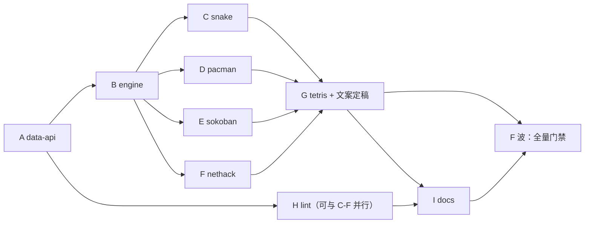

# games-pack 子计划总纲（overview）

主计划：[../games-pack-plan.md](../games-pack-plan.md)。本目录按「公共部分 → 单游戏 → 工具 → 文档」
拆成 9 份子计划，每份自带独占文件清单与可复制执行的验收命令，供主代理与执行子代理分别认领。

## 一、子计划索引与波次

| 波次 | 子计划 | 主题 | 独占文件 | 执行者 |
|---|---|---|---|---|
| A | [games-pack-data-api-plan-a.md](games-pack-data-api-plan-a.md) | Python 管道：`data_store` + `api.data` + 共享 Lua 模块预载 | `yate/services/data_store.py`、`lua/{library,runtime}.py`、`loader.py`、`bridges.py`、`api.py`、`_yate.lua`、`_yate.d.lua`、`tests/test_data_store.py`、`tests/test_lua_defs.py`、`tests/test_extension_bridges.py` | 主代理 |
| B | [games-pack-engine-plan-b.md](games-pack-engine-plan-b.md) | 公共引擎 `game_engine.lua` + 包入口 `games.lua` + 测试脚手架 | `yate/extensions/lib/game_engine.lua`、`yate/extensions/games.lua`、`tests/lua_game_harness.py`、`tests/test_lua_engine.py` | 主代理 |
| C | [games-pack-snake-plan-c.md](games-pack-snake-plan-c.md) | 贪食蛇 | `yate/extensions/snake.lua`、`tests/test_lua_game_snake.py` | 执行子代理 |
| D | [games-pack-pacman-plan-d.md](games-pack-pacman-plan-d.md) | 吃豆人 | `yate/extensions/pacman.lua`、`tests/test_lua_game_pacman.py` | 执行子代理 |
| E | [games-pack-sokoban-plan-e.md](games-pack-sokoban-plan-e.md) | 推箱子 | `yate/extensions/sokoban.lua`、`tests/test_lua_game_sokoban.py` | 执行子代理 |
| F | [games-pack-nethack-plan-f.md](games-pack-nethack-plan-f.md) | NetHack（nerd 图标） | `yate/extensions/nethack.lua`、`tests/test_lua_game_nethack.py` | 执行子代理 |
| G | [games-pack-tetris-plan-g.md](games-pack-tetris-plan-g.md) | 俄罗斯方块重构 + 最高分 | `yate/extensions/tetris.lua`、`tests/test_lua_tetris.py` | 主代理 |
| H | [games-pack-lint-plan-h.md](games-pack-lint-plan-h.md) | Lua lint 工具 | `tools/lint_lua.py`、`tests/test_lua_lint.py` | 主代理（可与 C/D/E/F 并行） |
| I | [games-pack-docs-plan-i.md](games-pack-docs-plan-i.md) | 双语文档 + CHANGELOG | `yate/docs/games.{en,zh}.md`、`yate/docs/extensions.{en,zh}.md`、`CHANGELOG{,.zh}.md` | 主代理 |

## 二、依赖关系与并行度



- **C/D/E/F 之间文件零重叠**，可 2 个一批并行下发（硬上限 6，实践 2~3）；同一批内禁止互相改文件。
- A 必须先于 B：引擎的 `store/scores/player` 依赖 `yate.data.*`。
- G 必须等 C/D/E/F 全部落地：`games.lua` 的可用游戏清单文案（`available: nethack pacman snake sokoban tetris`）
  要求五款游戏都已注册，否则断言会间歇失败。
- H 独立：只依赖文件已存在（先对 A/B 产物跑，C-F 落地后复跑一次）。

## 三、冻结契约（所有子计划共同遵守，改动必须先改本总纲）

### 3.1 `yate.data`（A 波产出）

```lua
yate.data.read(name)          -- string | nil
yate.data.write(name, text)   -- boolean
yate.data.remove(name)        -- boolean
yate.data.list(prefix)        -- python list（0-based）
```

### 3.2 `game_engine`（B 波产出，游戏只准用这些成员）

```lua
engine.json.encode(v) / engine.json.decode(text) -> v, err
engine.store(name) -> { load(), save(v)->boolean, clear()->boolean }
engine.scores(name) -> { entries(), best(), add(score)->rank|nil }
engine.player() / engine.set_player(name)
engine.register(name, launch) / engine.available() / engine.dispatch(args)
engine.open(spec) -> session | nil
session.paint() / session.status(text) / session.close() / session.name
engine.box_top(title, inner) / engine.box_bottom(inner)
engine.center(text, width) / engine.pad(text, width)
engine.frame(title, inner, lines) / engine.panel(title, width, lines)
engine.direction(key) -> dx, dy | nil
engine.rng(seed) -> { int(n), pick(t), state(), set(n) }
engine.utf8_char(code) -> string | nil
engine.trim(s) / engine.rep(s, n) / engine.now()
```

> 偏离登记（相对主计划 §6.2）：主计划曾写 `engine.glyphs(kind)`；实测应由 **nethack 自带字形表**
> （nerd/ascii 二元组）拥有语义，引擎只提供 `engine.utf8_char(code)` 原语，避免引擎知道游戏词汇。
> 主计划 §6.2 随本总纲同步更正。

### 3.3 文案冻结（测试逐字断言）

| 场景 | 文本 |
|---|---|
| `:game` 无参数 | `usage: :game <name> (games: nethack pacman snake sokoban tetris)` |
| 未知游戏 | `unknown game: chess (available: nethack pacman snake sokoban tetris)` |
| 已在运行 | `<name> is already running` |
| 玩家名 | `player: alice` |
| 状态栏 | 由 `session.status` 统一追加 `  escape quits` |

### 3.4 存档文件

`~/.yate/data/games/{profile,snake,pacman,tetris,sokoban,nethack}.json`，全部带 `"version":1`；
字段见各子计划。坏 JSON 必须静默回默认值（不抛异常）。

### 3.5 视觉规范（2026-10-20 追加：全 Unicode / nerd 图标，界面现代美观）

> 用户要求：**所有游戏界面统一使用 Unicode 图形字符（框线、块元素、几何符号、nerd 图标），
> 不得用简单 ASCII 充当视觉元素**；参照既有俄罗斯方块（框线 + 实心方块）的观感，
> 并在其上做现代化升级。ASCII 只允许作为「存档语义字符」与「字形回退」存在，
> 不作为屏幕呈现。

**共享字形词表**（`engine.glyph`，引擎导出，所有游戏只准从这里取字形）：

| 键 | 字形 | 用途 |
|---|---|---|
| `tl` / `tr` / `bl` / `br` | `╭` `╮` `╰` `╯` | 圆角边框（取代 `┌┐└┘`） |
| `h` / `v` | `─` `│` | 横向 / 纵向框线 |
| `block` | `█` | 实心块（墙、蛇身、方块） |
| `shade` / `light` | `▓` `░` | 半透明块（阴影、渐变、目标格底纹） |
| `box` / `box_on_goal` | `▣` `▩` | 箱子 / 已就位箱子 |
| `goal` | `◎` | 目标点 |
| `dot` / `big_dot` | `·` `●` | 豆子 / 能量豆、小标记 |
| `player` | `☻` | 角色（推箱子；NetHack 用 nerd 图标） |
| `star` / `heart` / `coin` | `★` `♥` `◉` | 最高分 / 生命 / 金币与能量 |
| `tri` / `diamond` / `ring` | `▲` `◆` `◌` | 幽灵 / 惊恐幽灵 / 被吃后的眼 |
| `arrow_up/down` | `▲` `▼` | 楼梯方向提示 |

**统一版式**（五款游戏一致，`engine` 提供助手）：

1. 外框：`╭─ <title> ─...─╮` / `╰─...─╯`，标题后留一个空格再补 `─`；
2. 标题行右侧可放一个图标（snake `★`、pacman `●`、sokoban `▣`、nethack `☻`、tetris `▩`），
   图标与标题之间用 ` · ` 分隔；
3. HUD 行：`项目 值` 用 **3 空格**分隔，关键值左对齐；最高分前加 `★`，生命用 `♥♥♥`；
4. 状态栏文本统一 `"<state>  escape quits"`；
5. 所有框线、块、几何符号均为**单宽**字符，禁止 emoji（宽度不可控）；
6. 多字节字形**不得参与字节切片**：行一律 `table.concat(cells)` 拼接。

**与既有 tetris 的关系**：tetris 的边框由 `┌─` 升级为 `╭─`（同一 `engine.box_top`），
其余视觉（双宽实心方块、右侧 next/help 箱）保持不变；`tests/test_lua_tetris.py` 的
边框断言随之更新（`┌─ stats` → `╭─ stats`），属规格变更。

各游戏的字形落地以本节词表为准；子计划里旧写的 `#` / `.` / `@` 等 ASCII 视觉只在
「存档语义字符」「ascii 字形回退」两种场合继续使用。

## 四、文件独占矩阵

| 文件 | 认领波次 |
|---|---|
| `yate/services/data_store.py` | A |
| `yate/services/extensions/lua/library.py` / `lua/runtime.py` / `loader.py` | A |
| `yate/services/extensions/bridges.py` / `api.py` | A |
| `yate/extensions/_yate.lua` / `_yate.d.lua` | A |
| `yate/extensions/lib/game_engine.lua` / `yate/extensions/games.lua` | B |
| `yate/extensions/snake.lua` / `pacman.lua` / `sokoban.lua` / `nethack.lua` / `tetris.lua` | C / D / E / F / G |
| `tools/lint_lua.py` | H |
| `tests/test_data_store.py`、`tests/test_lua_defs.py`、`tests/test_extension_bridges.py` | A |
| `tests/lua_game_harness.py`、`tests/test_lua_engine.py` | B |
| `tests/test_lua_game_snake.py` / `_pacman.py` / `_sokoban.py` / `_nethack.py` | C / D / E / F |
| `tests/test_lua_tetris.py` | G |
| `tests/test_lua_lint.py` | H |
| `yate/docs/*.md`、`CHANGELOG*.md` | I |

## 五、门禁（F 波，主代理亲自跑）

```powershell
.venv\Scripts\python.exe -m pyright yate/ tests/ tools/
.venv\Scripts\python.exe -m pytest tests/ -q
.venv\Scripts\python.exe -m pytest tests/ --cov=yate --cov-branch --cov-report=term-missing
.venv\Scripts\python.exe tools/lint_lua.py
```

通过判据：pyright 零诊断、pytest 全绿、覆盖率 ≥ `[tool.coverage.report] fail_under`（75）、
lint 退出码 0。

## 六、完成定义（DoD）

1. 五款游戏都能 `:game <name>` 启动、`escape` 退出、`r` 重开；
2. 推箱子/NetHack 关掉编辑器重新打开能继续，其余最高分可跨会话保留；
3. `~/.yate/data/games/` 下每游戏一个合法 JSON；
4. 每个游戏有独立测试文件且全绿；`game_engine.lua` 有独立单测；
5. `tools/lint_lua.py` 对全仓 Lua 0 issue，并被 `tests/test_lua_lint.py` 固化为门禁；
6. 双语文档成对落地（`games.en.md` / `games.zh.md`），扩展手册补 `api.data` 与共享模块；
7. 全量门禁退出码 0，方案文档回填真实数字与偏离记录。
