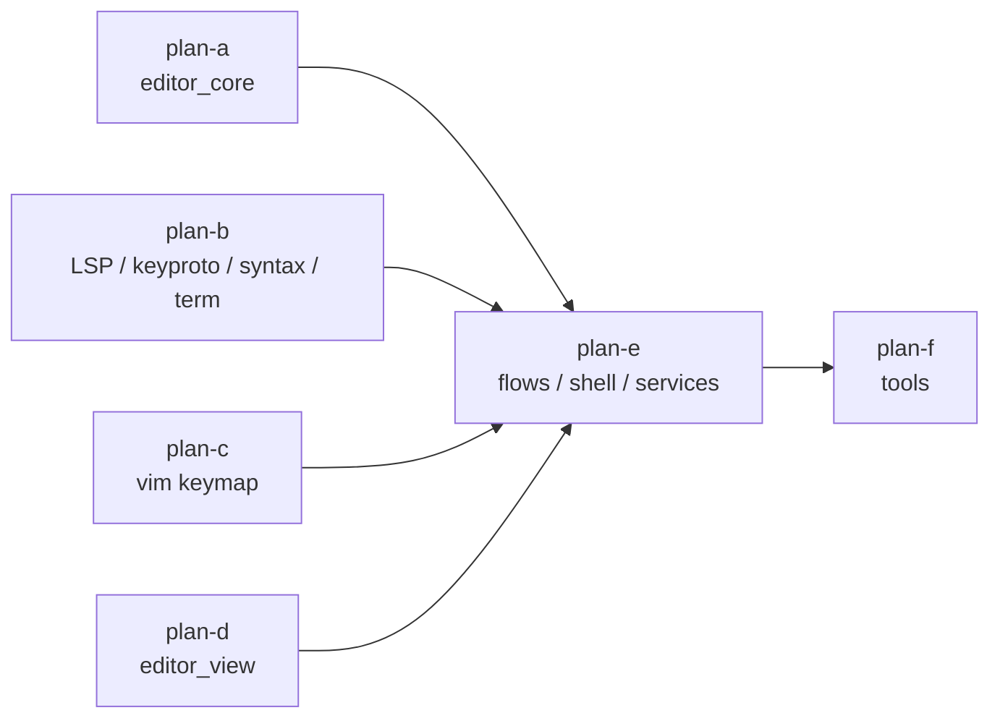

# global-review-fixes 总纲（修复 2026-10-22 全仓评审登记的 38 项发现）

- 来源记录：[2026-10-22 全仓库全局代码评审](../../reviews/2026-10-22-global-review.md)
- 分支：`fix/global-review-fixes`（任务 worktree 内）
- 范围：该评审登记的全部 **18 WARNING + 20 SUGGESTION**，逐条修复并补测试；
  不含评审“自我批判登记”中已删除/降级的条目，也不做计划外的顺手优化。
- 形态：主计划（本文件）+ 6 个子计划；子计划按互不重叠的独占文件清单切分。

## 一、目标与非目标

**目标**

1. 18 条 WARNING 全部修复，且每条都有能复现原缺陷、修复后转绿的测试。
2. 20 条 SUGGESTION 全部落地（含类型注解、异常兜底、边界校验、测试用例）。
3. 修复不得破坏架构边界（`architecture-boundaries.md` R1–R14）与编码规则
   （`python-coding-style.md`）。
4. 收尾时四道门禁全绿：pyright strict、pytest（含架构测试）、覆盖率 ≥ 75、
   冒烟 `tools.smoke_test`。

**非目标**

- 不处理评审第六节已删除/降级的项（例如 `_schedule_rerender` 定时器、
  同名覆盖内置主题、`CreatePipe` 泄漏之外的资源预优化）。
- 不做与登记条目无关的重构、命名清理或性能预优化。
- 不修改 `tools/smoke_test/smoke_baselines/*.json` 的内容；仅当 W-18 改动导致
  场景断言时序变化时，按“先确认行为正确、再更新基线”的流程处理。

## 二、子计划索引

| 子计划 | 主题 | 覆盖登记项 | 独占文件 |
|---|---|---|---|
| [plan-a](global-review-fixes-core-plan-a.md) | `editor_core` 纯文本层 | W-10 / W-12 / S-14 / S-17 / S-18 / S-20 | `yate/editor_core/{project_search,search,buffer,diff,document}.py` + 对应测试 |
| [plan-b](global-review-fixes-leaf-plan-b.md) | LSP / 键弦 / 键位记法 / 语法 / 终端后端 | W-05 / W-07 / W-11 / W-13 / S-12 / S-13 / S-19 | `yate/editor_lsp/{parsing,protocol}.py`、`yate/keyproto/frames.py`、`yate/keymaps/keys.py`、`yate/editor_syntax/ts_backend/languages.py`、`yate/editor_term/pty_proc.py` + 对应测试 |
| [plan-c](global-review-fixes-vim-plan-c.md) | vim 键位状态机 | W-06 / W-08 / S-09 / S-10 | `yate/keymaps/vim.py` + `tests/test_vim_keymap.py` |
| [plan-d](global-review-fixes-view-plan-d.md) | `editor_view` 组件 | W-04 / W-09 / S-07 / S-08 / S-11 | `yate/editor_view/{cells,themes,terminal,find_replace,manual}.py` + 对应测试 |
| [plan-e](global-review-fixes-flows-plan-e.md) | L3 流程 / L4 外壳 / services | W-01 / W-02 / W-03 / S-01–S-06 | `yate/yaterc_options.py`、`yate/flows/{prompt,document}_flows.py`、`yate/{app,editor,config,diagnostics}.py`、`yate/editor_view/theme.py`、`yate/services/{data_store,user_setup}.py`、`yate/services/extensions/api.py` + 对应测试 |
| [plan-f](global-review-fixes-tools-plan-f.md) | `tools/` 工具链 | W-14 / W-15 / W-16 / W-17 / W-18 / S-15 / S-16 | `tools/pack/wiki.py`、`tools/lint_lua.py`、`tools/yxp/cli.py`、`tools/smoke_test/report.py`、`tools/smoke_test/scenarios/regression.py`、`tools/release/cli.py`、`tools/changelog/{translations,cli}.py` + 对应测试 |

## 三、执行波次

同一波次内的子计划文件互不重叠，可并行；波次之间串行，上一波验收命令全部
退出码 0 才进入下一波。

| 波次 | 子计划 | 说明 |
|---|---|---|
| wave-1 | plan-a ∥ plan-b | L0 纯逻辑层，改动面独立 |
| wave-2 | plan-c ∥ plan-d | L1 键位状态机与 L2 组件，互不重叠 |
| wave-3 | plan-e | L3/L4/services 联动，依赖 wave-1/2 的底层行为已稳定 |
| wave-4 | plan-f | `tools/` 工具链，最后执行并跑冒烟场景 |



依赖说明：wave-3 中的 W-02/W-03 会经由 `SearchEngine` / `Document` 的行为；
wave-2 的 W-04 会改变 `cell_offsets` 语义。计划不假设这些改动会改变上层接口，
只要求前序波次验收通过，避免同一文件被两个执行者同时修改。

## 四、关键设计决策（备选方案与否决理由）

| 登记项 | 采纳方案 | 否决的备选与理由 |
|---|---|---|
| W-09 | `validate_theme` 按 `dataclasses.fields(Theme)` 遍历全部颜色槽（排除 `name`/`label`/`dark`/`extra`） | 手工维护第二份字段清单：新增颜色字段时必然漏校验，违背“every color must parse”的承诺 |
| W-14 | 在 `run()` 由 manifest 的 `*.zh.md` 键**推导** `*.en.md` 记录名 | 在 manifest 里新增 en 键：改变持久化 schema，旧 manifest 仍需迁移；推导式零迁移 |
| W-16 | `--force` 仅删除“含 `manifest` 且 `name` 匹配”的脚手架目录 | 只校验目录存在：仍会误删用户项目；要求交互确认：无人值守场景不可用 |
| W-04 | `char_to_cell` / `cell_to_char` / `cell_offsets` 三处统一零宽字符语义（附着前一格） | 只改 `cell_offsets`：渲染与鼠标/列换算仍不一致，缺陷只被部分修复 |
| S-01 | 在 `editor_view.theme.set_theme` 单点归一化 `strip().lower()` | 只在 L4 `app.py` 归一化：扩展 API / 命令路径仍可绕过，且存在两个归一化点 |
| S-09 | VISUAL 模式补齐 `g` / `f` / `F` / `t` / `T` / `;` / `,` / `r` 的前缀处理 | 只改手册注明“不支持”：手册现有“motions extend the selection”承诺继续失真 |
| S-10 | `dj` / `dk` / `dG`（及 `yj` / `cj` 等）按 vim 整行语义实现 | 手册注明“仅字符范围”：与 vim 用户预期不符，且改动集中在同一函数 |
| S-12 | `load_language` 拒绝 `BUILTIN_PACKS` 名称 | 引入“覆盖标记”：需新状态与回滚协议，超出本条修复范围 |
| S-17 | 替换串含换行时改走整段 `replace_range` | 直接拒绝：扩展/API 的合法多行替换能力被移除；逐行替换：行号漂移易错 |
| S-18 | `align` 越界抛 `IndexError` | 静默钳制：调用方无法发现坐标错误，缺陷被掩盖 |
| S-15 | 快照/回滚改 `read_bytes` / `write_bytes` | 保持文本读写：换行策略随检出配置漂移，无法保证 byte-exact |

## 五、验证与提交纪律

- 每个子计划自带验收命令；执行者只跑计划内命令，全量门禁由主代理在收尾时统一跑。
- 每个波次完成后单独提交一次（`fix(...)` / `test(...)`），不推送。
- 收尾门禁（与 CI 同口径）：

```powershell
.venv\Scripts\python.exe -m pyright yate/ tests/ tools/
.venv\Scripts\python.exe -m pytest tests/ -q -n auto
.venv\Scripts\python.exe -m pytest tests/test_architecture.py -q
.venv\Scripts\python.exe -m pytest tests --cov=yate --cov-branch --cov-report=term-missing --cov-fail-under=75 -n auto
.venv\Scripts\python.exe -m tools.smoke_test run --jobs 4
```

## 六、登记项追踪表

| ID | 子计划 | 状态 |
|---|---|---|
| W-01 | plan-e | 已完成 |
| W-02 | plan-e | 已完成 |
| W-03 | plan-e | 已完成 |
| W-04 | plan-d | 已完成 |
| W-05 | plan-b | 已完成 |
| W-06 | plan-c | 已完成 |
| W-07 | plan-b | 已完成 |
| W-08 | plan-c | 已完成 |
| W-09 | plan-d | 已完成 |
| W-10 | plan-a | 已完成 |
| W-11 | plan-b | 已完成 |
| W-12 | plan-a | 已完成 |
| W-13 | plan-b | 已完成 |
| W-14 | plan-f | 已完成 |
| W-15 | plan-f | 已完成 |
| W-16 | plan-f | 已完成 |
| W-17 | plan-f | 已完成 |
| W-18 | plan-f | 已完成 |
| S-01 | plan-e | 已完成 |
| S-02 | plan-e | 已完成 |
| S-03 | plan-e | 已完成 |
| S-04 | plan-e | 已完成 |
| S-05 | plan-e | 已完成 |
| S-06 | plan-e | 已完成 |
| S-07 | plan-d | 已完成 |
| S-08 | plan-d | 已完成 |
| S-09 | plan-c | 已完成 |
| S-10 | plan-c | 已完成 |
| S-11 | plan-d | 已完成 |
| S-12 | plan-b | 已完成 |
| S-13 | plan-b | 已完成 |
| S-14 | plan-a | 已完成 |
| S-15 | plan-f | 已完成 |
| S-16 | plan-f | 已完成 |
| S-17 | plan-a | 已完成 |
| S-18 | plan-a | 已完成 |
| S-19 | plan-b | 已完成 |
| S-20 | plan-a | 已完成 |

## 七、风险与回滚

- 风险 1：`cell_offsets` 语义变更影响光标/选区渲染。缓解：三函数统一语义并补
  combining-mark 用例，跑 `tests/test_cells.py`、`tests/test_app_render.py`。
- 风险 2：vim 行wise 操作改变既有行为。缓解：只对 `j`/`k`/`G` 分支生效，
  保留 `dw`/`d$` 等字符语义；新增用例逐条钉住。
- 风险 3：`tools/pack/wiki.py` 的清理逻辑误删。缓解：只从已记录 zh 键推导 en 名；
  新增“源文件删除后 en 页被清理”用例，保留用户手写页不动的既有断言。
- 回滚颗粒度：每个子计划为一次独立提交；任一波次验收失败，回滚该波次的提交，
  在计划文档记录失败命令与退出码后重新设计。

## 八、执行记录（收尾回填）

### 8.1 波次执行结果

| 波次 | 子计划 | 执行结果 |
|---|---|---|
| wave-1 | plan-a | pytest 190 项（189 passed / 1 skipped），pyright 0，退出码 0 |
| wave-1 | plan-b | pytest 239 passed / 3 skipped，pyright 0，退出码 0 |
| wave-2 | plan-c | pytest 179 passed，pyright 0，退出码 0 |
| wave-2 | plan-d | pytest 94 passed，pyright 0，退出码 0 |
| wave-3 | plan-e | pytest 169 passed，pyright 0，退出码 0 |
| wave-4 | plan-f | pytest 183 passed / 1 环境冲突（见 8.2），pyright 0；修复后 6 文件 184 passed |

### 8.2 偏离与校准记录

1. **plan-a**：BOM 用例的 `lines[0] == "hello"` 断言放在 `insert_text` 之前
   （插入后首行已是 `xhello`，计划散文顺序不可同时成立）。
2. **plan-b**：计划片段 `Document(TextBuffer(...))` 与构造签名不符，改为
   `Document(None, TextBuffer(...))`；W-11 使既有越界行断言失效，同步改为
   钳制后的 `(2, 0, 2, 0)`。
3. **plan-c**：S-10 使既有 3 个 `dG` 字符语义用例失效，按整行新语义改写
   （`d5G` 用例改名）；`vim.py` 实测 1480 行，已在
   `architecture-boundaries.md` §三.7 同步行数。
4. **plan-d**：`_run_search` 实际方法名为 `_search_worker`，按同处修改；
   原 `_relative_cached` 缓存用例随函数删除，替换为“结果标签为工作区相对路径”
   行为用例。
5. **plan-e**：`diagnostics._kv` 的 `# noqa` 单行超 100 字符，移到参数行；
   `tests/test_config.py::test_name_and_command_are_stripped` 依赖旧“filetypes
   原样保留”行为，已改名为 `test_name_command_and_filetypes_are_stripped`
   并断言去空白后的值（计划外必要同步）。
6. **plan-f（环境冲突）**：W-15 生效后，本机 `core.autocrlf=true` 使捆绑 Lua
   全部为 CRLF，`test_bundled_lua_files_pass_the_linter` 报 4521 项。裁定：
   不放宽 linter，补 `.gitattributes` 的 `*.lua text eol=lf` 并把工作树 Lua
   归一为 LF（索引本已是 LF，无内容 diff）。

### 8.3 审核迭代

- 第 1 轮 `code-review-expert`：0 CRITICAL / 1 WARNING / 4 SUGGESTION。
  WARNING 为“混合大小写自定义主题归一化后不可达”，已用
  `register_theme` 侧 canonical 键修复（`5be4f13`）。
- 第 2 轮聚焦审核：发现 `register_theme` 对非 str name 先 `.strip()` 抛
  `AttributeError`，已改为先做类型判断再由 `validate_theme` 报 `ValueError`
  （`b213bce`）。其余 SUGGESTION 中：`filetypes` 双 strip 已修；
  `data_store` 对 `a:b` 的拒绝维持保守口径（与“拒绝盘符形态”的可移植承诺一致，
  不作放宽）；计划回填在本节完成。
- 计划外修复 1 处：覆盖率并行跑暴露 `:only` 结构重建与 `EditorView.on_mount`
  的竞态（已删除 leaf 仍收到 Mount，`leaf_by_id` 断言崩溃）。`on_mount` 先以
  `leaf_for` 判活并跳过绘制（`ef44fd3`），随后全量门禁复测通过。

### 8.4 收尾门禁实测（2026-10-22，任务 worktree）

| 门禁 | 命令 | 结果 |
|---|---|---|
| pyright strict | `pyright yate/ tests/ tools/` | 0 errors / 0 warnings / 0 informations，exit 0 |
| 全量测试 | `pytest tests -n auto` | **2912 passed / 9 skipped**，exit 0（68.14s） |
| 架构守卫 | `pytest tests/test_architecture.py -q` | **36 passed**，exit 0 |
| 覆盖率 | `pytest tests --cov=yate --cov-branch --cov-fail-under=75 -n auto` | **91.90% ≥ 75**，exit 0 |
| 冒烟 | `tools.smoke_test run --jobs 4` | **112/112 场景、1354/1354 检查**，exit 0（93.73s） |

### 8.5 剩余待办（非阻塞）

- `data_store.resolve` 仍拒绝 POSIX 合法名 `a:b`（保守的可移植盘符判断）；
  如需放宽，另立任务并补跨平台用例。
- `architecture-boundaries.md` §三.7 已同步 `vim.py` / `editor.py` /
  `wiki.py` 的最新行数。

