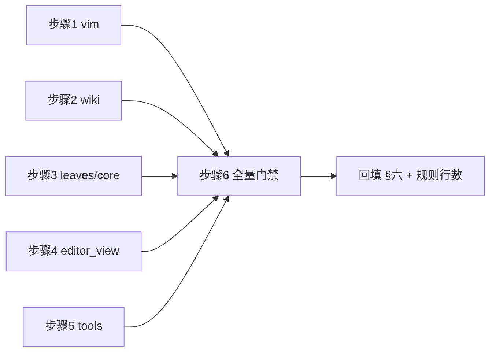

# global-review-fixes PR 预审修复方案（R-1 … R-16）

- 来源：对本分支 `fix/global-review-fixes` 的 PR 预审（`pr-review` 技能，
  对照 merge-base `b2ac11f`），结论 REQUEST_CHANGES：3 MAJOR + 13 MINOR。
- 前置记录：[global-review-fixes-plans/overview.md](../documents/global-review-fixes-plans/overview.md)
  （38 项原始发现的修复执行记录）。
- 范围：仅修复预审登记项，不做计划外的重构或优化。

## 一、目标与非目标

**目标**

1. 3 条 MAJOR 全部消除：vim `;`/`,` 的 count 泄漏、VISUAL 前向 `f` 的半开区间
   偏差、W-14 孤儿英文页清理误删「收养页」。
2. 13 条 MINOR 全部落地：注释精度、异常边界、跨平台测试钉、
   性能性质测试钉、on_mount 竞态回归测试、工具链排序/等待口径。
3. 收尾四道门禁全绿：pyright strict、全量 pytest（含架构测试）、覆盖率 ≥ 75、
   冒烟场景。

**非目标**

- 不改 `tools/smoke_test/smoke_baselines/*.json`。
- 不处理预审未登记的存量问题。
- 不重构 `vim.py` / `editor.py` / `wiki.py` 的体量（仅同步规则 §三.7 行数）。

## 二、关键设计决策（含对被否决路线的说明）

| 项 | 采纳方案 | 否决的备选与理由 |
|---|---|---|
| R-3（wiki 收养页） | manifest 仅在**工具真正写出** en 页时记录 `en 页名 -> 写出字节的 sha256`；prune 对 en 页额外校验当前内容哈希，不匹配即视为用户财产保留 | ① 只改 docstring + 打印：未消除数据丢失面，推翻了 prune 的安全承诺；② 派生 en 名但删除前不看内容（当前实现）：收养页/手改页仍会被删；③ 新增独立 manifest 文件：多一份持久化状态，旧清单无法迁移 |
| R-2（VISUAL `f`） | 在 visual `f` 与 `;`/`,` 的前向重复分支把光标后移一格（包含式，半开区间端点落在目标字符之后） | 改 `_resolve_find` 的 `select` 语义：会同时改变 `t`/`T`（其排他列本就正确）与操作符路径，破坏已钉住的 NORMAL 语义 |
| R-1（count 泄漏） | `;`/`,` 消费 count 并按次数重复（vim 语义），失败分支 `_clear_pending()` | 只在失败分支清 `count_str`：成功分支 `3;` 仍泄漏，缺陷只被部分修复 |
| R-14（on_mount 回归） | 在真实 App 上下文里对已从窗格树移除的 view 直接调用 `on_mount`，断言不再订阅主题 | 构造完整 EditorView 的假协作者：`super().on_mount()` 依赖真实挂载状态，假对象不可行 |
| R-15（smoke 等待） | `await app.workers.wait_for_complete()`（Textual 8.2.8 实测无 `has_group`，`WorkerManager` 只有 `wait_for_complete`） | 保留 `wait_until(popup.is_open)`：谓词已真，是空等待，worker 落地仍可能与 down 竞态 |

## 三、分步实施计划

### 步骤 1：vim 键位状态机（R-1 / R-2 / R-12）

- 输入：`tests/test_vim_keymap.py` 现有约定；`_resolve_find` 在返回前会清 `prefix`。
- 文件：`yate/keymaps/vim.py`、`tests/test_vim_keymap.py`。
- 改动：
  1. NORMAL `;`/`,` 分支（当前 806-811 行）：`n = self._take_count()`；无历史时
     `self._clear_pending()` 后再提示；有历史时循环 `n` 次 `self._repeat_find`。
  2. VISUAL `;`/`,` 分支（547-558 行）：同样消费 count；无历史时补
     `ui.message("no previous find")`（R-12）；前向 `f`（`not backward and not till`）
     每次移动后若光标变化则后移一格并钳到行尾。
  3. VISUAL `f`/`F`/`t`/`T` 分支（528-538 行）：调用前保存 `prefix` 与 `before`，
     `prefix == "f"` 且光标变化时后移一格再 `_fix_linewise`。
  4. 测试更新：`test_visual_find_extends_the_selection` 期望选区 `((0,0),(0,2))`、
     `d` 后文本 `"b.c.d"`；`test_visual_semicolon_repeats_the_find_and_extends`
     期望光标 `(0,4)`；`test_normal_commands_drop_a_leaked_count` 增补
     `("3", ";", "x")` 参数化；新增 visual 下 `3;` 与后向 `F` 的包含式断言。
- 验收：
  `python -m pytest tests/test_vim_keymap.py -q`；
  `python -m pyright yate/keymaps/vim.py tests/test_vim_keymap.py`。

### 步骤 2：wiki 孤儿页安全（R-3）

- 文件：`tools/pack/wiki.py`、`tests/test_pack_wiki.py`。
- 改动：
  1. `prune_orphan_pages(target, keep, recorded: dict[str, str])`：`recorded.get(posix)`
     为 `None` 即跳过；**en 页**删除前读 `existing.read_bytes()` 比对 sha256，
     不匹配（用户手改/收养）则保留；zh 页维持原语义（只认清单记录）。
     读取失败抛 `WikiError(WIKI_PRUNE_FAILED)`。
  2. `run()`：`recorded = dict(manifest)`，删除 zh→en 派生集合。
  3. 写出点记录 en 哈希：en_source 直写分支记录 `sha256(en_bytes)`；
     翻译落地分支在 `_write_page_text` 后用 `read_bytes()` 取实际落盘字节哈希，
     写入 `digests[page.en_target]`。
  4. 清单过滤保留 `collected`（zh）与 current run 的 en 目标名，避免 en 记录被裁掉。
  5. 更新模块头（清单语义）与 `prune_orphan_pages` / `_translation_state` /
     `_assert_prune_safe` 的 docstring 承诺。
  6. 测试：现有 `test_prune_removes_only_pages_recorded_in_the_manifest` 应继续通过；
     新增「收养 en 页 + 删除 zh 源 → en 页保留」「翻译后手改 en 页 + 删除 zh 源 →
     en 页保留」两条。
- 验收：`python -m pytest tests/test_pack_wiki.py -q`。

### 步骤 3：L0 叶子与 core / services（R-4 / R-5 / R-6 / R-7 / R-8 / R-9）

- 文件：`yate/keyproto/frames.py`、`yate/editor_lsp/parsing.py`、
  `yate/editor_view/cells.py`、`yate/editor_core/document.py`、
  `yate/yaterc_options.py`、`yate/services/data_store.py` + 对应测试。
- 改动：
  1. `frames.py::char_text`：拒绝 UTF-16 代理区 `0xD800-0xDFFF`。
  2. `parsing.py::_parse_diagnostics`：行钳到 `len(lines)-1`、列钳到该行长度
     （`lines` 非空时），与 W-11 的 `_range_to_buffer_cols` 口径一致；
     同步更新受影响测试。
  3. `cells.py::cell_to_char`：附着型零宽字符在边界判定**之前**跳过
     （`width == 0 and cells`），使点击组合簇右侧落在下一基础字符；
     补 `"a\u0301b"` 用例。
  4. `document.py::_decode`：注释收窄为「合法 UTF-8 BOM 优先」，并说明
     BOM + 非法 UTF-8 落入回退环（不改行为）。
  5. `yaterc_options.py`：filetypes 双 `strip()` 的空白语义注释补齐。
  6. `data_store.py`：抽出 `_has_drive_prefix(first)` 单行判定并在 `resolve` 调用；
     与 `candidate.drive` 互补（Windows 上可移植分支不可达，需直接钉判定函数）。
  7. 测试：`test_keyproto` 代理区、`test_cells` 组合簇反向映射、
     `test_data_store` 直接断言判定函数、`test_lsp_parsing` 钳制口径。
- 验收：`python -m pytest tests/test_keyproto.py tests/test_cells.py
  tests/test_data_store.py tests/test_lsp_parsing.py tests/test_editor_core.py
  tests/test_yaterc_options.py -q`。

### 步骤 4：editor_view / L3 外壳（R-10 / R-11 / R-13 / R-14）

- 文件：`yate/editor.py`、`yate/editor_view/themes.py`、
  `tests/test_app_find_replace.py`、`tests/test_app_textual.py`（或新增用例的宿主文件）。
- 改动：
  1. `Editor.set_theme`：删除本地 `strip().lower()`，改为先取
     `previous = theme.active().name`，再以 `set_theme` 返回的 `selected.name`
     判 `reselected`、取 `textual_theme_name(selected.name)`——归一化回到
     `editor_view.theme.set_theme` 单点。
  2. `themes.py::register_theme`：同名且内容不同的自定义主题覆盖时
     `log.warning("custom theme %r overrides a registered theme", key)`；
     补 `tracing.get_logger` 与一条 caplog 用例。
  3. `test_app_find_replace`：恢复「渲染路径不触发 `Path.resolve`」的计数断言
     （对已落地结果调用私有渲染路径两次，断言计数为 0）。
  4. `test_app_textual`：新增 on_mount 竞态回归用例——取已挂载 view，先
     `on_unmount` 摘订阅，再从窗格树移除其 leaf，直接调用 `on_mount`，
     断言不抛异常且未重新订阅（`_theme_unsubscribe is None`）。
- 验收：`python -m pytest tests/test_app_find_replace.py
  tests/test_app_textual.py tests/test_theme_palettes.py -q`。

### 步骤 5：tools 工具链（R-15 / R-16）

- 文件：`tools/lint_lua.py`、`tools/changelog/translations.py`、
  `tools/yxp/cli.py`、`tools/smoke_test/report.py`、
  `tools/smoke_test/scenarios/regression.py` + 对应测试。
- 改动：
  1. `lint_lua.check_paths`：`except (OSError, UnicodeDecodeError)`。
  2. `translations.load_overrides`：`read_text` 包进
     `OverrideFileError`（`OSError` / `UnicodeDecodeError`）。
  3. `yxp.create_scaffold`：`shutil.rmtree` 包进 `try/except OSError` →
     `YxpError`。
  4. `smoke_test/report._group`：排序谓词加 `x.error is None`，崩溃组归入
     failing 组。
  5. `regression._regress_completion_popup_keys`：`ctrl+space` 后改
     `await app.workers.wait_for_complete()` + `await pilot.pause()`，
     再读 `popup.is_open`；删除空等待。
  6. 测试：`test_lua_lint` 非 UTF-8 文件、`test_changelog_tool` 非 UTF-8
     覆盖文件、`test_tools_yxp` rmtree 失败、`test_smoke_tool` 崩溃组排序。
- 验收：`python -m pytest tests/test_lua_lint.py tests/test_changelog_tool.py
  tests/test_tools_yxp.py tests/test_smoke_tool.py -q`；
  `python -m tools.smoke_test run --jobs 4`。

### 步骤 6：收尾门禁与文档回填

1. 全量门禁（worktree 内并行口径）：
   `python -m pyright yate/ tests/ tools/`；
   `python -m pytest tests/ -q -n auto`；
   `python -m pytest tests/test_architecture.py -q`；
   `python -m pytest tests/ --cov=yate --cov-branch --cov-fail-under=75 -n auto`；
   `python -m tools.smoke_test run --jobs 4`。
2. 同步 `.trae/rules/architecture-boundaries.md` §三.7 中 `vim.py` / `editor.py` /
   `wiki.py` 的最新行数（修改文件后按规则要求更新）。
3. 回填本方案 §六 执行记录（真实数字、偏离项）。

## 四、风险与回滚

- 风险 1：wiki 清单新增 en 键改变持久化形态。缓解：旧清单无 en 键 → prune 保守
  保留，不迁移、不误删；新增「收养/手改保留」两条行为用例。
- 风险 2：VISUAL `f` 语义修正会改动 3 条既有断言的期望值。缓解：逐条按 vim
  实际行为改写，并补后向 `F`/`t` 的对称性断言证明未误伤。
- 风险 3：诊断范围钳制改变 LSP 越界行的既有断言。缓解：按 W-11 同口径改写，
  仅影响越界输入。
- 风险 4：smoke 等待改 `wait_for_complete` 可能等待无关 worker。缓解：该场景
  无 LSP/终端 worker；冒烟实跑 5/5 复核。
- 回滚：每个步骤为一次独立提交，任一步验收失败回滚该步并记录失败命令与退出码。

## 五、验证矩阵

## 六、执行记录（收尾回填）

- 执行日期：2026-10-23。执行方式：5 个 `plan-executor` 子代理并行，文件面互斥
  （每步一份独占文件清单，互不交叉）。
- 步骤 1（vim，R-1 / R-2 / R-12）：`pytest tests/test_vim_keymap.py -q` →
  183 passed；`pyright yate/keymaps/vim.py tests/test_vim_keymap.py` → 0 errors。
- 步骤 2（wiki，R-3）：`pytest tests/test_pack_wiki.py -q` → 44 passed。
- 步骤 3（L0 / core / services，R-4 … R-9）：
  `pytest tests/test_keyproto.py tests/test_cells.py tests/test_data_store.py
  tests/test_lsp_parsing.py tests/test_editor_core.py tests/test_yaterc_options.py -q`
  → 235 passed / 1 skipped。
- 步骤 4（editor_view / L3，R-10 / R-11 / R-13 / R-14）：
  `pytest tests/test_app_find_replace.py tests/test_app_textual.py
  tests/test_theme_palettes.py -q` → 117 passed；on_mount 新用例做过负向演练
  （临时把守卫改为 `if False:` 确认用例失败，再还原）。
- 步骤 5（tools，R-15 / R-16）：`pytest tests/test_lua_lint.py
  tests/test_changelog_tool.py tests/test_tools_yxp.py tests/test_smoke_tool.py -q`
  → 132 passed。
- 步骤 6（全量门禁，worktree 内）：
  - `python -m pyright yate/ tests/ tools/` → `0 errors, 0 warnings, 0 informations`；
  - `python -m pytest tests/ -q -n auto` 首轮 → 1 failed：仅
    `tests/test_pack_wiki_parallel.py` 的两条旧 manifest 断言（清单现含 en 键，
    属步骤 2 设计变更的必然结果），改写后重跑
    `pytest tests/test_pack_wiki.py tests/test_pack_wiki_parallel.py -q` →
    69 passed / 1 skipped；
  - `python -m pytest tests/test_architecture.py -q` → 36 passed；
  - `python -m pytest tests/ --cov=yate --cov-branch --cov-fail-under=75 -n auto`
    → `2930 passed, 9 skipped`，`TOTAL 91.94%`（阈值 75%，达标）；
  - `python -m tools.smoke_test run --jobs 4` → 112/112 scenarios passed；
  - `pyright tests/test_pack_wiki_parallel.py`（终态复核）→ 0 errors。
- 偏离项与计划外补充：
  1. **VISUAL 数字累积**（步骤 1）：计划要求断言 visual `v3;` 重复三次，而旧语义
     在 VISUAL 吞掉数字，`3` 无法到达 `;`。实现改为与 NORMAL 同规则累积
     （`_ARG_PREFIXES` 下不累积，`f3` 仍查找字符 `"3"`），并在所有离开 VISUAL
     的出口（ESC / `v` 关闭 / `y` `d` `x` / `:` `/` `?` / 移位 / 运动 / `gg`）
     清空 `count_str`，防止新增泄漏；既有用例
     `test_visual_mode_swallows_a_count_prefix` 前提失效，按新语义改写为
     `test_visual_count_applies_to_motions`（`v2l` 光标 → `(0,2)`）。
  2. **`tests/test_pack_wiki_parallel.py` 未在步骤 2 文件清单内**（计划遗漏）：
     en 哈希记录改变 manifest 形态，两条断言已同步为 zh+en 双键集合断言；
     该修正发生在门禁阶段（首轮全量唯一失败点）。
  3. **`# pyright: ignore[reportUnknownMemberType]` ×2**（步骤 5
     `tools/smoke_test/scenarios/regression.py`）：Textual `WorkerManager.
     wait_for_complete` 返回裸 `Worker` 泛型；仓库已有同类先例
     （`tools/smoke_test/harness.py:61`、`tests/conftest.py:71`），全量 pyright
     仍为 0 诊断。这是 pyright 规则级忽略，不是 R6 禁止的 `# type: ignore`。
  4. **`ThemeChanged` 载荷改用 `selected.name`**（步骤 4 实现细节）：归一化后的
     规范名与主题表键一致，避免监听者拿到未归一化的原始输入。
- 规则同步：`.trae/rules/architecture-boundaries.md` §三.7 三条豁免行数已更新为
  `keymaps/vim.py` 1528 行 / `editor.py` 1141 行 / `tools/pack/wiki.py` 1735 行
  （`splitlines()` 口径，2026-10-23 复测）。
