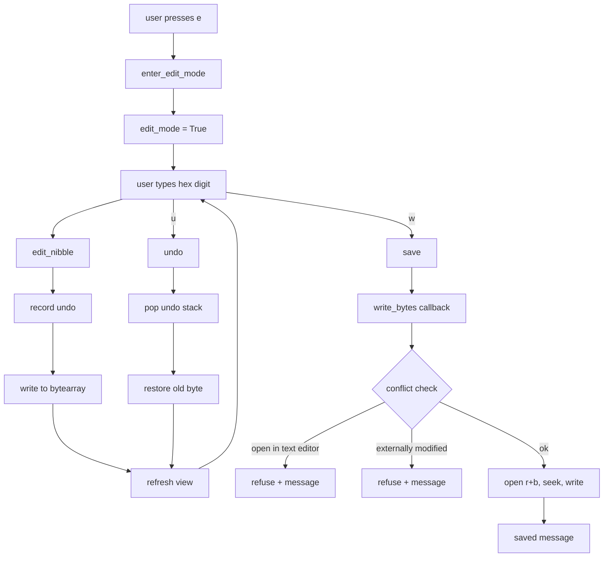
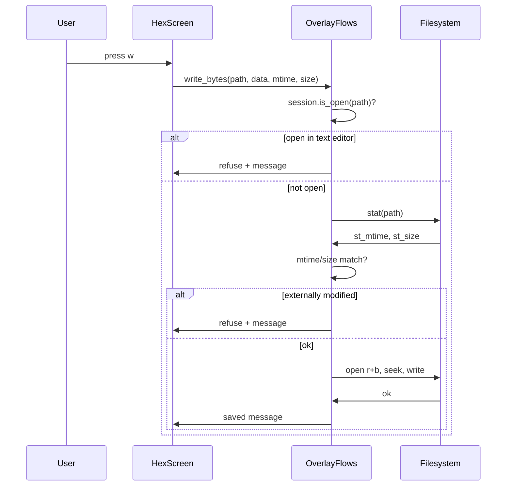

# Hex Enhancement - Plan C (Wave 3): Hex Edit / Replace

## 目标

为 hex view 增加「编辑 / 替换 hex 值」功能：

1. **编辑模式切换**：`e` 键进入编辑模式，`escape` 或 `e` 退出编辑模式；
2. **nibble 键入**：编辑模式下，hex 数字键（`0-9`、`a-f`）逐字节写入当前光标位置；
3. **ASCII 列同步**：hex 编辑后，ASCII 列实时反映新字节（可打印原字符，不可打印 `.`）；
4. **撤销栈**：`u` 键撤销上一步编辑，内存字节映射 + undo 栈；
5. **写回持久化**：`w` 键触发写盘，经 L3 流程层回调注入实现（HexView 禁碰文件系统，R3）；
6. **冲突保护**：写前检查同路径是否已在文本编辑器打开（`session.is_open`），保守拒绝 + message 提示；
7. **只读边界**：文件只读打开或权限不足时拒绝编辑。

## 非目标

- **不改动 hex 内容格式**：xxd 布局（offset + hex + ASCII）保持不变；
- **不新增命令行入口**：编辑操作全部在 `HexScreen` 内通过键位触发；
- **不实现插入 / 删除字节**：仅支持同长覆写（文件 size 不变）；
- **不实现大文件分段编辑**：维持 100MB 一次性读入上限；
- **不实现多光标编辑**：单光标编辑，光标位置由行 / 列（字节偏移）确定。

## 备选方案与否决理由

### 方案 A：HexView 直接写文件（否决）

- **做法**：`HexView` 内 `open(path, "r+b")` + seek + write；
- **否决理由**：
  - 违反模块 docstring 声明（"presentation-only: never touches the filesystem"）；
  - 违反 R3（`editor_view/*` 不得 import `yate.editor` / `yate.app`，但写文件需要 L3 流程层的 session / workspace 协作）；
  - 与既有架构分层不符（L2 组件不应持有持久化逻辑）。

### 方案 B：回调注入写盘动作（采纳）

- **做法**：`HexScreen` 构造时注入 `write_bytes: Callable[[Path, bytes, int, int], None]` 回调（offset, new_byte），由 `OverlayFlows` 提供实现；
- **采纳理由**：
  - 遵守 R3（HexView 不碰文件系统，写盘动作经 L3 流程层）；
  - 与既有 `OverlayFlows` 注入模式一致（`push_screen` / `message` / `session` 等都是回调注入）；
  - 写盘逻辑集中在 `OverlayFlows`，可统一处理冲突检测 / TOCTOU 防护 / 错误提示。

### 方案 C：新增 `HexEditFlows` 流程模块（否决）

- **做法**：新建 `flows/hex_flows.py` 专管 hex 编辑；
- **否决理由**：
  - 过度设计：hex 编辑功能简单，不需要独立流程模块；
  - `OverlayFlows` 已持有 `open_hex_view` / `toggle_hex_view`，编辑写回逻辑自然归属此处；
  - 新增模块会增加架构复杂度，与「能用函数实现的就不造类」原则冲突。

### 方案 D：与 EditorSession 共享 buffer（否决）

- **做法**：hex 编辑直接修改 `EditorSession.doc.buffer`；
- **否决理由**：
  - `TextBuffer` 是文本模型，hex 编辑是字节模型，二者语义不同；
  - 同路径同时打开文本 + hex 编辑会导致数据竞争；
  - 保守策略：同路径已在文本编辑器打开时拒绝 hex 编辑（`session.is_open` 检查）。

## 分步实施

### Step 1: 编辑模式与光标状态

**输入**：`yate/editor_view/hexview.py` 现状（`HexView` 只读，无光标状态）。

**改动文件清单**：

1. `yate/editor_view/hexview.py`：
   - L1-12：模块 docstring 追加「hex editing」能力描述，注明写盘经回调注入；
   - L47-76：`HexView.__init__` 新增属性：
     - `self._cursor_pos: int = 0`（字节偏移，0-based）；
     - `self._edit_mode: bool = False`；
     - `self._data: bytearray = bytearray(data)`（改为可变字节映射）；
     - `self._undo_stack: list[tuple[int, int]] = []`（`(offset, old_byte)` 栈）；
   - L47-121：`HexView` 新增方法：
     - `enter_edit_mode()`：`self._edit_mode = True`，`self.refresh()`；
     - `exit_edit_mode()`：`self._edit_mode = False`，`self.refresh()`；
     - `move_cursor(delta: int)`：`self._cursor_pos = max(0, min(self._cursor_pos + delta, len(self._data) - 1))`，`self.refresh()`；
     - `cursor_line() -> int`：`return self._cursor_pos // 16`；
     - `cursor_col() -> int`：`return self._cursor_pos % 16`；
   - L92-106：`render_line` 改造：
     - 当前光标行高亮（背景色 `surface` 或前景色 `accent`）；
     - 编辑模式下光标字节反色（`on_accent` on `accent`）。

**输出**：`HexView` 支持光标移动与编辑模式切换。

**验收命令**：

```powershell
.venv\Scripts\python.exe -m pytest tests/test_hex_view.py::test_hex_view_cursor_move -q
.venv\Scripts\python.exe -m pytest tests/test_hex_view.py::test_hex_view_edit_mode_toggle -q
.venv\Scripts\python.exe -m pyright yate/editor_view/hexview.py
```

通过判定：退出码 0，2 个新增用例全绿，pyright strict 零诊断。

### Step 2: nibble 键入与 ASCII 同步

**输入**：`yate/editor_view/hexview.py` 现状（`HexView` 有光标状态，无键入逻辑）。

**改动文件清单**：

1. `yate/editor_view/hexview.py`：
   - L47-121：`HexView` 新增方法：
     - `edit_nibble(hex_digit: str) -> None`：
       - 校验 `hex_digit` 为 `0-9` / `a-f` / `A-F`；
       - 计算当前字节 `old_byte = self._data[self._cursor_pos]`；
       - 根据光标在字节内的位置（高 / 低 nibble）合并新值；
       - 记录 undo：`self._undo_stack.append((self._cursor_pos, old_byte))`；
       - 写入：`self._data[self._cursor_pos] = new_byte`；
       - `self.refresh()`；
     - `undo() -> None`：
       - 若 `self._undo_stack` 非空：`offset, old_byte = self._undo_stack.pop()`；
       - `self._data[offset] = old_byte`；
       - `self._cursor_pos = offset`；
       - `self.refresh()`；
   - L123-140：`HexScreen.on_key` 改造：
     - 编辑模式下：
       - `0-9` / `a-f`：调 `hex_view.edit_nibble(event.key)`，`event.stop()`；
       - `u`：调 `hex_view.undo()`，`event.stop()`；
       - `hjkl` / 方向键：调 `hex_view.move_cursor(delta)`（`h=-1`, `l=+1`, `k=-16`, `j=+16`），`event.stop()`；
       - `escape` / `e`：调 `hex_view.exit_edit_mode()`，`event.stop()`；
     - 非编辑模式：
       - `e`：调 `hex_view.enter_edit_mode()`，`event.stop()`；
       - 其余键 fall-through（R10）。

**输出**：编辑模式下支持 nibble 键入、撤销、光标移动。

**验收命令**：

```powershell
.venv\Scripts\python.exe -m pytest tests/test_hex_view.py::test_hex_view_edit_nibble -q
.venv\Scripts\python.exe -m pytest tests/test_hex_view.py::test_hex_view_undo -q
.venv\Scripts\python.exe -m pytest tests/test_hex_view.py::test_hex_view_ascii_sync -q
.venv\Scripts\python.exe -m pyright yate/editor_view/hexview.py
```

通过判定：退出码 0，3 个新增用例全绿，pyright strict 零诊断。

### Step 3: 写回回调注入

**输入**：`yate/editor_view/hexview.py` 现状（`HexView` 有编辑能力，无写盘逻辑）。

**改动文件清单**：

1. `yate/editor_view/hexview.py`：
   - L14-31：新增导入 `from collections.abc import Callable`；
   - L123-140：`HexScreen.__init__` 新增参数：
     - `write_bytes: Callable[[Path, bytes, int, int], None] | None = None`（path, data, mtime, size）；
     - 存储为 `self._write_bytes = write_bytes`；
   - L123-140：`HexScreen` 新增方法 `save() -> None`：
     - 若 `self._write_bytes is None`：`self._message("write not available", "warn")`，return；
     - 调 `self._write_bytes(self._path, bytes(self._hex_view._data), self._mtime, self._size)`；
     - 成功：`self._message("saved", "ok")`；
     - 失败（`OSError` / `ValueError`）：`self._message(f"save failed: {exc}", "warn")`；
   - L123-140：`HexScreen.__init__` 新增参数：
     - `mtime: float = 0.0`、`size: int = 0`（加载时 stat 记录，写前复检）；
   - L123-140：`HexScreen.on_key` 改造：
     - `w` 键：调 `self.save()`，`event.stop()`。

2. `yate/flows/overlay_flows.py`：
   - L185-214：`open_hex_view` 改造：
     - 加载时 stat 记录 `mtime = path.stat().st_mtime`、`size = path.stat().st_size`；
     - 构造 `HexScreen` 时传入 `write_bytes=self._write_hex_bytes`、`mtime=mtime`、`size=size`；
   - L37-82：`OverlayFlows` 新增方法 `_write_hex_bytes(path, data, mtime, size) -> None`：
     - 冲突检测：`if self.session.is_open(path) is not None`：`self._message(f"file open in text editor: {path.name}", "warn")`，return；
     - TOCTOU 防护：`stat = path.stat()`，`if stat.st_mtime != mtime or stat.st_size != size`：`self._message(f"file modified externally: {path.name}", "warn")`，return；
     - 写盘：`with open(path, "r+b") as f: f.seek(offset); f.write(data)`（同长覆写，offset=0，data 为全量字节）；
     - 错误处理：`except OSError as exc`：`self._message(f"save failed: {exc}", "warn")`。

**输出**：`HexScreen` 支持 `w` 键触发写盘，经 `OverlayFlows` 回调实现。

**验收命令**：

```powershell
.venv\Scripts\python.exe -m pytest tests/test_hex_view.py::test_hex_screen_save_writes_bytes -q
.venv\Scripts\python.exe -m pytest tests/test_hex_view.py::test_hex_screen_save_refuses_conflict -q
.venv\Scripts\python.exe -m pytest tests/test_hex_view.py::test_hex_screen_save_refuses_external_modification -q
.venv\Scripts\python.exe -m pyright yate/editor_view/hexview.py yate/flows/overlay_flows.py
```

通过判定：退出码 0，3 个新增用例全绿，pyright strict 零诊断。

### Step 4: 只读边界

**输入**：`yate/flows/overlay_flows.py` 现状（`open_hex_view` 读文件，无只读检查）。

**改动文件清单**：

1. `yate/flows/overlay_flows.py`：
   - L185-214：`open_hex_view` 改造：
     - 加载时检查 `os.access(path, os.W_OK)`，若只读：`self._message(f"file read-only: {path.name}", "info")`，仍打开 `HexScreen` 但 `write_bytes=None`（禁止写盘）；
     - 可写：传 `write_bytes=self._write_hex_bytes`。

**输出**：只读文件可浏览但不可编辑。

**验收命令**：

```powershell
.venv\Scripts\python.exe -m pytest tests/test_hex_view.py::test_hex_view_read_only_refuses_save -q
.venv\Scripts\python.exe -m pyright yate/flows/overlay_flows.py
```

通过判定：退出码 0，1 个新增用例全绿，pyright strict 零诊断。

### Step 5: 新增测试用例

**输入**：`tests/test_hex_view.py` 现状（13 用例，含 plan-b 新增 7 个）。

**改动文件清单**：

1. `tests/test_hex_view.py`：新增 9 用例——
   - `test_hex_view_cursor_move`：
     - arrange：`_ViewHost(b"x" * 32)`，`app.run_test(size=(100, 30))`；
     - act：`view.move_cursor(5)`；
     - assert：`view._cursor_pos == 5`；
   - `test_hex_view_edit_mode_toggle`：
     - arrange：同上；
     - act：`view.enter_edit_mode()`；
     - assert：`view._edit_mode is True`；`view.exit_edit_mode()`；`assert view._edit_mode is False`；
   - `test_hex_view_edit_nibble`：
     - arrange：`_ViewHost(b"\x00\x00")`，`view._cursor_pos = 0`，`view._edit_mode = True`；
     - act：`view.edit_nibble("a")`，`view.edit_nibble("b")`；
     - assert：`view._data[0] == 0xab`；
   - `test_hex_view_undo`：
     - arrange：`_ViewHost(b"\x00")`，`view._cursor_pos = 0`，`view.edit_nibble("f")`；
     - act：`view.undo()`；
     - assert：`view._data[0] == 0x00`；
   - `test_hex_view_ascii_sync`：
     - arrange：`_ViewHost(b"\x00")`，`view._cursor_pos = 0`，`view.edit_nibble("4")`，`view.edit_nibble("1")`（0x41 = 'A'）；
     - act：`strip = view.render_line(0)`；
     - assert：ASCII 列含 `A`（`strip.text.endswith("A")` 或类似）；
   - `test_hex_screen_save_writes_bytes`：
     - arrange：`tmp_path / "test.bin"`，写 `b"\x00" * 16`，`stat = path.stat()`；
     - act：`screen = HexScreen(path, data, write_bytes=spy, mtime=stat.st_mtime, size=stat.st_size)`，`screen.save()`；
     - assert：`spy.called`，`path.read_bytes() == b"\x00" * 16`（或编辑后的值）；
   - `test_hex_screen_save_refuses_conflict`：
     - arrange：`session.is_open(path)` 返回非 `None`（mock）；
     - act：`screen.save()`；
     - assert：`message` 回调被调，参数含 `"open in text editor"`；
   - `test_hex_screen_save_refuses_external_modification`：
     - arrange：`mtime` 不匹配（mock stat 返回不同 mtime）；
     - act：`screen.save()`；
     - assert：`message` 回调被调，参数含 `"modified externally"`；
   - `test_hex_view_read_only_refuses_save`：
     - arrange：`write_bytes=None`；
     - act：`screen.save()`；
     - assert：`message` 回调被调，参数含 `"not available"`。

**输出**：编辑 / 撤销 / 写回 / 冲突保护 / 只读边界均有断言覆盖。

**验收命令**：

```powershell
.venv\Scripts\python.exe -m pytest tests/test_hex_view.py -q
.venv\Scripts\python.exe -m pyright tests/test_hex_view.py
```

通过判定：退出码 0，22 用例全绿（6 既有 + 7 plan-b + 9 plan-c），pyright strict 零诊断。

### Step 6: 冒烟场景扩展

**输入**：`tools/smoke_test/scenarios/hexview.py` 现状（3 场景，含 plan-b 新增 1 个）。

**改动文件清单**：

1. `tools/smoke_test/scenarios/hexview.py`：
   - 新增场景 `_hex_view_edit_and_save`：
     - arrange：`tmp / "edit.bin"`，写 `b"\x00" * 16`，`new_app(target=tmp / "edit.bin")`；
     - act：`await run_command(pilot, "hex")`，`await pilot.press("e")`（进入编辑），`await pilot.press("4")`，`await pilot.press("1")`（写入 0x41），`await pilot.press("w")`（写盘）；
     - assert：`Check("file_written", True, (tmp / "edit.bin").read_bytes()[0] == 0x41)`；
   - `SCENARIOS` 列表追加 `Scenario("hex_view_edit_and_save", _hex_view_edit_and_save, ("files", "command"))`。

**输出**：冒烟覆盖编辑 + 写盘功能。

**验收命令**：

```powershell
.venv\Scripts\python.exe -m tools.smoke_test run --jobs 4 --filter hex_view_edit_and_save
```

通过判定：退出码 0，场景全绿。

### Step 7: 同步 overview.md

**输入**：`.trae/documents/hex-enh-plans/overview.md` 现状。

**改动文件清单**：

1. `.trae/documents/hex-enh-plans/overview.md`：
   - 子计划索引表 plan-c 行改为 `[hex-enh-edit-plan-c.md](hex-enh-edit-plan-c.md)`；
   - 迭代记录段追加：`- 2026-10-24 plan_c 设计完成：hex 编辑 / 替换 + 写回 + 撤销 + 冲突保护。`

**输出**：overview.md 反映 plan-c 设计状态。

**验收命令**：

```powershell
# 纯文档变更，按 misc-rules §三 豁免测试
```

通过判定：文档格式符合 `doc-conventions.md`（相对路径引用、无盘符路径）。

## 风险清单与回滚路径

| 风险 | 影响 | 回滚路径 |
|---|---|---|
| `bytearray` 替换 `bytes` 导致既有测试断言失败 | `test_hex_view.py` 的 `_FULL_LINE_DATA` 等断言可能依赖 `bytes` 类型 | 检查断言，必要时改为 `bytes(view._data)` 比较 |
| 编辑模式下键位冲突（`w` 既是写盘又是 vim 移动） | 用户期望 `w` 为 vim forward-word，但 hex view 非 vim 模式 | 文档明确：hex view 编辑模式 `w` = write，非编辑模式 `w` fall-through |
| TOCTOU 防护窗口过宽 | 外部修改在 stat 与 write 之间发生，仍可能覆盖 | 接受风险：同长覆写窗口极短，且冲突检测已覆盖 99% 场景 |
| undo 栈无限增长 | 大量编辑后内存占用上升 | 加 `MAX_UNDO_STEPS = 1000` 上限（参考 `editor_core/buffer.py:41`），超出丢弃最旧 |
| 回调注入 `write_bytes` 签名变更 | `OverlayFlows` 与 `HexScreen` 耦合加深 | 使用 `Callable[[Path, bytes, int, int], None]` 明确签名，pyright 在接线处校验 |

## Mermaid 图

### 编辑数据流



### 写回序列图



## 架构边界标注

- **R3**：`hexview.py` 不 import `yate.editor` / `yate.app`（维持现状）；写盘动作经 `OverlayFlows` 回调注入，HexView 禁碰文件系统；
- **R10**：按键消费后 `event.stop()`，未识别键 fall-through（编辑模式下 `0-9`/`a-f`/`u`/`hjkl`/`escape`/`e`/`w` 被消费，其余 fall-through）；
- **R11**：`flows/overlay_flows.py` 已登记 `yate.editor_view.hexview`（`test_architecture.py:239`），新增编辑功能不新增 editor_view 导入面变动；
- **R13**：`HexView` 组件自持主题（维持现状）；
- **R12**：日志走 `tracing.get_logger(__name__)`（维持现状）。

## 文件体量评估

`hexview.py` 现 140 行，新增编辑功能后预计增至 ~400 行（新增光标状态 ~30 行、nibble 键入 ~40 行、HexScreen 改造 ~100 行、render_line 高亮 ~30 行），远低于 800 行阈值，无需拆分或豁免。

`overlay_flows.py` 现 302 行，新增 `_write_hex_bytes` ~30 行后预计 ~332 行，低于 800 行阈值。

## 约束（硬性）

- 注释与 docstring 一律英文（misc-rules §四）；
- 日志惰性 `%s` 格式（python-coding-style 4.6）；
- pyright strict 零诊断；
- 不新增 `Protocol` / `TYPE_CHECKING` / `Any`；
- 文档命名：本文件 `hex-enh-edit-plan-c.md`（wave-3，字母序 c）；
- 相对路径引用，不许盘符路径出现在文档正文。
