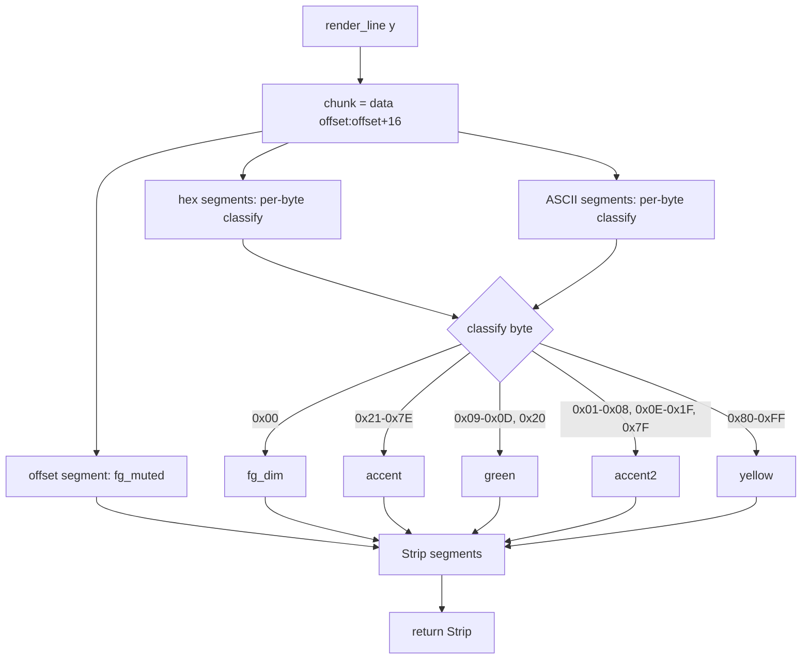
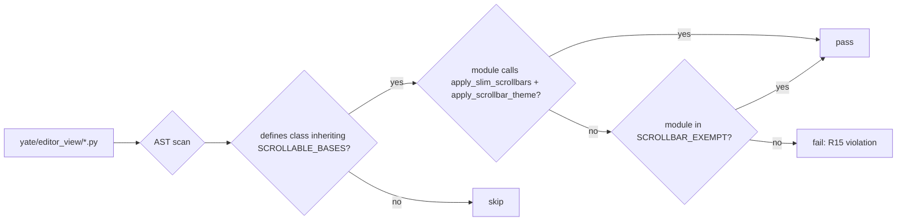

# Hex View Enhancement - Plan A (Wave 1)

## 目标

1. **滚动条主题一致**：`HexView`（含 `HexScreen` 覆盖层）的滚动条必须与 explorer / diff pane 等组件视觉一致——细滑块渲染器（`SlimScrollBarRender`）+ 主题调色板（track 透明、thumb 跟随 `theme.active()`）；
2. **字节分类着色**：hex 内容按字节类别着色（offset / null / printable / whitespace / ascii_other / non_ascii），颜色映射到既有主题令牌（`fg_muted` / `fg_dim` / `accent` / `green` / `accent2` / `yellow`），切换主题自动跟随；
3. **新增架构规则 R15**：所有可滚动组件（含弹窗）必须调用 `apply_slim_scrollbars` + `apply_scrollbar_theme`，落入 `architecture-boundaries.md` 并配架构守卫测试。

## 非目标

- **不改动视图格式布局**：xxd 布局（`{offset:08x}: ` + 2 组 8 字节 hex（组内无空格、组间 2 空格）+ 2 空格 + 16 字符 ASCII 列）保持不变；
- **不新增主题令牌**：复用既有 `Theme` dataclass 的 `fg_muted` / `fg_dim` / `accent` / `green` / `accent2` / `yellow`；
- **不改动 `hex-view.tcss`**：背景 /  foreground 走 Textual 主题变量桥（`$surface` / `$foreground`），自动跟随主题；
- **不改动既有测试的文本断言**：`test_hex_view.py` 的 `_FULL_LINE_TEXT` 等精确文本断言必须原样保持（着色改造只影响 `Segment` 样式，不影响 `.text`）。

## 备选方案与否决理由

### 方案 A：硬编码 hexyl RGB 颜色（否决）

- **做法**：直接写死 hexyl 的 `TrueColor(0x5F,0x87,0xD7)` 等 RGB 值；
- **否决理由**：违反 R13（组件自持主题）——切换主题时颜色不会跟随；与 explorer / diff pane 等组件的主题一致性被破坏；用户明确要求"与主题保持一致"。

### 方案 B：映射到既有主题令牌（采纳）

- **做法**：offset → `fg_muted`、null → `fg_dim`、printable → `accent`、whitespace → `green`、ascii_other → `accent2`、non_ascii → `yellow`；
- **采纳理由**：
  - 遵守 R13（订阅 `theme.subscribe`，切换主题自动重绘）；
  - 与 explorer / diff pane 等组件的主题一致性得到保证；
  - hue 与 hexyl 几乎一一对应（灰 / 蓝 / 绿 / 紫 / 橄榄黄）；
  - 复用既有 `Theme` dataclass，零新增字段。

### 方案 C：AST 动态扫描守卫（采纳）

- **做法**：`test_architecture.py` 新增 AST 守卫用例，扫 `yate/editor_view/*.py`：某模块定义了基类命中 `SCROLLABLE_BASES` 的类，该模块源码必须同时出现 `apply_slim_scrollbars(` 与 `apply_scrollbar_theme(` 调用；
- **采纳理由**：
  - 动态扫描比冻结名单更易维护——新增可滚动组件自动被拦截，无需手动登记；
  - 与既有守卫模式一致（参考 `NON_ASCII_COMMENT_EXEMPT` / `PRINT_EXEMPT_SITES` 的豁免集合模式，本规则豁免集初始为空）；
  - 8 个现合规模块全部通过，仅 `hexview.py` 待修——修复后 37/37 绿。

### 方案 D：冻结名单守卫（否决）

- **做法**：硬编码 `SCROLLABLE_MODULES: frozenset[str] = frozenset({...})`，逐一登记；
- **否决理由**：
  - 新增组件易漏登记，守卫失效；
  - 与既有 AST 扫描模式（R12 / 回调别名 / 命名守卫）不一致；
  - 维护成本高于 AST 动态扫描。

## 分步实施

### Step 1: 修复 HexView 滚动条接线

**输入**：`yate/editor_view/hexview.py` 现状（L78-90 只调 `theme.attach`，未调 `apply_slim_scrollbars` / `apply_scrollbar_theme`）。

**改动文件清单**：

1. `yate/editor_view/hexview.py`：
   - L14-31：新增导入 `from yate.editor_view.scrollbars import apply_slim_scrollbars, apply_scrollbar_theme`；
   - L78-82：`on_mount` 内先调 `apply_slim_scrollbars(self)`，再调 `self._apply_theme()`（新方法），再 `theme.attach(self, self._apply_theme)`；
   - L88-90：`_on_theme_changed` 改名为 `_apply_theme`，内部调 `apply_scrollbar_theme(self)` + `self.refresh()`（diff_pane.py:263-267 先例）。

**输出**：`HexView` 滚动条与 explorer / diff pane 视觉一致。

**验收命令**：

```bash
.venv\Scripts\python.exe -m pytest tests/test_hex_view.py -q
.venv\Scripts\python.exe -m pyright yate/editor_view/hexview.py
```

通过判定：退出码 0，既有 6 用例全绿，pyright strict 零诊断。

### Step 2: 实现字节分类着色

**输入**：`yate/editor_view/hexview.py` 现状（L92-121 只产纯文本 `Segment(line)`）。

**改动文件清单**：

1. `yate/editor_view/hexview.py`：
   - L92-106：`render_line` 改为返回多 `Segment`——offset 段用 `fg_muted`，hex 段按字节分类着色（调用新方法 `_hex_segments`），ASCII 段按字节分类着色（调用新方法 `_ascii_segments`），分隔空格用默认前景；
   - 新增 `_classify_byte(b: int) -> str`：返回类别名（`"null"` / `"printable"` / `"whitespace"` / `"ascii_other"` / `"non_ascii"`）；
   - 新增 `_theme_style(category: str) -> Style`：从 `theme.active()` 取对应令牌，返回 `Style(color=...)`；
   - 新增 `_hex_segments(chunk: bytes) -> list[Segment]`：逐字节产 hex 字符对，每对带分类样式；
   - 新增 `_ascii_segments(chunk: bytes) -> list[Segment]`：逐字节产 ASCII 字符（可打印原字符，不可打印 `.`），每字符带分类样式；
   - L108-116 / L118-121：`_format_hex` / `_format_ascii` 保留为纯文本版本（供测试断言 `.text` 使用），内部调新方法。

**输出**：hex 内容按字节类别着色，切换主题自动跟随。

**验收命令**：

```bash
.venv\Scripts\python.exe -m pytest tests/test_hex_view.py -q
.venv\Scripts\python.exe -m pyright yate/editor_view/hexview.py
```

通过判定：退出码 0，既有 6 用例全绿（文本断言不变），pyright strict 零诊断。

### Step 3: 新增测试用例

**输入**：`tests/test_hex_view.py` 现状（6 用例）。

**改动文件清单**：

1. `tests/test_hex_view.py`：新增 3 用例——
   - `test_hex_view_scrollbar_uses_slim_renderer`：
     - arrange：`_ViewHost(_FULL_LINE_DATA)`，`app.run_test(size=(100, 30))`；
     - act：`view = app.query_one(HexView)`；
     - assert：`view.vertical_scrollbar.renderer is SlimScrollBarRender`，`view.horizontal_scrollbar.renderer is SlimScrollBarRender`；
   - `test_hex_view_scrollbar_theme_follows_active`：
     - arrange：同上，`theme.set_theme("latte")`（try/finally 复位）；
     - act：`view = app.query_one(HexView)`；
     - assert：`view.styles.scrollbar_color == TextualColor.parse(theme.active().border)`；
   - `test_hex_view_render_line_segments_are_classified`：
     - arrange：`_ViewHost(bytes([0x00, 0x20, 0x41, 0x7F, 0x80]))`，`app.run_test(size=(100, 30))`；
     - act：`strip = view.render_line(0)`，`segments = list(strip)`；
     - assert：offset 段 `segments[0].style.color` == `theme.active().fg_muted`；hex 段 `0x00` 对应 `fg_dim`、`0x20` 对应 `green`（whitespace）、`0x41` 对应 `accent`（printable）、`0x7F` 对应 `accent2`（ascii_other）、`0x80` 对应 `yellow`（non_ascii）。

**输出**：滚动条接线 + 分类着色 + 主题跟随均有断言覆盖。

**验收命令**：

```bash
.venv\Scripts\python.exe -m pytest tests/test_hex_view.py -q
.venv\Scripts\python.exe -m pyright tests/test_hex_view.py
```

通过判定：退出码 0，9 用例全绿（6 既有 + 3 新增），pyright strict 零诊断。

### Step 4: 新增架构规则 R15 与守卫测试

**输入**：`.trae/rules/architecture-boundaries.md` 现状（R1-R14，36 用例）；`tests/test_architecture.py` 现状（36 用例）。

**改动文件清单**：

1. `.trae/rules/architecture-boundaries.md`：
   - §一 R14 之后加 **R15 — 滚动条与弹窗主题一致**：所有可滚动组件（`ScrollView` / `VerticalScroll` / `HorizontalScroll` / `ScrollableContainer` / `Tree` / `RichLog` / `ListView` 子类，含弹窗 `Screen` 内的滚动容器）必须在挂载时调 `apply_slim_scrollbars`、在主题绘制路径调 `apply_scrollbar_theme`（均出自 `editor_view/scrollbars.py`），与 explorer 滚动条（IKINF3 细滑块 + 主题调色板）保持视觉一致；
   - §二 分层职责表 L2 行补充"自持滚动条主题（R15）"；
   - §五 新增功能自检清单加一条"新可滚动组件已调 `apply_slim_scrollbars` + `apply_scrollbar_theme`（R15）？"；
   - §六 开头「36 个用例」改为「37 个用例」，表格加行 #37 `test_scrollable_widgets_apply_theme_scrollbar_pair` 守卫项 R15。

2. `tests/test_architecture.py`：
   - 新增 `SCROLLABLE_BASES: frozenset[str] = frozenset({"ScrollView", "VerticalScroll", "HorizontalScroll", "ScrollableContainer", "Tree", "RichLog", "ListView"})`；
   - 新增 `SCROLLBAR_EXEMPT: frozenset[str] = frozenset()`（豁免集，初始为空）；
   - 新增 `def test_scrollable_widgets_apply_theme_scrollbar_pair() -> None:`——AST 扫 `yate/editor_view/*.py`：某模块定义了基类命中 `SCROLLABLE_BASES` 的类，该模块源码必须同时出现 `apply_slim_scrollbars(` 与 `apply_scrollbar_theme(` 调用（AST `Call` 扫描，函数名命中 `ast.Name(id="apply_slim_scrollbars")` / `ast.Name(id="apply_scrollbar_theme")`）；豁免集 `SCROLLBAR_EXEMPT` 按模块相对路径登记。

**输出**：R15 规则落盘，37 用例全绿。

**验收命令**：

```bash
.venv\Scripts\python.exe -m pytest tests/test_architecture.py -q
.venv\Scripts\python.exe -m pytest tests/test_hex_view.py -q
.venv\Scripts\python.exe -m pyright yate/ tests/
```

通过判定：退出码 0，`test_architecture.py` 37 用例全绿（含新增 R15 守卫），`test_hex_view.py` 9 用例全绿，pyright strict 零诊断。

### Step 5: 同步 overview.md

**输入**：`.trae/documents/hex-enh-plans/overview.md` 现状（wave-1 到 wave-3）。

**改动文件清单**：

1. `.trae/documents/hex-enh-plans/overview.md`：
   - 迭代记录段追加：`- 2026-10-24 plan_a 执行完成：滚动条接线 + 字节分类着色 + R15 规则与守卫，37 用例全绿。`

**输出**：overview.md 反映 wave-1 执行结果。

**验收命令**：

```bash
# 纯文档变更，按 misc-rules §三 豁免测试
```

通过判定：文档格式符合 `doc-conventions.md`（相对路径引用、无盘符路径）。

## 风险清单与回滚路径

| 风险 | 影响 | 回滚路径 |
|---|---|---|
| `apply_slim_scrollbars` 在 `on_mount` 早期调用时 Textual 尚未创建 scrollbar widget | 调用 `widget.vertical_scrollbar` 会触发懒创建，不会失败（diff_pane.py:254 先例） | 若失败，改为 `call_after_refresh(apply_slim_scrollbars, self)` |
| 分类着色后 `Segment` 数量增加，`render_line` 性能下降 | 16 字节/行，每字节 2 hex 字符 + 1 ASCII 字符 = 48 个 `Segment`，Textual `Strip` 可承受 | 若性能瓶颈，改为按连续同类字节合并 `Segment` |
| 既有测试断言 `.text` 失败 | 着色改造只影响 `Segment.style`，不影响 `.text`；`_format_hex` / `_format_ascii` 保留纯文本版本供断言 | 若失败，检查 `Strip.text` 实现是否正确拼接 |
| AST 守卫误伤非可滚动基类 | `SCROLLABLE_BASES` 明确列举 7 个 Textual 基类，不会误伤 | 若误伤，调整 `SCROLLABLE_BASES` 或加入 `SCROLLBAR_EXEMPT` |

## Mermaid 图

### 着色数据流



### 守卫扫描面



## 架构边界标注

- **R3**：`hexview.py` 不 import `yate.editor` / `yate.app`（维持现状）；
- **R13**：`HexView` 组件自持主题——订阅 `theme.subscribe` 自行上色（`_apply_theme` 内调 `apply_scrollbar_theme` + `refresh`），L3/L4 不代 paint；
- **R15（新）**：所有可滚动组件必须调 `apply_slim_scrollbars` + `apply_scrollbar_theme`；
- **R12**：日志走 `tracing.get_logger(__name__)`（维持现状）；
- **R10**：按键消费后 `event.stop()`，未识别键 fall-through（维持现状）。

## 约束（硬性）

- 注释与 docstring 一律英文（misc-rules §四）；
- 日志惰性 `%s` 格式（python-coding-style 4.6）；
- pyright strict 零诊断；
- 不新增 `Protocol` / `TYPE_CHECKING` / `Any`；
- 文档命名：本文件 `hex-enh-fix-plan-a.md`（wave-1，字母序 a）；
- 相对路径引用，不许盘符路径出现在文档正文。
