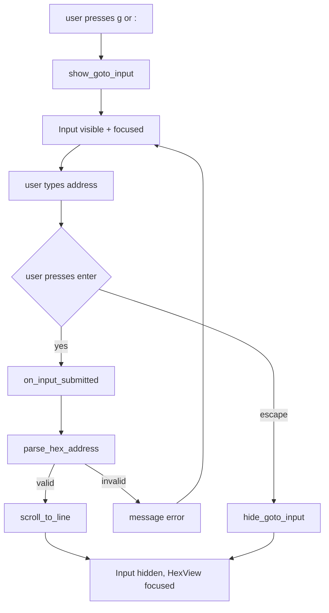

# Hex Enhancement - Plan B (Wave 2): Goto Address

## 目标

为 hex view 增加「跳转到指定地址」功能：

1. **地址输入**：在 `HexScreen` 内提供地址输入框（Textual `Input`），支持 `0x` 前缀十六进制与纯十进制；
2. **地址解析与校验**：解析输入文本为整数地址，校验是否越界（超出文件 size）；
3. **视图定位**：跳转后滚动到目标行，目标字节高亮可见；
4. **键位触发**：`g` 或 `:` 键打开输入框，`enter` 提交，`escape` 取消并关闭输入框。

## 非目标

- **不改动 hex 内容格式**：xxd 布局（offset + hex + ASCII）保持不变；
- **不新增命令行入口**：`HexScreen` 是 modal，主屏命令行不可达，地址输入必须在 overlay 内部实现；
- **不改动文件内容**：跳转是纯视图操作，HexView 不碰文件系统（R3）；
- **不新增架构规则**：跳转功能不触碰新的架构边界，维持既有 R3/R10/R11/R13。

## 备选方案与否决理由

### 方案 A：命令行 `:hex goto <addr>`（否决）

- **做法**：在 `HexScreen` 上挂命令行输入，解析 `:hex goto 0x100`；
- **否决理由**：
  - `HexScreen` 是 `ModalScreen`，主屏 `PromptBar` 被遮挡，命令行不可达；
  - 需新增 modal 内命令行机制，复杂度高，与既有 palette / find_replace 的 Input 模式不一致；
  - 用户期望在 hex view 内快速跳转，命令行路径过长。

### 方案 B：overlay 内 Input 输入框（采纳）

- **做法**：`HexScreen` 内嵌一个 `Input` widget（默认隐藏），按 `g` 或 `:` 显示并聚焦，`enter` 提交，`escape` 取消；
- **采纳理由**：
  - 与既有 `palette.py` / `find_replace.py` 的 Input 用法一致（L2 组件自持输入）；
  - 实现简单，无需新增机制；
  - 用户交互路径短（一键触发，输入地址，回车跳转）。

### 方案 C：vim 风格 `gg` / `G` 跳转（否决）

- **做法**：`gg` 跳到文件头，`G` 跳到文件尾，`<addr>G` 跳到指定行；
- **否决理由**：
  - hex view 不是 vim，用户期望按地址跳转而非按行号；
  - 需要新增 vim 模式识别与计数前缀解析，复杂度高；
  - 与既有 `prompt_flows.goto_line` 的绝对/相对行号模式不一致（hex view 用地址而非行号）。

## 分步实施

### Step 1: 地址解析函数

**输入**：无（纯函数，无外部依赖）。

**改动文件清单**：

1. `yate/editor_view/hexview.py`：
   - L1-12：模块 docstring 追加「goto address」能力描述；
   - L14-31：新增导入 `import re`；
   - L36-44：常量段后新增函数 `parse_hex_address(text: str, file_size: int) -> int`：
     - 去除首尾空白；
     - 匹配正则 `r"^(?:0x)?([0-9a-fA-F]+)$"`（十六进制）或 `r"^\d+$"`（十进制）；
     - 解析为整数，校验 `0 <= addr < file_size`，越界抛 `ValueError`；
     - 返回地址（字节偏移）。

**输出**：纯函数 `parse_hex_address`，可独立测试。

**验收命令**：

```powershell
.venv\Scripts\python.exe -m pytest tests/test_hex_view.py::test_parse_hex_address_valid_hex -q
.venv\Scripts\python.exe -m pytest tests/test_hex_view.py::test_parse_hex_address_valid_decimal -q
.venv\Scripts\python.exe -m pytest tests/test_hex_view.py::test_parse_hex_address_out_of_bounds -q
.venv\Scripts\python.exe -m pytest tests/test_hex_view.py::test_parse_hex_address_invalid_format -q
.venv\Scripts\python.exe -m pyright yate/editor_view/hexview.py
```

通过判定：退出码 0，4 个新增用例全绿，pyright strict 零诊断。

### Step 2: HexScreen 内嵌 Input 与跳转逻辑

**输入**：`yate/editor_view/hexview.py` 现状（`HexScreen` 只处理 `q`/`escape`）。

**改动文件清单**：

1. `yate/editor_view/hexview.py`：
   - L14-31：新增导入 `from textual.widgets import Input, Static`、`from textual.containers import Vertical`；
   - L123-140：`HexScreen` 改造：
     - `compose()` 改为：`Vertical` 容器内 `HexView` + `Input`（默认 `display=False`，id=`"hex-goto-input"`）+ `Static`（提示文本，id=`"hex-goto-hint"`，默认隐藏）；
     - 新增属性 `_goto_input: Input | None = None`（`on_mount` 后 `query_one` 获取）；
     - 新增方法 `show_goto_input()`：显示 input + hint，聚焦 input；
     - 新增方法 `hide_goto_input()`：隐藏 input + hint，聚焦回 HexView；
     - `on_key()` 改造：
       - `g` 或 `:` 键：若 input 未显示，调 `show_goto_input()`，`event.stop()`；
       - `escape` 键：若 input 已显示，调 `hide_goto_input()`，`event.stop()`；否则 `dismiss(None)`，`event.stop()`；
       - `q` 键：若 input 未显示，`dismiss(None)`，`event.stop()`；
       - 其余键 fall-through（R10）；
     - 新增 `on_input_submitted(event: Input.Submitted)`：
       - 若 `event.input.id == "hex-goto-input"`：
         - 调 `parse_hex_address(event.value, len(self._data))`；
         - 成功：调 `hex_view.scroll_to_line(addr // 16)`，`hide_goto_input()`；
         - 失败（`ValueError`）：`self._message(f"invalid address: {event.value!r}", "warn")`（需注入 message 回调，见 Step 3）；
   - L47-121：`HexView` 新增方法 `scroll_to_line(line: int)`：
     - 计算 `scroll_y = max(0, min(line, self.virtual_size.height - 1))`；
     - 调 `self.scroll_to(y=scroll_y, animate=False)`。

**输出**：`HexScreen` 支持 `g`/`:` 触发输入，`enter` 跳转，`escape` 取消。

**验收命令**：

```powershell
.venv\Scripts\python.exe -m pytest tests/test_hex_view.py::test_hex_screen_goto_input_shows_on_g -q
.venv\Scripts\python.exe -m pytest tests/test_hex_view.py::test_hex_screen_goto_input_submits_and_scrolls -q
.venv\Scripts\python.exe -m pytest tests/test_hex_view.py::test_hex_screen_goto_input_escapes_without_jump -q
.venv\Scripts\python.exe -m pyright yate/editor_view/hexview.py
```

通过判定：退出码 0，3 个新增用例全绿，pyright strict 零诊断。

### Step 3: OverlayFlows 注入 message 回调

**输入**：`yate/flows/overlay_flows.py` 现状（`open_hex_view` 传 `path`/`data` 给 `HexScreen`）。

**改动文件清单**：

1. `yate/flows/overlay_flows.py`：
   - L185-214：`open_hex_view` 改造：
     - 构造 `HexScreen` 时传入 `message=self._message`（新增参数）；
   - L216-230：`toggle_hex_view` 同理。

2. `yate/editor_view/hexview.py`：
   - L123-140：`HexScreen.__init__` 改造：
     - 新增参数 `message: Callable[[str, str], None] | None = None`；
     - 存储为 `self._message = message`；
     - `on_input_submitted` 内调 `self._message(...)` 时判空（`if self._message is not None`）。

**输出**：`HexScreen` 可显示错误消息（地址越界 / 格式错误）。

**验收命令**：

```powershell
.venv\Scripts\python.exe -m pytest tests/test_hex_view.py -q
.venv\Scripts\python.exe -m pyright yate/editor_view/hexview.py yate/flows/overlay_flows.py
```

通过判定：退出码 0，既有 + 新增用例全绿，pyright strict 零诊断。

### Step 4: 新增测试用例

**输入**：`tests/test_hex_view.py` 现状（6 用例）。

**改动文件清单**：

1. `tests/test_hex_view.py`：新增 7 用例——
   - `test_parse_hex_address_valid_hex`：
     - arrange：`text = "0x1a"`, `file_size = 100`；
     - act：`addr = parse_hex_address(text, file_size)`；
     - assert：`addr == 26`；
   - `test_parse_hex_address_valid_decimal`：
     - arrange：`text = "42"`, `file_size = 100`；
     - act：`addr = parse_hex_address(text, file_size)`；
     - assert：`addr == 42`；
   - `test_parse_hex_address_out_of_bounds`：
     - arrange：`text = "0xff"`, `file_size = 100`；
     - act/assert：`with pytest.raises(ValueError, match="out of bounds")`；
   - `test_parse_hex_address_invalid_format`：
     - arrange：`text = "xyz"`, `file_size = 100`；
     - act/assert：`with pytest.raises(ValueError, match="invalid format")`；
   - `test_hex_screen_goto_input_shows_on_g`：
     - arrange：`_ScreenHost()`，`app.push_screen(HexScreen(path, data))`；
     - act：`await pilot.press("g")`；
     - assert：`input.display is True`，`input.has_focus`；
   - `test_hex_screen_goto_input_submits_and_scrolls`：
     - arrange：同上，`await pilot.press("g")`，`await pilot.fill("hex-goto-input", "0x10")`；
     - act：`await pilot.press("enter")`；
     - assert：`hex_view.scroll_offset.y == 1`（16 bytes per line, addr 0x10 = line 1）；
   - `test_hex_screen_goto_input_escapes_without_jump`：
     - arrange：同上，`await pilot.press("g")`；
     - act：`await pilot.press("escape")`；
     - assert：`input.display is False`，`hex_view.scroll_offset.y == 0`（未跳转）。

**输出**：地址解析 + 跳转交互均有断言覆盖。

**验收命令**：

```powershell
.venv\Scripts\python.exe -m pytest tests/test_hex_view.py -q
.venv\Scripts\python.exe -m pyright tests/test_hex_view.py
```

通过判定：退出码 0，13 用例全绿（6 既有 + 7 新增），pyright strict 零诊断。

### Step 5: 冒烟场景扩展

**输入**：`tools/smoke_test/scenarios/hexview.py` 现状（2 场景）。

**改动文件清单**：

1. `tools/smoke_test/scenarios/hexview.py`：
   - 新增场景 `_hex_view_goto_address`：
     - arrange：`new_app(target=tmp / "a.txt")`，`await run_command(pilot, "hex")`；
     - act：`await pilot.press("g")`，`await pilot.fill("hex-goto-input", "0x10")`，`await pilot.press("enter")`；
     - assert：`Check("svg_shows_offset_row_10", True, _has_offset_row(rows, row=1))`（SVG 文本含 `00000010:`）；
   - `SCENARIOS` 列表追加 `Scenario("hex_view_goto_address", _hex_view_goto_address, ("files", "command"))`。

**输出**：冒烟覆盖跳转功能。

**验收命令**：

```powershell
.venv\Scripts\python.exe -m tools.smoke_test run --jobs 4 --filter hex_view_goto_address
```

通过判定：退出码 0，场景全绿。

### Step 6: 同步 overview.md

**输入**：`.trae/documents/hex-enh-plans/overview.md` 现状。

**改动文件清单**：

1. `.trae/documents/hex-enh-plans/overview.md`：
   - 子计划索引表 plan-b 行改为 `[hex-enh-goto-plan-b.md](hex-enh-goto-plan-b.md)`；
   - 迭代记录段追加：`- 2026-10-24 plan_b 设计完成：跳转地址功能（Input 输入框 + 地址解析 + 视图定位）。`

**输出**：overview.md 反映 plan-b 设计状态。

**验收命令**：

```powershell
# 纯文档变更，按 misc-rules §三 豁免测试
```

通过判定：文档格式符合 `doc-conventions.md`（相对路径引用、无盘符路径）。

## 风险清单与回滚路径

| 风险 | 影响 | 回滚路径 |
|---|---|---|
| `Input` 在 `HexScreen` 内布局错位 | 视觉缺陷，input 遮挡 hex 内容 | 调整 `hex-view.tcss` 或 `compose()` 布局，改用 `Vertical` 容器分层 |
| 地址解析正则误判合法输入 | 用户输入 `0x10` 被拒 | 调整正则，增加单元测试覆盖边界（`0x0`、`0xffffffff`、纯 `0`） |
| `scroll_to_line` 滚动越界 | 视图跳到错误位置 | 加 `max(0, min(line, max_line))` 钳制，单元测试覆盖 |
| `message` 回调未注入 | 错误提示不显示 | `HexScreen.__init__` 默认 `message=None`，调用前判空 |

## Mermaid 图

### 跳转数据流



### 地址解析状态机

```mermaid
stateDiagram-v2
    [*] --> Idle
    Idle --> InputVisible: g or :
    InputVisible --> Idle: escape
    InputVisible --> Parsing: enter
    Parsing --> Idle: valid address
    Parsing --> InputVisible: invalid address
    Idle --> [*]: q or escape
```

## 架构边界标注

- **R3**：`hexview.py` 不 import `yate.editor` / `yate.app`（维持现状）；
- **R10**：按键消费后 `event.stop()`，未识别键 fall-through（`g`/`:`/`escape`/`q`/`enter` 被消费，其余 fall-through）；
- **R11**：`flows/overlay_flows.py` 已登记 `yate.editor_view.hexview`（`test_architecture.py:239`），新增跳转功能不新增 editor_view 导入面变动；
- **R13**：`HexView` 组件自持主题（维持现状）；
- **R12**：日志走 `tracing.get_logger(__name__)`（维持现状）。

## 文件体量评估

`hexview.py` 现 140 行，新增跳转功能后预计增至 ~250 行（新增 `parse_hex_address` ~20 行、`HexScreen` 改造 ~80 行、`HexView.scroll_to_line` ~5 行），远低于 800 行阈值，无需拆分或豁免。

## 约束（硬性）

- 注释与 docstring 一律英文（misc-rules §四）；
- 日志惰性 `%s` 格式（python-coding-style 4.6）；
- pyright strict 零诊断；
- 不新增 `Protocol` / `TYPE_CHECKING` / `Any`；
- 文档命名：本文件 `hex-enh-goto-plan-b.md`（wave-2，字母序 b）；
- 相对路径引用，不许盘符路径出现在文档正文。
