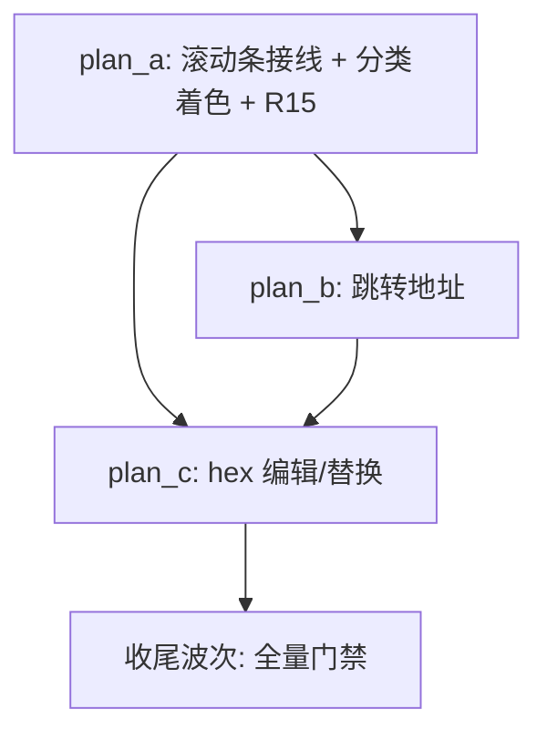

# Hex Enhancement - Overview

> **分支改名记录**：任务分支 feat/hex-enh 基于 feat/hex-feat @ 25eca92（2026-10-24 由 feat/hex-view-enh 改名迁移）；方案目录由 hex-view-enh-plans/ 改名为 hex-enh-plans/，plan-a 文件由 hex-view-enh-fix-plan-a.md 改名为 hex-enh-fix-plan-a.md。

## 目标

在 feat/hex-view 基础只读浏览（IKQ2D5）之上，按 issue 指定的 4 个问题增强：

1. **滚动条样式与主题不一致（视觉缺陷，IKINF3）**：HexView 滚动条为 Textual 默认亮紫色，期望与 explorer 滚动条视觉完全一致（细滑块 + 主题调色板）；
2. **hex 内容无分类着色（可读性）**：参考 rust hexyl 字节分类着色——偏移地址一种颜色；null(0x00) 弱灰、ASCII 可打印(0x21-0x7E) 蓝、ASCII 空白(0x09-0x0D,0x20) 绿、ASCII 其他(0x01-0x08,0x0E-0x1F,0x7F) 紫、非 ASCII(0x80-0xFF) 橄榄黄；映射既有主题令牌，不硬编码 RGB；**硬约束**：视图格式布局不变（xxd 布局、列宽、文本内容与既有测试断言原样保持）；
3. **跳转到指定地址（交互）**：提供"跳转到指定偏移"操作，支持 0x 前缀十六进制与十进制；跳转后视口/光标定位到目标行；
4. **编辑/替换 hex 值（功能扩展）**：定位到某字节后编辑/替换其值（hex 键入，ASCII 列同步反映），持久化写回文件；需明确与 EditorSession 文本会话的关系、文件并发保护与撤销路径。

**附加产出**：新增架构规则 R15——所有可滚动组件（含弹窗/覆盖层 Screen 内的滚动容器）必须与主题保持一致，配架构守卫测试。

## 非目标

- **不改动视图格式布局**：xxd 布局（`{offset:08x}: ` + 2 组 8 字节 hex（组内无空格、组间 2 空格）+ 2 空格 + 16 字符 ASCII 列）保持不变；
- **不新增主题令牌**：复用既有 `Theme` dataclass 的 `fg_muted` / `fg_dim` / `accent` / `green` / `accent2` / `yellow`；
- **不改动 `hex-view.tcss`**：背景 / 前景走 Textual 主题变量桥（`$surface` / `$foreground`），自动跟随主题；
- **不改动既有测试的文本断言**：`test_hex_view.py` 的 `_FULL_LINE_TEXT` 等精确文本断言必须原样保持（着色改造只影响 `Segment` 样式，不影响 `.text`）；
- **不新增文档**：hex view 尚未被 `yate/resources/manual.*.md` / `yate/docs/*.md` 收录（实测 grep 仅命中 `manual.en.md:703` 的 "Binary and large (> 2 MB) files are skipped" 提及，无独立章节）；按 doc-conventions §三 双语同步硬约束，若本任务新增手册章节则必须双语同步，但 issue 未要求文档增强，故登记为"未收录，本任务不新增"，留作后续文档专项；
- **大文件分段加载**：留作后续 feature，本任务维持 100MB 一次性读入上限。

## 子计划索引

| 子计划 | 主题 | 波次 |
|---|---|---|
| [hex-enh-fix-plan-a.md](hex-enh-fix-plan-a.md) | 滚动条接线 + hexyl 分类着色 + R15 规则与守卫 + 测试 | wave-1 |
| [hex-enh-goto-plan-b.md](hex-enh-goto-plan-b.md) | 跳转地址功能 + 测试 + 冒烟场景扩展 | wave-2 |
| [hex-enh-edit-plan-c.md](hex-enh-edit-plan-c.md) | hex 编辑/替换 + 写回 + 撤销 + 冲突保护 + 测试 + 冒烟场景扩展 | wave-3 |

## 执行波次表

```
wave-1: plan_a  (滚动条接线 + hexyl 分类着色 + R15 规则与守卫 + 测试)
   |
   v
wave-2: plan_b  (跳转地址功能 + 测试 + 冒烟场景扩展)
   |
   v
wave-3: plan_c  (hex 编辑/替换 + 写回 + 撤销 + 冲突保护 + 测试 + 冒烟场景扩展)
   |
   v
收尾波次: 全量门禁（pyright / pytest -n auto / 架构测试 / 覆盖率 --cov-fail-under=75 / 冒烟 tools.smoke_test run --jobs 4）
```

波次间串行：上一波全部子计划验收通过（验收命令退出码 0）才允许进入下一波。

## 依赖关系图



## 关键事实清单（调研取证）

### 问题 1-2（修复面，调研已完成）

- **根因**：`yate/editor_view/hexview.py` `on_mount`（L78-82）只调 `theme.attach(self, self._on_theme_changed)`，`_on_theme_changed`（L88-90）只 `self.refresh()`；**未调** `apply_slim_scrollbars` / `apply_scrollbar_theme`。editor_view 下其余 7 个可滚动组件均已接线（editor.py:193/204、explorer.py:247/279、diff_pane.py:254/266、manual.py:232/242、modals.py:36/46、find_replace.py:89/99、palette.py:128/138）。
- **两函数在** `yate/editor_view/scrollbars.py`：`apply_slim_scrollbars`（L94）/ `apply_scrollbar_theme`（L114，track 透明、thumb=t.border、hover=fg_dim、active=accent）。
- **render_line**（L92-106）返回单 `Segment(line)` 整行默认前景色；`_format_hex`（L108-116）/`_format_ascii`（L118-121）产纯文本。着色改造后 `Strip.text` 仍可精确断言（既有测试 test_hex_view.py 的 `_FULL_LINE_TEXT` 等断言必须原样通过）。
- **hexyl 分类**（rust hexyl src/color.rs 默认）：offset=Fixed(242) 灰、null=Fixed(240) 暗灰、printable=蓝 #5F87D7、whitespace=绿 #00AF5F、ascii_other=紫 #AF5F87、non_ascii=橄榄黄 #AF8700。推荐映射（旧方案 plan-f 已论证采纳）：offset→`fg_muted`、null→`fg_dim`、printable→`accent`、whitespace→`green`、ascii_other→`accent2`、non_ascii→`yellow`（Theme dataclass 既有令牌，yate/editor_view/themes.py L66-121）。ASCII 列 `.` 按原字节分类色。组间分隔/末行填充空格用默认前景。
- **hexyl 分类边界**（旧方案 plan-f 核对）：whitespace=0x09-0x0D+0x20、printable=0x21-0x7E、other=0x01-0x08+0x0E-0x1F+0x7F。
- **R15 守卫测试设计**（旧方案已论证采纳 AST 动态扫描）：`tests/test_architecture.py` 新增 `test_scrollable_widgets_apply_theme_scrollbar_pair`——AST 扫 `yate/editor_view/*.py`，某模块定义了基类命中 `SCROLLABLE_BASES`（ScrollView/VerticalScroll/HorizontalScroll/ScrollableContainer/Tree/RichLog/ListView）的类，该模块必须同时出现 `apply_slim_scrollbars(` 与 `apply_scrollbar_theme(` 调用（AST Call 扫描）；豁免集 `SCROLLBAR_EXEMPT` 初始为空。同步 `.trae/rules/architecture-boundaries.md`（R14 后加 R15、§二 L2 行、§五自检清单、§六 36→37 计数与表格加行）。

### 问题 3-4（新功能，调研结论）

- **HexView 是** `ScrollView` + `HexScreen(ModalScreen[None])`（hexview.py L47/L123）；模块 docstring 声明"presentation-only: never touches the filesystem"——**编辑写盘必须走 L3 流程层回调注入，HexView 自身禁碰文件系统**（R3）。
- **yate/flows/overlay_flows.py** 持有 `open_hex_view` / `toggle_hex_view`（R11 已登记 `yate.editor_view.hexview` 导入）；OverlayFlows 注入 `push_screen` / `pop_screen` / `current_screen` / `message` / `mounted`。
- **HexScreen 是 modal**——主屏命令行不可达，问题 3 的地址输入必须在 HexScreen/HexView 内部实现（Textual Input 或自定义键捕获，参考 yate 内既有输入先例如 prompt bar / modals.py 的 Input 用法——find_replace.py:180-181 / manual.py:402 / palette.py:552 均有 Input 用法）。
- **文件写回**：同长覆写 `open(path, "r+b")` + seek + write；加载时 stat 记录 mtime/size，写前复检防覆盖外部修改（TOCTOU 防护）；与 EditorSession 的冲突策略：`session.is_open(path)`（session.py:85-91）可查"同路径已打开"——保守拒绝 + message 提示是默认候选（若同路径已在文本编辑器打开且 buffer dirty，拒绝 hex 编辑以防数据竞争）。
- **撤销**：编辑 overlay（内存字节映射）+ undo 栈；键位设计参考主流 hex 编辑器——移动 hjkl/方向键、回车或 e 进入编辑、hex 数字键入 nibble、u 撤销、w 写盘。
- **冒烟场景**：`tools/smoke_test/scenarios/hexview.py` 已存在（108 行），新功能需扩展场景。
- **手册**：hex view 尚未被 `yate/resources/manual.*.md` / `yate/docs/*.md` 独立收录（仅 `manual.en.md:703` 提及 "Binary and large (> 2 MB) files are skipped"），按 doc-conventions §三 双语同步硬约束，本任务不新增文档（登记理由：issue 未要求文档增强，留作后续文档专项）。

### 架构边界标注

- **R3**：`hexview.py` 不 import `yate.editor` / `yate.app`（维持现状）；
- **R10**：按键消费后 `event.stop()`，未识别键 fall-through（维持现状；编辑模式下数字/hjkl 等键被消费属预期，须写明消费面）；
- **R11**：`flows/overlay_flows.py` 已登记 `yate.editor_view.hexview`（`test_architecture.py:239`），新增编辑/跳转功能不新增 editor_view 导入面变动；
- **R13**：`HexView` 组件自持主题——订阅 `theme.subscribe` 自行上色（`_apply_theme` 内调 `apply_scrollbar_theme` + `refresh`），L3/L4 不代 paint；
- **R15（新）**：所有可滚动组件必须调 `apply_slim_scrollbars` + `apply_scrollbar_theme`；
- **R12**：日志走 `tracing.get_logger(__name__)`（维持现状）；
- **R14**：扩展机件子包化（不涉及本任务）；
- **文件体量阈值**：`hexview.py` 现仅 140 行，新增功能（跳转 + 编辑）后若超 800 行须拆分或登记豁免（写入方案）。

## 【执行】【审核】迭代记录段

- 2026-10-24 主代理调研：核实问题 1-2 根因（hexview.py L78-90 未调 scrollbar 接线函数）、问题 3-4 接线事实（OverlayFlows 持有全屏能力、session.is_open 可查同路径打开）；核对旧方案 plan-f（滚动条接线 + 分类着色 + R15 守卫）调研结论可复用；确认 hex view 尚未被手册独立收录（登记不新增文档理由）。
- 2026-10-24 plan-b 设计完成：跳转地址功能（Input 输入框 + 地址解析 + 视图定位），方案落盘 hex-enh-goto-plan-b.md。
- 2026-10-24 plan-c 设计完成：hex 编辑 / 替换 + 写回 + 撤销 + 冲突保护，方案落盘 hex-enh-edit-plan-c.md。
- 2026-10-24 plan_a 执行完成：滚动条接线 + 字节分类着色 + R15 规则与守卫，37 用例全绿。
- 2026-10-24 plan_b 执行完成：跳转地址功能（parse_hex_address 纯函数 + goto 内嵌 Input + scroll_to_line + OverlayFlows message 回调注入），test_hex_view.py 17 用例全绿、pyright 零诊断、冒烟 hex_view_goto_address 8/8 checks 通过。
- 2026-10-24 plan_c 执行完成：hex 编辑（e 进入编辑模式 / escape 退出，编辑态 e 键入 nibble 0xE + nibble 两拍写一字节 + 光标移动）+ undo（上限 1000）+ 写回回调注入（HexScreen.write_bytes，冲突 / TOCTOU 门居 OverlayFlows._write_hex_bytes，同长 r+b 覆写）+ 只读边界（os.access → write_bytes=None），test_hex_view.py 26 用例全绿、pyright 零诊断、冒烟 hex_view_edit_and_save 9/9 checks 通过。
- 2026-10-24 评审迭代：修复 W-1 保存指纹回填 / W-2 键位文档对齐 / W-3 补齐写盘与编辑路由单测（+13 用例：hexview.py 覆盖率 81%→96%、overlay_flows.py 83%→89%）；S-1/S-2/S-4 登记待办。
- 2026-10-24 复审通过：W-1/W-2/W-3 逐项判定已解决且回归锁有效，修复未引入新 CRITICAL/WARNING；N-1（写后 stat 兜底）登记为非阻塞建议。
- 2026-10-24 收尾门禁（主代理实测，worktree venv，CI 并行口径）：pyright yate/ tests/ tools/ pack/ 零诊断；pytest tests/ -q -n auto 2991 passed / 9 skipped；pytest tests/test_architecture.py -q 37 passed（含 R15 守卫）；分支覆盖率 92.03%（门槛 75）；tools.smoke_test run --jobs 4 116/116 场景、1396/1396 checks 全过。已登记待办（后续迭代）：S-1 删除 _format_hex/_format_ascii/cursor_col 死代码、S-2 SCROLLABLE_BASES 补 DataTable/DirectoryTree/OptionList/SelectionList 派生基类、S-4 :hex 打开活动文本文档时不注入必被拒的 writer、N-1 写后 stat 纳入 try 兜底。
